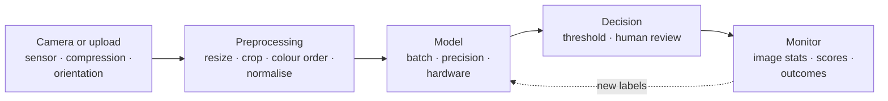

# Shipping vision in production

*Part of [Convolutional networks for the product and technology leader](./README.md)*

*Last reviewed: 2026-10 · Volatility: medium*

## TL;DR

A vision model that scores well in a notebook can fail on the first real camera. Most of the failures are not in the model. They are in what happens to the image before the model sees it, and in how the world in front of the camera changes after launch.

Three things are specific to vision. First, the **preprocessing contract**: every pre-trained model expects a precise resize, crop, colour order and normalisation. Break it and accuracy drops with no error. Second, **resolution and hardware** set the cost per image, and an edge device changes the model you can afford. Third, **image shift**: lighting, blur, compression, new cameras and new products move the inputs away from the training set.

The general machinery is covered elsewhere. [ML in production](../machine-learning/ml-in-production.md) covers training-serving skew, drift and monitors. [Batching, memory and precision](../tensors/batching-memory-and-precision.md) and [Matrix multiplication](../tensors/matrix-multiplication.md) cover why batching pays and what number formats trade. This lesson adds only the vision-specific part.

> 🎯 **For the product leader**
>
> **Why it matters** — A vision feature's quality is set at the camera and the preprocessing code as much as in the model. Its cost is set by resolution, frame rate and the hardware it runs on.
>
> **What it changes in your decisions** — You ask for the preprocessing contract as a tested artifact. You size hardware from cameras, frames per second and measured latency. You fund a test set of hard and corrupted images, not only clean ones.
>
> **Ask your eng team** — *"Is there a test that fails if serving preprocessing differs from training, and what does our model score on blurred, dark and compressed versions of our test images?"*
>
> **Risk if ignored** — A new camera vendor sends images in a different colour order. Accuracy falls overnight. The dashboard shows normal latency and no errors, so nobody notices for weeks.

## The mental model: the image's journey



Think of a lab test. A blood sample is drawn, stored, transported and prepared before the machine reads it. A perfect machine gives the wrong answer if the sample was handled differently from the calibration samples.

The analogy breaks at one point. A lab can reject a bad sample. A vision model scores whatever it is given, with no warning that the image was prepared wrongly.

## Mechanics

### The preprocessing contract

Torchvision ships each set of pre-trained weights with its own transform. For ResNet-50 `IMAGENET1K_V2`, the transform resizes to 232 pixels, centre-crops to 224, scales values to the 0 to 1 range, then normalises each channel with means `(0.485, 0.456, 0.406)` and standard deviations `(0.229, 0.224, 0.225)`. The older `IMAGENET1K_V1` weights for the same architecture use a different resize. ConvNeXt-Tiny's weights use 236. EfficientNet-B0's use 256 with bicubic resampling.

So the contract belongs to the weights, not the architecture. Common ways to break it:

- **Colour order.** OpenCV's `imread` returns blue-green-red by default. If the model was trained on red-green-blue, it now sees swapped channels.
- **Resize and crop.** Serving squashes the whole image to 224 by 224 instead of resizing then cropping. Objects change shape.
- **Normalisation.** Values in 0 to 255 instead of 0 to 1, or the wrong means.
- **Layout.** Channels first or channels last. [What a tensor is](../tensors/what-a-tensor-is.md) covers this. When the shapes still line up, the error is silent.
- **Orientation.** Photos can carry an Exchangeable Image File Format (EXIF) orientation tag. Pillow's `ImageOps.exif_transpose` applies that tag to the pixels. If the loader never applies the tag, the image can arrive sideways.

Each of these is a vision-specific form of the training-serving skew in [ML in production](../machine-learning/ml-in-production.md).

### Fixed input sizes

Some models require one input size. Torchvision's ViT asserts that the height and width match the size it was built for ([CNNs vs. vision transformers](./cnns-vs-vision-transformers.md)). A CNN accepts other sizes, but its accuracy was measured at one size. Serve at the size you tested.

### Resolution, frame rate and hardware

Cost per image grows with resolution: about four times for each doubling of the side, as [How a convolution sees](./how-a-convolution-sees.md) shows. A video feature multiplies that by frames per second and by the number of cameras.

The hardware sets the menu. TensorFlow's MobileNet page lists, on a Pixel 1 phone's large core, 51.2 ms for MobileNetV3-Large in float and 44 ms in 8-bit, with ImageNet top-1 of 75.2% and 73.9%. The 8-bit model is faster and 1.3 points less accurate. [Quantization formats](../content/01-inference-internals/quantization-formats.md) covers that tradeoff in depth.

### Image shift and robustness

Real images get blurred, darkened, compressed and partly blocked. The ImageNet-C benchmark measures this with 15 corruption types applied to ImageNet images. Its authors also point to ImageNet-A, "real-world, unmodified natural images that cause model accuracy to substantially degrade." ImageNetV2 is a fresh ImageNet test set, built to match the original distribution as closely as possible and sampled after a decade of progress on the original. These benchmarks share one lesson. A score on one clean test set does not tell you how the model behaves on new images.

For your product, the same idea is cheap. Make corrupted copies of your own test images and score them. Track simple image statistics in production, such as brightness, blur, size and aspect ratio. Feed them into the drift monitors from [ML in production](../machine-learning/ml-in-production.md).

## Worked example: eight cameras on a loading dock

*This example is illustrative. The camera count, frame rate, batch size and latency are assumed. The arithmetic is shown.*

A warehouse runs a damage-detection model on 8 cameras at 10 frames per second each.

1. **Load.** 8 × 10 = 80 images per second.
2. **Batching.** The service groups 8 images per batch, one from each camera, so it runs 80 ÷ 8 = 10 batches per second.
3. **Measured latency.** On the chosen graphics processing unit (GPU), one batch of 8 takes 20 ms (assumed, measured in a load test).
4. **Utilisation.** 10 batches × 20 ms = 200 ms of GPU time each second, so the GPU is about 20% busy.
5. **Headroom.** At 20 ms a batch, the GPU can run 1,000 ÷ 20 = 50 batches a second, which is 400 images a second, or 40 cameras at 10 frames per second.
6. **A resolution change.** The team wants to double the input side to see small dents. As a first estimate, compute per image rises about 4 times. If latency rises in proportion, capacity falls to about 10 cameras. The team re-runs the load test before it commits, because equal FLOPs do not mean equal time ([Matrix multiplication](../tensors/matrix-multiplication.md)).

**The preprocessing check.** Before launch, the team runs 200 test images (assumed) through both the training pipeline and the serving pipeline and compares the model inputs value by value. The check fails. The new cameras deliver blue-green-red. The fix is one line. Without the test, the dashboard would have shown normal latency and no errors.

## Tradeoffs and decisions

- **Edge vs. cloud.** On the device, latency is low, the image stays local and no network is needed. In exchange the model must be small, and updates ship with app releases. In the cloud, models can be larger and easier to update, at the cost of network latency, bandwidth and per-image serving cost.
- **Resolution vs. cost.** Higher resolution finds smaller defects and costs about four times per doubling. Crop to the region of interest when you can.
- **Frame rate vs. cost.** Many products do not need every frame. Sampling 2 frames a second instead of 10 cuts load five times.
- **Lower precision vs. accuracy.** An 8-bit model is faster and smaller and can be a little less accurate, as in the MobileNet figures above. Test on your images.
- **Automation vs. review.** A threshold that sends uncertain images to a person lowers error and adds labour. It also creates labels for the next training round.

## Failure modes

- **Silent preprocessing skew.** Colour order, resize, normalisation or orientation differ between training and serving. Accuracy drops with no error.
- **A new camera or a firmware update.** Colour, exposure or compression changes. Image statistics shift before accuracy visibly falls.
- **Night, rain, glare.** The test set was taken in daylight. Corrupted-image tests would have shown the gap.
- **Resolution raised without a load test.** Latency targets break at peak.
- **Feedback blind spots.** Only images a person reviewed get labels. The model is never checked on the images it was confident about.
- **A model swapped, a contract kept.** New weights arrive with a different expected resize. The serving code still uses the old one.

## Under the hood

A preprocessing contract as data, and a test that compares two pipelines. Standard-library Python. This sketch is not run as part of the lesson's code files.

```python
CONTRACT = {                       # torchvision ResNet50_Weights.IMAGENET1K_V2
    "resize": 232, "crop": 224, "channel_order": "RGB",
    "scale": 1 / 255, "mean": (0.485, 0.456, 0.406), "std": (0.229, 0.224, 0.225),
}

def normalise(pixel_rgb, c=CONTRACT):
    """One pixel, values 0-255, in RGB order -> the three numbers the model expects."""
    return tuple((v * c["scale"] - m) / s for v, m, s in zip(pixel_rgb, c["mean"], c["std"]))

def test_serving_matches_training(train_inputs, serve_inputs, tol=1e-4):
    worst = max(abs(a - b) for a, b in zip(train_inputs, serve_inputs))
    assert worst < tol, f"serving preprocessing differs from training by {worst:.4f}"

red = (255, 0, 0)
assert normalise(red) != normalise(red[::-1])    # swapped colour order gives different inputs
```

In torchvision you can read the contract from the weights instead of writing it by hand: `ResNet50_Weights.IMAGENET1K_V2.transforms()`. Its description reads: resize to `resize_size`, centre crop to `crop_size`, rescale to `[0.0, 1.0]`, then normalise with the given mean and standard deviation.

Capacity planning in one line, for the worked example: `cameras_supported = (1000 / batch_ms) * batch_size / fps`, which gives (1,000 ÷ 20) × 8 ÷ 10 = 40.

## Practitioner checklist

- [ ] Is the preprocessing contract written down per set of weights, not per architecture?
- [ ] Does a test fail when serving preprocessing differs from training?
- [ ] Do we handle colour order, orientation flags and channel layout explicitly?
- [ ] Have we scored blurred, dark, noisy and compressed copies of our test images?
- [ ] Do we monitor image statistics (brightness, blur, size) as well as scores?
- [ ] Is hardware sized from cameras, frame rate and a measured load test?
- [ ] Do we re-run the load test after any change in resolution, model or precision?
- [ ] Is there a review path for low-confidence images, and do its labels feed retraining?

## Related lessons

- [ML in production](../machine-learning/ml-in-production.md) — skew, drift, monitors and retraining for any model.
- [Batching, memory and precision](../tensors/batching-memory-and-precision.md) — memory and number formats.
- [Matrix multiplication](../tensors/matrix-multiplication.md) — why one batched call beats many single ones.
- [Quantization formats](../content/01-inference-internals/quantization-formats.md) — lower precision for serving, in depth.
- [How a convolution sees](./how-a-convolution-sees.md) — why resolution sets the cost.
- [Cost optimization](../cost-optimization/README.md) — what serving costs over a model's life.

## Sources

- PyTorch torchvision source, `torchvision/transforms/_presets.py` ([GitHub, main branch](https://github.com/pytorch/vision/blob/main/torchvision/transforms/_presets.py)): `ImageClassification` resizes to `resize_size`, centre-crops to `crop_size`, rescales to `[0.0, 1.0]` and normalises with default mean `(0.485, 0.456, 0.406)` and std `(0.229, 0.224, 0.225)`. Read 2026-10.
- PyTorch torchvision weight tables in `resnet.py`, `convnext.py`, `efficientnet.py` and `vision_transformer.py` ([GitHub, main branch](https://github.com/pytorch/vision/tree/main/torchvision/models)): ResNet-50 `IMAGENET1K_V2` uses `crop_size=224, resize_size=232`, while `IMAGENET1K_V1` uses `crop_size=224` with the default resize; ConvNeXt-Tiny `resize_size=236`; EfficientNet-B0 `resize_size=256` with bicubic interpolation; ViT asserts the input height and width. Read 2026-10.
- TensorFlow Models, *MobileNet* README ([GitHub, master branch](https://github.com/tensorflow/models/blob/master/research/slim/nets/mobilenet/README.md)): MobileNetV3-Large on a Pixel 1 large core, 51.2 ms in float and 44 ms in 8-bit, with top-1 of 75.2% and 73.9%; latencies in milliseconds. Read 2026-10.
- Hendrycks and Dietterich, *robustness* README ([GitHub, master branch](https://github.com/hendrycks/robustness/blob/master/README.md)): ImageNet-C and its 15 corruptions; ImageNet-A as natural images "that cause model accuracy to substantially degrade". Read 2026-10.
- *ImageNetV2* README ([GitHub, master branch](https://github.com/modestyachts/ImageNetV2/blob/master/README.md)): new test sets sampled after a decade of progress, built so the distribution is "as similar as possible" to the original. Read 2026-10.
- OpenCV source, `modules/imgcodecs/include/opencv2/imgcodecs.hpp` ([GitHub, 4.x branch](https://github.com/opencv/opencv/blob/4.x/modules/imgcodecs/include/opencv2/imgcodecs.hpp)): `imread` defaults to `IMREAD_COLOR_BGR`, which converts to "the 3 channel BGR color image". Read 2026-10.
- Pillow source, `src/PIL/ImageOps.py` ([GitHub, main branch](https://github.com/python-pillow/Pillow/blob/main/src/PIL/ImageOps.py)): `exif_transpose` transposes an image that has an EXIF Orientation tag other than 1. Read 2026-10.
- The warehouse example, its camera count, frame rate, batch size and latency are invented. The arithmetic is shown in the lesson.
