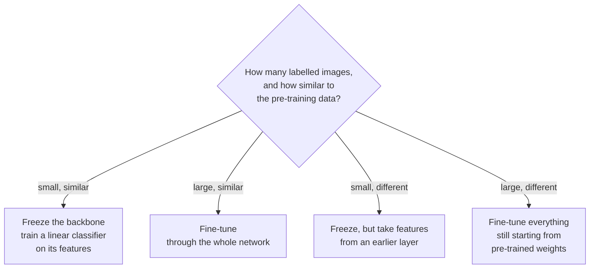

# Transfer learning and labels: start from someone else's model

*Part of [Convolutional networks for the product and technology leader](./README.md)*

## TL;DR

Almost nobody trains a vision model from scratch. The CS231n course notes say very few people do, because few teams have a big enough dataset. Instead a team takes a network already trained on a large dataset such as ImageNet and reuses it. This is **transfer learning**.

There are three ways to reuse it. Use it as a **frozen feature extractor** and train only a small classifier on top. **Fine-tune** it: keep training some or all of its layers on your data. Or train from scratch, which is rarely the right call. The choice depends on two things: how many labelled images you have, and how much they look like the pre-training images.

Labels are the real budget. Transfer learning cuts how many you need. It does not remove the need for a clean, honest test set.

> 🎯 **For the product leader**
>
> **Why it matters** — The transfer choice sets the labelling budget, the training cost and the time to a first result. A frozen backbone with a small head can give a baseline in a day. A full fine-tune needs more labels, more compute and more care.
>
> **What it changes in your decisions** — You ask for the cheapest baseline first: frozen features and a simple classifier. You fund more labels or a fine-tune only when that baseline misses the bar.
>
> **Ask your eng team** — *"What did a frozen pre-trained backbone with a simple classifier score on our test set, before we decided to fine-tune?"*
>
> **Risk if ignored** — A team spends weeks fine-tuning a large model on 800 images. It overfits. A frozen baseline that took an afternoon would have scored better.

## The mental model: a 2 by 2 grid



The grid comes from the CS231n transfer-learning notes. Two questions place you in it: how much data, and how different it is.

The grid breaks at the edges. "Small" and "similar" have no fixed thresholds. Your own test set is what places you, not a rule of thumb.

## Mechanics

### What "frozen" means

A pre-trained classifier ends with a layer that scores the original classes, such as ImageNet's 1,000. You remove it. Everything before it now turns an image into a vector of features. You train a new small classifier on those vectors. The backbone's weights do not change.

In library terms, freezing means telling the library not to compute gradients for those weights. The Tensors lesson on [automatic differentiation](../tensors/automatic-differentiation.md) shows the accidental version of this: a cut graph that silently freezes a layer. Here you cut it on purpose, and you know which layers stopped learning.

A classifier as simple as one linear layer on frozen features is called a **linear probe**. Meta's DINOv2 README says its features "can be directly employed with classifiers as simple as linear layers" and "perform well across domains without any requirement for fine-tuning."

### What fine-tuning adds

Fine-tuning keeps training the backbone on your data. You can train all of it, or freeze the early layers and train the later ones. The CS231n notes give the reason to freeze early layers: they hold generic features such as edge detectors, and later layers are more specific to the original dataset. They also advise a smaller learning rate for the pre-trained weights than for the new classifier, so training does not wreck what the backbone already knows.

### The four cases

The CS231n notes give rules of thumb for the grid above:

1. **Small and similar.** Do not fine-tune, because of overfitting risk. Train a linear classifier on the features.
2. **Large and similar.** Fine-tune through the full network.
3. **Small and very different.** Train only a linear classifier, but on features from earlier in the network, since the top layers are tuned to the original data.
4. **Large and very different.** You could train from scratch. In practice it is still often better to start from pre-trained weights and fine-tune everything.

### Labels

Transfer learning cuts how many labels you need. It does not change what makes a label set good. It needs clean labels, enough examples of each class, and a test set that the model never sees in training. [Data: features, labels, splits and leakage](../machine-learning/data-features-labels-and-leakage.md) covers splits and leakage. For images, one extra rule matters: near-duplicate photos of the same item must sit on the same side of the split.

## Worked example: the defect classifier

*This example is illustrative. The image counts and the class list are assumed. The parameter counts come from torchvision's ResNet-50 and are recomputed here.*

A factory wants to sort photos of parts into 4 classes: good, scratched, dented, discoloured. It has 1,200 labelled photos, 300 per class. The photos are close-ups of metal, unlike ImageNet's everyday scenes. That is case 3: small and different.

**Step 1: count what you would train.** Torchvision lists ResNet-50 at 25,557,032 parameters. Its last layer maps 2,048 features to 1,000 classes: 2,048 × 1,000 + 1,000 = 2,049,000 parameters. Remove it and 23,508,032 remain. A new 4-class layer adds 2,048 × 4 + 4 = 8,196.

| Option | Parameters trained | Share of the model |
| --- | --- | --- |
| Frozen backbone, new 4-class head | 8,196 | 0.035% of 23,516,228 |
| Fine-tune everything | 23,516,228 | 100% |

**Step 2: run the cheap baseline.** The team trains the 8,196-parameter head first. Following case 3, it also tries features from an earlier stage, as in [From edges to objects](./from-edges-to-objects.md).

**Step 3: decide.** The team compares both probes on a test set of photos taken on different days from the training photos. If the best probe meets the bar, it ships. If not, the next spend is a choice. Label more photos, or fine-tune the later layers with a small learning rate. The cheaper of the two goes first.

**Step 4: budget the labels.** A class with too few examples gets few test examples too. With 300 photos a class and a 20% test split (assumed), each class has 60 test photos. One mistake moves that class's recall by about 1.7 points (1 ÷ 60). The team decides that is too coarse for the rarest defect and labels more of that class first.

## Tradeoffs and decisions

- **Frozen vs. fine-tuned.** Frozen is fast, cheap and hard to overfit, and it is capped by what the backbone already sees. Fine-tuning can fit your images better. It costs more compute, needs more labels and can overfit a small set.
- **Late vs. early features.** Late features are strong when your images look like the pre-training data. Early features transfer to different images and leave more for your classifier to learn.
- **More labels vs. a bigger model.** Both raise accuracy. Labels also strengthen your test set. A bigger model raises your serving bill and leaves the test set as thin as before.
- **One backbone vs. many.** Sharing one frozen backbone across several product features saves serving cost, and every feature then depends on its quality.

## Failure modes

- **Fine-tuning a big model on a small set.** It memorises the training photos and scores worse on new ones.
- **Leakage across the split.** Five photos of the same part, some in training and some in test. The score is inflated.
- **A high learning rate on pre-trained weights.** Early training destroys the useful features.
- **A preprocessing mismatch.** The backbone expects the exact resizing and normalisation it was trained with. A different one can quietly lower accuracy. [Shipping vision in production](./shipping-vision-in-production.md) covers this.
- **A licence missed.** The DINOv2 repository, for example, releases its XRay-DINO and Cell-DINO weights under the FAIR Noncommercial Research License, unlike its main Apache 2.0 weights (as of 2026-10). Check the licence of the exact weights before you build on them. [Vision foundation models](./vision-foundation-models.md) has more examples.

## Under the hood

A frozen backbone with a new head, sketched in PyTorch. This is a sketch of the configuration, not code this lesson runs.

```python
from torchvision.models import resnet50, ResNet50_Weights
import torch.nn as nn

model = resnet50(weights=ResNet50_Weights.IMAGENET1K_V2)
for p in model.parameters():
    p.requires_grad = False                 # freeze: no gradients for the backbone
model.fc = nn.Linear(2048, 4)               # new head; its weights train by default
preprocess = ResNet50_Weights.IMAGENET1K_V2.transforms()   # the exact preprocessing it expects
```

Torchvision's `ResNet` class builds its last layer as `nn.Linear(512 * block.expansion, num_classes)`. The ResNet-50 block sets `expansion = 4`, which gives the 2,048 inputs above. The arithmetic of the table:

```python
fc_old = 2048 * 1000 + 1000          # 2,049,000
backbone = 25_557_032 - fc_old       # 23,508,032
head = 2048 * 4 + 4                  # 8,196
assert backbone + head == 23_516_228
assert round(100 * head / (backbone + head), 3) == 0.035
```

To fine-tune later layers only, unfreeze `model.layer4` and give its parameters a smaller learning rate than `model.fc`.

## Practitioner checklist

- [ ] Do we have a frozen-backbone baseline score before any fine-tuning?
- [ ] Have we placed our data in the grid: how many labels, how different from the pre-training data?
- [ ] For different-looking images, did we try features from an earlier layer?
- [ ] Does every class have enough test images for its score to be stable?
- [ ] Are near-duplicate photos kept on one side of the split?
- [ ] Do we use the exact preprocessing the pre-trained weights expect?
- [ ] Have we checked the licence of the weights?

## Related lessons

- [From edges to objects](./from-edges-to-objects.md) — why early features transfer and late ones are specific.
- [Vision foundation models](./vision-foundation-models.md) — large pre-trained backbones, and their licences.
- [Automatic differentiation](../tensors/automatic-differentiation.md) — freezing as a deliberate cut in the gradient graph.
- [Generalization: overfitting and the bias–variance tradeoff](../machine-learning/generalization-overfitting-and-bias-variance.md) — why a small set overfits a big model.
- [Prompting vs. RAG vs. fine-tuning](../llms/prompting-vs-rag-vs-finetuning.md) — the same cheapest-lever-first rule for language models.

## Sources

- CS231n course notes, *Transfer learning* ([GitHub source, master branch](https://github.com/cs231n/cs231n.github.io/blob/master/transfer-learning.md)): few people train from scratch for lack of data; ImageNet as 1.2 million images in 1,000 categories; the fixed-feature-extractor and fine-tuning strategies; the four scenarios by dataset size and similarity; early features generic, later features specific; a smaller learning rate for pre-trained weights. Read 2026-10.
- Meta AI Research (FAIR), *DINOv2* README ([GitHub, main branch](https://github.com/facebookresearch/dinov2/blob/main/README.md)): features usable "with classifiers as simple as linear layers", performing well "without any requirement for fine-tuning"; main code and weights under the Apache License 2.0; XRay-DINO and Cell-DINO weights under the FAIR Noncommercial Research License. Read 2026-10.
- PyTorch torchvision source, `torchvision/models/resnet.py` ([GitHub, main branch](https://github.com/pytorch/vision/blob/main/torchvision/models/resnet.py)): `ResNet50_Weights.IMAGENET1K_V2` with `num_params` 25,557,032; the final layer `nn.Linear(512 * block.expansion, num_classes)`; `expansion = 4` in the ResNet-50 block. Read 2026-10.
- The factory example, the class counts and the test split are invented. The arithmetic is shown in the lesson.
