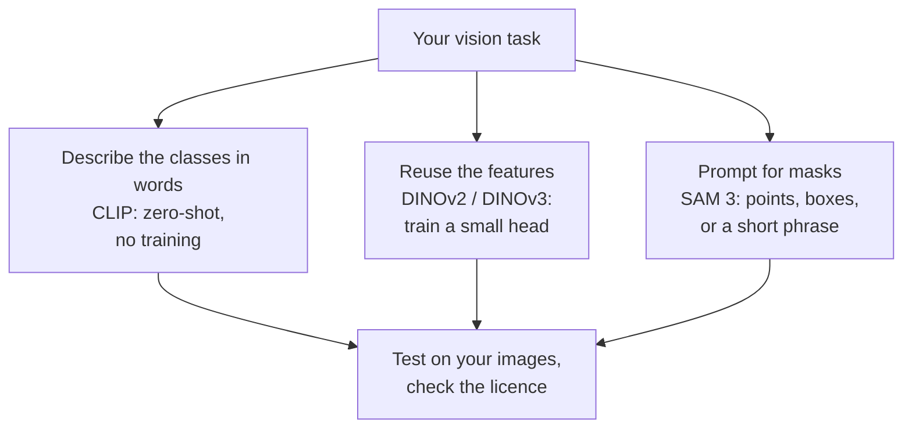

# Vision foundation models: CLIP, DINO and SAM

*Part of [Convolutional networks for the product and technology leader](./README.md)*

## TL;DR

A **vision foundation model** is a large model pre-trained on a very large image collection, often without hand-made labels, and meant to be reused for many tasks. This lesson covers three families.

- **CLIP** (OpenAI) learns from images paired with captions. You can classify an image by comparing it with text labels you write, with no training. This is **zero-shot** classification.
- **DINOv2 and DINOv3** (Meta) learn image features with no labels at all. You put a small classifier on top, often a single linear layer.
- **SAM 3** (Meta) segments objects from a prompt: points, boxes, masks, or a short text phrase such as "a player in white".

These models change the first question. It is no longer "how many images must we label to train?" It is "can a foundation model do this with few labels or none, and are we allowed to ship it?" The licence and the vendor's stated intended use are now part of the technical choice.

This field moves fast. Every model name, licence and figure here is as of 2026-10. Check the source before you build.

> 🎯 **For the product leader**
>
> **Why it matters** — A foundation model can turn a three-month labelling project into a one-week prototype. It can also carry a licence that forbids your use, or a vendor note that says it is not meant for deployment.
>
> **What it changes in your decisions** — You try zero-shot or a linear probe before you fund labelling. You check the licence, the access terms and the intended-use statement before the prototype becomes the plan.
>
> **Ask your eng team** — *"Which foundation model did we try first, what did it score on our test set with no training, and does its licence allow our commercial use?"*
>
> **Risk if ignored** — A team ships a feature on weights released for non-commercial research. Or it trusts a zero-shot score that looks confident and was never tested on its own images.

## The mental model: three ways to reuse a big model



Think of hiring a contractor who has already seen millions of buildings. You can describe the job in words (zero-shot). You can give a short briefing and a few examples (a small head on frozen features). Or you can point at the parts of a drawing you want traced (prompted segmentation).

The analogy breaks because the contractor's experience is its training data, and you cannot interview it. The CLIP model card says the data is "more representative of people and societies most connected to the internet." Your images may sit outside that experience.

## Mechanics

### CLIP: compare an image with text

CLIP has two encoders, one for images and one for text. Training pulls matching image and caption pairs together. To classify, you write one prompt per class, such as "a photo of a {label}". CLIP encodes the image and each prompt. The class whose text vector is most similar to the image vector wins. The README's example multiplies the similarities by 100 and applies a softmax to get probabilities.

The README reports that CLIP "matches the performance of the original ResNet50 on ImageNet 'zero-shot' without using any of the original 1.28M labeled examples." The model card lists limits. CLIP struggles with fine-grained classification and counting objects. Its performance and biases depend on how the classes are worded and chosen.

### DINOv2 and DINOv3: features without labels

DINOv2 was "pretrained on a dataset of 142 M images without using any labels or annotations." Its README says the features work "with classifiers as simple as linear layers" across many tasks "without any requirement for fine-tuning." That makes it a strong frozen backbone for [transfer learning](./transfer-learning-and-labels.md). DINOv3 continues the line. It offers ViT and ConvNeXt backbones pre-trained on a web dataset, plus ViT backbones pre-trained on satellite imagery.

### SAM 3: segment from a prompt

SAM 3 is "a unified foundation model for promptable segmentation in images and videos." It can "detect, segment, and track objects using text or visual prompts such as points, boxes, and masks." Compared with SAM 2, it adds the ability to segment every instance of a concept given by a short text phrase. Meta reports that it reaches 75 to 80% of human performance on a new benchmark it built. The README's image example returns masks, boxes and scores for a text prompt.

### Licences, access and intended use (as of 2026-10)

| Model | Code and weights licence | Access | Vendor's note on use |
| --- | --- | --- | --- |
| CLIP | MIT licence in the repository | Open download | The model card says "any deployed use case of the model … is currently out of scope", and certain surveillance and facial-recognition uses always are |
| DINOv2 | Apache License 2.0 for code and weights | Open download | Some later variants in the same repository, such as XRay-DINO, carry the FAIR Noncommercial Research License |
| DINOv3 | The DINOv3 License | Request access; links sent by e-mail once accepted | Read the licence terms for your use |
| SAM 3 | The SAM License | Request access on Hugging Face, then authenticate | Read the licence terms for your use |

The point of the table is not the rows. It is the habit of making one. Two models in one repository can carry different licences.

## Worked example: a zero-shot score that looks too sure

*This example is illustrative. The similarity values are assumed, not produced by a real model. The method follows CLIP's README.*

A marketplace wants to route product photos to three teams: shoes, bags and watches. Before labelling anything, the team tries CLIP zero-shot with the prompts "a photo of a shoe", "a photo of a bag" and "a photo of a watch".

**Case A.** For one photo the assumed similarities are 0.31, 0.27 and 0.22.

1. Multiply by 100: 31, 27 and 22.
2. Softmax. Subtract the largest, giving 0, −4 and −9. Raise e to each: 1, 0.0183 and 0.0001.
3. Divide by their sum. The probabilities are **0.982, 0.018 and 0.0001**.

The model looks 98% sure. The raw similarities differed by only 0.04. The factor of 100 turns small gaps into near-certainty.

**Case B.** Another photo scores 0.29, 0.28 and 0.27. The same steps give **0.665, 0.245 and 0.090**. This time the model hedges.

**The decision.** The team does not route on the probability alone. It labels 300 photos as a test set (assumed), measures accuracy per class, and picks a threshold below which a person decides. It then checks the CLIP model card. Deployment is out of scope there, so for production the team compares a model whose licence and stated use fit, such as a DINOv2 backbone with a linear probe trained on the same 300 photos plus more.

## Tradeoffs and decisions

- **Zero-shot vs. a trained head.** Zero-shot needs no labels and is fast to try. A small head on frozen features needs some labelled training images and can fit your classes better. Both need a labelled test set.
- **General vs. specialised.** Foundation models know common scenes. Medical, industrial or satellite images may sit outside their training data. DINOv3's satellite backbones exist for this reason.
- **Capability vs. licence.** The most capable checkpoint may have the most restrictive terms. A permissive, slightly weaker model can be the better product choice.
- **Size vs. serving cost.** Foundation backbones range from small to very large. DINOv3 lists backbones from 21 million parameters (ViT-S/16 distilled) to 6,716 million (ViT-7B/16). Size up only when a smaller one misses the bar.
- **Prompt wording vs. stability.** Zero-shot results shift with how the classes are worded. That makes them easy to tune and easy to break.

## Failure modes

- **A licence found at launch.** The prototype used weights the company may not ship. The work restarts.
- **Confident zero-shot scores trusted.** The softmax makes small gaps look certain. Errors pass with 98% "confidence".
- **Wording drift.** Someone edits a class prompt. Results change across the board, and no test catches it.
- **Bias in the classes.** The CLIP model card reports that its performance and biases "can depend significantly on class design." A product that classifies people inherits this.
- **Fine detail and counting.** The CLIP model card names fine-grained classification and counting as weak spots. A feature that needs either fails quietly.
- **Domain gap.** Everyday-photo features do poorly on X-rays or wafers. The team mistakes this for a labelling problem.

## Under the hood

CLIP zero-shot, from its README (abridged). It runs with the `clip` package installed. This lesson does not run it.

```python
model, preprocess = clip.load('ViT-B/32', device)
text_inputs = torch.cat([clip.tokenize(f"a photo of a {c}") for c in classes]).to(device)
with torch.no_grad():
    image_features = model.encode_image(image_input)
    text_features = model.encode_text(text_inputs)
image_features /= image_features.norm(dim=-1, keepdim=True)
text_features /= text_features.norm(dim=-1, keepdim=True)
similarity = (100.0 * image_features @ text_features.T).softmax(dim=-1)
```

The two `norm` lines make every vector length 1, so the matrix multiply gives cosine similarities. The worked example's arithmetic in plain Python:

```python
import math
def probs(sims, scale=100.0):
    logits = [scale * s for s in sims]
    top = max(logits)
    e = [math.exp(x - top) for x in logits]
    return [x / sum(e) for x in e]

assert [round(p, 3) for p in probs([0.31, 0.27, 0.22])] == [0.982, 0.018, 0.0]
assert [round(p, 3) for p in probs([0.29, 0.28, 0.27])] == [0.665, 0.245, 0.09]
```

SAM 3 on an image, from its README: build the model, call `processor.set_image(image)`, then `processor.set_text_prompt(state=inference_state, prompt=...)`. The output holds `masks`, `boxes` and `scores`.

## Practitioner checklist

- [ ] Did we try zero-shot or a linear probe on a foundation model before funding labels?
- [ ] Do we have a labelled test set from our own images, even a small one?
- [ ] Have we set a threshold below which a person decides, instead of trusting the softmax?
- [ ] Have we read the licence, the access terms and the intended-use note for the exact checkpoint?
- [ ] Are class prompts versioned and tested like code?
- [ ] Have we checked performance across the groups our product serves?

## Related lessons

- [Transfer learning and labels](./transfer-learning-and-labels.md) — frozen features and linear probes.
- [CNNs vs. vision transformers](./cnns-vs-vision-transformers.md) — the backbones these models use.
- [Embeddings and semantic search](../rag-vector-databases/embeddings-and-semantic-search.md) — searching by vector similarity, the same idea CLIP uses.
- [Build, buy, or fine-tune](../generative-ai/build-buy-or-fine-tune.md) — the same decision for generative models.
- [Governance, audit and compliance](../ai-security-and-guardrails/governance-audit-and-compliance.md) — making licence and use checks part of the process.

## Sources

- OpenAI, *CLIP* README ([GitHub, main branch](https://github.com/openai/CLIP/blob/main/README.md)): CLIP trained on image and text pairs; matching the original ResNet-50 on ImageNet zero-shot without the 1.28M labelled examples; the zero-shot code with the "a photo of a {c}" prompt, normalised features and the factor of 100 before the softmax. The repository's LICENSE file is the MIT License. Read 2026-10.
- OpenAI, *CLIP* model card ([GitHub, main branch](https://github.com/openai/CLIP/blob/main/model-card.md)): image and text encoders trained with a contrastive loss; "any deployed use case of the model … is currently out of scope"; surveillance and facial-recognition uses always out of scope; data skewed toward people "most connected to the internet"; weaknesses in fine-grained classification and counting; performance and biases depending on class design. Read 2026-10.
- Meta AI Research (FAIR), *DINOv2* README ([GitHub, main branch](https://github.com/facebookresearch/dinov2/blob/main/README.md)): pre-trained on 142 M images without labels; features usable with linear classifiers without fine-tuning; code and weights under Apache License 2.0; XRay-DINO and Cell-DINO weights under the FAIR Noncommercial Research License. Read 2026-10.
- Meta AI Research, *DINOv3* README ([GitHub, main branch](https://github.com/facebookresearch/dinov3/blob/main/README.md)): ViT and ConvNeXt backbones pre-trained on a web dataset, ViT backbones pre-trained on a satellite dataset, backbones from 21M parameters (ViT-S/16 distilled) to 6,716M (ViT-7B/16); weights by access request; code and weights under the DINOv3 License. Read 2026-10.
- Meta, *SAM 3* README ([GitHub, main branch](https://github.com/facebookresearch/sam3/blob/main/README.md)): promptable segmentation in images and videos from text or visual prompts; segmenting all instances of a concept from a short phrase, with "a player in white" as an example prompt; 75 to 80% of human performance on Meta's new benchmark; access requested on Hugging Face; the SAM License; the image usage example. Read 2026-10.
- The marketplace example and its similarity values are invented. The arithmetic is shown and checked in the lesson.
