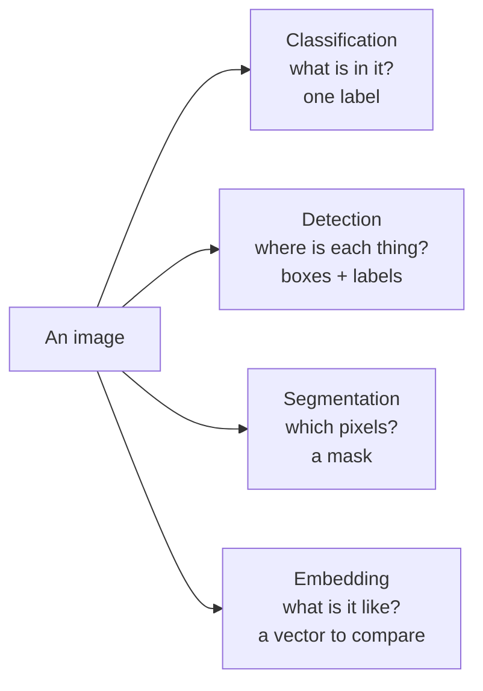

# What computer vision does: the four jobs

*Part of [Convolutional networks for the product and technology leader](./README.md)*

## TL;DR

Computer vision turns pixels into a decision. Most products ask one of four questions about an image. **What is in it?** That is classification. **Where is each thing?** That is detection, which draws a box around each object. **Which pixels belong to what?** That is segmentation, which colours every pixel. **What is it similar to?** That is an embedding, a list of numbers you can search and compare.

The four jobs differ in what they cost to label, how you measure them and how fast they run. A box costs more to draw than a label. A mask costs more than a box. So the first product decision is the framing: pick the least detailed output that still answers the product question.

This lesson is about that choice. It does not explain how an image becomes numbers. [What a tensor is](../tensors/what-a-tensor-is.md) covers that: an image batch is a grid of shape (batch, channels, height, width).

> 🎯 **For the product leader**
>
> **Why it matters** — The framing sets the labelling budget, the metric and the latency. A team that asks for masks when a yes-or-no label would do can spend many times the labelling money for no product gain.
>
> **What it changes in your decisions** — You write the product question first, then pick the job. You ask what each output costs to label, and which metric will decide launch.
>
> **Ask your eng team** — *"What is the simplest output that answers our product question, and what would it cost us to label 5,000 images for it?"*
>
> **Risk if ignored** — A detection project that should have been a classifier. Months go into drawing boxes. The product only ever needed to know whether a shelf was empty.

## The mental model: four questions, four outputs



Read the four jobs as a ladder of detail. Each step down tells you more about the image, and each step costs more to label and to run. The embedding sits beside the ladder. It needs no labels for the answer itself, only for testing.

## Mechanics

### Classification

The model returns one score per class. The highest score wins. A classifier trained on ImageNet, the standard benchmark, scores 1,000 classes. A product classifier might score three: "shelf full", "shelf partly empty", "shelf empty".

You measure it with accuracy, or better, with precision and recall per class. [Measuring a model](../machine-learning/measuring-a-model.md) covers both, and how to pick a threshold from the cost of each error.

### Detection

The model returns a list of boxes. Each box has four corner coordinates, a label and a score. Torchvision's detection models document this output: `boxes` as `[x1, y1, x2, y2]`, plus `labels` and `scores`, one entry per object found.

A predicted box rarely matches the true box exactly. So detection is measured with **intersection over union (IoU)**: the overlap of the two boxes divided by the area they cover together. A box counts as correct when its IoU passes a threshold. The usual summary is **mean average precision (mAP)**. The Common Objects in Context (COCO) benchmark's evaluation code averages it over ten IoU thresholds, from 0.50 to 0.95 in steps of 0.05. Model tables often label this "mAP 50-95".

### Segmentation

The model returns a mask: a label for every pixel. **Semantic** segmentation labels each pixel with a class, such as "road". **Instance** segmentation also separates objects, such as car 1 and car 2. Torchvision's Mask R-CNN returns one mask per detected object, as a grid of values between 0 and 1 that you threshold, usually at 0.5.

### Embeddings

The model returns a vector, often hundreds or thousands of numbers long. A ResNet-50's last layer before its classifier, for example, holds 2,048. Similar images get nearby vectors. You can then search a catalogue for look-alikes, group photos, or find duplicates. The search side is the same as for text: see [Embeddings and semantic search](../rag-vector-databases/embeddings-and-semantic-search.md). [Vision foundation models](./vision-foundation-models.md) covers models that produce good image vectors with no labels.

## Worked example: the shelf monitor

*This example is illustrative. The labelling times and the hourly rate are assumed, not measured.*

A retailer wants to know when a shelf needs restocking. The team has 5,000 shelf photos to label. Three framings are on the table.

| Framing | What a labeller does | Assumed time per image | Hours for 5,000 images | Cost at an assumed $30 an hour |
| --- | --- | --- | --- | --- |
| Classification | Pick one of three labels | 3 seconds | 4.2 | $125 |
| Detection | Draw about 10 boxes, about 7 seconds each | 70 seconds | 97.2 | $2,917 |
| Segmentation | Trace about 10 masks, about 30 seconds each | 300 seconds | 416.7 | $12,500 |

The arithmetic is seconds times 5,000, divided by 3,600 for hours, then times $30.

Now ask the product question. "Does this shelf need restocking?" Classification answers it. "Which product is missing?" needs detection, with a box per product. "How much shelf area is empty?" needs segmentation.

The team ships classification first. It labels in an afternoon and tells the store when to act. Detection waits until the product question changes.

**A check on the metric.** Two boxes, each 10 by 10 pixels, overlap in a 5 by 5 corner. The overlap is 25 square pixels. Together they cover 100 + 100 − 25 = 175. The IoU is 25 ÷ 175 = 0.143. At a threshold of 0.5, this prediction counts as a miss, even though it touches the object.

## Tradeoffs and decisions

- **Detail vs. labelling cost.** Each step down the ladder adds information and multiplies labelling time. You pay that cost again every time you relabel.
- **Detail vs. speed.** Detail costs compute. In the Ultralytics tables (as of 2026-10), the smallest YOLO26 classifier runs at 224 pixels in about 5.0 ms on a central processing unit (CPU). The smallest detector runs at 640 pixels in about 38.9 ms, and the smallest instance-segmentation model in about 53.3 ms. Part of that gap is the larger input. Check the latency on your own hardware before you promise a real-time feature.
- **A fixed class list vs. an embedding.** A classifier knows only its classes. An embedding can match new products without retraining, but someone must still decide what "similar enough" means.
- **One model vs. two stages.** A cheap classifier can filter images before a costly detector runs. You save compute and add a second place to fail.

## Failure modes

- **Over-framing.** The team builds detection when the product needed a label. The labelling budget runs out first.
- **Under-framing.** A classifier says "damaged", but the repair team needs to know where. The product sends people to search by eye.
- **The wrong metric.** Accuracy looks high on a set where 95% of shelves are full. A model that always says "full" scores 95%.
- **A loose IoU threshold.** A threshold of 0.5 counts sloppy boxes as hits. Counting by box then looks fine and measuring by box fails.
- **Labels that disagree.** Two labellers draw different boxes for the same item. The model learns the noise. Measure agreement before you scale.

## Under the hood

The four jobs return four output shapes. For a batch of `N` images:

```text
classification   scores  (N, num_classes)            one row of class scores per image
detection        per image: boxes (K, 4), labels (K,), scores (K,)     K varies per image
segmentation     per image: masks (K, 1, H, W), one soft mask per instance (Mask R-CNN)
embedding        vectors (N, D)                       D numbers per image
```

Intersection over union for two boxes in `[x1, y1, x2, y2]` form:

```python
def iou(a, b):
    w = max(0, min(a[2], b[2]) - max(a[0], b[0]))
    h = max(0, min(a[3], b[3]) - max(a[1], b[1]))
    inter = w * h
    union = (a[2] - a[0]) * (a[3] - a[1]) + (b[2] - b[0]) * (b[3] - b[1]) - inter
    return inter / union

assert round(iou([0, 0, 10, 10], [5, 5, 15, 15]), 3) == 0.143
```

The COCO evaluation code sets its IoU thresholds with
`np.linspace(.5, 0.95, int(np.round((0.95 - .5) / .05)) + 1, endpoint=True)`, which gives ten values from 0.50 to 0.95.

## Practitioner checklist

- [ ] Have we written the product question before choosing the job?
- [ ] Is our framing the least detailed output that answers it?
- [ ] Do we know the labelling time per image for that framing, measured on a sample?
- [ ] Have we named the launch metric, and is it right for an imbalanced set?
- [ ] For detection, have we fixed the IoU threshold the metric uses?
- [ ] Have two labellers labelled the same sample, and do they agree?

## Related lessons

- [How a convolution sees](./how-a-convolution-sees.md) — how the model turns pixels into these outputs.
- [What a tensor is](../tensors/what-a-tensor-is.md) — the shape and size of an image batch.
- [Measuring a model](../machine-learning/measuring-a-model.md) — precision, recall and thresholds for any classifier.
- [Data: features, labels, splits and leakage](../machine-learning/data-features-labels-and-leakage.md) — labels and honest test sets.
- [The modalities](../generative-ai/the-modalities.md) — making images rather than reading them.

## Sources

- PyTorch torchvision source, `torchvision/models/detection/faster_rcnn.py` and `mask_rcnn.py` ([GitHub, main branch](https://github.com/pytorch/vision/tree/main/torchvision/models/detection)): detection output as `boxes` in `[x1, y1, x2, y2]` format with `labels` and `scores`; Mask R-CNN `masks` as one soft mask per instance, in the 0 to 1 range, "generally" thresholded at 0.5. Read 2026-10.
- COCO API source, `PythonAPI/pycocotools/cocoeval.py` ([GitHub, master branch](https://github.com/cocodataset/cocoapi/blob/master/PythonAPI/pycocotools/cocoeval.py)): IoU thresholds from 0.50 to 0.95 in ten steps. Read 2026-10.
- Ultralytics README ([GitHub, main branch](https://github.com/ultralytics/ultralytics/blob/main/README.md)): model tables report "mAP val 50-95" on COCO val2017; the same library offers detection, segmentation, classification and pose models; CPU speeds, measured with an Open Neural Network Exchange (ONNX) export, of 5.0 ms for YOLO26n-cls at 224 pixels, 38.9 ms for YOLO26n at 640 pixels and 53.3 ms for YOLO26n-seg at 640 pixels. Read 2026-10.
- PyTorch torchvision source, `torchvision/models/resnet.py` ([GitHub, main branch](https://github.com/pytorch/vision/blob/main/torchvision/models/resnet.py)): the final layer is `nn.Linear(512 * block.expansion, num_classes)`, with `expansion = 4` for the ResNet-50 block, so 2,048 features. Read 2026-10.
- CS231n course notes, *Transfer learning* ([GitHub source](https://github.com/cs231n/cs231n.github.io/blob/master/transfer-learning.md)): ImageNet as "1.2 million images with 1000 categories". Read 2026-10.
- The shelf example, the labelling times and the hourly rate are invented. The arithmetic is shown in the lesson.
