# How a model learns

*Part of [Visual explainers](./README.md)*

*Last reviewed: 2026-11 · Volatility: medium*

## In one minute

A language model is trained by playing one game, over and over: guess the next word. Each wrong guess nudges millions of numbers a little. After an enormous number of nudges, the guesses become good. This page follows one training example, **"The cat sat on the ___"**, from raw text to a weight update. It then shows how the same push, in smaller doses, turns a word predictor into an assistant.

You will meet the **loss**, the **gradient**, the **learning rate** and three kinds of training: pretraining, supervised tuning and preference tuning.

*Reading time: about 10 minutes. The probabilities are illustrative. The tuning numbers come from the toy model in this site's fine-tuning module.*

## 1 · Raw text

Training starts with text: books, web pages, code and more. Nobody labels it. The text itself is the teacher, because every sentence contains its own answers. In "The cat sat on the mat", the word after "on the" is "mat".

This is called **self-supervised** learning. It scales, because the world has far more text than anyone could label by hand.

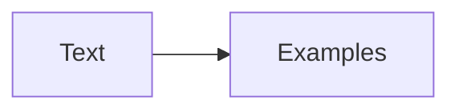

**Remember:** the data supplies its own answers.

## 2 · An example and a target

Training cuts the text into tokens and makes examples. The **input** is the words so far. The **target** is the word that really came next. One sentence makes many examples, one for each position.

The model never sees the answer when it guesses. It sees "The cat sat on the" and must say what comes next. Then it is told the truth.

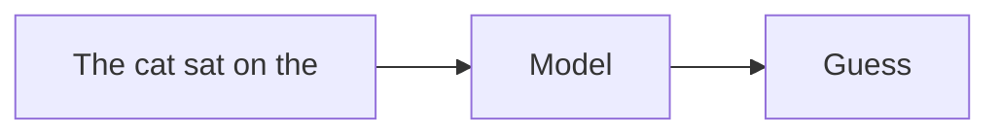

**Remember:** each example is a question with a hidden, known answer.

## 3 · A guess

For the input, the model gives a probability to every word it knows. These are its **guess**. At the start of training, the numbers are random, so the guess is poor. Later, "mat", "floor" and "sofa" get high odds and "carburetor" gets almost none.

In our example the model gives the true word, "mat", a probability of 0.30. That is not bad, and not good either.

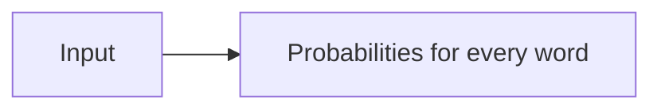

**Remember:** the model never says one word. It spreads probability over all of them.

## 4 · The loss

The **loss** is a number that says how wrong the guess was. For language models it is the negative logarithm of the probability given to the true word. If the model gave "mat" 0.90, the loss is small. If it gave 0.02, the loss is large.

A probability of 0.30 gives a loss of about 1.20. The goal of training is to push the average loss down, over all examples.

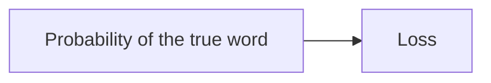

**Remember:** a lower loss means the model was less surprised by the real word.

## 5 · Who to blame

The model has millions or billions of numbers, called **weights**. Which ones caused the poor guess? **Backpropagation** works that out. It runs the model backwards and gives each weight a **gradient**: a hint about which way to change it, and by how much, to lower the loss.

You can picture it as a huge set of dials. The gradient says, for each dial, "turn left a little" or "turn right a little".

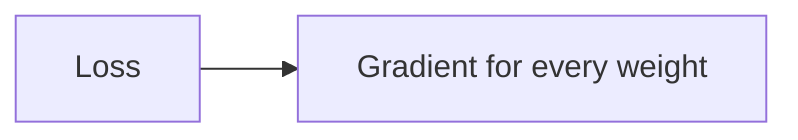

**Remember:** the gradient is a direction for every weight, not an answer.

## 6 · A small step

Training moves each weight a small step in the direction that lowers the loss. The size of the step is the **learning rate**. Too small, and training crawls. Too large, and it overshoots and the loss blows up. A good rate makes steady progress.

After one step, the probability of "mat" might rise from 0.30 to 0.34, and the loss falls from about 1.20 to 1.08. One step helps a little. The power comes from the number of steps.

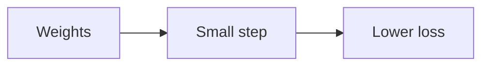

**Remember:** learning is many small, safe steps, not one clever jump.

## 7 · Repeat, a very large number of times

Training does this loop on **batches** of examples, again and again: guess, measure the loss, find the gradients, take a step. Over an enormous amount of text, the model has to get good at grammar, facts, style and reasoning patterns, because those all help predict the next word.

This stage is **pretraining**. It is the expensive one. It produces a **base model**: a very capable text continuer that does not yet behave like an assistant.

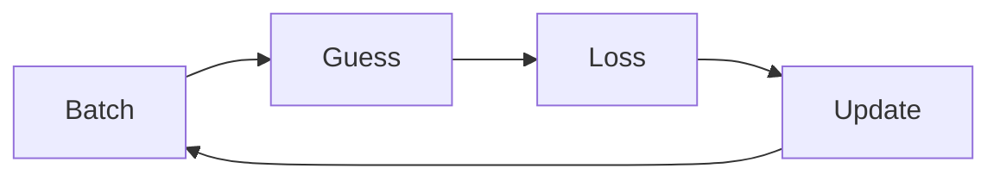

**Remember:** pretraining builds the abilities. It does not build the manners.

## 8 · From predictor to assistant

Ask a base model "What is a mortgage rate?" and it may continue with more questions, as if it were a quiz sheet. To make it answer, a second stage shows it examples of good answers and trains on those. This is **supervised fine-tuning**.

It works with far less data than pretraining. In the toy model in this site's fine-tuning module, the chance of the wanted answer rose from 0.083 to 0.987. It also has a cost. The loss on ordinary text rose from 1.103 to 2.280, so general ability slipped.

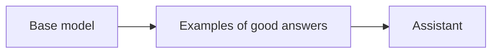

**Remember:** a small push can change behaviour a lot, and can break other things.

## 9 · Learning what people prefer

Instructions are not enough. People also prefer some answers to others: clearer, safer, less rambling. **Preference tuning** shows the model pairs of answers, one better than the other, and nudges it toward the better one. Methods include reinforcement learning from human feedback and direct preference optimization.

The InstructGPT paper reported that people preferred outputs from a tuned 1.3-billion-parameter model to those of the 175-billion-parameter GPT-3, despite the size gap.

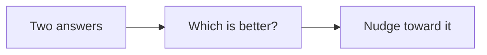

**Remember:** preference tuning shapes taste. It can also be over-optimized.

## 10 · What training cannot fix

Training is good at behaviour: format, tone, style and how to follow instructions. It is poor at adding new facts reliably, at knowing what happened yesterday and at guarantees. A fact that was rare in the training text may not stick. A fact that changed will be stale.

That is why products add retrieval for fresh facts, tools for exact work and checks for safety. Tuning also forgets: a push that teaches one thing can erode another.

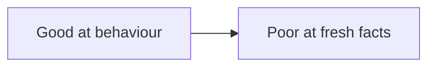

**Remember:** train for behaviour, retrieve for facts, and test what you did not mean to change.

## The whole journey

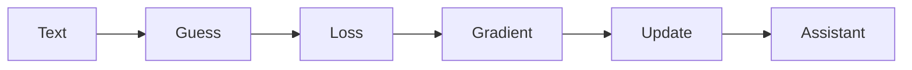

## Where it breaks

- **Bad data.** The model learns the mistakes in its examples.
- **Forgetting.** A narrow push can damage general ability.
- **Reward hacking.** A model optimized against a proxy learns to please the proxy.
- **Stale knowledge.** The facts stop at the training cutoff.
- **Over-fitting.** The model memorizes its examples instead of learning the pattern.

## Go deeper

- [Training: loss and gradient descent](../machine-learning/training-loss-and-gradient-descent.md) — stages 3 to 7 with code.
- [From base model to assistant](../fine-tuning/from-base-model-to-assistant.md) — stages 8 and 9 in depth.
- [Preference tuning and reward hacking](../fine-tuning/preference-tuning-and-reward-hacking.md) — where preference tuning goes wrong.
- [Supervised fine-tuning](../fine-tuning/supervised-fine-tuning.md) — data size, speed and forgetting.
- [Prompting vs. RAG vs. fine-tuning](../llms/prompting-vs-rag-vs-finetuning.md) — choosing the lever.

## Test yourself

1. **What does the loss measure?**
   

Answer
How surprised the model was by the real next word: the negative logarithm of the probability it gave that word. A probability of 0.30 gives a loss of about 1.20.

2. **What does the learning rate do?**
   

Answer
It sets the size of each step. Too small is slow. Too large overshoots and the loss blows up.

3. **Why can supervised tuning hurt general ability?**
   

Answer
The weights are shared, so a push that makes one behaviour likely changes others. In the toy model, the loss on ordinary text rose from 1.103 to 2.280.

## Sources

- Long Ouyang et al., [*Training language models to follow instructions with human feedback*](https://arxiv.org/abs/2203.02155), arXiv 2203.02155, 2022, abstract read 2026-11: supervised fine-tuning on labeler demonstrations, then fine-tuning with reinforcement learning from human feedback on ranked outputs, and the finding that outputs of the 1.3B InstructGPT model are preferred to those of the 175B GPT-3.
- This site's seeded toy model, `fine-tuning/code/lesson1_pipeline.py` (run 2026-11-09), for the 0.083 to 0.987 and 1.103 to 2.280 figures. The example sentence, the probabilities 0.30 and 0.34 and the loss values computed from them are illustrative. This page's fact-check is pending.
