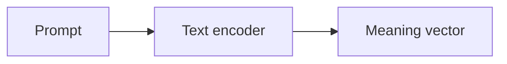
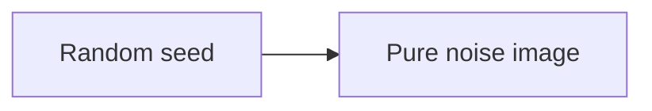
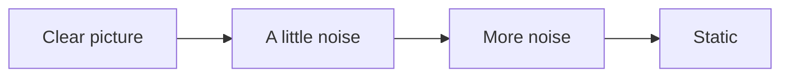
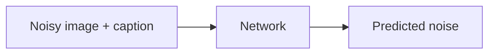
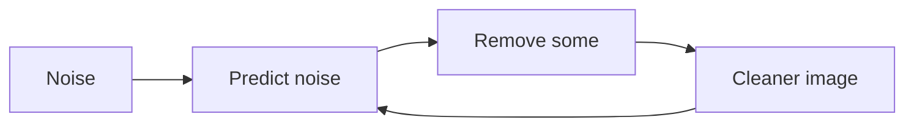
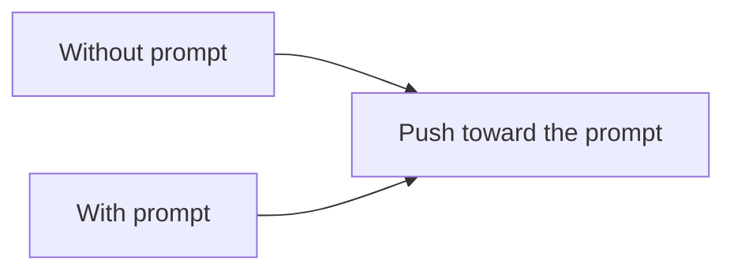
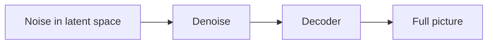
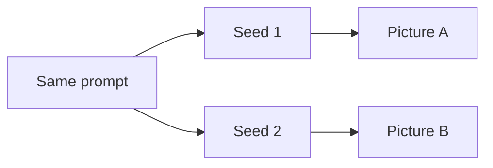
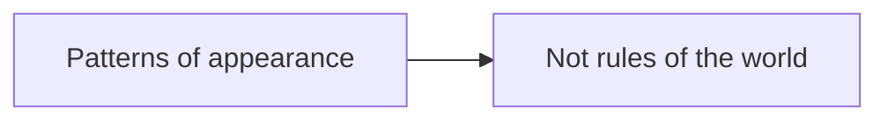
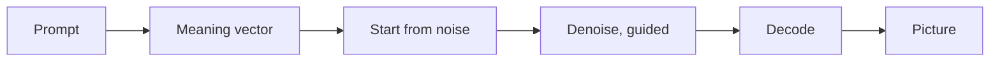

# How an image model draws

*Part of [Visual explainers](./README.md)*

*Last reviewed: 2026-11 · Volatility: medium*

## In one minute

Many image generators start from pure noise, like television static, and clean it up step by step until a picture appears. The prompt steers each step. This page follows one image, **"a red kite over a beach"**, from a text prompt to pixels. It covers how the model is trained to remove noise, why it works in a compressed space and why the same prompt gives different pictures.

You will meet **diffusion**, **denoising**, the **guidance** scale and the **latent space**. The explanation stays at the level of the idea. Details differ between products.

*Reading time: about 10 minutes. Step counts and sizes are illustrative.*

## 1 · The prompt becomes a meaning vector

The text "a red kite over a beach" goes through a **text encoder**, a model that turns words into a list of numbers that capture their meaning. Similar prompts get similar numbers.

This vector is the **condition**. It will steer the drawing at every step. The image model never reads your words directly. It reads this vector.

**Remember:** the picture is steered by a vector, not by the words.

## 2 · Start from noise

Generation starts with an image that is entirely random noise. It contains no kite and no beach. Each pixel is a random value.

This is the opposite of drawing from a blank page. The model begins with chaos and removes what does not belong. The starting noise comes from a random **seed**. The same seed gives the same starting noise.

**Remember:** generation starts from noise, and a seed fixes which noise.

## 3 · Training adds noise on purpose

To teach a model to clean up, you first need practice material. Training takes real pictures and adds noise to them, a little at a time, until nothing but noise is left. This is the **forward process**. It needs no learning, only a recipe for adding noise.

The result is a ladder for each training picture: a clear image, a slightly noisy one, a noisier one and so on, down to static.

**Remember:** the model learns by seeing real pictures made worse in small steps.

## 4 · The network learns to predict the noise

At a random rung of the ladder, the network sees the noisy image, the rung number and the caption. Its task is to **predict the noise** that was added. Then it is told the true noise and nudged to do better, the same way any model learns from its errors.

A model that can name the noise in an image can also take that noise away. The 2020 paper on denoising diffusion models showed that this approach could produce high-quality images.

**Remember:** the skill being learned is "what is the noise in this picture?".

## 5 · The denoising loop

To draw, the model runs the process backwards. From pure noise, it predicts the noise, removes a portion of it and gets a slightly cleaner image. Then it does it again. After many steps, which can number in the tens, a clear picture emerges.

Early steps decide the layout: where the horizon and the kite go. Later steps add detail: the texture of sand and the string of the kite.

**Remember:** a picture is made by many small clean-ups, not one stroke.

## 6 · The prompt as a guide

At every step, the meaning vector steers the clean-up. A technique called **guidance** makes the steering stronger. The model predicts the noise twice, once with the prompt and once without, and pushes the result further in the direction the prompt adds.

The **guidance scale** sets how hard it pushes. Low values give images that drift from the prompt. High values follow the prompt closely and can look harsh or over-saturated.

**Remember:** guidance is a dial between "free" and "obedient".

## 7 · Working in a small space

Cleaning up millions of pixels at every step is slow. The 2022 latent diffusion paper noted that doing this in pixel space "often consumes hundreds of GPU days" in training and that inference is expensive. Its fix was to work in the **latent space** of a pretrained autoencoder instead.

An autoencoder squeezes an image into a much smaller grid of numbers and can expand it back. The diffusion runs on the small grid. At the end, a decoder turns the clean small grid into the full picture. The paper also added cross-attention layers so the model can be conditioned on text.

**Remember:** drawing in a compressed space is far cheaper than drawing pixels.

## 8 · Why the same prompt gives different pictures

The seed sets the starting noise. A different seed means different noise, so the clean-up settles on a different image that still fits the prompt. Some tools also add randomness inside the steps.

This is a feature. One prompt has many valid pictures. Keeping the seed fixed gives repeatable results. Changing only the prompt while keeping the seed lets you compare small edits.

**Remember:** the prompt picks a family of pictures. The seed picks one.

## 9 · Where it fails

Image models learn patterns of how things look, not how things work. They can struggle with exact counts, readable text, hands and complex spatial relations such as "the cup is left of the book". Rare combinations that are missing from the training data are weak points.

They can also reproduce biases in their training data, and they raise questions about copyright and misuse. These are product and policy problems as well as technical ones.

**Remember:** the model knows what things look like, not how they work.

## The whole journey

## Where it breaks

- **Counts and text.** Wrong numbers of fingers, garbled lettering.
- **Spatial relations.** Left and right swap.
- **Prompt drift.** A low guidance scale ignores part of the prompt.
- **Over-saturation.** A high guidance scale looks harsh.
- **Data issues.** Bias, copyright and unsafe content in the training set.

## Go deeper

- [The modalities](../generative-ai/the-modalities.md) — images, audio and video in the GenAI picture.
- [Convolutional networks](../cnns/README.md) — how models see images.
- [Probabilistic software](../generative-ai/probabilistic-software.md) — why the output varies.
- [AI security and guardrails](../ai-security-and-guardrails/README.md) — misuse and safeguards.
- [Embeddings and semantic search](../rag-vector-databases/embeddings-and-semantic-search.md) — meaning as a vector.

## Test yourself

1. **What does the network learn to predict during training?**
   

Answer
The noise that was added to a picture. A network that can name the noise can remove it.

2. **Why does the same prompt give different images?**
   

Answer
The seed sets the starting noise. A different seed leads the clean-up to a different picture that still fits the prompt.

3. **Why work in a latent space?**
   

Answer
It is much smaller than pixel space, so each step is far cheaper. A decoder turns the final latent into the full image.

## Sources

- Jonathan Ho, Ajay Jain and Pieter Abbeel, [*Denoising Diffusion Probabilistic Models*](https://arxiv.org/abs/2006.11239), arXiv 2006.11239, 2020, abstract read 2026-11: diffusion probabilistic models for high-quality image synthesis.
- Robin Rombach et al., *High-Resolution Image Synthesis with Latent Diffusion Models*, CVPR 2022, abstract read 2026-11: applying diffusion in the latent space of pretrained autoencoders, "significantly reducing computational requirements compared to pixel-based" diffusion models, and adding cross-attention layers for conditioning on text.
- Jonathan Ho and Tim Salimans, [*Classifier-Free Diffusion Guidance*](https://arxiv.org/abs/2207.12598), arXiv 2207.12598, 2022, read 2026-11-09: one model handles both conditional and unconditional generation, and blending the two trades sample quality against variety. Step counts and the example prompt are illustrative, and products differ in detail. This page's fact-check is pending.
