# Inside one LLM request

*Part of [Visual explainers](./README.md)*

*Last reviewed: 2026-11 · Volatility: fast*

## In one minute

You ask a chat assistant a question and words start to appear. This page follows one request from the moment you press Enter to the last word on your screen. The question is **"What is a mortgage rate?"**.

Along the way you will meet seven ideas that explain almost everything about speed, cost and limits in AI products: **tokens**, the **context window**, **prefill**, **decode**, the **KV cache**, **streaming** and **batching**. The last stages show why serving many people at once is hard.

*Reading time: about 10 minutes. The token IDs and probabilities are illustrative. The memory and speed numbers come from this site's own worked examples.*

## 1 · You press Enter

Your question does not go straight to a model. It first reaches a **gateway**, a front door that checks who you are and whether you are within your limits. Limits are often counted in tokens as well as requests.

The gateway adds the other things the model must see, such as the system instructions and the earlier messages in the chat. Then the request waits in a **queue** until a machine is free. Only then does it reach a **GPU replica**: one copy of the model running on an accelerator.

Everything before the model is ordinary web engineering. What happens inside the replica is the new part.

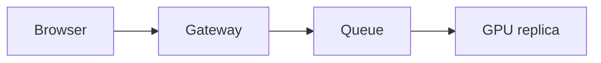

**Remember:** a request spends time waiting before the model ever sees it.

## 2 · Text becomes tokens

A model does not read letters or words. It reads **tokens**: pieces of text, such as a whole word, part of a word or punctuation. A **tokenizer** splits your text into tokens, and each token maps to a whole number in the model's vocabulary.

Your question might split like the figure shows. A different model may split it differently. Common words are often one token. Rare words break into several.

Tokens matter everywhere: prices are quoted per token, context limits are counted in tokens and speed is measured in tokens per second.

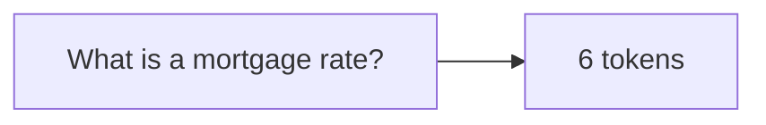

**Remember:** the model sees a list of numbers, not your sentence.

## 3 · The context window

The **context window** is the most tokens the model can look at in one go. Your question is only a small part of it. The window also holds the system instructions, tool descriptions, earlier messages and any documents the app added. The answer must fit too.

If everything does not fit, the app has to cut something: drop old messages, summarize them or refuse. The window is not a memory. The model sees only what is in it for this one request.

Longer windows cost more. Attention, which you will see in the transformer explainer, does more work as the window grows.

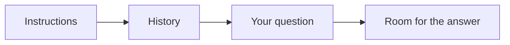

**Remember:** the window is shared by everything the app sends, and it is not memory.

## 4 · Prefill: read the prompt

Now the model reads the whole prompt. This stage is called **prefill**. Because every prompt token already exists, the accelerator can work on all of them at the same time, in one large pass through the model's layers.

Inside each layer, **attention** lets each token take information from the tokens before it. A token can look backwards, never forwards. That keeps the model's job simple: predict what comes next.

Prefill ends with a score for every word in the vocabulary. Those scores decide the first word of the answer. Prefill is the main part of the wait before the first word appears.

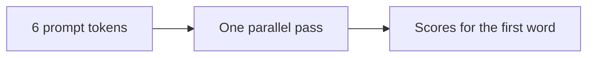

**Remember:** prefill reads the prompt in parallel, so it is fast per token.

## 5 · The KV cache is born

While reading, attention computes two things for each token in each layer: a **key** and a **value**. They are what later tokens look up. The model keeps them in the **KV cache**, so it never has to recompute them.

The cache is useful and expensive. It grows with every token, for every conversation, and it sits in the accelerator's memory next to the model's weights. For a 7-billion-parameter-class model, one 8,192-token conversation needs about 4.0 GiB of cache.

On an 80 GiB accelerator, the weights take about 12.6 GiB. The rest is mostly cache. That is why memory, not arithmetic, usually decides how many people one machine can serve.

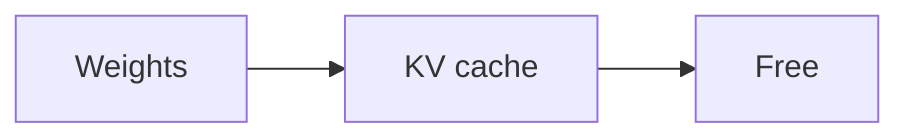

**Remember:** the cache trades memory for speed, and memory runs out first.

## 6 · The decode loop

Now the model writes the answer one token at a time. This stage is **decode**. It picks a token, adds it to the text and runs again with the longer text. Each new token needs the one before it, so the steps cannot run side by side the way prefill can.

At each step the model reads from the KV cache, adds the key and value of the newest token to it, and produces scores for the next word. Then the loop repeats until the model emits an end marker or reaches a length limit.

Decode is slower per token than prefill. Each step reads all the weights from memory to produce one token.

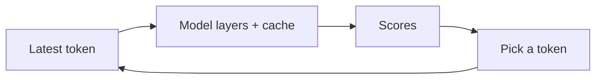

**Remember:** decode is one token per step, so a long answer takes many steps.

## 7 · Choosing the next word

The scores for every word become **probabilities**. Something has to choose. The simplest rule is to take the highest. Many apps instead **sample**: they pick at random, weighted by probability. This is why the same question can get different answers.

**Temperature** adjusts the odds. A low temperature sharpens them, so the top word wins more often. A high temperature flattens them, so unlikely words get a chance. Low is steadier, and high is more varied.

The choice happens at every step. A word picked early shapes everything after it.

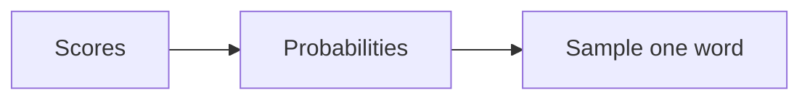

**Remember:** the model writes by choosing from probabilities, one token at a time.

## 8 · Streaming to your screen

The server does not wait for the whole answer. It sends tokens to your browser as they are made. This is **streaming**. It does not make the model faster. It makes the answer feel faster, because you start reading at once.

A common way is **server-sent events**: the browser keeps one connection open, and the server pushes small updates down it. Some apps use **WebSockets** when data must flow both ways, as in voice.

The server may group several tokens into one chunk. Small chunks look smooth. Larger chunks reduce overhead.

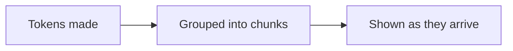

**Remember:** streaming changes when you see the answer, not how fast it is made.

## 9 · Many people at once

One machine serves many conversations. Running them together in a **batch** lets the accelerator read the weights once for many tokens, which raises output a lot. A batch of 16 streams gave about 2,365 tokens per second in total in our example, against about 148 for one stream.

The catch is that answers differ in length. With **static batching**, a group waits for its longest answer. With **continuous batching**, a finished answer leaves at once and a waiting request takes its place. In our example, 64 requests took 1,887 steps with continuous batching and 2,890 with static batching.

Memory limits the batch. On the 80 GiB machine from stage 5, 16 long conversations fit.

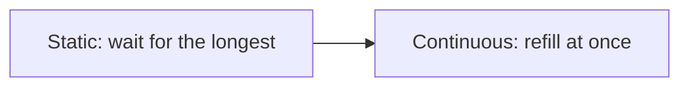

**Remember:** serving is a packing problem: fill the accelerator without running out of memory.

## 10 · Where the time and money go

Two numbers describe the experience. **Time to first token** is the wait before the first word. It includes the network, any queue and prefill. **Tokens per second** is how fast the rest arrives, and it is set by decode.

Cost follows the same split. Long prompts cost prefill work and cache memory. Long answers cost decode steps. Bigger models cost more of both. Providers price input and output tokens separately for this reason.

So to make a product faster or cheaper, you can shorten the prompt, cache a shared prefix, shorten the answer, pick a smaller model or batch better.

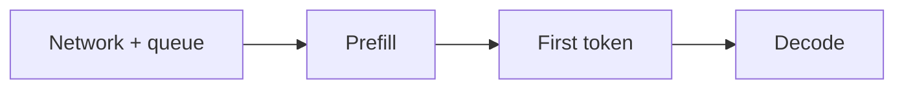

**Remember:** first-token time is mostly prefill and queueing. Speed after that is decode.

## The whole journey

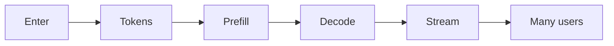

## Where it breaks

- **Queueing.** A busy system makes you wait before any work starts.
- **Context overflow.** Too much is sent, so something is cut.
- **Out of memory.** Too many long conversations for the cache.
- **Slow first token.** A very long prompt means a long prefill.
- **Uneven answers.** One very long answer holds up a static batch.

## Go deeper

- [Generating text and the KV cache](../transformers/generating-text-and-the-kv-cache.md) — the formulas behind stages 4 to 6.
- [GenAI and agent platforms](../system-design/genai-and-agent-platforms.md) — the serving side in full.
- [The context window](../llms/the-context-window.md) — limits and what to put in the window.
- [Temperature, sampling and determinism](../llms/temperature-sampling-and-determinism.md) — stage 7 in depth.
- [Cost optimization](../cost-optimization/README.md) — turning tokens into money.

## Test yourself

1. **Why does the first word take longer than the next ones?**
   

Answer
The first word waits for network, any queue and prefill, which reads the whole prompt. Later words come from decode, one token per step.

2. **Why does memory limit how many people one accelerator can serve?**
   

Answer
Each conversation's KV cache grows with every token and sits beside the weights. In the example, 16 long conversations fit on 80 GiB.

3. **Does streaming make the model generate faster?**
   

Answer
No. It sends tokens as they are made, so you see the answer sooner.

## Sources

- Woosuk Kwon et al., *Efficient Memory Management for Large Language Model Serving with PagedAttention*, SOSP 2023, abstract read 2026-11: the KV cache is large and grows and shrinks, and wasting it by fragmentation limits the batch size. The paper reports 2 to 4 times higher throughput for vLLM at the same latency.
- Gyeong-In Yu et al., *Orca*, OSDI 2022: continuous batching. Not re-opened.
- This site's worked examples: `transformers/code/` for cache sizes and `system-design/code/llm_serving.py` for decode speed and batching steps. Token IDs, probabilities and the example question are illustrative. This page's fact-check is pending.
