# One agent run, step by step

*Part of [Visual explainers](./README.md)*

*Last reviewed: 2026-11 · Volatility: fast*

## In one minute

A chatbot answers. An **agent** acts. It chooses a step, uses a tool, looks at the result and decides what to do next, until the job is done or it must stop. This page follows one run with one goal: **"Refund order 55812 if eligible."**

You will meet the **agent loop**, **tool calls**, the **gateway** that checks them, **stop conditions** and **human checkpoints**. The design question behind every stage is the same: how much freedom should the model have, and what keeps it safe?

*Reading time: about 10 minutes. The order, amounts and limits are invented for the example.*

## 1 · A goal comes in

The user, or another program, gives the agent a **goal** in plain words. The goal is open: it does not say which steps to take. That is the difference between an agent and a fixed workflow, where the code decides the steps.

Anthropic's engineering team draws the line this way: workflows run models and tools along paths set in advance, while in agents the model directs its own process and tool use. Agents suit open-ended tasks where you cannot predict the number of steps.

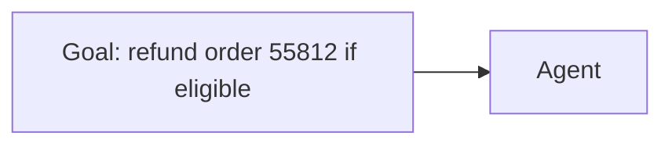

**Remember:** an agent gets a goal, and chooses its own steps.

## 2 · The context is assembled

Before the model decides anything, the platform builds its input: the **instructions** (what the agent is for and what it must never do), the **tool descriptions** (what each tool does and how to call it), the goal and any earlier steps.

The model sees only what is in this input. If the refund policy is not in it, or reachable through a tool, the model cannot know it. Good context is half of a good agent.

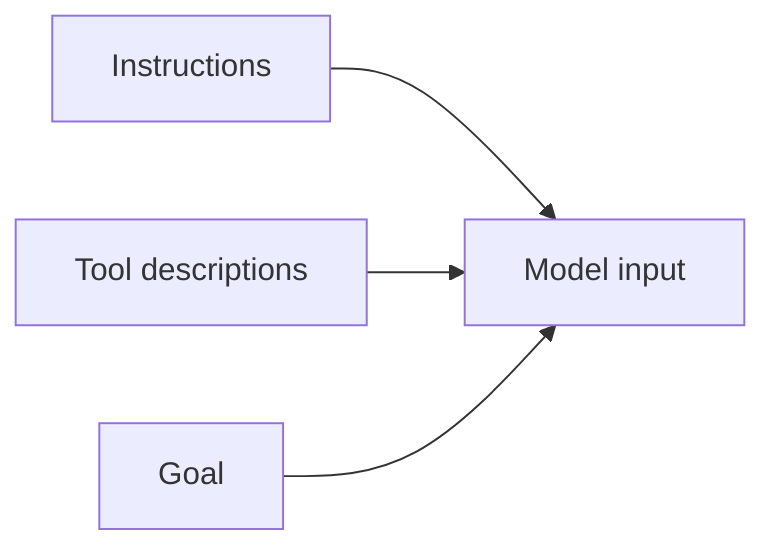

**Remember:** an agent can only act on what its input tells it.

## 3 · The model picks a step

The model reads its input and decides what to do next. Often it first looks something up. Here it chooses to find the order. It might also reason in words about its plan before it acts.

The model is not running code. It is writing text that says what it wants done. The platform decides whether to do it. This split is the key to safety.

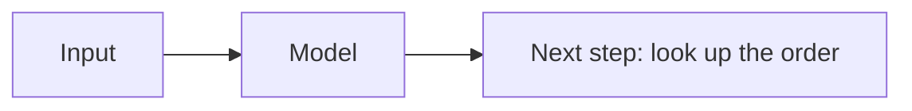

**Remember:** the model proposes. The platform decides.

## 4 · A tool call

The model's proposal takes a fixed shape: a **tool call** with a name and arguments, for example "look up order, order number 55812". Tools are the agent's hands. They can read data, draft text or change the world.

Tool design matters. The same post reports that for a coding benchmark, changing a tool to always require absolute file paths made the model use it flawlessly. Make a tool hard to misuse, and give it a clear description.

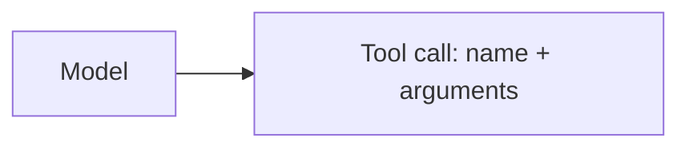

**Remember:** a tool call is a structured request, not an action yet.

## 5 · The gateway checks it

A **tool gateway** sits between the model and the tools. It checks every call: is this tool allowed for this agent, are the arguments within limits and does this action need a person's approval? A denied call never runs.

Reads are usually allowed. A refund of $24.10 may be allowed only with approval. A deletion of a customer account may never be allowed at all. The checks live in code, not in the model's instructions, because a model can be talked out of instructions.

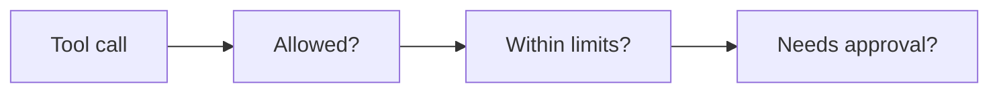

**Remember:** put the rules in code the model cannot argue with.

## 6 · The result is observed

The tool runs and returns a result: the order record. The platform adds it to the agent's input. The same post stresses that, at each step, the agent should get "ground truth" from the environment, such as tool results, to judge its progress.

The result may be missing, wrong or surprising. A good agent handles errors. A weak one treats an error message as a success and carries on.

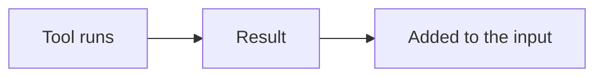

**Remember:** the agent learns from tool results, so errors must be visible to it.

## 7 · The loop

Now the model reads the longer input and picks the next step: check the refund policy, then work out eligibility, draft a message, propose the refund. Each pass adds to the input. This is the **agent loop**: decide, act, observe, repeat.

The loop is what makes agents powerful and risky. A small mistake early in the run shapes every later step. Errors **compound**. The input also grows with each step, which costs more and can crowd out earlier details.

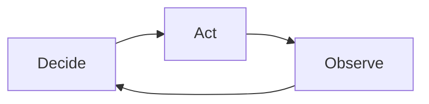

**Remember:** more steps mean more chances to go wrong, and more cost.

## 8 · When to stop

A loop needs ways to end. A good agent has several. It can finish: the goal is met. It can get blocked: it needs information it cannot get. Or it can hit a **limit**: a maximum number of steps, a spend cap or a time limit.

The Anthropic post recommends stopping conditions such as a maximum number of iterations to keep control. In our example, the cap is 8 steps and $0.50 of model spend, and the run uses 5 steps and $0.31.

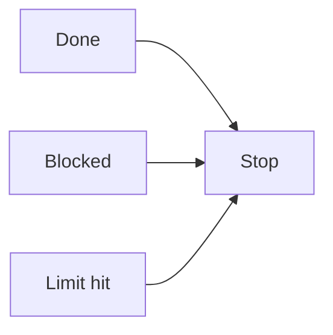

**Remember:** every agent needs a way to stop that does not depend on its own judgement.

## 9 · A human checkpoint

For some actions, a person should decide. The agent pauses and shows a plain summary: **"Refund $24.10 to order 55812. Reason: item arrived damaged. Source: ticket message 3."** The person approves, edits or declines.

The summary has to be good enough to read in seconds, or approval turns into reflex. Show the amount, the target and the reason. Offer a safe default. The same post notes that agents can pause for human feedback at checkpoints or when blocked.

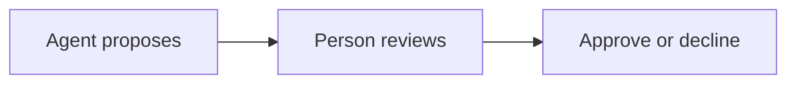

**Remember:** an approval step only protects if people can read what they approve.

## 10 · Report and log

The agent reports back: what it did, what it found and what is left. The platform also records every step, tool call and result in a **log**. The log is how you debug a bad run, audit an action and improve the agent.

Over time, the logs feed evaluations. Failures become test cases. The data also shows whether it is safe to give the agent more freedom, or time to give it less.

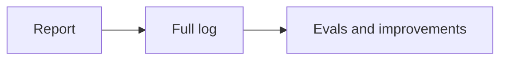

**Remember:** a run you cannot replay is a run you cannot trust.

## The whole journey

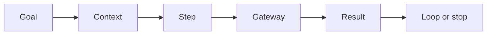

## Where it breaks

- **Compounding errors.** An early mistake poisons later steps.
- **Loops that never end.** No cap on steps or spend.
- **Repeated side effects.** A crash replays a paid action.
- **Over-powered tools.** One tool can do too much.
- **Hidden instructions.** Text in a page or file steers the agent.
- **Approval fatigue.** People click yes without reading.

## Go deeper

- [What an agent is and how much autonomy it needs](../ai-agents/what-an-agent-is-and-how-much-autonomy-it-needs.md) — the concepts.
- [Designing agentic flows](../building-ai-native-products/designing-agentic-flows.md) — tools, autonomy and limits from the product seat.
- [GenAI and agent platforms](../system-design/genai-and-agent-platforms.md) — the platform that runs the loop.
- [Tool calling](../tool-calling/README.md) — how models call tools.
- [Running an agent in production](../ai-agents/running-an-agent-in-production.md) — logs, monitoring and limits.

## Test yourself

1. **What is the difference between a workflow and an agent?**
   

Answer
In a workflow, code sets the path in advance. In an agent, the model directs its own steps and tool use.

2. **Why do the permission checks live in a gateway and not in the instructions?**
   

Answer
Code cannot be talked out of a rule. A model can be persuaded or tricked by text it reads.

3. **Name three ways a run can end.**
   

Answer
The goal is met, the agent is blocked, or a limit such as a step cap, spend cap or time limit is hit.

## Sources

- Anthropic, "Building effective agents", anthropic.com/engineering/building-effective-agents, 2024-12-19, read 2026-11: workflows versus agents; stopping conditions such as a maximum number of iterations; pausing for human feedback at checkpoints; "ground truth" from the environment at each step; the absolute-file-path example; extensive testing in sandboxed environments. The page notes that much of the tooling it describes has changed since December 2024.
- The goal, order number, amounts and limits are invented for the example.
- Independent fact-check: this is this page's first independent check. It ran in four blind passes on 2026-11-07 to 2026-11-10 by a separate agent with web access, blind to the edits. The last pass found no wrong or stale claims.
