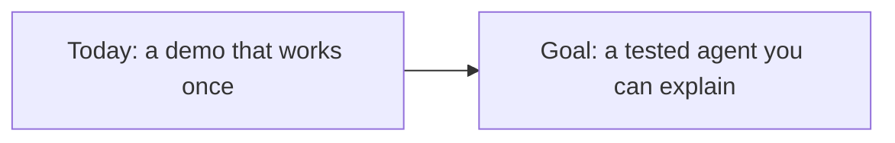
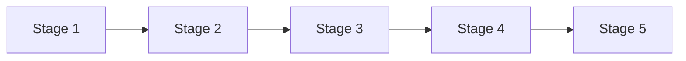
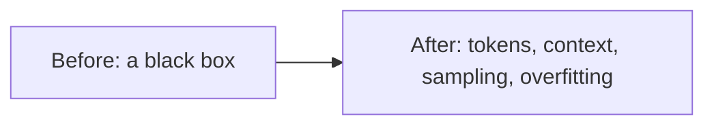
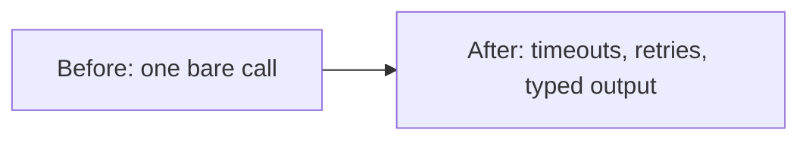
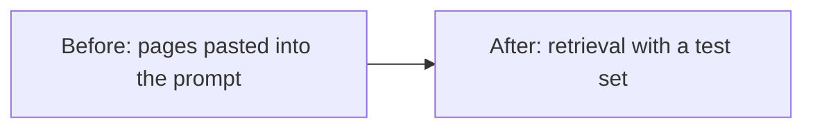
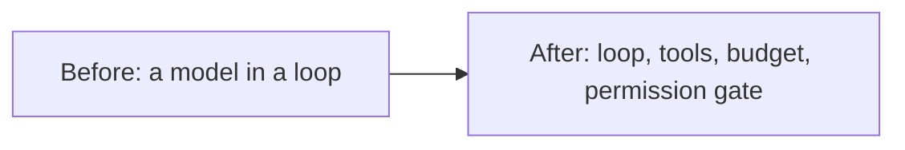
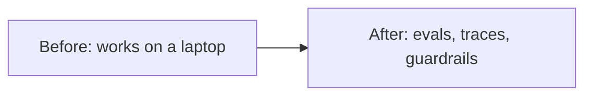
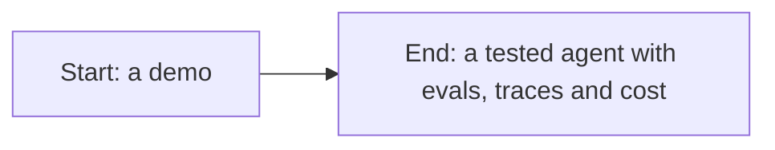
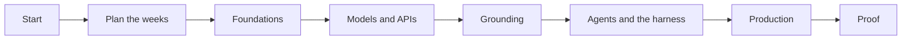

# An AI engineer's path, one stage at a time

*Part of [Visual explainers](./README.md)*

*Last reviewed: 2026-11 · Volatility: medium*

## In one minute

A learning path is a list of lessons in order. This page follows one learner through one path, to show what each stage changes in what they can do. The learner is a backend engineer at Freightly, a logistics company. Their task: **build an internal support agent that answers questions from the operations runbooks, and can open a ticket when it cannot help.**

The engineer can build web services. They have never built a system with a model inside. The [AI Engineer path](../learning-paths/ai-engineer.md) has five stages. After each one, the engineer can build or test one more part of the agent, and a "Do this" check proves it. The last stage is the proof: a capstone that passes its tests.

*Reading time: about 10 minutes. Freightly, the engineer, the support agent and every number about it are invented. The stage names, hours and lessons come from the AI Engineer path itself.*

## 1 · Where the engineer starts

The engineer could wire up a model call in an afternoon. A demo would answer some runbook questions well. That is the trap. A demo does not show how often the answers are wrong, what happens when a tool fails, or what stops the agent from opening a hundred tickets in a loop.

The engineer cannot yet say how a model produces its answer, how to measure whether retrieval found the right runbook page, or where to put the rules the agent must never break.

The path is build-first. It starts with how models learn, then moves through calling models, grounding, agents and production. Each stage adds a part of the support agent, with a test that fails when the part is broken.

**Remember:** a demo shows what works once. A test shows what keeps working.

## 2 · Plan the weeks

The path has five stages and takes about 86 hours in all. That is the longest of the four paths. The hours are this course's rule of thumb: about 25 minutes for a reading lesson and about an hour for each harness lesson you build. The capstone is counted as 3 hours.

The engineer has about 9 hours a week for this. At 9 hours a week, about 10 weeks. The longest stage is stage 4, agents and the harness, at about 29.5 hours, because it builds an agent's parts by hand. Stage 5, production, is almost as long.

The engineer treats the harness phases like any other stage: read, build, then run the tests.

**Remember:** the build stages take the most time. Protect those weeks in the calendar.

## 3 · Stage 1: Foundations

*Path stage 1 · about 15.5 hours · 37 lessons*

This stage reads machine learning, tensors, convolutional networks, transformers, fine-tuning and the basics of large language models, plus this page. It starts with the explainer [One token through a transformer](./one-token-through-a-transformer.md).

Before this stage, a model was a black box that returned text. After it, the engineer can say what a token is, what the context window limits, and why the same question can get different answers. They can also read a training curve. When a small classifier for ticket types scores well on training data and badly on new tickets, they see overfitting, not bad luck.

These ideas come back later. Context limits shape how much runbook text the agent can read at once.

**Do this:** read a training curve and say whether the model is overfitting. Use [Generalization: overfitting and the bias–variance tradeoff](../machine-learning/generalization-overfitting-and-bias-variance.md).

**Remember:** know how the model works before you build around it.

## 4 · Stage 2: Models and APIs

*Path stage 2 · about 7 hours · 17 lessons*

This stage is about calling a model well. It starts with the explainer [Inside one LLM request](./inside-one-llm-request.md), then covers API contracts, structured output and prompts that hold up.

Before this stage, the engineer's model call was a single line with no error handling. After it, every call has a timeout, a retry rule and a typed output. When the model is asked whether to open a ticket, it returns a fixed structure with a reason, not free text that the code must guess at.

The engineer can also diagnose a failing prompt. When the agent gives vague answers, they check the prompt's structure and examples before they reach for a bigger model.

**Do this:** call a model with retries and a typed output, then diagnose one failing prompt. Use [Calling an LLM API](../api-integrations/calling-an-llm-api.md).

**Remember:** treat a model call like any network call: it can be slow, fail or return the wrong shape.

## 5 · Stage 3: Grounding and memory

*Path stage 3 · about 6 hours · 15 lessons*

This stage gives the model the right facts. It covers retrieval, embeddings, vector databases, chunking and how to measure retrieval.

Before this stage, the engineer pasted a few runbook pages into the prompt. After it, they build a retrieval pipeline. The runbooks are split into chunks, indexed and searched for each question. Then the engineer writes a small test set: questions with the runbook page that should answer each one. Now they can measure how often search finds the right page.

That measure matters later. When the agent gives a wrong answer, the engineer can tell whether search missed the page or the model misread it.

**Do this:** build a retrieval pipeline and measure it with a test set. Use [Retrieval quality](../rag-vector-databases/retrieval-quality.md).

**Remember:** measure retrieval on its own, so you can tell a search failure from a model failure.

## 6 · Stage 4: Agents and the harness (build it)

*Path stage 4 · about 29.5 hours · 34 lessons*

This is the core of the path. The engineer builds the parts of an agent by hand in the harness track: the loop, tools, context, prompts, files and shell, and permissions. It starts with the explainer [One agent run, step by step](./one-agent-run.md).

Before this stage, "the agent" was a model in a loop. After it, the support agent has a loop with a step limit, a ticket tool with a clear contract, a context budget that keeps the runbook text within the window, and a permission gate. The gate checks every tool call in code. The agent may search runbooks freely, but it may open at most one ticket per conversation.

Each part has tests that fail when the engineer breaks it on purpose.

**Do this:** build the loop with tools, a permission gate and a context budget, and break each one to see its test fail. Start with [Phase 01 — Foundations and the Loop](../harness-engineering/phases/01-foundations-and-the-loop/README.md).

**Remember:** a rule in a prompt is a request. A rule in code is a control.

## 7 · Stage 5: Production

*Path stage 5 · about 28 hours · 41 lessons*

The last stage prepares the agent for real use. The engineer builds the rest of the harness, ending with the capstone, and reads about serving, routing, evals, tracing, security, access control and system design. The path counts the capstone as 3 hours of this stage. It includes the explainer [Anatomy of a guardrailed request](./anatomy-of-a-guardrailed-request.md).

Before this stage, the agent worked on the engineer's laptop. After it, every request leaves a trace that shows each step, tool call, token count and cost. An eval set runs on every change. A question built to trick the agent into opening tickets for another team is blocked by the permission gate, and the attempt is logged.

The engineer can now say how the agent fails, and how they would see it fail.

**Do this:** add evals and traces to the agent, and test one attack against it. Use [Evals](../content/04-evals-observability/evals.md).

**Remember:** in production, you need to see each request, not only the answer.

## 8 · Proof of skill

The proof is the capstone. The engineer assembles the parts into one agent, then shows four things: the evals and their results, a trace of one request from input to answer, the permission rules, and the cost per request.

Then they check the five checkpoints of the path. Can they explain tokens, context windows and sampling, and read a training curve? Can they call a model with retries and a typed output? Can they build retrieval and measure it? Do they have a loop with tools, a permission gate and a context budget, with tests? Does the capstone pass its tests, with evals, traces, permission rules and cost?

If any answer is no, they go back to that stage. Freightly's support agent waits until the answers are yes.

**Do this:** run the practitioner checklist on the [AI Engineer path page](../learning-paths/ai-engineer.md) against your capstone.

**Remember:** the proof of the path is an agent whose failures you can show and explain.

## The whole journey

## Where it breaks

- **Tuning before testing.** The engineer changes prompts with no test set, and guesses.
- **Rules in the prompt.** The ticket limit lives in the instructions, and a clever question gets past it.
- **No permission gate.** One tool call can do more than the agent should.
- **Skimming the build.** The engineer reads the harness lessons without typing the code, and misses the failures.
- **No failure tests.** Nobody breaks the agent on purpose, so the first break is in production.

## Go deeper

- [AI Engineer path](../learning-paths/ai-engineer.md) — every lesson, checkpoint and skip-ahead rule.
- [Visual learning paths](../learning-paths/visual-paths.md) — the four paths as pictures.
- [An AI engineering lead's path, one stage at a time](./one-ai-engineering-lead-path.md) — the same ground, read for review rather than build.
- [Harness engineering](../harness-engineering/README.md) — the build track at the centre of the path.
- [Retrieval quality](../rag-vector-databases/retrieval-quality.md) — measuring search.
- [Tool contracts & reliability](../tool-calling/tool-contracts-and-reliability.md) — tools that are hard to misuse.

## Test yourself

1. **The agent gives a wrong answer. How does the retrieval test set help?**
   

Answer
It shows whether search found the right runbook page. If it did, the problem is in the prompt or the model. If not, fix retrieval first.

2. **Where should the limit of one ticket per conversation live?**
   

Answer
In code, in the permission gate. A rule in the prompt can be talked around.

3. **Why break the agent on purpose before launch?**
   

Answer
To check that each test catches its failure. A test that never fails proves nothing.

## Sources

- Path data as of 2026-11-07: the stage names, hours, lesson counts and checkpoints come from the AI Engineer path in this repository (`scripts/gen_learning_paths.py`), which generates the [path page](../learning-paths/ai-engineer.md). The hours are this course's rule of thumb, about 25 minutes a reading lesson, about an hour for each harness lesson you build and 3 hours for the capstone, not measured. The weeks use the path's own pace of 9 hours a week. The lessons each stage relies on for its "Do this" check: [Generalization: overfitting and the bias–variance tradeoff](../machine-learning/generalization-overfitting-and-bias-variance.md), [Calling an LLM API](../api-integrations/calling-an-llm-api.md), [Retrieval quality](../rag-vector-databases/retrieval-quality.md), [Phase 01 — Foundations and the Loop](../harness-engineering/phases/01-foundations-and-the-loop/README.md), [Evals](../content/04-evals-observability/evals.md).
- Freightly, the engineer, the support agent, its ticket limit and every number about it are invented for the example.
- Independent fact-check: run on 2026-11-07 by a separate agent with web access, blind to the edits, over three passes, recorded in [PR #178](https://github.com/aakashagg123/gatsby/pull/178). Pass 1 found one wrong row (the AI Product Lead weeks) and four unsupported rows. Pass 2 found one unsupported row. Pass 3 was clean, with no wrong, stale or unsupported claims. The checker compared the page with the path data and the linked lessons. It counted the lessons in each stage by hand rather than running the generator; `scripts/check_path_explainers.py` checks the same numbers by machine. The hours remain this course's rule of thumb, not measured.
