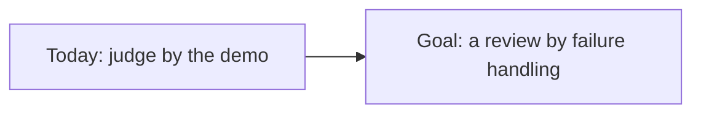
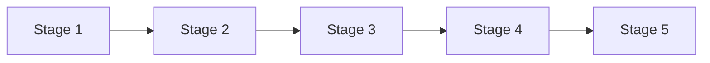
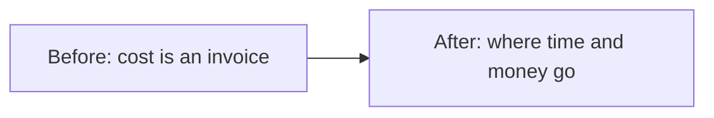
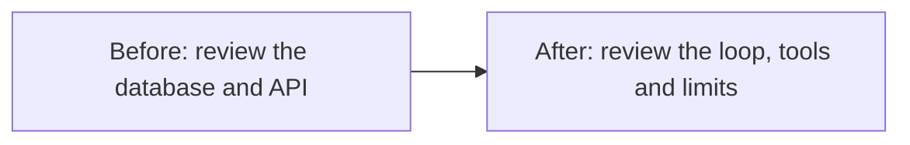
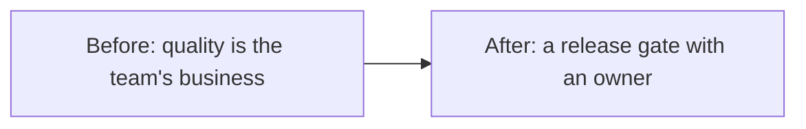
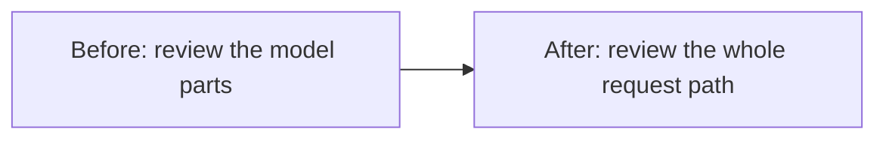
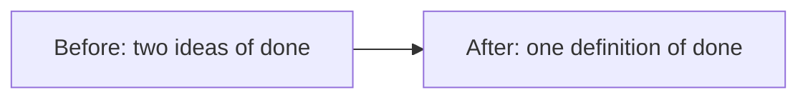
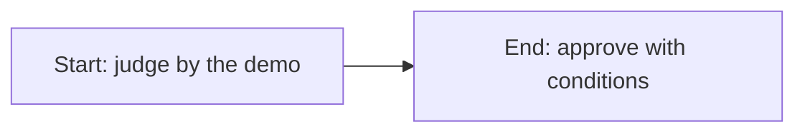
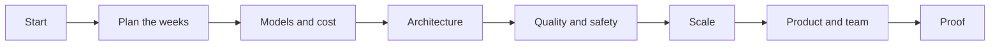

# An AI engineering lead's path, one stage at a time

*Part of [Visual explainers](./README.md)*

*Last reviewed: 2026-11 · Volatility: medium*

## In one minute

A learning path is a list of lessons in order. This page follows one learner through one path, to show what each stage changes in what they can do. The learner is an engineering lead at Pillar, a company that sells software to insurers. Their team brings a design document: **a claims assistant that answers from policy documents and uses an agent to update claim records.** The lead must approve it, push back or ask for changes.

The [AI Engineering Lead path](../learning-paths/ai-engineering-lead.md) has five stages. After each one, the lead can review one more part of the design, and a "Do this" check proves it. The last stage is the proof: a review decision with conditions the team can meet.

*Reading time: about 10 minutes. Pillar, the engineering lead, the claims assistant and every number about it are invented. The stage names, hours and lessons come from the AI Engineering Lead path itself.*

## 1 · Where the engineering lead starts

The engineering lead has run design reviews for years. They know how to question a database choice or a retry policy. This design is different. It has a model that can be wrong without an error, and an agent that changes claim records.

Today, the lead would judge the design by its demo, and the demo looks good. They cannot yet say where a request's time and money go, whether the agent needs to be an agent, or what release gate would satisfy an insurer's security review.

The path is the engineer path in short form, plus what a lead adds: cost, architecture review, quality standards and working with product. The lead reads for judgement, and skims the build lessons.

**Remember:** approve a design by how it fails, not by its demo.

## 2 · Plan the weeks

The path has five stages and takes about 44.5 hours in all. The hours are this course's rule of thumb: about 25 minutes for each reading lesson, and about 2 hours to skim each harness phase.

The lead has about 3 hours a week. At 3 hours a week, about 15 weeks. That is longer than the review can wait. So the lead reads the stages in order, but brings each stage's questions to the review as they go. The longest stage is stage 2, architecture you can review, at about 16.5 hours. Stage 4, systems at scale, is the shortest at about 2.5 hours.

**Remember:** when the path is longer than the deadline, use each stage's questions as you go.

## 3 · Stage 1: How models behave and what they cost

*Path stage 1 · about 14 hours · 34 lessons*

This stage reads how models work, how serving works and what drives cost, plus this page. It starts with two explainers: [Inside one LLM request](./inside-one-llm-request.md) and [One token through a transformer](./one-token-through-a-transformer.md).

Before this stage, cost was a line on the vendor's invoice. After it, the lead can split one request. The wait before the first word comes from the queue and from reading the prompt. The rest comes from writing the answer. Long prompts, long answers and big models cost more.

The lead also asks why the design fine-tunes a model for policy answers. Retrieval would keep answers current when policies change, at a lower cost.

**Do this:** explain where a request's time and money go, and name three levers that change them. Use [Latency, quality, cost, and reliability across the full inference stack](../content/06-strategy-tradeoffs/inference-stack-tradeoffs.md).

**Remember:** every request's time and money come from the prompt, the answer and the model size.

## 4 · Stage 2: Architecture you can review

*Path stage 2 · about 16.5 hours · 38 lessons*

This is the longest stage. It covers retrieval, context, memory, tools, agents and workflows, and skims four harness phases. It starts with the explainer [One agent run, step by step](./one-agent-run.md).

Before this stage, the lead could review the database and the API. After it, they can review the agent. They check the loop and its step limit, the tools and what each one can change, the permissions, the budgets and the failure handling. The design has no step limit, and the record-update tool can change any claim.

The lead also asks whether the agent needs to be an agent. Updating a claim record follows fixed steps. A workflow with one model step would be simpler to test and to stop.

**Do this:** review one agent design for its loop, tools, permissions, budgets and failure handling. Use [When not to build an agent](../ai-agents/when-not-to-build-an-agent.md).

**Remember:** the first review question for an agent is whether it needs to be one.

## 5 · Stage 3: Quality, safety and access

*Path stage 3 · about 6 hours · 15 lessons*

This stage reads evals, security, access control and multi-tenancy. It includes the explainer [Anatomy of a guardrailed request](./anatomy-of-a-guardrailed-request.md).

Before this stage, quality and safety were the team's business. After it, the lead sets the standard. The release gate needs an eval set with must-not-fail cases, such as "never update a closed claim", and a named owner. The threat model must cover a claim document that hides instructions for the agent.

Access is the question an insurer will ask first. Each insurer's data must be separated from every other insurer's, in search, in caches and in logs. The lead asks the team to show it.

**Do this:** name the release gate for one AI feature, its owner, and the evidence a buyer would ask for. Use [Building the eval stack in the right order](../evaluation-and-observability/building-the-eval-stack-in-the-right-order.md).

**Remember:** the lead sets the quality and safety bar, and names who owns it.

## 6 · Stage 4: Systems at scale

*Path stage 4 · about 2.5 hours · 6 lessons*

This is the shortest stage. It reads system design and reliability. An AI feature still runs on ordinary systems, and the same bar applies.

Before this stage, the lead reviewed the model parts with new eyes and the rest out of habit. After it, they review the whole request path. What happens when the claims system is slow? What happens when the model provider has an outage? Is there a fallback, and what does the adjuster see?

The design had no answer for a provider outage. The team adds one: answers from retrieval only, with a notice, until the provider recovers.

**Do this:** run a design review for scale, failure and cost on one service. Use [Reliability & failure](../technical-product-sense/reliability-and-failure.md).

**Remember:** an AI feature fails like any other system too. Plan for the outage.

## 7 · Stage 5: Work with product and run the team

*Path stage 5 · about 5.5 hours · 13 lessons*

The last stage turns standards into process. It reads technical product management, AI-assisted development and product sense for AI.

Before this stage, the lead and the product manager each had their own idea of "done". After it, they share one. Done means the release gate passes, the incident plan names who can switch the agent off, and a quality drop in production pages someone, just like an outage.

The lead also sets how the team works with coding agents. The team specifies each task, and an engineer verifies each result before it merges.

**Do this:** agree one definition of done, one quality bar and one incident process with your product manager. Use [Technical product management for AI](../technical-product-management/tpm-for-ai-products.md).

**Remember:** product and engineering need one quality bar and one incident process.

## 8 · Proof of skill

The proof is the review decision: approve, with conditions. The conditions come from the stages. Use retrieval, not fine-tuning, for policy answers. Make record updates a workflow with a step limit, and limit the tool to open claims. Add a release gate with must-not-fail cases and an owner. Separate each insurer's data. Add a fallback for a provider outage. Agree done with the product manager.

Then the lead checks the five checkpoints of the path. Can they explain where time and money go? Can they review an agent design? Can they name a release gate and its owner? Can they run a design review for scale and failure? Do they and their product manager share one definition of done?

**Do this:** run the practitioner checklist on the [AI Engineering Lead path page](../learning-paths/ai-engineering-lead.md) against your own review.

**Remember:** the proof of the path is a review whose conditions make the design safer.

## The whole journey

## Where it breaks

- **Approving by demo.** The design is judged on its best case, not its failures.
- **No owner for the eval set.** The gate exists, and nobody keeps it current.
- **Safety left to the security team.** The design that makes safety hold is never reviewed.
- **Skipping the economics.** The cost surprise arrives after launch.
- **Two ideas of done.** Product ships what engineering has not finished checking.

## Go deeper

- [AI Engineering Lead path](../learning-paths/ai-engineering-lead.md) — every lesson, checkpoint and skip-ahead rule.
- [Visual learning paths](../learning-paths/visual-paths.md) — the four paths as pictures.
- [An AI engineer's path, one stage at a time](./one-ai-engineer-path.md) — the same ground, read to build.
- [When not to build an agent](../ai-agents/when-not-to-build-an-agent.md) — the first review question.
- [Building the eval stack in the right order](../evaluation-and-observability/building-the-eval-stack-in-the-right-order.md) — the release gate.
- [One agent run, step by step](./one-agent-run.md) — what the agent in the design does at runtime.

## Test yourself

1. **The design fine-tunes a model to answer from policy documents. What does the lead ask?**
   

Answer
Why not retrieval. It keeps answers current when policies change, and usually costs less to change.

2. **The record-update tool can change any claim. What condition does the lead set?**
   

Answer
Limit it in code to the claims the agent may change, such as open claims only, and add a step limit.

3. **Why does the provider outage belong in an AI design review?**
   

Answer
The feature runs on ordinary systems too. Without a fallback, an outage at the provider becomes an outage for every adjuster.

## Sources

- Path data as of 2026-11-07: the stage names, hours, lesson counts and checkpoints come from the AI Engineering Lead path in this repository (`scripts/gen_learning_paths.py`), which generates the [path page](../learning-paths/ai-engineering-lead.md). The hours are this course's rule of thumb, about 25 minutes a reading lesson and about 2 hours to skim a harness phase, not measured. The weeks use the path's own pace of 3 hours a week. The lessons each stage relies on for its "Do this" check: [Latency, quality, cost, and reliability across the full inference stack](../content/06-strategy-tradeoffs/inference-stack-tradeoffs.md), [When not to build an agent](../ai-agents/when-not-to-build-an-agent.md), [Building the eval stack in the right order](../evaluation-and-observability/building-the-eval-stack-in-the-right-order.md), [Reliability & failure](../technical-product-sense/reliability-and-failure.md), [Technical product management for AI](../technical-product-management/tpm-for-ai-products.md).
- Pillar, the engineering lead, the claims assistant, its design and every condition on it are invented for the example.
- Independent fact-check: run on 2026-11-07 by a separate agent with web access, blind to the edits, over three passes, recorded in [PR #178](https://github.com/aakashagg123/gatsby/pull/178). Pass 1 found one wrong row (the AI Product Lead weeks) and four unsupported rows. Pass 2 found one unsupported row. Pass 3 was clean, with no wrong, stale or unsupported claims. The checker compared the page with the path data and the linked lessons. It counted the lessons in each stage by hand rather than running the generator; `scripts/check_path_explainers.py` checks the same numbers by machine. The hours remain this course's rule of thumb, not measured.
