# One AI feature, from idea to launch

*Part of [Visual explainers](./README.md)*

*Last reviewed: 2026-11 · Volatility: medium*

## In one minute

An AI feature is not done when the demo works. It is done when you know what it is worth, what it costs when it is wrong, and when you will pull it back. This page follows one feature from the first idea to the first month in production. The feature is **claim summaries for insurance adjusters** at Northwind Mutual.

At each stage you make one call that only the product manager can make: the size of the prize, the cost of an error, the quality bar, the cheapest way to reach it, the model, the design for being wrong, the launch gate and the readout.

*Reading time: about 10 minutes. Northwind Mutual is invented. Every number on this page is illustrative, and every price is an assumed example, not a vendor quote.*

## 1 · The size of the prize

Start with the job, not the model. Northwind's adjusters handle about 40,000 claims a month. Each adjuster reads the whole file first: notes, emails, photos and earlier claims. That takes about 12 minutes per claim.

The idea is a one-page summary at the top of every file. If reading drops to 5 minutes, the team saves 7 minutes on each of 40,000 claims. That is 280,000 minutes, or about 4,667 hours a month.

This number is the ceiling, not the forecast. It tells you how much you can spend to get there, and whether the idea is worth a team at all.

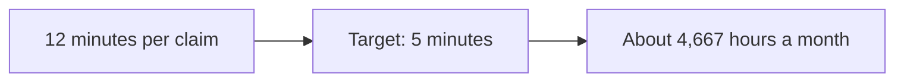

**Remember:** size the prize before you pick the tool, so you know what the feature may cost.

## 2 · Is AI the right tool?

Some of the file is already structured: policy number, dates, amounts. Ordinary code can show those fields with no model at all, and it will not invent them.

The rest is free text: adjuster notes, customer emails, repair quotes. A rule cannot summarize a rambling email. A language model can, but it is **probabilistic**: it will sometimes be wrong, and it will not tell you when.

So the design splits the work. Code shows the structured fields. The model writes only the summary of the free text.

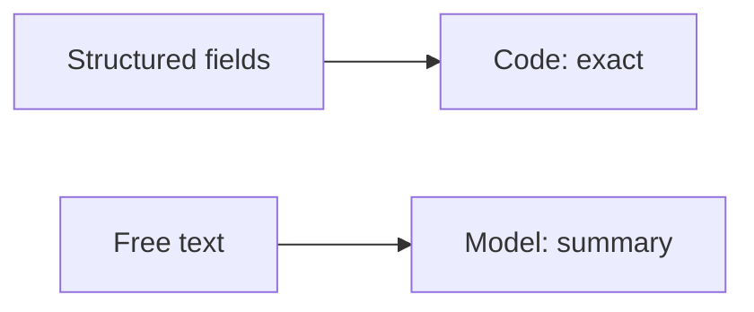

**Remember:** use a model only for the part that rules cannot do.

## 3 · The cost of being wrong

Not all errors are equal. A summary with awkward wording costs a few seconds. A summary that leaves out an earlier claim on the same car could lead to a wrong payout. That is a real loss, and a possible fraud gap.

Write the errors down and rank them by harm. The high-harm ones become **must-not-fail cases**: inputs where any failure blocks launch, whatever the average score says. Northwind picks 10 of them, such as "a prior claim exists" and "the customer disputes liability".

This table, more than any model benchmark, sets how careful the feature must be.

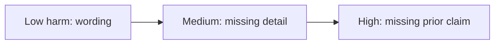

**Remember:** rank errors by harm. The worst ones become must-not-fail cases.

## 4 · A spec built on examples

A normal acceptance test says "given this input, expect this output". A model's output varies, so the spec uses **examples** instead: real inputs, with an accepted answer and a rejected one for each.

Northwind's one-page spec names the job, the inputs, the scope and what the summary must never do. It lists 3 worked examples, the 10 must-not-fail cases and a quality bar. The bar is **85% of held-back test cases pass, and none of the 10 must-not-fail cases fail**.

The same examples become the first evaluation set. If a case is in the spec, it is in the test.

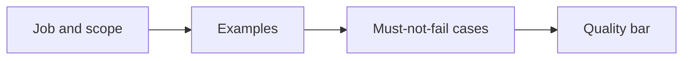

**Remember:** for a model feature, the examples are the spec.

## 5 · The cheapest lever first

There are three ways to make a model better at a task: change the prompt, give it the right documents (**retrieval**), or train it further (**fine-tuning**). Try them in that order, because each one costs more than the last.

Northwind scores each step on 150 development cases. A plain prompt passes 74%. Adding retrieval of the policy wording takes it to 86%. Adding three worked examples to the prompt takes it to 90%. On 60 held-back cases it scores 52, about 87%.

The bar is met without training a model. Fine-tuning stays on the shelf.

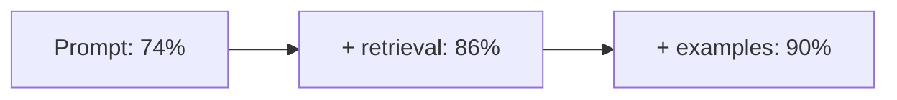

**Remember:** climb from prompt to retrieval to fine-tuning, and stop when the bar is met.

## 6 · Choosing the model

Quality is one of three numbers. The other two are speed and cost. Northwind runs the same 150 cases on three models. The large model passes 91%, but its slowest answers take 6.8 seconds and a claim costs about $0.11. The small model is fast and cheap, but it fails 3 of the 10 must-not-fail cases, so it is out.

The mid-size model passes 90%, answers within 3.1 seconds and costs about $0.04 a claim. That is a file of about 15,000 input tokens and 600 output tokens at assumed prices of $2 and $10 per million.

The mid-size model wins, and the decision record says what would change it.

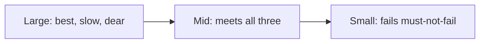

**Remember:** choose on quality, speed and cost together, using your own cases.

## 7 · Design for being wrong

Even at 90%, about 1 summary in 10 has a problem. The design must make problems easy to spot and cheap to fix. Microsoft researchers list guidelines for this, such as "make clear how well the system can do what it can do" and "support efficient correction".

Northwind's design has four parts. Each sentence in the summary links to its source in the file. A field the model could not find shows "not found", never a guess. The full file stays one click away. The adjuster confirms the summary before any decision.

These choices cost little. They turn a hidden error into a visible one.

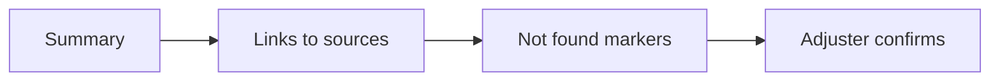

**Remember:** design the screen for the 1 time in 10 the model is wrong.

## 8 · The launch gate

A **launch gate** is a short list of numbers, agreed in advance, that decide when to ship, when to widen and when to roll back. Agreeing it before launch stops a debate in the middle of an incident.

- **Ship** to 20 adjusters if the held-back score is at least 85% and no must-not-fail case fails.
- **Widen** after two weeks if adjusters correct fewer than 15% of summaries and reading time falls by at least 3 minutes.
- **Roll back** if a missed detail changes a claim decision, the score drops below 80%, the slowest answers pass 5 seconds or a claim costs more than $0.08.

The claims director owns the **kill switch** and can pull it alone.

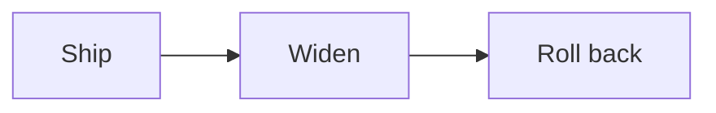

**Remember:** write the roll-back rule before launch, with numbers and an owner.

## 9 · A staged rollout

The feature reaches people in steps. In weeks 1 and 2 it goes to 20 adjusters. In weeks 3 and 4 it goes to 10% of claims, then to 50% in weeks 5 and 6, and to everyone from week 7.

At each step the team checks the gate's numbers before moving on. The early group also gives the best feedback, because they see every rough edge. At 10%, Northwind found that photo-heavy files produced thin summaries, and added a line that says "photos not summarized".

A staged rollout trades speed for safety. You learn on a few claims before you bet all of them.

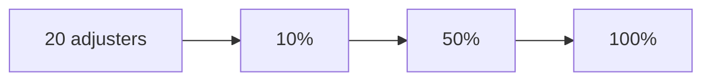

**Remember:** widen only when the numbers from the last step hold.

## 10 · The first-month readout

In the first full month at 100%, reading time fell from 12 minutes to 6.5, not to the 5 that the team had hoped for. That saves 5.5 minutes on 40,000 claims: 220,000 minutes, or about 3,667 hours.

At an assumed loaded cost of $45 an hour, that time is worth about $165,000 a month. The model costs about $1,600 a month (40,000 claims × $0.04). Adjusters corrected 11% of summaries. No missed detail changed a decision.

The value is real only if the saved time goes to other work, such as faster payouts or fewer new hires. Say which one in the readout.

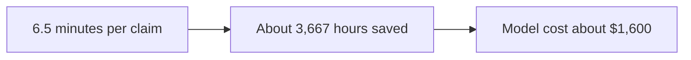

**Remember:** report value in the units the business uses, and say where the saved time goes.

## The whole journey

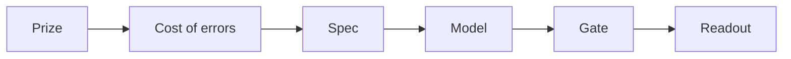

## Where it breaks

- **No prize sized.** The team cannot say what the feature may cost.
- **Average score only.** A 90% score hides a must-not-fail case that fails.
- **Fine-tuning first.** The team trains a model before trying the prompt and retrieval.
- **Gate without numbers.** Nobody can agree, during an incident, that it is time to roll back.
- **Value assumed, not measured.** The readout repeats the target instead of the result.

## Go deeper

- [Capstone: ship one AI-native feature](../building-ai-native-products/capstone-ship-one-ai-native-feature.md) — the launch gate template.
- [Practice: the AI feature spec](../building-ai-native-products/ux-practice-the-ai-feature-spec.md) — the one-page spec with examples.
- [Practice: probing and choosing models](../building-ai-native-products/model-intuition-practice.md) — the bake-off in stage 6.
- [Practice: hill climbing](../building-ai-native-products/hill-climbing-in-practice.md) — the climb in stage 5, with development and held-back sets.
- [Designing for ambiguity](../building-ai-native-products/designing-for-ambiguity.md) — the screen in stage 7.
- [Build, buy, or fine-tune](../generative-ai/build-buy-or-fine-tune.md) — when the cheap levers are not enough.
- [Launches, rollouts & migrations](../technical-product-management/launches-rollouts-and-migrations.md) — staged rollout in general.
- [Product sense for AI products](../product-sense/product-sense-for-ai.md) — judging whether AI fits the job.

## Test yourself

1. **The average score is 92%, but one must-not-fail case fails. Do you ship?**
   

Answer
No. A must-not-fail case blocks launch whatever the average says. That is the point of naming them.

2. **Why try retrieval before fine-tuning?**
   

Answer
It is cheaper and faster to change, and it often closes the gap. Northwind reached its bar without training a model.

3. **Reading time fell by 5.5 minutes a claim. When is that not worth $165,000 a month?**
   

Answer
When the saved time is not used for other work. The readout must say where the time goes.

## Sources

- Saleema Amershi et al., *Guidelines for Human-AI Interaction*, Conference on Human Factors in Computing Systems (CHI), 2019, read 2026-11: 18 guidelines, including G2 "Make clear how well the system can do what it can do" and G9 "Support efficient correction".
- Anthropic, "Define your success criteria", platform.claude.com/docs/en/test-and-evaluate/define-success, read 2026-11: success criteria should be specific, measurable, achievable and relevant, and most uses need several criteria, including latency and price.
- Northwind Mutual, its claims, scores, prices, hours and costs are invented for the example.
- Independent fact-check: run on 2026-11-04 by a separate agent with web access, blind to the edits. Result: clean, with no wrong, stale or unsupported claims. The checker confirmed the wording of the human-AI guidelines on Microsoft's own guidelines page, not in the paper PDF. It read the success-criteria page in part: the first 100,000 of about 153,000 characters. Vendor documentation pages carry no on-page date, so the vendor terms above hold as of the read date.
