# From one AI task to gross margin

*Part of [Visual explainers](./README.md)*

## In one minute

An ordinary software feature costs almost nothing extra each time someone uses it. An AI feature does. Every use costs tokens, so the heaviest users cost the most. If the price is a flat fee per seat, those users can wipe out the margin.

This page follows one feature at **Quill**, a documents app, from the tokens in a single task to the gross margin on a seat and the pricing choice that follows. The feature is **"Draft with AI"**, added to a plan that costs $24 per seat per month.

*Reading time: about 10 minutes. Quill is invented. All prices, usage figures and costs are illustrative, not vendor quotes.*

## 1 · The plan before AI

Quill's team plan costs $24 per seat per month. Before the new feature, the cost of serving a seat is about $3.60 a month: hosting, storage and support. That leaves a **gross margin** of 85%.

A margin like that is normal for software. It is also why many teams add an AI feature to the same plan without changing the price. The extra cost looks small.

The rest of this page tests that belief, one step at a time.

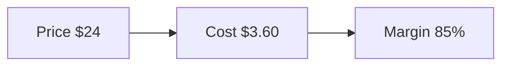

**Remember:** know the margin before the feature, so you can see what it changes.

## 2 · One task, in tokens

A "Draft with AI" task sends the model about 2,500 tokens. That covers Quill's instructions, the user's request and the part of the document the user selected. The model writes back about 600 tokens: a draft of a page or so.

These two numbers come from the product's logs, not from a guess. They vary by user and by task, so the team looks at the typical task and at the long tail too.

Everything that follows is built on these two numbers.

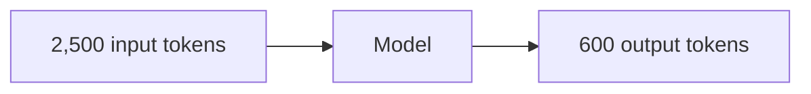

**Remember:** measure tokens per task from logs. It is the base of every cost number.

## 3 · The cost of one task

At assumed prices of $2 per million input tokens and $10 per million output tokens, the task costs:

- input: 2,500 × $2 ÷ 1,000,000 = $0.005
- output: 600 × $10 ÷ 1,000,000 = $0.006

That is $0.011, or 1.1 cents a task. Output is the larger part, even though there are fewer output tokens, because each one costs five times more. That ratio is not only an assumption: Anthropic's current models also charge 5 times as much for output as for input.

One cent sounds like nothing. The question is how many tasks a seat runs in a month.

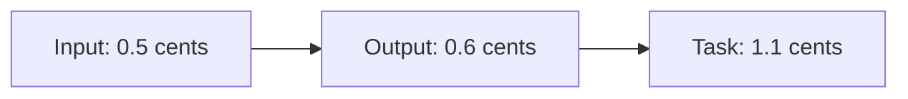

**Remember:** output tokens cost more than input tokens. Long answers are expensive.

## 4 · Usage is not average

Seats do not use the feature equally. In Quill's first month, a light seat ran about 10 tasks, which cost $0.11. A typical seat ran about 60, which cost $0.66. The heaviest 5% of seats ran about 1,500 tasks each, which cost $16.50.

The heaviest seats cost 150 times as much as the light ones, and they pay the same $24.

An average hides this. The average cost per seat may look fine while a small group of seats loses money every month.

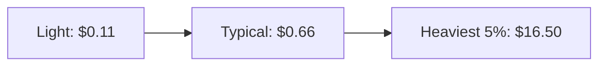

**Remember:** look at the heaviest users, not the average user.

## 5 · Margin by seat

Now put the AI cost on top of the $3.60 base cost.

- A typical seat: $24 − $3.60 − $0.66 = $19.74, a margin of about 82%.
- A heavy seat: $24 − $3.60 − $16.50 = $3.90, a margin of about 16%.

The typical seat barely notices the feature. The heavy seat earns almost nothing. And heavy users are often the most engaged customers, the ones you least want to lose or annoy.

This is the core problem. The price is per seat, but the cost is per task.

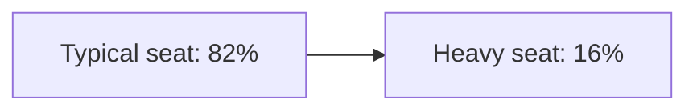

**Remember:** a per-seat price with a per-task cost turns your best users into your least profitable.

## 6 · Pull the cost levers

Before changing the price, cut the cost. Quill tries two levers.

First, **prompt caching**. About 1,500 of the 2,500 input tokens are the same in every task: Quill's instructions. Cached, they cost a tenth of the price. The task falls to about 0.83 cents.

Second, **shorter answers**. Most users trim the drafts anyway. Asking for about 400 output tokens instead of 600 cuts the output cost by a third. The task falls to about 0.63 cents.

A heavy seat now costs 1,500 × 0.63 cents, about $9.45. Its margin rises to about 46%. That is better, but it is still far below 85%.

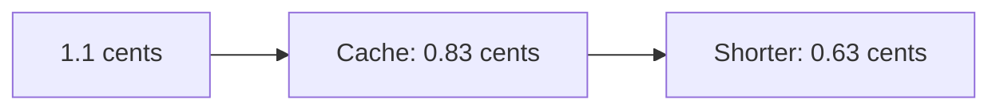

**Remember:** cut the cost first, then decide whether the price must change.

## 7 · Three ways to price it

Quill compares three pricing options. Each one is judged by the margin on a heavy seat, at 0.63 cents a task.

| Option | How it works | Heavy-seat margin |
| --- | --- | --- |
| **Fair-use cap** | 300 tasks, then a smaller model at about 0.1 cents a task | about 72% |
| **Credits** | 300 tasks included, then packs of 1,000 for $15 | about 76% |
| **AI tier** | A $36 plan that includes 2,000 tasks | about 64% |

There is no right answer in the numbers alone. A cap keeps the bill simple but can feel stingy. Credits match price to cost but make the bill harder to predict. A tier is easy to sell but asks every heavy user to upgrade.

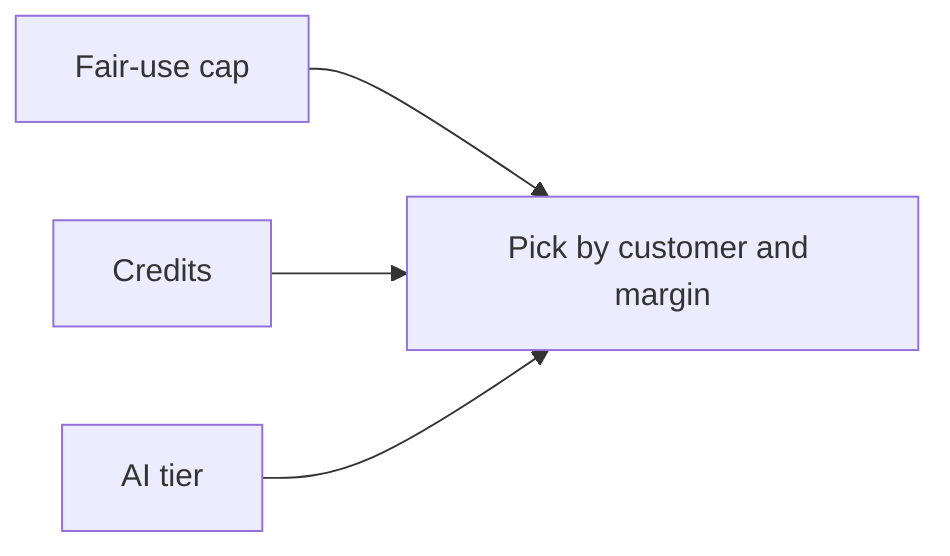

**Remember:** when cost per customer varies a lot, the price needs a usage part.

## 8 · Budgets that act

A budget that only sends a report is a wish. Quill puts the limits in code. Each seat gets its monthly allowance. Past it, the product switches to the smaller model and tells the user.

The company also sets a monthly spend budget for the feature. An alert fires at 80% of the budget, so the team can act before it is spent. A sudden jump in tasks from one account, such as a script calling the feature in a loop, triggers its own alert.

Limits protect the margin and catch abuse at the same time.

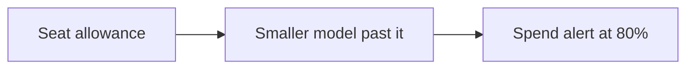

**Remember:** put cost limits in code, and alert before the budget is spent.

## 9 · Forecast two curves

Next year's cost can move in two directions at once. Usage grows as people adopt the feature. The cost of a task may fall, for example if the team moves to a cheaper model. A single "cost per user" line mixes the two and hides both.

Quill models them apart. It assumes tasks per seat grow 15% a quarter and cost per task falls 10% a quarter. Both are assumptions, not promises. The cost of a typical seat goes from about 37.8 cents to 39.1, 40.5 and 41.9 cents over four quarters. Each quarter it is 1.15 × 0.9 = 1.035 times the last.

If either assumption shifts, the forecast shows which one, and when.

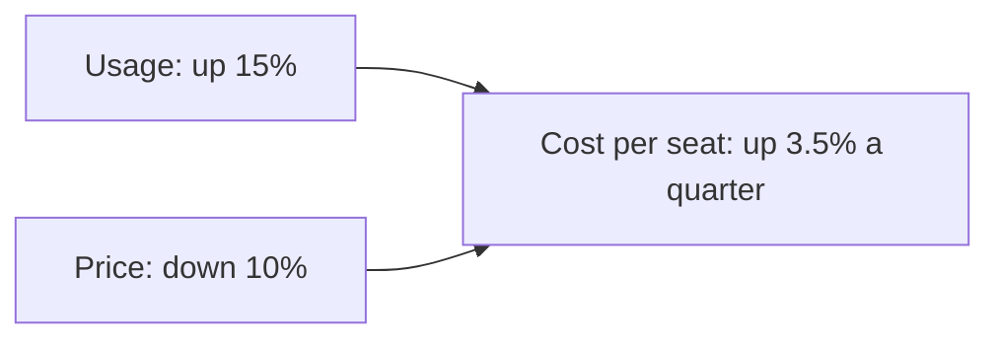

**Remember:** forecast usage and price as two separate curves.

## 10 · Cost per useful result

Cost per task is not the number the business cares about. What matters is the cost of a result someone used. Users keep about 70% of Quill's drafts. So the cost per kept draft is 0.63 ÷ 0.70, about 0.9 cents.

This number can reverse a decision. A cheaper model at 0.30 cents a task looks like a saving. But if users keep only 30% of its drafts, each kept draft costs 1.0 cent. That is more than the current model.

The FinOps Foundation lists "cost per successful outcome" as a key measure for AI spend for the same reason.

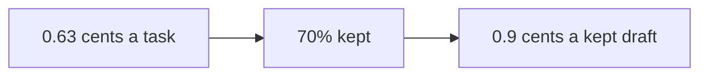

**Remember:** judge cost per useful result, not cost per task.

## The whole journey

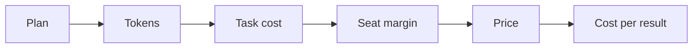

## Where it breaks

- **Average-user math.** The average seat looks fine while heavy seats lose money.
- **Flat seat price.** Cost grows per task, and revenue does not.
- **Budgets on paper.** Nothing stops spend when a limit is reached.
- **One-line forecast.** Usage growth and price cuts hide each other.
- **Cheapest per task.** A cheaper model costs more per useful result.

## Go deeper

- [FinOps for AI: budgets, forecasting & the cost review](../cost-optimization/finops-budgets-forecasting-and-the-cost-review.md) — budgets, two-curve forecasts and cost per outcome.
- [The cost stack, and the build-vs-buy breakeven](../cost-optimization/the-cost-stack-and-the-build-vs-buy-breakeven.md) — reading a price sheet.
- [Pricing and business models](../business-acumen/monetization-and-business-models.md) — choosing the value metric for an AI feature.
- [Unit economics](../business-acumen/unit-economics.md) — margin from one transaction to a cohort.
- [The economics of infrastructure](../technical-product-sense/economics-of-infrastructure.md) — fixed and variable cost.
- [Cost attribution](../content/04-evals-observability/cost-attribution.md) — tying spend to features and users.

## Test yourself

1. **Why does a heavy user hurt the margin of an AI feature more than of an ordinary feature?**
   

Answer
Every AI task costs tokens, so cost grows with use. A flat seat price does not grow with it.

2. **Which should you try first: cutting cost or changing the price?**
   

Answer
Cutting cost, with caching and shorter answers. Then price for the cost that remains.

3. **A cheaper model halves the cost per task. When is it still the wrong choice?**
   

Answer
When users keep so few of its results that the cost per useful result goes up.

## Sources

- FinOps Foundation, "FinOps for AI" overview, finops.org/wg/finops-for-ai-overview, updated 2026-10-28, read 2026-11: track cost per inference, per user and per successful outcome; its KPIs include cost per successful outcome and cache hit rate.
- Anthropic, "Pricing" and "Prompt caching", platform.claude.com, read 2026-11-04: on Anthropic's current models, the output price per token is 5 times the input price; a cache read costs 0.1 times the base input price on most models (0.05 times on Claude Opus 5.5 and Sonnet 5.5). Quill's prices are illustrative and use the 0.1 multiplier.
- The rule that a price needs a usage part when cost varies a lot between customers comes from this site's [pricing lesson](../business-acumen/monetization-and-business-models.md), where it is labelled as judgement.
- Quill, its plan, prices, usage, margins and growth rates are invented for the example. This page's fact-check is pending.
