# One AI incident, from alert to postmortem

*Part of [Visual explainers](./README.md)*

## In one minute

AI features fail in a way that ordinary features rarely do. The service stays up and no error is thrown, but the answers are wrong. Users notice before the dashboards do. When it happens, the product manager's job is not to fix the code. It is to size the harm, choose what users see, tell people the truth and decide how to make it right.

This page follows one incident at **Harbor Credit Union**. Its assistant starts telling members that the overdraft fee is $0. The real fee is $29. The page runs from the first screenshot to the actions that enter the roadmap.

*Reading time: about 10 minutes. Harbor Credit Union, its fee, its timeline and its numbers are invented. The incident roles and the postmortem practice follow Google's site reliability engineering book.*

## 1 · Detection

At 21:40 on a Tuesday, a member posts a screenshot. The assistant says: "There is no overdraft fee on your account." The member was charged $29 the week before.

At the same time, support sees more tickets than usual about fees. No alert has fired. The assistant is up, fast and answering every question. By every system measure it is healthy.

This is the typical shape of an AI incident. The first signal comes from people, not from monitoring.

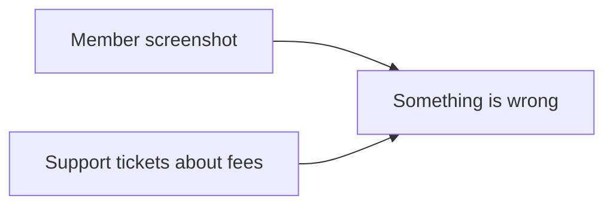

**Remember:** an AI feature can be up and wrong at the same time.

## 2 · Declare it and set the severity

The on-call engineer and the product manager agree to declare an incident at 21:52. Google's site reliability engineering book advises declaring early: it is better to declare, find a simple fix and close it than to let a problem grow for hours.

Next comes the **severity level** (SEV). Harbor's ladder puts wrong information about money that many members can see at SEV2. That means a response team now, and updates to leadership every hour.

The ladder was agreed months ago. Nobody argues about it tonight.

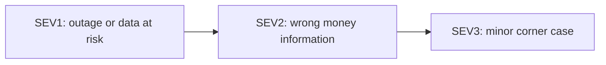

**Remember:** agree the severity ladder before the incident, so nobody debates it during one.

## 3 · Roles

Google's model splits the work into roles. The **incident commander** keeps the big picture and assigns work. The operations lead changes the system, and only that group does. The communications lead keeps users and leaders informed. The planning lead tracks follow-up work and hand-offs.

At Harbor, the on-call engineer leads operations. The product manager takes communications. The engineering manager is the incident commander.

The commander's most important job, in Google's words, is to keep a living incident document. Every action and every time goes into it.

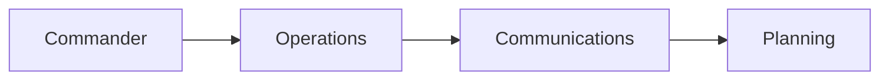

**Remember:** one commander, clear roles and one live document.

## 4 · Stop the harm first

The team does not know the cause yet. That can wait. The first job is to stop more members getting the wrong answer.

There are two prepared options. The **kill switch** turns the assistant off and sends every chat to human agents, which adds about 40 minutes of wait at this hour. The **degraded mode** keeps the assistant on, but sends every question about fees to the fixed fee page, written by people.

The product manager chooses degraded mode at 21:58. It stops the harm and keeps the assistant useful for everything else. Both options were designed before launch, so the choice took minutes.

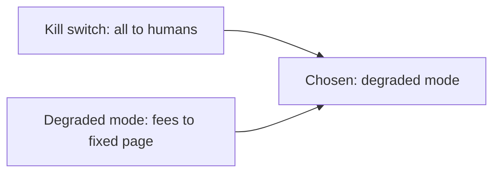

**Remember:** mitigate before you diagnose, using a fallback you chose in advance.

## 5 · Tell people the truth

Communication starts at once and runs on a clock. At 22:10 support gets a short script: the assistant gave wrong fee information, the correct fee is on the fee page, and any member who was misled will hear from Harbor. At 22:30 leaders get the first update, and then one every hour.

The message is plain. It says what is known, what is not known and when the next update comes. It does not guess the cause, and it does not promise a refund before that decision is made.

Trust is often lost less by the error than by silence or spin.

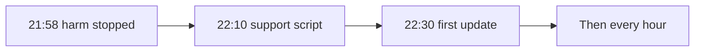

**Remember:** say what you know, what you do not know and when you will speak next.

## 6 · Size the blast radius

The next morning the team uses the logs to find who was affected. The **blast radius** is the set of people and decisions the error reached.

The fee page changed 6 days ago. Since then the assistant had 52,000 conversations. Of these, 3,100 asked about fees, and 1,240 got the "$0" answer.

This is why AI features need full logs of each conversation. Without them, the team could only guess, and the make-good decision would be a guess too.

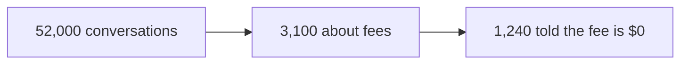

**Remember:** logs turn "some members were affected" into a number you can act on.

## 7 · The causes, in the plural

The trace finds a chain. Six days ago, the fee schedule was updated. The new version put the fee table in an image. The ingestion step that feeds the assistant's search could not read the image, so the real fee vanished from the index. Search then returned the closest match it had: a page about a student account with no overdraft fee.

That is the trigger. The conditions that let it through matter more. No one tested the assistant when documents changed. Fee answers did not cite their source. No alert watched answers about money.

A **blameless postmortem** looks for these conditions, not for a person to blame.

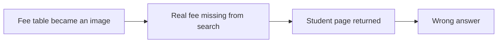

**Remember:** the trigger is one cause. Look for the conditions that let it through.

## 8 · Make it right

Now a product decision with a cost. Of the 1,240 members told "$0", 310 were charged the $29 fee in the following days. Refunding them all costs 310 × $29 = $8,990.

The options are to refund only members who complain, to refund all 310, or to refund all 310 and write to all 1,240. The product manager recommends the last option. It costs the same $8,990, plus a letter. A member who relied on the assistant should not have to notice the error to be made whole.

This decision is not a legal opinion. Legal and compliance review it before the letters go out.

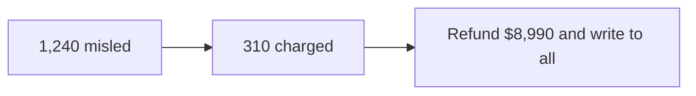

**Remember:** decide the make-good from the blast radius, not from who complains.

## 9 · The postmortem

Within a week the team writes the postmortem. It has five parts: the impact, the timeline, the causes, what went well and the actions.

Google's book defines a blameless postmortem as one that finds the contributing causes "without indicting any individual or team". It assumes people acted reasonably on what they knew. The book also suggests deciding the triggers for a postmortem in advance. One of them is an incident found by people rather than by monitoring, as this one was.

What went well matters too. Degraded mode existed, and it worked in 6 minutes.

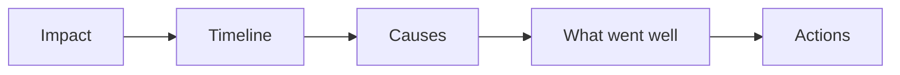

**Remember:** a postmortem that blames a person stops hearing the truth.

## 10 · Actions into the roadmap

A postmortem is only useful if its actions ship. Each action gets an owner and a date, and is tracked like a feature.

| Action | Owner | Due |
| --- | --- | --- |
| Run the assistant's tests on every document change | AI engineering lead | 2 weeks |
| Fee answers must cite the source page | Product manager | 3 weeks |
| Alert on a change in answers about money | Data lead | 4 weeks |
| Flag documents whose tables cannot be read | Content operations | 2 weeks |

The product manager reviews the list monthly. A repeat incident with an open action is treated as a process failure.

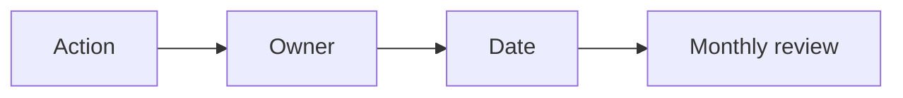

**Remember:** an action without an owner and a date will not ship.

## The whole journey

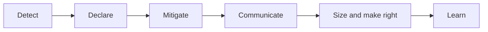

## Where it breaks

- **Monitoring for uptime only.** The assistant is up and wrong, and nothing alerts.
- **Diagnosis first.** The team hunts the cause while members keep getting wrong answers.
- **No prepared fallback.** The kill switch is the only option, so the choice is all or nothing.
- **No logs.** The blast radius is a guess, so the make-good is a guess.
- **Blame.** The postmortem names a person, and the conditions stay.
- **Actions that never ship.** The same incident returns next quarter.

## Go deeper

- [Incidents & postmortems](../technical-product-management/incidents-and-postmortems.md) — the lifecycle and the AI extension.
- [Launches, rollouts & migrations](../technical-product-management/launches-rollouts-and-migrations.md) — rollback-ready releases.
- [Reliability & failure](../technical-product-sense/reliability-and-failure.md) — how systems fail.
- [Reliability and operations](../system-design/reliability-and-operations.md) — the operations side in depth.
- [Observability](../content/04-evals-observability/observability.md) — logs, traces and quality alerts.
- [Governance, audit & compliance](../ai-security-and-guardrails/governance-audit-and-compliance.md) — records that regulators and auditors expect.
- [One eval regression, traced to its cause](./one-eval-regression-traced.md) — catching a quality drop before it ships.

## Test yourself

1. **The cause is unknown and members are still getting wrong answers. What comes first?**
   

Answer
Stop the harm with a prepared fallback, such as degraded mode. Diagnosis comes after.

2. **Why did no alert fire?**
   

Answer
The alerts watched uptime and errors. The assistant was up and fast, and only its answers were wrong.

3. **Why refund all 310 members rather than only those who complain?**
   

Answer
The logs show exactly who was misled and charged. Fairness should not depend on a member noticing the error.

## Sources

- Google, *Site Reliability Engineering*, chapter "Managing Incidents", sre.google/sre-book/managing-incidents, read 2026-11: the roles of incident command, operational work, communication and planning; "it is better to declare an incident early"; the commander's most important job is to keep a living incident document.
- Google, *Site Reliability Engineering*, chapter "Postmortem Culture", sre.google/sre-book/postmortem-culture, read 2026-11: a blameless postmortem focuses on contributing causes "without indicting any individual or team"; teams should define postmortem triggers in advance, including when monitoring fails and an incident is found manually.
- Harbor Credit Union, its fee, timeline, conversation counts, refunds and owners are invented for the example. This page's fact-check is pending.
