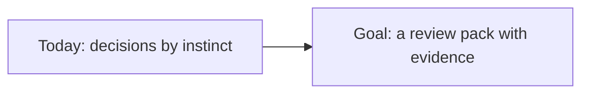
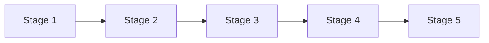
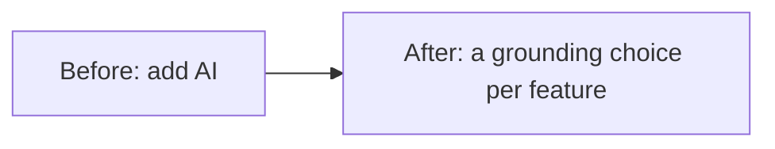
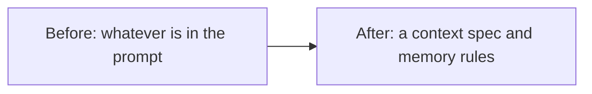
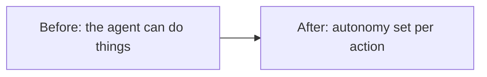
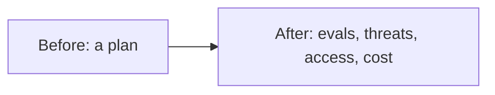
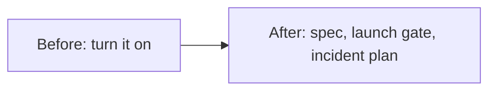
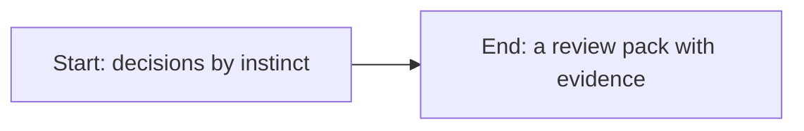
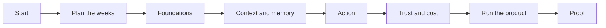

# An AI product lead's path, one stage at a time

*Part of [Visual explainers](./README.md)*

*Last reviewed: 2026-11 · Volatility: medium*

## In one minute

A learning path is a list of lessons in order. This page follows one learner through one path, to show what each stage changes in what they can do. The learner is the new AI product lead at Brightlane, a company that sells HR software. They own three AI features: answers to policy questions, summaries of interview notes, and a planned agent that helps new hires through onboarding. In a quarter's time, they must defend the plan for all three at an architecture review.

The [AI Product Lead path](../learning-paths/ai-product-lead.md) has five stages. After each one, the lead can make one more call for Brightlane, and a "Do this" check proves it. The last stage is the proof: the review pack.

*Reading time: about 10 minutes. Brightlane, the AI product lead, the three features and every number about them are invented. The stage names, hours and lessons come from the AI Product Lead path itself.*

## 1 · Where the AI product lead starts

The AI product lead knows product well and has shipped one AI feature before. What is new is the scope. Three features share one platform. Each one needs a different answer on grounding, memory and autonomy, and the wrong answer is expensive to reverse.

Today, the lead decides by instinct. Policy answers "probably need retrieval". The onboarding agent "should be able to do things". Nobody has said what the agent may remember about a new hire, or what it may do without asking.

The review will ask for evidence: how each feature gets its facts, what it remembers, what it can do, how its quality is measured and what it costs. The path is built to produce that evidence.

**Remember:** at this level, your calls set the architecture. Make them on purpose.

## 2 · Plan the weeks

The path has five stages and takes about 32 hours in all. The hours are this course's rule of thumb: about 25 minutes for each lesson.

The lead has about 4 hours a week. At 4 hours a week, about 8 weeks. That fits inside the quarter, with a few weeks to spare before the review. The longest stage is stage 1, model and data foundations, at about 10 hours.

Some lessons on this path repeat the Senior PM path, and the path page marks them with ↺. A lead who did the Senior PM path can skip those and finish in about 18.5 hours. This lead did not, so they read everything, in order.

**Remember:** plan the weeks against your deadline, and skip only what you have already read.

## 3 · Stage 1: Model and data foundations

*Path stage 1 · about 10 hours · 24 lessons*

This stage reads large language models, generative AI, machine learning, retrieval and knowledge graphs, plus this page. It is about one decision: how each feature grounds its answers.

Before this stage, the lead treated "add AI" as one choice. After it, they see three separate ones. Policy answers need retrieval over Brightlane's policy documents, because policies change and every answer must cite one. Interview-note summaries need only a good prompt, because the notes arrive with the request. The onboarding agent needs retrieval over the onboarding checklist and a few tools.

Fine-tuning is off the table for now. None of the features needs a new style or format that a prompt cannot give.

**Do this:** for each feature, choose prompting, retrieval or fine-tuning, and write one reason. Use [Prompting vs. RAG vs. fine-tuning](../llms/prompting-vs-rag-vs-finetuning.md).

**Remember:** grounding is decided per feature, with a reason you can write down.

## 4 · Stage 2: Context and memory

*Path stage 2 · about 5 hours · 12 lessons*

This stage covers what the model sees on each request, and what the product remembers between requests. Both are product decisions.

Before this stage, "context" meant whatever the engineers put in the prompt. After it, the lead writes a context spec for policy answers. It lists the sources, the owner of each one, how fresh it must be and how quality is measured. HR owns the policy library. A policy must reach the index within a day of a change.

Memory is a harder call. The onboarding agent may remember a new hire's progress through the checklist. It must not remember anything from their interview notes. The lead writes both rules down, with a retention period.

**Do this:** write the context spec for one feature: sources, owners, freshness and quality measure. Use [Context as a spec-able requirement](../context-engineering/context-as-a-spec-able-requirement.md).

**Remember:** what the model sees, and what the product remembers, both need an owner.

## 5 · Stage 3: Action: tools, agents, workflows

*Path stage 3 · about 5.5 hours · 13 lessons*

This stage is about the line between talking and doing. It covers tool calling, agents and workflows.

Before this stage, the onboarding agent "could do things". After it, the lead lists each action and sets its autonomy. Reading the checklist: the agent acts alone. Booking a welcome meeting: the agent drafts it and the new hire confirms. Requesting a laptop: a person in IT approves.

The lead also asks whether this needs an agent at all. Most onboarding steps happen in a fixed order. So the design becomes a workflow with one model step for questions, which is simpler to test and to stop.

**Do this:** set the autonomy level for each action of one agent, and say what would make you lower it. Use [What an agent is, and how much autonomy it needs](../ai-agents/what-an-agent-is-and-how-much-autonomy-it-needs.md).

**Remember:** set autonomy per action, and know what would make you lower it.

## 6 · Stage 4: Trust, access and cost

*Path stage 4 · about 5.5 hours · 13 lessons*

This stage reads three explainers, [One model change](./one-model-change.md), [From one AI task to gross margin](./one-ai-feature-p-and-l.md) and [One eval regression](./one-eval-regression-traced.md), and lessons on evals, security, access control and cost.

Before this stage, the lead had a plan. After it, they have evidence. Each feature has an eval set with must-not-fail cases. Policy answers have a threat model that covers a question built to leak another employee's data. Each feature has a cost per task, with its assumptions shown.

Access is the new idea. The onboarding agent acts with the new hire's own permissions, never with a service account that can see everyone. That rule comes from [Access control for AI agents](../access-control/access-control-for-ai-agents.md).

**Do this:** put together eval results, a threat model and a cost per task for one feature. Use [Building the eval stack in the right order](../evaluation-and-observability/building-the-eval-stack-in-the-right-order.md).

**Remember:** a reviewer trusts evidence: evals, a threat model and a cost per task.

## 7 · Stage 5: Run the product

*Path stage 5 · about 6 hours · 15 lessons*

The last stage turns the decisions into documents a team can run. It reads three explainers, including [One AI feature, from idea to launch](./one-ai-feature-from-idea-to-launch.md) and [One AI incident, from alert to postmortem](./one-ai-incident-review.md), and lessons on specs, launches, incidents and the AI feature spec.

Before this stage, launch meant "turn it on". After it, the onboarding workflow has a spec with examples, a launch gate with numbers for ship, widen and roll back, and an incident plan. The plan names who can switch the agent off, and what new hires see if it is off.

The lead also plans the first month: who reads the edit and approval rates, and when the eval set gets refreshed.

**Do this:** write the spec, the launch gate and the incident plan for one AI feature. Use [Capstone: ship one AI-native feature](../building-ai-native-products/capstone-ship-one-ai-native-feature.md).

**Remember:** a feature is ready to launch when its roll-back rule is written.

## 8 · Proof of skill

The proof is the review pack for the architecture review. For each feature it shows the grounding choice and its reason, the context spec and memory rules, the autonomy level of each action, the evals, threat model, access rule and cost per task, and the launch gate and incident plan.

Then the lead checks the five checkpoints of the path. Can they compare prompting, retrieval and fine-tuning and pick one with reasons? Can they write a context spec? Can they set an autonomy level and say what would lower it? Can they show evals, a threat model and a cost per task? Can they write the spec, the launch gate and the incident plan?

If any answer is no, they reread that stage before the review.

**Do this:** run the practitioner checklist on the [AI Product Lead path page](../learning-paths/ai-product-lead.md) against your own review pack.

**Remember:** the proof of the path is a review you can pass with evidence, not with confidence.

## The whole journey

## Where it breaks

- **One answer for every feature.** Three features get the same grounding, memory and autonomy, and two of them are wrong.
- **Memory without rules.** The agent keeps data nobody decided to keep.
- **Agent by default.** A fixed workflow would have been simpler to test and to stop.
- **Evidence after launch.** Evals and a threat model arrive when a customer finds the gap.
- **Agents with broad access.** The agent acts with a service account that can see everyone's data.

## Go deeper

- [AI Product Lead path](../learning-paths/ai-product-lead.md) — every lesson, checkpoint and skip-ahead rule.
- [Visual learning paths](../learning-paths/visual-paths.md) — the four paths as pictures.
- [A senior PM's path, one stage at a time](./one-senior-pm-path.md) — the path that comes before this one.
- [One user story becomes an agent spec](./one-user-story-to-agent-spec.md) — autonomy per action, in depth.
- [Context as a spec-able requirement](../context-engineering/context-as-a-spec-able-requirement.md) — the context spec.
- [Access control for AI agents](../access-control/access-control-for-ai-agents.md) — whose permissions an agent uses.
- [Capstone: ship one AI-native feature](../building-ai-native-products/capstone-ship-one-ai-native-feature.md) — the launch gate.

## Test yourself

1. **Why do the three Brightlane features get different grounding choices?**
   

Answer
Each gets its facts from a different place. Policies change and need retrieval. Interview notes arrive with the request, so a prompt is enough.

2. **The onboarding agent can book meetings and request laptops. Which should a person approve, and why?**
   

Answer
The laptop request, because it commits money and another team's time. Booking a meeting is easy to undo, so the new hire's confirmation is enough.

3. **Whose permissions should the onboarding agent act with?**
   

Answer
The new hire's own, never a service account that can see everyone. Then the agent cannot reach data the person could not.

## Sources

- Path data as of 2026-11-07: the stage names, hours, lesson counts and checkpoints come from the AI Product Lead path in this repository (`scripts/gen_learning_paths.py`), which generates the [path page](../learning-paths/ai-product-lead.md). The hours are this course's rule of thumb, about 25 minutes a lesson, not measured. The weeks use the path's own pace of 4 hours a week. The 18.5-hour figure is the path's own estimate for a reader who did the Senior PM path. The lessons each stage relies on for its "Do this" check: [Prompting vs. RAG vs. fine-tuning](../llms/prompting-vs-rag-vs-finetuning.md), [Context as a spec-able requirement](../context-engineering/context-as-a-spec-able-requirement.md), [What an agent is, and how much autonomy it needs](../ai-agents/what-an-agent-is-and-how-much-autonomy-it-needs.md), [Building the eval stack in the right order](../evaluation-and-observability/building-the-eval-stack-in-the-right-order.md), [Capstone: ship one AI-native feature](../building-ai-native-products/capstone-ship-one-ai-native-feature.md).
- Brightlane, the AI product lead, the three features, the policy timing and every rule about them are invented for the example.
- Independent fact-check: run on 2026-11-07 by a separate agent with web access, blind to the edits, over three passes, recorded in [PR #178](https://github.com/aakashagg123/gatsby/pull/178). Pass 1 found one wrong row (the AI Product Lead weeks) and four unsupported rows. Pass 2 found one unsupported row. Pass 3 was clean, with no wrong, stale or unsupported claims. The checker compared the page with the path data and the linked lessons. It counted the lessons in each stage by hand rather than running the generator; `scripts/check_path_explainers.py` checks the same numbers by machine. The hours remain this course's rule of thumb, not measured.
