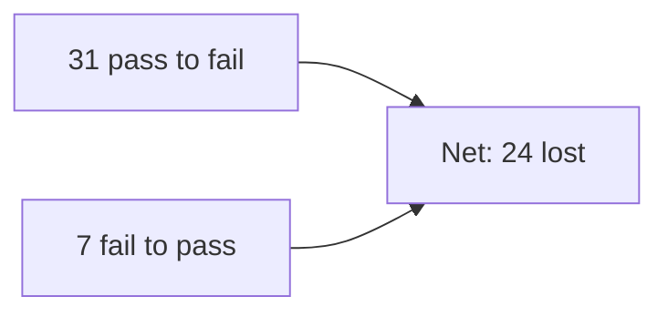
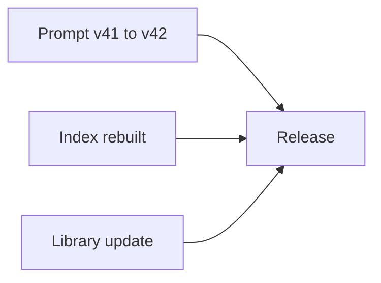
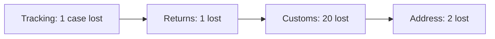
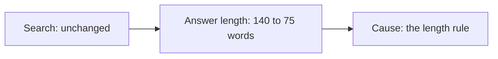
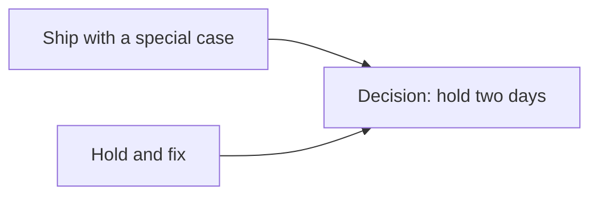
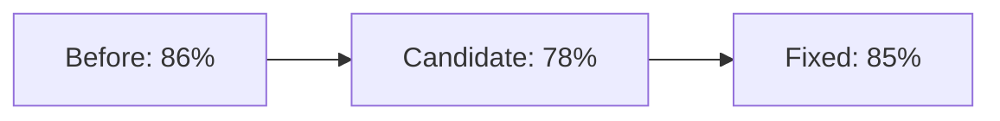
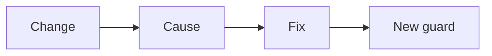
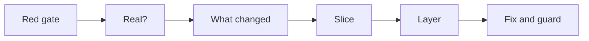

# One eval regression, traced to its cause

*Part of [Visual explainers](./README.md)*

## In one minute

An **eval** is a set of test cases that scores an AI feature before it ships. One day the score drops. The tempting move is to guess a cause and patch it. The better move is a short trace: check that the drop is real, find what changed, find where it hurts, then find which layer caused it.

This page follows one drop for **Parcelpoint**, a shipping-support assistant. A release candidate fails its eval gate: the score falls from 86% to 78%. Ten stages later, the team knows the cause, has fixed it and has a new rule that would have caught it.

*Reading time: about 10 minutes. Parcelpoint, its test cases and its scores are invented. The statistics method follows Evan Miller's paper on error bars for evals.*

## 1 · The gate turns red

Every Parcelpoint release runs 300 test cases in **continuous integration** (CI): the automatic checks that run before code can ship. The current version passes 258 of them, or 86%. The release candidate passes 234, or 78%.

The gate blocks the release. That is its job. It does not say why the score fell, or whether the fall matters.

The product manager has one question to answer first: is this a real problem, or noise in the test?

**Remember:** a red gate is a question, not an answer.

## 2 · Is the drop real?

A score from 300 cases is an estimate, with an error bar. For a pass rate near 80%, the **standard error** is about 2 points. So each score is uncertain by about ±4 to 5 points.

The two scores come from the same 300 cases, so compare them case by case. This is a **paired comparison**. It is more precise, because both versions find the same cases easy or hard. Here, 31 cases went from pass to fail and 7 went from fail to pass. The net loss is 24 cases.

Paired, the 8-point drop has an uncertainty of about ±4 points. Compared as two separate scores, it would be about ±6. Either way, the drop is real.

**Remember:** before acting on a score change, ask how big the error bar is.

## 3 · What changed?

The release bundles three changes. The prompt moved from version 41 to version 42. The search index was rebuilt. A software library was updated. The model itself did not change: Parcelpoint pins the model version, so a vendor update cannot slip in.

Write the list down before forming a theory. Teams often blame the change they like least. A written list keeps the search honest.

Each change maps to a layer of the system: the prompt, the retrieval and the plumbing. The next stages narrow it down to one.

**Remember:** list every change in the release before you guess a cause.

## 4 · Slice the score

A total score hides where the damage is. Split the 300 cases by the kind of question, called a **slice**.

| Slice | Cases | Before | After |
| --- | --- | --- | --- |
| Tracking | 120 | 95% | 94% |
| Returns | 80 | 88% | 86% |
| Customs and duties | 50 | 84% | 44% |
| Address changes | 50 | 64% | 60% |

Customs fell by 40 points. The other slices moved by 4 points or less, inside the noise. The drop is not spread across the product. It is one kind of question.

**Remember:** slice the score. Most regressions live in one corner.

## 5 · Read the failures

Numbers point to a corner. Reading tells you what went wrong there. Customs now has 28 failing cases. Eight of them failed before the release too. The team opens the other 22, the customs cases that passed before and fail now, and sorts them by cause. This is **error analysis**.

- 15 answers leave out the duty threshold: the value above which a parcel pays import duty.
- 4 answers apply the rule for the wrong country.
- 3 answers have a tone problem.

One cause covers two thirds of the new failures. The answers are not wrong so much as incomplete. They stop before the most important fact.

**Remember:** read the failures and count the causes. One cause usually dominates.

## 6 · Find the layer

A missing fact has two likely causes. Either search did not find the document, or the model had it and left it out.

Check search first. For customs questions, the right document was in the top five results in 46 of 50 cases, before and after the release. That is a **recall at 5** of 0.92, unchanged. Search is fine.

Then check the answers. The typical customs answer fell from 140 words to 75. Prompt version 42 had added one new line: "Keep every answer under 80 words." Short answers suit tracking questions. They cut off customs answers, which need a threshold and a list of steps.

**Remember:** test each layer in turn, starting with the one that is easiest to rule out.

## 7 · Hold or ship?

Now a product decision. Customs questions are about 1 in 8 of real traffic. The release also has a fix that support wants this week.

Option one: ship now, and keep the old prompt for customs questions only. That ships the fix, but it adds a special case that someone must remember to remove. Option two: hold the release for two days, fix the prompt, and re-run the eval.

Parcelpoint holds. A wrong customs answer can cost a customer money at the border. The support fix can wait two days.

**Remember:** the trace gives the facts. The product manager weighs the harm.

## 8 · Fix and check again

The new prompt line says: "Keep answers under 80 words, unless the answer needs a threshold, a fee or a list of steps."

The re-run passes 256 of 300, or 85%. Customs recovers to 41 of 50. The other slices are within one case of where they were. Two cases below the old total is well inside the noise.

The team also runs the **holdout** set: 100 cases that are never used to tune the prompt. It scores 85, against 86 before. The fix did not just fit the 300 cases it was tested on.

**Remember:** after a fix, check the cases you did not tune on.

## 9 · Make it impossible to repeat

A fix that leaves the test set unchanged invites the same mistake later. Parcelpoint adds the 15 "missing threshold" cases to the eval as **regression cases**: cases that once failed and must keep passing.

It also adds two rules to the gate. No slice may drop more than 5 points, even when the total passes. And any prompt line that limits length must be tested on the slice with the longest answers.

The total-score gate would have passed a smaller version of this bug. The slice rule would not.

**Remember:** every regression should leave behind a test that would catch it.

## 10 · The log entry

The trace ends with a short entry in the change log. The next person who sees a drop in customs can read it in a minute.

- **What changed:** prompt v42 added a limit of 80 words.
- **What broke:** customs answers left out the duty threshold, so the slice fell from 84% to 44%.
- **How it was found:** paired comparison, slicing, error analysis, then a layer check.
- **The fix:** the limit now allows longer answers that need a threshold, a fee or steps.
- **The new guard:** 15 regression cases and the slice rule.

**Remember:** write down the cause and the guard, not only the fix.

## The whole journey

## Where it breaks

- **Chasing noise.** A 2-point drop on a small set triggers a week of work.
- **Total score only.** One slice collapses while the total looks acceptable.
- **Guessing the layer.** The team rebuilds search when the prompt was the cause.
- **Tuning on the test.** The fix fits the test cases and fails on new ones.
- **No regression cases.** The same bug ships again next quarter.

## Go deeper

- [Why eval investment is the job](../evaluation-and-observability/why-eval-investment-is-the-job.md) — a score is an estimate, not a fact.
- [Building the eval stack in the right order](../evaluation-and-observability/building-the-eval-stack-in-the-right-order.md) — from reading outputs to a full test stack.
- [Practice: hill climbing](../building-ai-native-products/hill-climbing-in-practice.md) — error analysis and the holdout set.
- [Retrieval quality](../rag-vector-databases/retrieval-quality.md) — recall and how to measure search.
- [Technical product management for AI](../technical-product-management/tpm-for-ai-products.md) — eval-driven development.
- [Evals](../content/04-evals-observability/evals.md) — the engineering side of the eval suite.

## Test yourself

1. **The score drops 2 points on 100 cases. What do you do first?**
   

Answer
Check the error bar. On 100 cases, a 2-point move is likely noise.

2. **Why compare the two versions case by case?**
   

Answer
Both versions see the same cases, so a paired comparison removes the variation from easy and hard cases and gives a tighter error bar.

3. **The answers were missing a fact. Why check search before the prompt?**
   

Answer
A missing fact can mean the document was never found. Search is quick to check, and ruling it out points to the prompt or the model.

## Sources

- Evan Miller, *Adding Error Bars to Evals: A Statistical Approach to Language Model Evaluations*, arXiv 2411.00640, 2024, full text read 2026-11. For a pass rate, the standard error is √(p(1 − p)/n), and a 95% interval is the mean ± 1.96 standard errors. The paper recommends comparing two models on question-level paired differences, which lowers the variance when the models agree on which questions are hard.
- The error bars on this page are derived from the invented counts. Standard error at 86% of 300: √(0.86 × 0.14 / 300), about 2.0 points. At 78%, about 2.4 points. Unpaired error of the difference: √(2.0² + 2.4²), about 3.1 points, so ±6 at 95%. Paired: the 300 case differences have 31 at −1, 7 at +1 and 262 at 0, which gives a standard error of about 2.0 points, so ±4 at 95%.
- How the counts fit together (derived from the invented data): customs passed 42 of 50 before and 22 after. That net loss of 20 is 22 cases that went from pass to fail, minus 2 that went the other way. Across all slices, 31 cases went from pass to fail and 7 from fail to pass: customs 22 and 2, tracking 2 and 1, returns 3 and 2, address 4 and 2.
- Parcelpoint, its cases, slices, scores and prompt are invented for the example. This page's fact-check is pending.
