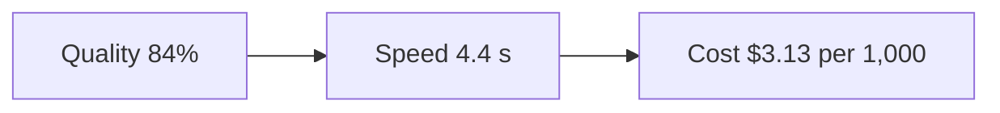
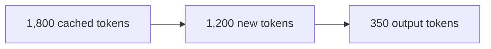
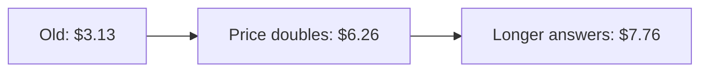
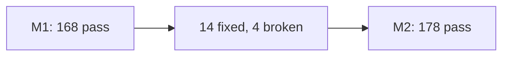
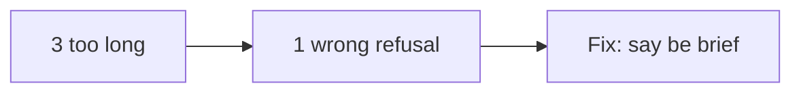
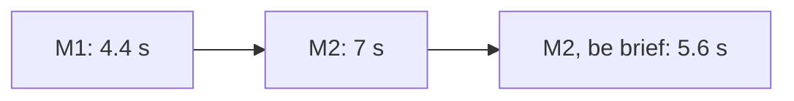
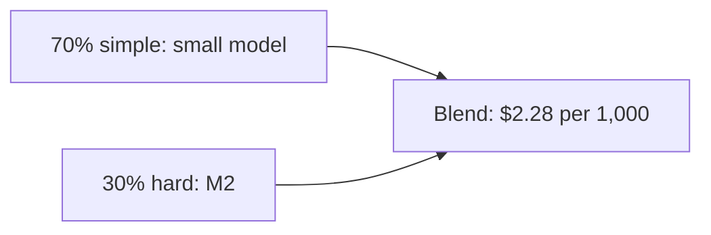
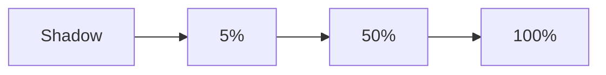
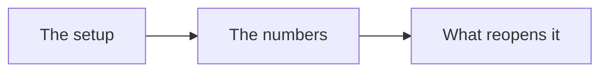

# One model change: cost, speed and quality

*Part of [Visual explainers](./README.md)*

## In one minute

A model is a part you rent, and the vendor will retire it. When it does, you must move to a new model, and three numbers move at once: **quality**, **speed** and **cost**. This page follows one move for **Tally**, a helpdesk assistant, from the retirement notice to the decision record.

The surprise is where the cost goes. The new model's price per token is double the old one. But the bill grows by more than that, because the new model writes longer answers. And routing simple questions to a smaller model cuts the bill to below where it started.

*Reading time: about 10 minutes. Tally is invented. All prices are illustrative, not quotes. Real vendor terms, such as notice periods and cache discounts, are in the Sources.*

## 1 · The notice arrives

Tally runs on a pinned model version, called M1 here. An email arrives: M1 is **deprecated** and will be **retired** in 60 days. After that date, calls to M1 fail.

This is normal. Anthropic, for example, gives at least 60 days' notice before it retires a publicly released model, and it names a recommended replacement. Request settings can be retired too: a newer API version removed some sampling settings, so a request that sends them now fails.

The notice turns a choice into a deadline. The work below has to fit in 60 days.

**Remember:** every model in your product has a retirement date. Plan the move before the notice.

## 2 · The scorecard you start from

You cannot judge a change without a baseline. Tally's team keeps three numbers on one card.

- **Quality:** 168 of 200 test cases pass, which is 84%.
- **Speed:** a typical answer finishes in about 4.4 seconds.
- **Cost:** about $3.13 for every 1,000 questions.

Each number comes from the same 200 cases, so the new model can be run on exactly the same inputs. The card also names the product signals that matter in production: how often agents edit an answer, and how often a chat is passed to a person.

**Remember:** write the baseline down before you test anything new.

## 3 · The cost of one question

A question costs **input tokens** (what Tally sends) plus **output tokens** (what the model writes). Output tokens cost more. Anthropic's current models, for example, charge 5 times as much for output as for input.

Each Tally request sends about 3,000 tokens. Of these, 1,800 are the same every time: the instructions and the help-centre rules. The model writes about 350 tokens. At M1's assumed prices of $1 per million input tokens and $5 per million output tokens, the request costs $0.00475.

Tally also uses **prompt caching**: the shared 1,800 tokens are stored and re-read at a tenth of the price. That brings the input to $0.00138 and the total to $0.00313, or $3.13 per 1,000. This ignores the small cost of writing the cache.

**Remember:** cost is input plus output, and output is the expensive part.

## 4 · The new model's price

The recommended replacement, M2, has assumed prices of $2 per million input tokens and $10 per million output tokens. That is double M1. So you might expect the bill to double, to about $6.26 per 1,000.

It does not. On the same questions, M2 writes longer answers: about 500 tokens instead of 350. The input still costs $0.00276 with caching, but the output now costs $0.005. The total is $0.00776, or $7.76 per 1,000. That is 2.5 times the old bill, not 2.

The price list told only half the story. Behaviour sets the rest.

**Remember:** a new model can change how much it writes, and that changes the bill.

## 5 · The same test, two columns

Now run M2 on the same 200 cases. It passes 178, which is 89%. That looks like a 5-point gain. But the useful view is case by case: M2 fixed 14 cases that M1 failed, and it broke 4 that M1 passed.

The fixes and the breaks matter more than the total. A gain on easy cases and a loss on a must-not-fail case is a bad trade, even if the total rises.

Comparing two models on the same cases, one case at a time, is also the honest way to tell a real change from noise. Evan Miller's paper on error bars for evals recommends exactly this paired view.

**Remember:** read which cases changed, not only the total.

## 6 · Read the broken cases

Open the 4 broken cases. Three are answers that run past the 120-word limit in Tally's spec. One is a refusal: M2 declined to explain the refund policy, which M1 answered well.

The 14 fixed cases are mostly harder questions, with several steps, which M2 handles better. That is the reason to move.

The broken cases point to a cheap fix. Tally's prompt never said "be brief", because M1 was brief anyway. A habit of the old model had become a silent part of the spec. A new model does not share old habits.

**Remember:** a new model does not inherit the old model's habits. State them in the prompt.

## 7 · Speed follows length

A user waits for two things: the **time to first token** (TTFT), and the time to write the rest. Assume M1 starts in 0.5 seconds and writes 90 tokens a second. Its 350-token answer is done in about 4.4 seconds.

Assume M2 starts in 0.8 seconds and writes 80 tokens a second. Its 500-token answer takes about 7 seconds. The model is not much slower per token. It writes more.

The team adds "answer in under 120 words" to the prompt. Answers fall to about 380 tokens, which take about 5.6 seconds and cost $6.56 per 1,000. A re-run passes 180 of 200: the 3 long answers now pass, and 1 other case broke.

**Remember:** shorter answers are faster and cheaper at the same time.

## 8 · Send easy questions to a small model

About 70% of Tally's questions are simple, like "where is my order?". They do not need M2. **Model routing** sends them to a small model, S, at assumed prices of $0.10 and $0.50 per million. With about 300 output tokens and no caching, a simple question costs about $0.45 per 1,000.

On the 140 simple test cases, S passes 136. The be-brief M2 from stage 7 passes 138 of them. The team accepts the 2-case gap. M2 alone passed 180 of 200, so the routed setup passes 180 − 2 = 178, or 89%.

The blended cost is 70% × $0.45 + 30% × $6.56, which is about $2.28 per 1,000. That is lower than the $3.13 the team started with, and quality is 5 points higher.

**Remember:** the cheapest fix is often to stop using the big model for small jobs.

## 9 · Roll out in steps

A test set is a sample, and real traffic has surprises. So the change goes out in steps, inside the 60 days.

In week 3, the new setup runs in **shadow mode**: it answers copies of real questions, and nobody sees the answers. In week 4 it serves 5% of users, then 50% in week 5 and everyone in week 6. At each step the team watches the edit rate and the hand-off rate. The old model stays ready as a fallback until the retirement date.

That leaves about two weeks of slack before the deadline.

**Remember:** keep the old setup ready until the new one has run cleanly on real traffic.

## 10 · The decision record

The move ends with one short page that the next person can read. It names the setup: M2 for hard questions, S for simple ones, with "be brief" in the prompt. It gives the numbers: 89% quality, about 5.6 seconds for an M2 answer and about $2.28 per 1,000 questions.

It also says what would reopen the decision: S falling below 95% on the simple cases, a price change, or the next retirement notice. And it names the person who re-runs the 200 cases each month.

A model and a prompt are a pair. The record treats them as one version.

**Remember:** a model decision is never final. Write down what would change it.

## The whole journey

## Where it breaks

- **No baseline.** Nobody can say whether the new model is better.
- **Price list only.** The forecast misses a change in answer length.
- **Total score only.** A broken must-not-fail case hides inside a higher total.
- **Old habits lost.** The old model did something the prompt never asked for.
- **Late start.** The work begins after the notice, and the deadline forces a rushed move.

## Go deeper

- [Choosing a model](../llms/choosing-a-model.md) — the dimensions and model routing.
- [Prompts in production](../prompt-engineering/prompts-in-production.md) — treat a model upgrade as a migration.
- [Practice: probing and choosing models](../building-ai-native-products/model-intuition-practice.md) — the bake-off table.
- [The cost stack, and the build-vs-buy breakeven](../cost-optimization/the-cost-stack-and-the-build-vs-buy-breakeven.md) — reading a price sheet.
- [Model routing](../content/02-reliable-outputs/model-routing.md) — how routing works.
- [Inside one LLM request](./inside-one-llm-request.md) — why first-token time and writing speed differ.

## Test yourself

1. **The new model's prices are double the old ones. Why did Tally's bill go up 2.5 times?**
   

Answer
The new model wrote longer answers, and output tokens are the expensive part.

2. **The new model scores 5 points higher. What do you check before you accept it?**
   

Answer
Which cases broke, especially must-not-fail cases. A higher total can hide a bad trade.

3. **How did the move end up cheaper than where it started?**
   

Answer
Routing the 70% of simple questions to a small model, and asking the big model to be brief.

## Sources

- Anthropic, "Model deprecations", platform.claude.com/docs/en/about-claude/model-deprecations, read 2026-11: the lifecycle terms (active, legacy, deprecated, retired); at least 60 days' notice before retiring a publicly released model; requests to retired models fail; `temperature`, `top_p` and `top_k` removed in API version `2026-10-21`.
- Anthropic, "Prompt caching" and "Pricing", platform.claude.com, read 2026-11-04: on Anthropic's current models, the output price per token is 5 times the input price; a cache read costs 0.1 times the base input price on most models (0.05 times on Claude Opus 5.5 and Sonnet 5.5, and 0.025 times on Claude Fable 5.1 and Mythos 5.1); a 5-minute cache write costs 1.25 times. Tally's prices are illustrative and use the 0.1 multiplier.
- Evan Miller, *Adding Error Bars to Evals: A Statistical Approach to Language Model Evaluations*, arXiv 2411.00640, 2024, read 2026-11: compare two models on question-level paired differences.
- Tally, M1, M2, S, their prices, speeds, scores and the 70% share are invented for the example. This page's fact-check is pending.
