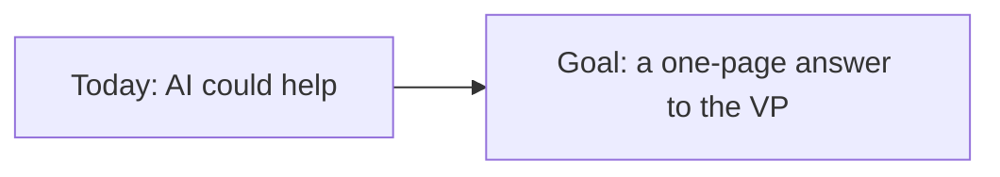
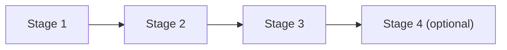
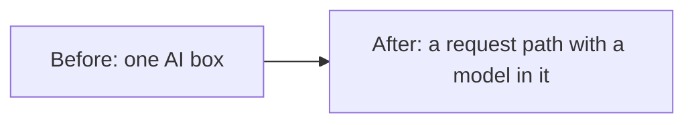
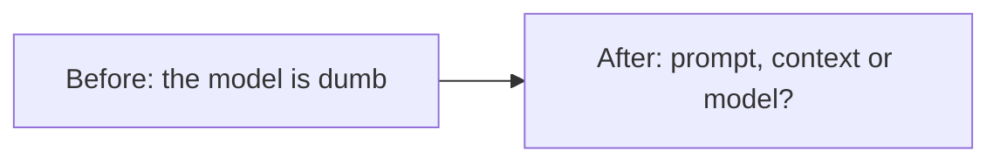
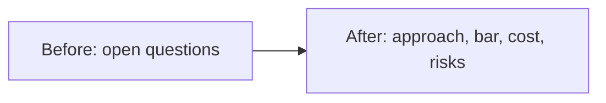
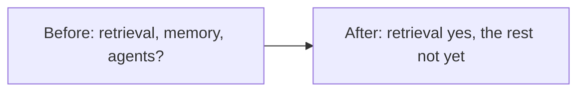
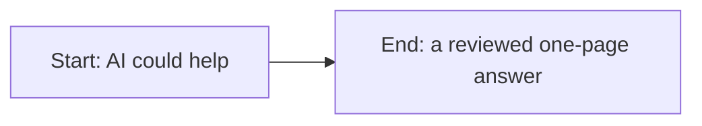
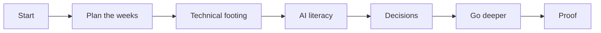

# A senior PM's path, one stage at a time

*Part of [Visual explainers](./README.md)*

## In one minute

A learning path is a list of lessons in order. This page follows one learner through one path, to show what each stage changes in what they can do. The learner is a senior product manager at Wayline, an online travel company. Their vice president (VP) asks: **"Should we build an AI assistant that helps customers change their bookings? What will it cost, and what could go wrong?"**

At the start, the senior PM cannot answer any of the three questions. The [Senior PM path](../learning-paths/senior-product-manager.md) has four stages. After each one, the PM can do one new thing for Wayline, and a "Do this" check proves it. The last stage is the proof: a one-page answer to the VP.

*Reading time: about 10 minutes. Wayline, the senior PM, the VP and every number about the assistant are invented. The stage names, hours and lessons come from the Senior PM path itself.*

## 1 · Where the senior PM starts

The senior PM has shipped many features, but none with a model inside. They can say that AI "could help" customers change bookings. They cannot yet say how the assistant would work, how good it must be, what it would cost or what could go wrong.

Those gaps are normal. They are also exactly what the VP asked about. A demo will not answer them. A demo shows that something works once, not how often it fails or what it costs at scale.

The path is built for this moment. It skips engineering detail on purpose. It spends most of its time on the calls that only the product manager can make: the approach, the quality bar, the cost and the risk.

**Remember:** start from the decision you must make, not from the technology.

## 2 · Plan the weeks

The path has four stages and takes about 21 hours in all. The hours are this course's rule of thumb: about 25 minutes for each lesson.

The senior PM has about 3 hours a week to spare. At 3 hours a week, about 7 weeks. The longest stage is stage 2, AI literacy, at about 8.5 hours. Stage 4 is optional, so the core of the path is the first three stages.

Seven weeks is too slow for a VP who wants an answer this quarter. So the PM tells the VP when the answer will come, and why. Each stage also gives a partial answer along the way, so the VP sees progress every week or two.

**Remember:** plan the weeks before you start, and tell people when the answer will come.

## 3 · Stage 1: Technical footing

*Path stage 1 · about 2.5 hours · 6 lessons*

This stage has five lessons from technical product sense, plus this page. They cover how a request travels through a system, what an API contract promises, where latency comes from and how systems fail.

Before this stage, the senior PM pictured the assistant as one box marked "AI". After it, they can draw the real request path. A customer's message goes to Wayline's app, then to a model, then to the booking system, and back. They can mark where waiting happens and what breaks when the booking system is slow.

They can also name what changes when one box is a model: the answer varies, and it can be wrong without an error.

**Do this:** draw the request path for one booking change, and mark where the model sits. Use [How systems are built](../technical-product-sense/how-systems-are-built.md).

**Remember:** a model is one part of a system. Draw the whole path before you judge the part.

## 4 · Stage 2: AI literacy

*Path stage 2 · about 8.5 hours · 20 lessons*

This is the longest stage. It starts with three explainers: [Inside one LLM request](./inside-one-llm-request.md), [How a model learns](./how-a-model-learns.md) and [One agent run, step by step](./one-agent-run.md). Then come lessons on machine learning, generative AI, large language models and prompting.

Before this stage, a bad answer from the team's prototype looked like "the model is dumb". After it, the senior PM can ask better questions. Did the model see the fare rules at all? Was the context window full of chat history? Would the same prompt give a different answer on another run?

They can now tell a prompt problem from a missing-information problem. That changes who fixes it, and how.

**Do this:** take one bad answer from a prototype and say whether it is a prompt, context or model problem. Use [When prompts fail: the diagnostic playbook](../prompt-engineering/when-prompts-fail.md).

**Remember:** most bad answers have a cause you can name. Name it before you ask for a bigger model.

## 5 · Stage 3: The decisions only you own

*Path stage 3 · about 6 hours · 15 lessons*

Now the senior PM makes the four calls. The stage reads four explainers, including [One AI feature, from idea to launch](./one-ai-feature-from-idea-to-launch.md) and [From one AI task to gross margin](./one-ai-feature-p-and-l.md), and lessons on the approach, evals, cost and risk.

Before this stage, the PM had questions. After it, they have a draft. The approach is to buy a hosted model and give it Wayline's fare rules through retrieval, not to train a model. The quality bar is a pass rate on 50 test cases, with five must-not-fail cases, such as "never confirm a change the fare rules forbid". The cost is an estimate per booking change. The top three risks each have a guardrail.

All the Wayline numbers are illustrative. The method is the point.

**Do this:** write the one-page case for build, buy or fine-tune, with an eval plan, a cost per task and the top three risks. Use [Build, buy, or fine-tune](../generative-ai/build-buy-or-fine-tune.md).

**Remember:** the approach, the quality bar, the cost and the risk are product calls. Make them in writing.

## 6 · Stage 4: Go deeper where your product needs it (optional)

*Path stage 4 · about 4 hours · 9 lessons*

This stage is optional, and the senior PM reads only part of it. It covers retrieval, memory and agents. The Wayline assistant must answer from fare rules that change every season, so retrieval matters. The PM reads the retrieval lessons in full.

Memory and agents are different. The assistant does not need to remember customers between chats. It also should not act alone: a person confirms each booking change. So the PM skims those lessons and writes down why the assistant needs neither, for now.

That written "no" is as useful as a "yes". It keeps the first version small, and it says what would change the answer later.

**Do this:** decide whether the assistant needs retrieval, memory or an agent, and write one line on each. Use [When to use RAG, and when not to](../rag-vector-databases/when-to-use-rag.md).

**Remember:** read the deep lessons your product needs, and write down why you skipped the rest.

## 7 · Proof of skill

The proof is the one-page answer to the VP, reviewed with the engineering lead before it goes up. It answers the three questions. How it would work: a hosted model with retrieval over fare rules, and a person confirms every change. What it would cost: an estimate per booking change, with the assumptions shown. What could go wrong: three named risks, each with a guardrail and an owner.

Then the senior PM checks the four checkpoints of the path. Can they explain a request path and where latency comes from? Can they say why the same prompt gives different answers? Can they write the one-page case? Can they tell when a feature needs retrieval, memory or an agent?

If any answer is no, they reread that stage.

**Do this:** run the practitioner checklist on the [Senior PM path page](../learning-paths/senior-product-manager.md) against your own one-page case.

**Remember:** the proof of a path is a decision you can defend, not the lessons you read.

## The whole journey

## Where it breaks

- **Reading the whole library.** The path picks lessons. Reading every lesson in every track doubles the time.
- **Stopping at literacy.** The PM can talk about AI but still cannot answer the VP.
- **No eval owner.** The quality bar exists on paper, and nobody runs the tests.
- **Reading in a vacuum.** Without a real question like Wayline's, the lessons fade.
- **Skipping the written "no".** The first version grows to include memory and agents it did not need.

## Go deeper

- [Senior PM path](../learning-paths/senior-product-manager.md) — every lesson, checkpoint and skip-ahead rule.
- [Visual learning paths](../learning-paths/visual-paths.md) — the four paths as pictures.
- [Build, buy, or fine-tune](../generative-ai/build-buy-or-fine-tune.md) — the decision at the heart of stage 3.
- [Building the eval stack in the right order](../evaluation-and-observability/building-the-eval-stack-in-the-right-order.md) — the quality bar in practice.
- [The cost stack, and the build-vs-buy breakeven](../cost-optimization/the-cost-stack-and-the-build-vs-buy-breakeven.md) — the cost estimate.
- [The threat model, and guardrails as architecture](../ai-security-and-guardrails/the-threat-model-and-guardrails.md) — the risks and their guardrails.
- [One AI feature, from idea to launch](./one-ai-feature-from-idea-to-launch.md) — what happens after the VP says yes.

## Test yourself

1. **A launch is two weeks away. Which stage do you do first?**
   

Answer
Stage 3, the decisions. It covers the approach, the eval plan, the cost and the risks a launch needs. Go back to stages 1 and 2 after.

2. **A prototype gives a wrong fare. What does stage 2 teach you to ask first?**
   

Answer
Whether the model saw the fare rules at all. A wrong answer is often missing information, not a weak model.

3. **Why write down that the assistant does not need memory or an agent?**
   

Answer
It keeps the first version small, and it records what would change the decision later.

## Sources

- The stage names, hours, lesson counts and checkpoints come from the Senior PM path in this repository (`scripts/gen_learning_paths.py`), which generates the [path page](../learning-paths/senior-product-manager.md). The hours are this course's rule of thumb, about 25 minutes a lesson, not measured. The weeks use the path's own pace of 3 hours a week.
- Wayline, the senior PM, the VP, the assistant and its 50 test cases and five must-not-fail cases are invented for the example. This page's fact-check is pending.
