# One token through a transformer

*Part of [Visual explainers](./README.md)*

*Last reviewed: 2026-11 · Volatility: medium*

## In one minute

A transformer is a stack of identical blocks. Each block does two things to every token: it lets the token look at the other tokens, and then it reworks the token alone. This page follows one token, **"bank"** in the phrase **"the river bank"**, through one block, and then up through the stack. The aim is to see how the model can tell a river bank from a money bank.

You will meet **embeddings**, **attention** with its query, key and value, **heads**, the **feed-forward layer** and the **residual stream**.

*Reading time: about 10 minutes. The tiny vectors and weights are made up so the arithmetic fits on a page. Real models use thousands of numbers per token.*

## 1 · A token becomes a vector

The model starts with a token ID. It looks the ID up in a table and gets a list of numbers: the token's **embedding**. This is the token's starting meaning. The table is learned. Tokens used in similar ways end up with similar lists.

At this point "bank" has the same embedding whatever sentence it is in. It could mean a river edge or a place for money. Context has not yet been used. That is what the rest of the stack adds.

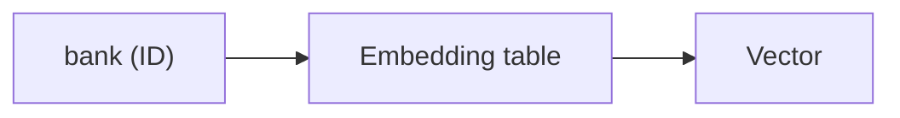

**Remember:** the first vector for a word ignores its context.

## 2 · Position is added

Attention on its own does not know word order. "Dog bites man" and "man bites dog" would look alike. So the model adds a **position signal** to each token's vector. In our phrase, "the" is first, "river" second and "bank" third.

Some models add fixed wave patterns. Some learn a vector per position. Some, such as those with rotary embeddings, turn the numbers by an angle that depends on position. Whatever the method, the token now carries both what it is and where it is.

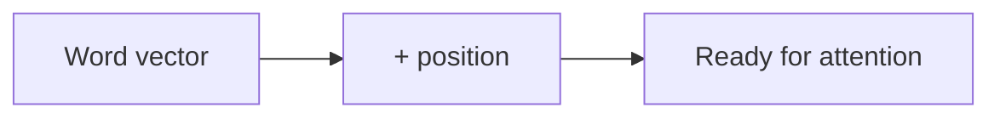

**Remember:** order has to be added, because attention alone does not see it.

## 3 · Three views: query, key and value

Each block turns every token's vector into three new ones, using three learned matrices.

- The **query** says what this token is looking for.
- The **key** says what this token offers, so others can match it.
- The **value** is the information it hands over when someone chooses it.

Think of a library. The query is your question, the keys are the labels on the shelves, and the values are the books.

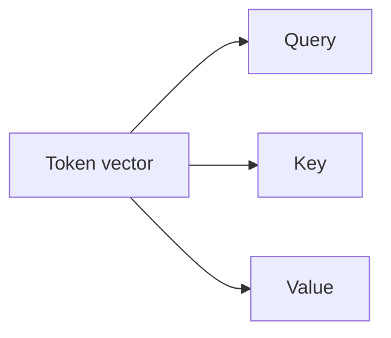

**Remember:** query asks, key advertises, value delivers.

## 4 · Scores: who matters to me?

To decide where "bank" should look, the model compares its query with the key of every token it is allowed to see: "the", "river" and "bank" itself. The comparison is a dot product: a large number means a good match. The scores are divided by the square root of the vector size to keep them from growing too large.

In our toy numbers, "bank" scores 0.07 against "the", 0.89 against "river" and 0.58 against itself. "River" is the best match.

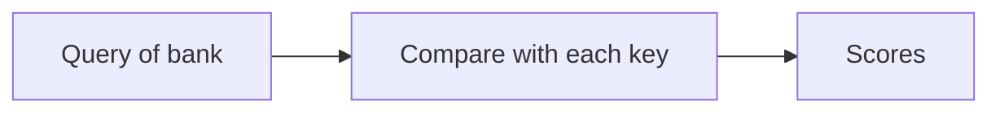

**Remember:** a score says how relevant another token is to this one.

## 5 · Scores become weights

The scores go through **softmax**, which turns them into positive numbers that add up to 1. Higher scores get most of the weight. Here "bank" gives about 20% to "the", 46% to "river" and 34% to itself.

Generation models use a **causal mask**: a token may look only at itself and tokens before it. That keeps the model honest when it predicts the next word. "Bank" is last, so it can see all three.

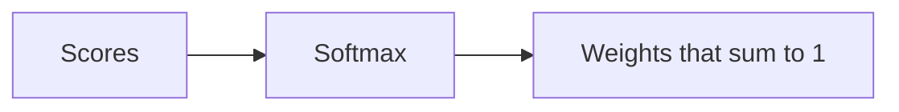

**Remember:** attention weights are shares of attention, and they sum to 1.

## 6 · Mixing the values

The new vector for "bank" is the weighted sum of the **values**: 20% of the value of "the", 46% of "river" and 34% of "bank". Information flows from the tokens that matter into this one.

Now the vector for "bank" carries a trace of "river". It is no longer the same as it was in a sentence about money. This is how context gets in.

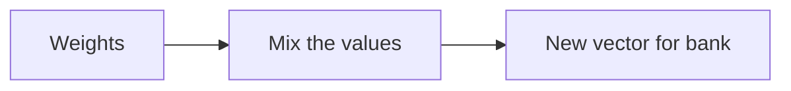

**Remember:** attention is a weighted mix of what other tokens carry.

## 7 · Many heads

One round of attention can ask only one kind of question. So a block runs several **heads** side by side, each with its own query, key and value matrices. One head may track grammar. Another may track what a pronoun refers to. Another may follow names.

The heads' results are joined and mixed by one more matrix. A useful view is that each head writes its own small note, and the notes add.

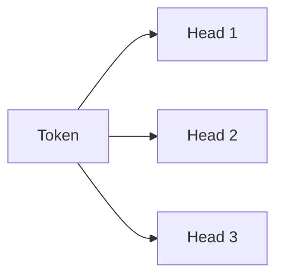

**Remember:** heads let a block ask several questions at once.

## 8 · The feed-forward layer

Attention moves information between tokens. The **feed-forward layer** then works on each token alone. It widens the vector, applies a nonlinear function and narrows it again. No information crosses between tokens here.

This layer is large. In a typical block it holds about two thirds of the parameters, and research suggests much of the model's stored knowledge sits in these layers. Attention finds the right information, and the feed-forward layer processes it.

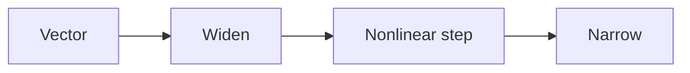

**Remember:** attention shares information. The feed-forward layer thinks about it, one token at a time.

## 9 · The residual stream

Attention and the feed-forward layer do not replace the token's vector. They **add** to it. This running total is called the **residual stream**. Each part reads the stream, writes a small note and leaves the rest alone.

This has two benefits. A block that writes nothing changes nothing, so deep stacks train well. And the stream gives a place where many parts can collaborate on one vector.

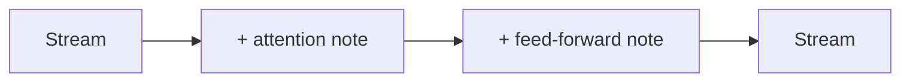

**Remember:** each layer adds to the vector. Nothing is overwritten.

## 10 · Up the stack, and out

The block repeats, with different weights, many times: a few dozen layers in large models. In the early layers, "bank" may only pick up nearby words. In later layers, its vector can hold richer ideas, such as "the edge of a river".

At the top, the last token's vector is turned into a score for every word in the vocabulary. The model picks the next word. The Transformer paper showed that a network built only on attention, without recurrence or convolution, reached 28.4 BLEU on English-to-German translation and 41.8 on English-to-French.

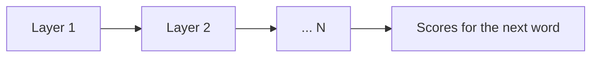

**Remember:** a transformer is one block repeated, and the vector grows richer each time.

## The whole journey

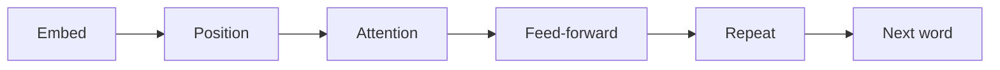

## Where it breaks

- **Long inputs.** Attention costs grow with the square of the length.
- **Lost in the middle.** Information buried in a long prompt is used less well.
- **Position limits.** A model can fail at lengths it never saw in training.
- **Confident errors.** Attention finds patterns. It does not check facts.

## Go deeper

- [Attention](../transformers/attention.md) — the arithmetic behind stages 3 to 6, with code.
- [The block](../transformers/the-block.md) — heads, feed-forward and residuals.
- [Position and the cost of context](../transformers/position-and-the-cost-of-context.md) — stage 2 and long inputs.
- [The shape of a transformer](../transformers/the-shape-of-a-transformer.md) — counting parameters.
- [Generating text and the KV cache](../transformers/generating-text-and-the-kv-cache.md) — how the model runs in practice.

## Test yourself

1. **What are the query, key and value?**
   

Answer
The query is what a token looks for. The key is what it offers for matching. The value is the information it passes on if chosen.

2. **In the example, which token gets the most attention from "bank", and why?**
   

Answer
"River", with about 46% of the weight. Its key matches the query of "bank" best.

3. **Why is the residual stream useful?**
   

Answer
Each part adds to the vector instead of replacing it, so a block that writes nothing changes nothing, and deep stacks train well.

## Sources

- Ashish Vaswani et al., *Attention Is All You Need*, NeurIPS 2017, abstract read 2026-11: a network "based solely on attention mechanisms, dispensing with recurrence and convolutions entirely", with 28.4 BLEU on WMT 2014 English-to-German and 41.8 on English-to-French.
- This site's `transformers/code/` and lessons for the two-thirds feed-forward share, heads that add, and the residual stream. The tiny vectors and the scores 0.07, 0.89 and 0.58 are made up for the example. This page's fact-check is pending.
