# One user story becomes an agent spec

*Part of [Visual explainers](./README.md)*

*Last reviewed: 2026-11 · Volatility: medium*

## In one minute

A user story works well when the software does exactly what it is told. An AI agent does not. It chooses some of its own steps, and it will sometimes choose wrong. So the story has to grow into a different document: an **agent spec** that says what the agent may do, what it must never do, when it stops and how much freedom it has.

This page follows one story at **Fieldline**, a tool that dispatchers use to schedule repair technicians. The story is: *"As a dispatcher, when a customer misses an appointment, I want the job rebooked the same day, so that technicians are not left idle."*

*Reading time: about 10 minutes. Fieldline, its numbers and its rules are invented for the example. For how the finished agent runs, see [One agent run](./one-agent-run.md).*

## 1 · The story and its value

Start where every story starts: the user and the pain. Fieldline's dispatchers handle about 180 missed appointments a week. Each one takes about 9 minutes to rebook by hand: find a free slot, check the technician's skills, message the customer, confirm. That is 1,620 minutes, or 27 hours a week.

The story asks for something to do this work. It does not yet say how much of it a machine should do alone.

That is the question the rest of the spec answers.

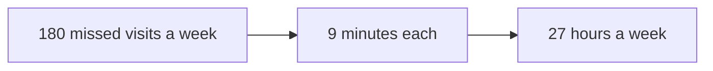

**Remember:** keep the user and the value at the top of the spec. Every later limit is weighed against them.

## 2 · Why the old acceptance criteria break

A classic acceptance test reads: "Given a missed appointment, when the dispatcher clicks rebook, then the job moves to the next free slot." Code passes it every time or fails it every time.

An agent that writes to customers will not give the same output twice. A single "then" cannot describe it. The spec needs three new things instead: **examples** of good and bad results, a **pass rate** to reach on a test set, and **must-not-fail cases** that block launch if any of them fails.

The examples become the tests. The pass rate becomes the quality bar.

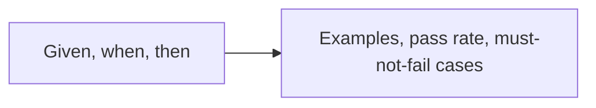

**Remember:** for a probabilistic feature, replace fixed acceptance criteria with examples and a pass rate.

## 3 · Workflow or agent?

Anthropic's engineering team draws a useful line. A **workflow** runs models and tools along steps set in code. An **agent** lets the model direct its own steps. Their advice is to find the simplest solution and add complexity only when it is needed.

Look at Fieldline's steps. Finding a free slot with the right skills is a search with rules. Booking is a fixed call. Only the customer conversation is open-ended: a customer may ask to change the time, the address or the job.

So Fieldline uses a workflow, with one model step for the conversation. Most of the "agent" is ordinary code.

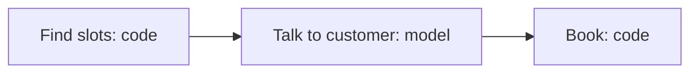

**Remember:** give the model only the steps that need judgement. Code does the rest.

## 4 · The tool inventory

List every tool the model can call, and class each one. A **read** tool looks something up. A **draft** tool prepares something a person can check. An **act** tool changes the world.

| Tool | Class | Can it be undone? |
| --- | --- | --- |
| `find_slots` | read | nothing to undo |
| `draft_message` | draft | yes |
| `send_message` | act | no |
| `book_slot` | act | yes, by moving the booking back to its old slot |

The act tools carry the risk. They get the tightest limits in the next stages. A tool the agent does not need is not on the list at all.

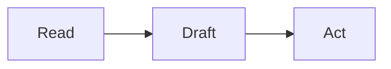

**Remember:** class every tool as read, draft or act. The act tools need the most care.

## 5 · Limits in code

Each act tool gets hard limits. The code that runs the tool checks them, so the model cannot talk its way past them.

- Book only within the next 5 working days.
- Book only a technician with the right skill for the job.
- Never book into overtime.
- Send at most 3 messages to a customer per rebooking.
- Never cancel a job. Moving a booking is allowed. Cancelling stays a person-only action.

The Open Worldwide Application Security Project (OWASP) names giving a model too much power **excessive agency**. Its causes are too many functions, too many permissions and too much autonomy. Limits in code answer the first two.

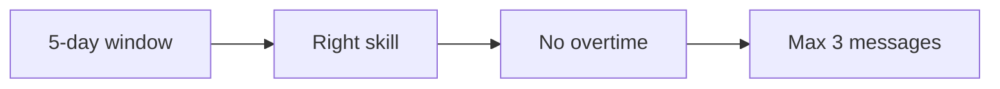

**Remember:** put limits where the model cannot argue with them: in the code that runs the tool.

## 6 · How much freedom for each action

Autonomy is a dial, not a switch, and it is set per action. Fieldline uses three levels: the agent **suggests**, a person **approves** before it acts, or the agent **acts** alone.

| Action | Level at launch |
| --- | --- |
| Find slots | acts |
| Draft a message | acts |
| Send a message | dispatcher approves |
| Book a slot | dispatcher approves |

OWASP's advice for high-impact actions is the same: require a person to approve them before they run. Approval keeps a person in charge while the team learns how often the agent is right.

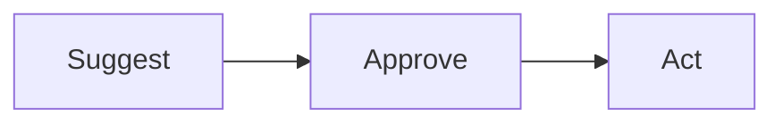

**Remember:** set autonomy per action, and start low for actions that cannot be undone.

## 7 · Examples become the test set

The spec collects 40 real examples of missed appointments, each with an accepted result and a rejected one. The rejected ones teach as much as the accepted ones: a polite message that books the wrong technician is still wrong.

Eight of them are must-not-fail cases. They include a double booking, a booking outside working hours, a booking for the wrong address and a message promising a time that was never offered.

The engineering team turns the 40 examples into the first eval set. The must-not-fail cases run on every change, before anything ships.

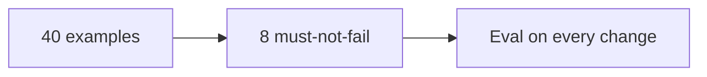

**Remember:** the examples in the spec and the cases in the test are the same list.

## 8 · Plan the bad days

Before launch, list how the agent could fail, and what stops each failure. This is a **risk register**. Each row has a likelihood, an impact, a control and a test.

- **The customer writes "book me in tonight at 10 pm".** Likely. Medium impact. Control: the working-hours limit in code. Test: 10 such messages.
- **Two dispatchers approve the same slot.** Unlikely. High impact. Control: the booking call checks the slot is still free. Test: run both approvals at once.
- **The message tool fails, and the agent reports success.** Medium likelihood. High impact. Control: the agent must see the error. Test: switch the tool off.

Run every test in a sandbox before launch.

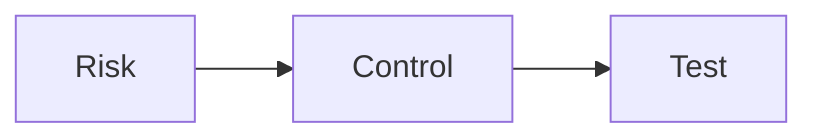

**Remember:** every risk needs a control and a test that proves the control works.

## 9 · The rule for more freedom

Autonomy should grow on evidence, not on confidence. The spec writes the rule in advance.

Fieldline's rule: bookings move from "dispatcher approves" to "agent acts" when, over at least 500 bookings and 4 weeks, at least 95% are approved without edits and no must-not-fail case reaches a customer. The rule also works in reverse. One double booking sends the action back to approval.

A rule written in advance stops two failures: freedom granted because a demo went well, and freedom never granted because nobody decided.

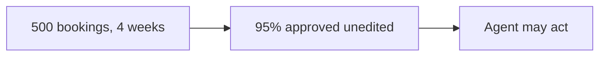

**Remember:** write the rule for more autonomy, and the rule for less, before launch.

## 10 · The page engineering receives

The story is now a one-page spec. It holds the user and the value, the workflow and the one model step, the tools and their classes, the limits, the autonomy per action, the 40 examples, the risk register and the rule for more freedom.

Engineering answers with a design document, often called a **request for comments** (RFC). The product manager's questions for it come straight from the spec. Where do the limits live? What happens when a tool fails? How do we stop the agent mid-run? Who can do that?

The spec does not say how to build the agent. It says what "safe and useful" means, with numbers.

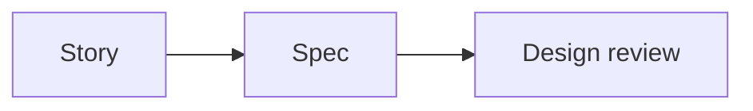

**Remember:** the spec says what safe and useful mean. The design says how to build it.

## The whole journey

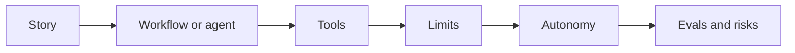

## Where it breaks

- **Fixed acceptance criteria.** The test passes in the demo and fails in production.
- **Agent by default.** A fixed workflow would have been simpler and safer.
- **Limits in the prompt.** The model is asked politely, and a customer talks it out of the rule.
- **One autonomy level.** Reading and booking get the same freedom.
- **No rule for more freedom.** Autonomy grows on a good demo, or never grows.

## Go deeper

- [Specs, PRDs & RFCs](../technical-product-management/specs-prds-and-rfcs.md) — acceptance criteria for probabilistic features.
- [Practice: the agent spec and risk register](../building-ai-native-products/agentic-flows-practice.md) — the templates used on this page.
- [When not to build an agent](../ai-agents/when-not-to-build-an-agent.md) — the case for a workflow.
- [Choosing a workflow pattern](../agentic-workflows/choosing-a-workflow-pattern.md) — the patterns between a single call and an agent.
- [Permissions, blast radius & the trust boundary](../tool-calling/permissions-blast-radius-and-the-trust-boundary.md) — tool permissions in depth.
- [One agent run, step by step](./one-agent-run.md) — what happens when the finished agent runs.

## Test yourself

1. **Why can a "given, when, then" test not describe an agent's message to a customer?**
   

Answer
The agent's output varies from run to run. The spec needs examples, a pass rate and must-not-fail cases instead.

2. **Why does Fieldline give only the customer conversation to the model?**
   

Answer
It is the only step that needs judgement. Finding slots and booking follow rules, so code does them more reliably.

3. **When should booking move from "dispatcher approves" to "agent acts"?**
   

Answer
When a rule written in advance is met, such as 95% approved unedited over 500 bookings and 4 weeks, with no must-not-fail case reaching a customer.

## Sources

- Anthropic, "Building effective agents", anthropic.com/engineering/building-effective-agents, 2024-12-19, read 2026-11: workflows run models and tools through predefined code paths, while agents direct their own processes and tool use; find the simplest solution and increase complexity only when needed. The page notes that much of its tooling has changed since December 2024.
- OWASP GenAI Security Project, "LLM06:2025 Excessive Agency", genai.owasp.org, read 2026-11: the root causes are excessive functionality, excessive permissions and excessive autonomy; the advice is to require a human to approve high-impact actions before they are taken.
- Fieldline, its story, numbers, tools, limits and rules are invented for the example.
- Independent fact-check: run on 2026-11-04 by a separate agent with web access, blind to the edits. Result: clean, with no wrong, stale or unsupported claims.
