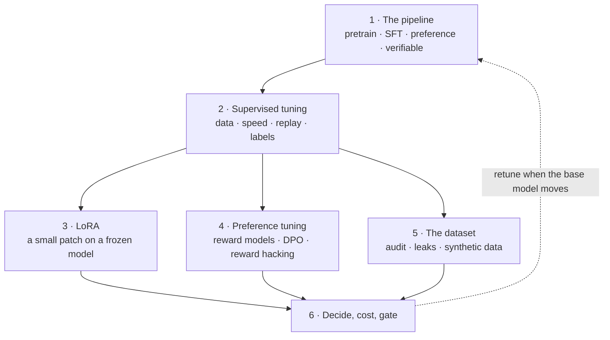

# Fine-tuning and post-training for the product and technology leader

*Part of the [foundation modules](../tensors/README.md). It builds on [machine learning](../machine-learning/README.md), [tensors](../tensors/README.md) and [transformers](../transformers/README.md).*

A language model starts as a **base model**. It predicts the next token, and that is all. The assistant you use is that model after **post-training**: supervised fine-tuning on example answers, preference tuning on pairs of better and worse answers, and sometimes reinforcement learning against a check. Teams can add their own fine-tuning on top.

Fine-tuning is the most over-chosen option in AI roadmaps. It feels like owning the model. It is good at changing behaviour, such as format, tone and a narrow task. It is a poor way to add facts. It has side effects, and it has a fixed cost that only high volume repays.

This module teaches how it works, so you can decide. You learn what each stage changes, what a few examples can and cannot do, why LoRA made tuning cheap, how preference tuning goes wrong, why the dataset is the real product, and how to test the break-even and gate the release.

Every lesson has two layers. The body is for the leader who decides. A short **Under the hood** section is for the engineer who builds. It points to code that runs on the Python standard library, with no install, and ends in `assert` lines. The code trains a very small next-word model by gradient descent, so each effect can be measured: the behaviour learned, the damage to everything else, the adapter that can be removed, the reward that gets gamed. The numbers are real for the toy and illustrative for real models.

**A note on scope.** The decision between prompting, retrieval and tuning is covered in [RAG vs. long context vs. fine-tuning](../rag-vector-databases/rag-vs-long-context-vs-finetuning.md) and the [strategy lesson](../content/06-strategy-tradeoffs/finetune-vs-icl-vs-rag.md). This module does not repeat it. It adds the mechanics, the data, the cost model and the checks.

## Where the depth lives

Each lesson summarizes an idea and points to the lesson that covers it in full.

| If you want the full depth on | Read |
| --- | --- |
| Whether to prompt, retrieve or tune | [RAG vs. long context vs. fine-tuning](../rag-vector-databases/rag-vs-long-context-vs-finetuning.md) and [Build, buy or fine-tune](../generative-ai/build-buy-or-fine-tune.md) |
| The training loop and overfitting | [Training: loss and gradient descent](../machine-learning/training-loss-and-gradient-descent.md) and [Generalization](../machine-learning/generalization-overfitting-and-bias-variance.md) |
| Memory for weights, gradients and optimizer state | [Batching, memory and precision](../tensors/batching-memory-and-precision.md) |
| What the weights are made of | [The block](../transformers/the-block.md) and [The shape of a transformer](../transformers/the-shape-of-a-transformer.md) |
| Smaller number formats and distillation for serving | [Quantization formats](../content/01-inference-internals/quantization-formats.md) and [Distillation](../content/01-inference-internals/speculative-quantization-distillation.md) |
| Evals, judges and monitoring | [Evaluation and observability](../evaluation-and-observability/README.md) |
| Data poisoning and what tuning does for safety | [AI security and guardrails](../ai-security-and-guardrails/README.md) |
| What a model costs over its life | [Cost optimization](../cost-optimization/README.md) |

## The knowledge graph



Read it as a chain with a fan. The **pipeline** shows where tuning sits. **Supervised tuning** is the step most teams run, and it has four dials. **LoRA** cuts its cost. **Preference tuning** shapes taste and invites gaming. The **dataset** decides what any of them learns. All three feed one decision: **whether it pays, and whether it passed the gate**. When the base model changes, the loop starts again.

## The lessons

1. [From base model to assistant: the post-training pipeline](./from-base-model-to-assistant.md) — what each stage uses and teaches, and what it breaks.
2. [Supervised fine-tuning](./supervised-fine-tuning.md) — how much data, how fast, what to mix in, and how labels matter.
3. [LoRA and parameter-efficient tuning](./lora-and-parameter-efficient-tuning.md) — a small, removable patch, and what it saves.
4. [Preference tuning and reward hacking](./preference-tuning-and-reward-hacking.md) — reward models, DPO, and why the proxy gets gamed.
5. [The dataset: quality, duplicates, contamination and synthetic data](./the-dataset.md) — the audit that comes before training.
6. [Deciding, costing and checking a fine-tune](./deciding-costing-and-checking-a-fine-tune.md) — break-even, distillation and the release gate.

Then the [recap and real-world examples](./recap.md), with a self-test.

## Run the code

Every example is in `fine-tuning/code/`. Run them all with one command.

```bash
python3 fine-tuning/code/test_examples.py
```

The files are `lesson1_pipeline.py` through `lesson6_decide.py`, built on `toy_lm.py`. A passing file checks the direction of each claim, such as general loss rising after narrow tuning, or dropping the adapter restoring the base model exactly. Run a file to see every quoted number printed.
