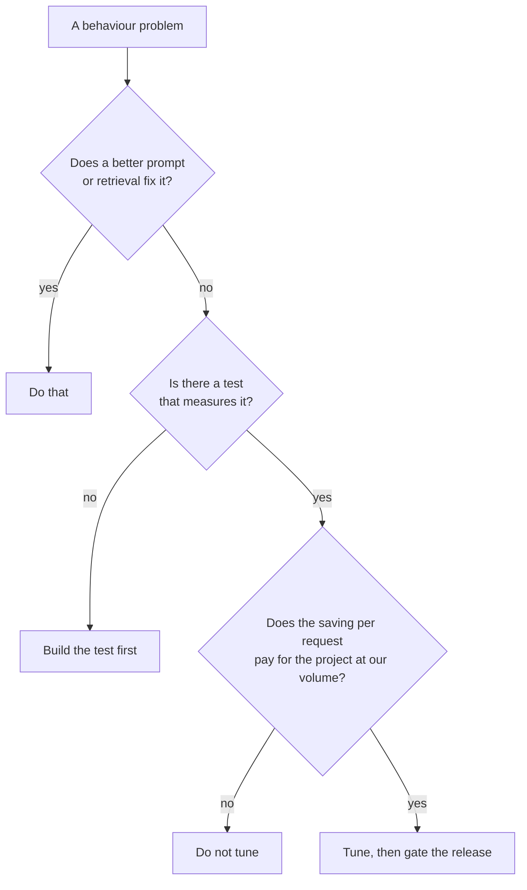

# Deciding, costing and checking a fine-tune

*Part of [Fine-tuning and post-training for the product and technology leader](./README.md)*

*Last reviewed: 2026-10 · Volatility: fast*

## TL;DR

Fine-tune when you have a behaviour problem that a better prompt cannot fix, you have a test that measures it, and the volume is high enough to pay for the project. In other cases, a prompt, a retrieved document or a different model is cheaper.

The cost case usually rests on one trade. A large model with a long prompt of instructions and examples is replaced by a smaller tuned model with a short prompt. The saving per request is real. The project has a fixed cost: data, training, evaluation, and the work of keeping the model current. The break-even volume is the fixed cost divided by the saving per request.

A release gate keeps the project honest. Ship only if the target task improved by an agreed margin and general ability did not slip.

> 🎯 **For the product leader**
>
> **Why it matters** — Fine-tuning is the most over-chosen option in AI roadmaps. It feels like owning the model. Often a prompt, a retrieval step or a cheaper model does the job at a fraction of the effort.
>
> **What it changes in your decisions** — You ask for the break-even volume and the release gate before approving a tuning project. You also plan for a retune each time the base model changes.
>
> **Ask your eng team** — *"What is the best result we get from prompting and retrieval, what does tuning add on top, and at what volume does the saving cover the project?"*
>
> **Risk if ignored** — A fine-tuned model that costs more than the prompt it replaced, and falls behind each time the vendor releases a better base model.

## The mental model: a fixed cost against a per-request saving



## Mechanics

### When tuning fits

Tuning fits these needs: a consistent format or voice, a narrow task where a small model can match a large one, a long prompt you want to shorten, and style that is hard to describe in words. It does not fit adding facts, fixing knowledge gaps or handling data that changes often. For those, see [RAG vs. long context vs. fine-tuning](../rag-vector-databases/rag-vs-long-context-vs-finetuning.md).

### The cost model

Per request, count input and output tokens at each model's price. A tuned small model usually has a short prompt, because the instructions and examples live in the weights. A custom model may also cost a premium to host.

The fixed cost has four parts: writing and checking data, training runs, the evaluation work, and upkeep. Upkeep is the one teams forget. When the base model improves, the tuned version falls behind, and the data may need to be run again.

### Distillation

Distillation trains a small model on the outputs of a large one. The large model writes the training answers. The cost of that step is the number of examples times the large model's price per example. It is often modest next to the engineering time.

### The release gate

Define two numbers before training. The first is the minimum gain on the target task. The second is the largest drop in general ability you will accept. Test the tuned model against the base model on both. Ship only if it clears both.

## Tradeoffs and decisions

- **Prompt now vs. tune later.** A prompt ships today. Tuning pays back only at volume.
- **Vendor tuning vs. own.** A vendor's service is quick and ties you to that vendor and base model. Your own gives control and a team to run.
- **One task vs. many.** A model tuned for one task is sharp. Tuning for many is harder to test.
- **Retune cadence.** More frequent retuning keeps pace with base models and costs more.

## Failure modes

- **Tuning before testing.** No test, so no way to know if it worked.
- **Ignoring the fixed cost.** The saving per request looks large, and the project never pays back.
- **No upkeep.** The base model moves on, and the tuned model ages.
- **Ungated release.** The target score rose and general ability fell, and nobody checked.
- **Wrong problem.** A knowledge gap fixed with tuning, when retrieval would have worked.

## Under the hood

The file is `fine-tuning/code/lesson6_decide.py`. All prices are invented. The break-even function compares the two ways to answer a request.

```python
def breakeven(prompt_big=1800, prompt_small=150, out_tokens=200, serve_premium=1.5, fixed=2000.0, price=PRICE):
    big = per_request(prompt_big, out_tokens, price["big_in"], price["big_out"])
    small = per_request(prompt_small, out_tokens, price["small_in"] * serve_premium, price["small_out"] * serve_premium)
    saving = big - small
    return dict(big=big, small=small, saving=saving, requests=fixed / saving if saving > 0 else float("inf"))
```

The release gate is two comparisons: gain at least `min_gain`, and general ability down by at most `max_general_drop`.

## Worked example: when a fine-tune pays back

*This example is invented. The prices and volumes are assumptions for the arithmetic, not quotes. The numbers come from `fine-tuning/code/lesson6_decide.py`.*

A large model costs $3 per million input tokens and $15 per million output tokens. A small model costs $0.25 and $1.25. A tuned small model costs 1.5 times that to host. Each request has 200 output tokens.

| | Prompt | Cost per 1,000 requests |
| --- | --- | --- |
| Large model, long few-shot prompt | 1,800 tokens | $8.40 |
| Tuned small model, short prompt | 150 tokens | $0.43 |

The saving is $7.97 per 1,000 requests.

| Project cost | Break-even |
| --- | --- |
| $2,000 | about 251,000 requests |
| $500 | about 63,000 requests |

If the large model needed only a 300-token prompt, the saving would shrink and the break-even for $2,000 would rise to about 577,000 requests. A shorter prompt on the large model removes much of the case for tuning.

**Distillation.** Having the large model write 20,000 training examples, at 400 input and 250 output tokens each, costs $99.00.

**The release gate.** Three candidates are tested against a baseline score of 0.84 and a general score of 0.80. A minimum gain of 0.02 and a largest general drop of 0.01 are required.

| Candidate | Gain | General ability | Ship? |
| --- | --- | --- | --- |
| A: 0.91, general 0.795 | Yes | Yes | Yes |
| B: 0.91, general 0.74 | Yes | No | No |
| C: 0.85, general 0.80 | No | Yes | No |

Candidate B would look best on the target task alone and is rejected for the damage to general ability.

## Practitioner checklist

- [ ] Have we tried a better prompt and retrieval first, and recorded the result?
- [ ] Is there a test that measures the behaviour we want to change?
- [ ] Have we computed the break-even volume, including the fixed cost and upkeep?
- [ ] Is the release gate defined before training?
- [ ] Do we have a plan for when the base model changes?
- [ ] Do we know the licence terms for any data a model wrote?

## Related lessons

- [RAG vs. long context vs. fine-tuning](../rag-vector-databases/rag-vs-long-context-vs-finetuning.md) — which tool for which need.
- [When to use RAG, and when not to](../rag-vector-databases/when-to-use-rag.md) — the decision tree for knowledge.
- [Build, buy or fine-tune](../generative-ai/build-buy-or-fine-tune.md) — the product-level view.
- [Cost optimization](../cost-optimization/README.md) — the levers around the model.
- [Evaluation and observability](../evaluation-and-observability/README.md) — building the test first.

## Sources

- Hinton, Vinyals and Dean, *Distilling the Knowledge in a Neural Network*, 2015 ([arxiv.org/abs/1503.02531](https://arxiv.org/abs/1503.02531)).
- Ouyang et al., *Training language models to follow instructions with human feedback*, NeurIPS 2022 ([arxiv.org/abs/2203.02155](https://arxiv.org/abs/2203.02155)): a smaller tuned model preferred over a much larger base model.
- Hu et al., *LoRA*, ICLR 2022 ([arxiv.org/abs/2106.09685](https://arxiv.org/abs/2106.09685)): the cost of adapters.
- The prices, volumes and every number are invented. They come from `fine-tuning/code/lesson6_decide.py`. This module's sources were not re-opened during the build, and its fact-check is pending.
