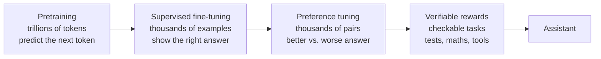

# From base model to assistant: the post-training pipeline

*Part of [Fine-tuning and post-training for the product and technology leader](./README.md)*

*Last reviewed: 2026-10 · Volatility: fast*

## TL;DR

A **base model** is trained on huge amounts of text to predict the next token. It continues text. It does not follow instructions. The assistant you talk to is that model after a second phase, called **post-training**, that costs a small fraction as much and changes how the model behaves.

Post-training has three common steps. **Supervised fine-tuning (SFT)** trains on example conversations, so the model learns the format and tone of an answer. **Preference tuning** trains on pairs of answers, one better than the other, so the model learns which kind of answer people prefer. Some pipelines add **reinforcement learning** against a checkable reward, such as a passing test.

Each step moves the model. Each step also moves things you did not ask about. This lesson shows the pipeline on a small model you can run, and what each stage changes.

> 🎯 **For the product leader**
>
> **Why it matters** — Most of what makes a model feel like a product, its manners, its format, its refusals, comes from post-training, not from the first training run. When you fine-tune, you are changing that layer.
>
> **What it changes in your decisions** — You treat fine-tuning as a way to change behaviour, with side effects, and not as a way to add knowledge. You plan for a before-and-after test of what you did not mean to change.
>
> **Ask your eng team** — *"Which stage are we changing, what data does it use, and what do we check afterwards to see what else moved?"*
>
> **Risk if ignored** — A tuned model that gives the right format and has quietly lost other skills. The loss shows up months later in a use case nobody tested.

## The mental model: raw talent, then training for the job



Pretraining builds the talent. Post-training shapes the manners. The later steps use far less data, so each one moves the model by a small, focused push. A small push in the wrong direction is still a push.

## Mechanics

### What each stage uses

| Stage | Data | What it teaches |
| --- | --- | --- |
| Pretraining | Web-scale text, no labels | Language, facts, patterns |
| Supervised fine-tuning | Prompts with ideal answers | Format, tone, how to follow an instruction |
| Preference tuning | A prompt with a better and a worse answer | Which answers people prefer |
| Reinforcement learning with checkable rewards | Tasks with an automatic check | Reasoning and tool use that pass the check |

The InstructGPT paper from OpenAI shows the scale gap. Its tuning used about 13,000 prompts for supervised training, and tens of thousands for the preference stages. Pretraining the base model used hundreds of billions of tokens. The authors report that their 1.3 billion parameter tuned model was preferred by human raters to the 175 billion parameter base model. They also report that the largest tuning run took about 60 petaflop/s-days, against about 3,640 for pretraining the base model. That is under 2%.

### Why a small step can change so much

Post-training does not add much knowledge. It points what the model already has. This is the argument of the LIMA paper, which tuned a model on only 1,000 carefully chosen examples and got strong results. The authors call it the superficial alignment hypothesis: most of what a model knows comes from pretraining, and tuning mainly teaches the format.

### Why a small step can break so much

The weights are shared. A change that makes one behaviour likely also changes the numbers behind other behaviours. Researchers call the loss of earlier skills **catastrophic forgetting**. In a large model it is usually milder than in a toy, and it is real.

## Tradeoffs and decisions

- **Behaviour vs. knowledge.** Tuning is good at format, tone and style. It is a poor way to add facts. See [lesson 6](./deciding-costing-and-checking-a-fine-tune.md).
- **Few clean examples vs. many noisy ones.** A small, checked set often beats a large messy one.
- **One stage vs. all.** Many products need only supervised tuning. Preference tuning and reinforcement learning add cost and risk.
- **Own tuning vs. the vendor's.** A vendor's assistant has already been post-trained. Your tuning sits on top of theirs.

## Failure modes

- **Tuning to add facts.** The model learns the style of the facts and not the facts.
- **Narrow data, wide damage.** A behaviour learned on one task leaks into others.
- **No before-and-after test.** The team checks the new behaviour and not the old ones.
- **Mistaking format for ability.** A model that answers in the right shape is not a model that answers correctly.

## Under the hood

The files are in `fine-tuning/code/`. `toy_lm.py` is a tiny next-word model. It has an embedding table `E` and a shared output table `U`, and gradients written by hand. It is trained on a small grammar. After the word `q`, the base model has no preference, so every word is about equally likely.

```python
def pretrained(seed=0, d=2):
    model = ToyLM(d=d, seed=seed)
    train(model, make_corpus(60, seed=1), epochs=8, lr=0.2)
    return model
```

`lesson1_pipeline.py` then runs two more stages on it. Supervised tuning shows the pair `q → answer` many times. A preference step uses the **direct preference optimization** update: raise the preferred word and lower the rejected one, scaled by how wrong the current margin is.

## Worked example: three stages on a toy

*This example is invented. The numbers come from `fine-tuning/code/lesson1_pipeline.py`.*

| Stage | P(answer after q) | P(sorry after q) | Loss on general text |
| --- | --- | --- | --- |
| Pretrained | 0.083 | 0.091 | 1.103 |
| After supervised tuning | 0.987 | 0.001 | 2.280 |
| After preference tuning | 1.000 | 0.000 | 2.677 |

**The behaviour is learned.** The chance of `answer` after `q` goes from 0.083 to 0.987.

**The rest of the model pays.** The loss on ordinary text, which has nothing to do with `q`, more than doubles, from 1.103 to 2.280. Lower is better, so the model got worse at the thing it was good at. The cause is shared weights. [Lesson 2](./supervised-fine-tuning.md) shows what limits the damage.

**Preference tuning adds a push.** The rejected word `sorry` falls to nearly zero. The general loss rises again, to 2.677. Each stage moves other things too.

## Practitioner checklist

- [ ] Do we know which stage we are changing and what data it uses?
- [ ] Are we tuning for behaviour, not for facts?
- [ ] Do we measure general ability before and after?
- [ ] Is the data small, clean and checked?
- [ ] Do we know what the vendor's own post-training already did?

## Related lessons

- [Supervised fine-tuning](./supervised-fine-tuning.md) — how much data, how fast, and what it costs the rest.
- [RAG vs. long context vs. fine-tuning](../rag-vector-databases/rag-vs-long-context-vs-finetuning.md) — which tool for which need.
- [Fine-tuning vs. ICL vs. RAG vs. distillation](../content/06-strategy-tradeoffs/finetune-vs-icl-vs-rag.md) — the strategy view.
- [What an LLM actually is](../llms/what-is-an-llm.md) — training and inference.
- [Training: loss and gradient descent](../machine-learning/training-loss-and-gradient-descent.md) — the loop every stage uses.

## Sources

- Ouyang et al., *Training language models to follow instructions with human feedback* (InstructGPT), NeurIPS 2022 ([arxiv.org/abs/2203.02155](https://arxiv.org/abs/2203.02155)): the three-step pipeline, the data sizes, the preference of raters for the 1.3 billion parameter model, and the compute comparison.
- Zhou et al., *LIMA: Less Is More for Alignment*, NeurIPS 2023 ([arxiv.org/abs/2305.11206](https://arxiv.org/abs/2305.11206)): strong results from 1,000 curated examples, and the superficial alignment hypothesis.
- Wei et al., *Finetuned Language Models Are Zero-Shot Learners* (FLAN), ICLR 2022 ([arxiv.org/abs/2109.01652](https://arxiv.org/abs/2109.01652)): instruction tuning.
- McCloskey and Cohen, *Catastrophic interference in connectionist networks*, 1989: forgetting when a network learns new data.
- The toy model and every number are invented. They come from `fine-tuning/code/`. This module's sources were not re-opened during the build, and its fact-check is pending.
