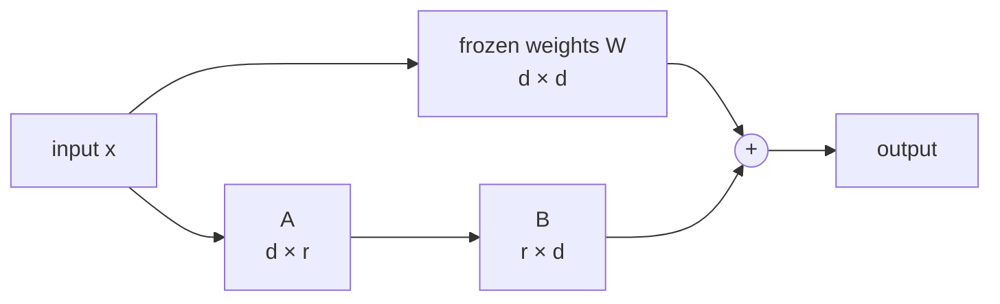

# LoRA and parameter-efficient tuning

*Part of [Fine-tuning and post-training for the product and technology leader](./README.md)*

*Last reviewed: 2026-10 · Volatility: fast*

## TL;DR

Full fine-tuning updates every weight. For a model with billions of weights, that needs memory for the weights, their gradients and the optimizer's running averages, about 16 bytes per weight in the usual setup. A 7 billion parameter model then needs around 100 GiB before the first batch.

**LoRA**, short for low-rank adaptation, freezes the model and learns a small add-on instead. For a large matrix, it trains two thin matrices whose product is the change. The thin matrices hold well under 1% of the weights. The training memory falls to a little more than the cost of holding the frozen model.

The add-on is small. You can store one per customer or task, load it next to one shared base model, and drop it to get the base model back exactly. LoRA does not stop the add-on from hurting general ability, but it makes the damage reversible and cheap to test.

> 🎯 **For the product leader**
>
> **Why it matters** — LoRA moves tuning from a cluster job to a single-machine job, and turns "a model per customer" from a storage nightmare into a file per customer.
>
> **What it changes in your decisions** — Tuning experiments get cheap, so you can run several and compare. Customization per tenant becomes realistic. Your serving system must be able to swap adapters.
>
> **Ask your eng team** — *"What rank and which matrices did we adapt, how does each adapter compare with the base on a general test, and can we serve many adapters on one base?"*
>
> **Risk if ignored** — A plan that assumes tuning needs a cluster, or the opposite: a fleet of adapters with no test showing that any of them still behaves well outside its own task.

## The mental model: a thin patch over a frozen sheet

Imagine a large printed map you cannot redraw. LoRA lays a thin, transparent sheet over it with a few corrections. The sheet is cheap to make and cheap to store. Lift it and the map is as before.



The output is `W·x + A·B·x`. Only `A` and `B` are trained. The rank `r` is small, often 8 to 64, against a width `d` in the thousands.

## Mechanics

### How many parameters

A `d × d` matrix has `d²` weights. A low-rank change has `A` of size `d × r` and `B` of size `r × d`, which is `2dr` weights. For `d = 4,096` and `r = 16`, that is 131,072 against 16,777,216 for the full matrix: 0.78%.

### Why it works

Hu and colleagues argued that the change a model needs for a new task has a low intrinsic rank. A small number of directions carries most of the update. So a thin patch is enough for many tasks, though not for all. Tasks that need broad new knowledge may need a higher rank, or full tuning.

### The starting point

`B` starts at zero. So `A·B` starts at zero, and the model starts exactly as the base model. Training then moves it away.

### Memory

With mixed precision and the Adam optimizer, each trained weight costs about 16 bytes: 2 for the weight, 2 for its gradient and 12 for the optimizer state. Full tuning pays that for every weight. LoRA pays it only for the add-on, and keeps the frozen weights at 2 bytes each. **QLoRA** goes further and holds the frozen weights in 4 bits. Dettmers and colleagues used it to tune a 65 billion parameter model on one 48 GB accelerator.

### Serving

An adapter can be merged into the weights for no extra latency. It can also be kept separate and swapped per request, so one base model serves many customers.

## Tradeoffs and decisions

- **Rank.** A low rank is small and may underfit. A high rank is closer to full tuning and costs more.
- **Which matrices.** Adapting attention matrices is common. Adding the feed-forward layers gives more capacity and more parameters.
- **Merged vs. swappable.** Merging is simplest to serve. Swapping gives per-customer behaviour from one base.
- **LoRA vs. full tuning.** Full tuning can learn more and costs far more.

## Failure modes

- **Assuming safety.** An adapter can hurt general ability. It is only easy to remove.
- **Rank too low.** The adapter cannot hold the behaviour, and training loss stalls.
- **Adapter and base mismatch.** An adapter trained on one base is loaded on another, or on a newer version.
- **Untested merges.** Merging into quantized weights can shift outputs slightly.
- **Adapter sprawl.** Hundreds of adapters with no owner and no tests.

## Under the hood

The file is `fine-tuning/code/lesson3_lora.py`. The toy model has an `add_lora(rank)` method. The two factors `A` and `B` sit beside the frozen tables, and `B` starts as zeros. Training with `lora_only=True` updates only the factors.

```python
tuned = base.copy()
tuned.add_lora(rank=1)
train(tuned, [(Q, ANS)] * 50, epochs=3, lr=0.2, lora_only=True)
tuned.A = tuned.B = None          # drop the adapter: the base model is back
```

The file also counts parameters and memory for a 7B-class shape.

## Worked example: a patch on a toy, and the cost at scale

*This example is invented. The numbers come from `fine-tuning/code/lesson3_lora.py`.*

**The adapter starts as a no-op.** Before training, the model's output differs from the base model's by exactly 0.

**It learns the behaviour.** After training only the adapter, the chance of the target word after `q` is 0.988. The base weights are untouched.

**It can still hurt.** General loss is 1.103 for the base model. With the adapter loaded, it is 7.650. The adapter pushes `answer` up in every context, not only after `q`. LoRA limits what can change. It does not make the change safe.

**It is reversible.** With the adapter dropped, the general loss is 1.103 again, exactly the base value.

**It is small.** The toy has 48 trainable weights in full tuning and 14 in the adapter.

**At scale.** A 7B-class model with 32 layers, width 4,096, and rank 16 on two matrices per layer:

| | Trainable parameters | Training memory |
| --- | --- | --- |
| Full tuning | 6.74 billion | about 100 GiB |
| LoRA, rank 16 | 8.4 million (0.12%) | about 12.7 GiB |

The memory counts weights, gradients and optimizer state, and leaves out activations. The lesson on [batching, memory and precision](../tensors/batching-memory-and-precision.md) explains where the 16 bytes come from.

## Practitioner checklist

- [ ] Do we know the rank, the adapted matrices and the share of trainable parameters?
- [ ] Is each adapter tested on a general set, not only on its own task?
- [ ] Do we record which base model and version each adapter was trained on?
- [ ] Can our serving stack swap adapters per request, or merge them safely?
- [ ] Is there an owner and a retirement rule for each adapter?

## Related lessons

- [Supervised fine-tuning](./supervised-fine-tuning.md) — the training LoRA makes cheaper.
- [Batching, memory and precision](../tensors/batching-memory-and-precision.md) — the 16 bytes per weight.
- [Quantization formats](../content/01-inference-internals/quantization-formats.md) — the 4-bit base used by QLoRA.
- [Matrix multiplication: the workhorse](../tensors/matrix-multiplication.md) — why a thin product is cheap.
- [Multi-tenant isolation](../content/05-safety-multitenancy/multi-tenant-isolation.md) — one adapter per customer, and what must not leak.

## Sources

- Hu et al., *LoRA: Low-Rank Adaptation of Large Language Models*, ICLR 2022 ([arxiv.org/abs/2106.09685](https://arxiv.org/abs/2106.09685)): the low-rank update, the zero initialization of one factor, and the reported cuts in trainable parameters and memory for a 175 billion parameter model.
- Dettmers et al., *QLoRA: Efficient Finetuning of Quantized LLMs*, NeurIPS 2023 ([arxiv.org/abs/2305.14314](https://arxiv.org/abs/2305.14314)): 4-bit frozen weights, and tuning a 65 billion parameter model on one 48 GB accelerator.
- The toy model and every number are invented or illustrative. They come from `fine-tuning/code/lesson3_lora.py`. This module's sources were not re-opened during the build, and its fact-check is pending.
