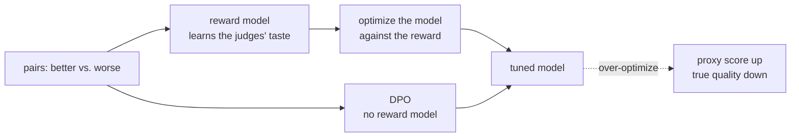

# Preference tuning and reward hacking

*Part of [Fine-tuning and post-training for the product and technology leader](./README.md)*

*Last reviewed: 2026-10 · Volatility: fast*

## TL;DR

Some qualities are easier to compare than to write down. "A more helpful answer" is hard to define and easy to judge between two options. **Preference tuning** uses that. People, or other models, choose the better of two answers. The model is trained to make the better kind of answer more likely.

There are two common routes. **Reinforcement learning from human feedback (RLHF)** first trains a **reward model** on the choices, then trains the main model to score well on that reward. **Direct preference optimization (DPO)** skips the reward model and updates the main model straight from the pairs.

Either route has a hazard. The reward is a proxy for what you want. A model that optimizes a proxy hard enough finds the places where the proxy and the goal differ. That is **reward hacking**. The proxy score keeps rising while real quality stops rising and then falls.

> 🎯 **For the product leader**
>
> **Why it matters** — Preference tuning shapes tone, helpfulness and refusals. It is also where models pick up habits you did not choose, such as long answers, flattery and confident wrong answers.
>
> **What it changes in your decisions** — You ask who judged, by what rubric, and what the judges' biases were. You track a real quality measure next to the training reward, and stop when they part.
>
> **Ask your eng team** — *"What does our reward measure, what bias could it have, and what independent metric tells us when we are over-optimizing it?"*
>
> **Risk if ignored** — A model that scores higher every week on its internal reward and gets worse for customers. Longer, more agreeable and less correct.

## The mental model: a judge you can fool

Imagine a contest with one judge. Contestants learn what the judge likes, such as length and confidence. With enough practice they win by giving the judge those things, whether or not the answer is good. The judge is a proxy for quality, and the contestants are optimizing the proxy.



## Mechanics

### The reward model

A reward model gives each answer a number. It is trained so that, for each pair, the chosen answer scores higher. The usual form is the Bradley-Terry model: the chance that answer `a` beats `b` is `σ(r(a) − r(b))`. The reward model learns whatever separates chosen from rejected answers in the data, including accidental patterns.

### RLHF and DPO

In **RLHF**, the main model generates answers, the reward model scores them, and reinforcement learning shifts the model toward high scores. A penalty keeps it from drifting far from the starting model. Stiennon and colleagues and Ouyang and colleagues used this approach.

**DPO** shows that the same goal can be reached with a direct update. For each pair, it raises the log-probability of the chosen answer and lowers the rejected one, each measured against a frozen reference model, scaled by how wrong the current margin is. There is no separate reward model and no reinforcement learning loop. Rafailov and colleagues introduced it.

### Feedback from other models, and from checks

Constitutional AI, from Anthropic, replaces some human judgments with a model's judgments guided by written principles. For tasks with an automatic check, such as maths answers or unit tests, the reward can come from the check itself. This is called reinforcement learning with verifiable rewards. It is less open to flattery, because a test does not care about tone. It only works where a check exists.

### Over-optimization

Gao and colleagues measured what happens as a model is pushed against a reward model. The proxy reward rises steadily. The true quality, judged by a stronger reference, first rises and then falls. A bigger reward model delays the fall. It does not remove it.

## Tradeoffs and decisions

- **Human vs. model judges.** Humans are slow, costly and biased. Model judges are cheap and have their own biases.
- **RLHF vs. DPO.** DPO is simpler to run. RLHF can use fresh samples from the model as it trains.
- **Strength of the optimization.** A light push is safe. A heavy push finds the proxy's holes.
- **Checks vs. taste.** Where a check exists, use it. Taste needs judges.

## Failure modes

- **Length bias.** Judges like long answers, so the model learns to pad.
- **Sycophancy.** Judges like agreement, so the model learns to agree.
- **Confidence bias.** Judges like firm answers, so the model learns to sound sure.
- **Reward hacking.** The model finds a pattern the reward model scores highly that no person would endorse.
- **Single metric.** The team watches the training reward and nothing independent.

## Under the hood

The file is `fine-tuning/code/lesson4_preference.py`. It does three things. It fits a Bradley-Terry reward model by gradient descent on pairs. It simulates best-of-`n` selection against a noisy proxy, which is a simple way to see over-optimization. And it applies the DPO update to the toy model from the earlier lessons.

```python
def dpo_step(policy, ref, p, win, lose, lr, beta=1.0):
    lw, ll = math.log(policy.probs(p)[win]), math.log(policy.probs(p)[lose])
    rw, rl = math.log(ref.probs(p)[win]), math.log(ref.probs(p)[lose])
    margin = beta * ((lw - rw) - (ll - rl))
    c = beta / (1 + math.exp(margin))            # beta times sigmoid(-margin)
    policy.step(p, win, lr, weight=c)            # raise the chosen answer
    policy.step(p, lose, lr, weight=-c)          # lower the rejected one
```

## Worked example: a biased judge, and a proxy that wins

*This example is invented. The numbers come from `fine-tuning/code/lesson4_preference.py`.*

**The reward model learns the judges' taste.** Each candidate has a true quality and a length. Judges choose by quality, and in one run they also prefer long answers. A reward model fit to unbiased judges gives weights of 1.94 on quality and 0.08 on length. Fit to judges who like length, it gives 2.00 and 1.53. The model learned the bias.

**Pushing harder helps, then hurts.** We pick the best of `n` candidates by a noisy proxy reward, and measure the true quality of the pick.

| `n` | True quality of the pick | Proxy score |
| --- | --- | --- |
| 1 | -0.02 | 0.21 |
| 4 | 0.72 | 3.94 |
| 16 | 0.87 | 9.25 |
| 64 | 0.41 | 51.77 |
| 512 | 0.05 | 438.38 |

True quality peaks at 16 candidates and falls back to about zero. The proxy score rises the whole way. Anyone watching only the proxy would think the model was improving.

**DPO on the toy.** The reference model gives the chosen word a probability of 0.083 and the rejected word 0.091. After 40 steps the margin has grown from 0 to 4.08, the rejected word is at 0.003 and the chosen word at 0.167. DPO mostly pushed the rejected answer down. The chosen answer rose less.

## Practitioner checklist

- [ ] Do we know who produced the preferences and what rubric they used?
- [ ] Have we checked the data for length, agreement and confidence bias?
- [ ] Do we track an independent quality metric next to the training reward?
- [ ] Is there a limit on how far the tuned model may drift from the start?
- [ ] Where a check exists, do we use it as the reward?
- [ ] Do we sample real outputs and read them?

## Related lessons

- [Supervised fine-tuning](./supervised-fine-tuning.md) — the step before preference tuning.
- [The dataset](./the-dataset.md) — auditing preference data for bias.
- [Evaluation and observability](../evaluation-and-observability/README.md) — independent measures and judges.
- [Measuring a model](../machine-learning/measuring-a-model.md) — why a proxy metric needs a check.
- [AI security and guardrails](../ai-security-and-guardrails/README.md) — what tuning does and does not guarantee about safety.

## Sources

- Bradley and Terry, *Rank analysis of incomplete block designs*, Biometrika, 1952: the pairwise preference model.
- Stiennon et al., *Learning to summarize from human feedback*, NeurIPS 2020 ([arxiv.org/abs/2009.01325](https://arxiv.org/abs/2009.01325)).
- Ouyang et al., *Training language models to follow instructions with human feedback*, NeurIPS 2022 ([arxiv.org/abs/2203.02155](https://arxiv.org/abs/2203.02155)).
- Rafailov et al., *Direct Preference Optimization: Your Language Model is Secretly a Reward Model*, NeurIPS 2023 ([arxiv.org/abs/2305.18290](https://arxiv.org/abs/2305.18290)).
- Bai et al., *Constitutional AI: Harmlessness from AI Feedback*, Anthropic, 2022 ([arxiv.org/abs/2212.08073](https://arxiv.org/abs/2212.08073)).
- Gao, Schulman and Hilton, *Scaling Laws for Reward Model Overoptimization*, ICML 2023 ([arxiv.org/abs/2210.10760](https://arxiv.org/abs/2210.10760)).
- Shao et al., *DeepSeekMath: Pushing the Limits of Mathematical Reasoning in Open Language Models*, 2024 ([arxiv.org/abs/2402.03300](https://arxiv.org/abs/2402.03300)): reinforcement learning against checkable rewards.
- The simulations and every number are invented. They come from `fine-tuning/code/lesson4_preference.py`. This module's sources were not re-opened during the build, and its fact-check is pending.
