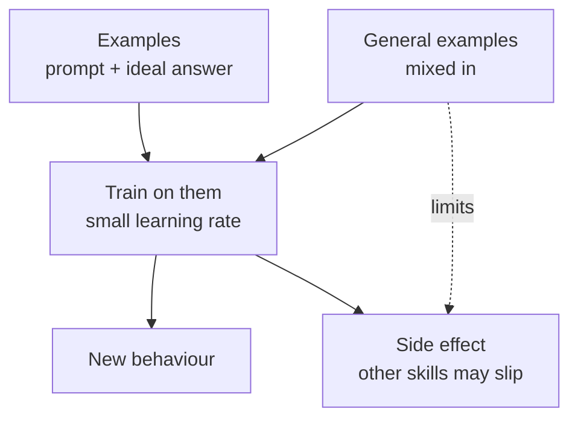

# Supervised fine-tuning

*Part of [Fine-tuning and post-training for the product and technology leader](./README.md)*

*Last reviewed: 2026-10 · Volatility: fast*

## TL;DR

**Supervised fine-tuning (SFT)** continues training a model on examples of the behaviour you want: a prompt and the answer you would accept. The model learns to produce answers like them.

Four things decide how it goes. **How much data.** A few examples do little and enough do a lot. **How fast you learn.** A high learning rate teaches faster and forgets more. **What else you feed it.** Mixing in general examples keeps the rest of the model steady. **How clean the labels are.** The model learns your mistakes as faithfully as your intent.

The practical rule is to start small. Use a few hundred examples that a careful person checked. Measure the new behaviour and the old ones. Then add data only where a test shows a gap.

> 🎯 **For the product leader**
>
> **Why it matters** — SFT is the tuning most teams will do. It is cheap to start and easy to get subtly wrong. The cost is in the data and the checks, not the training run.
>
> **What it changes in your decisions** — You invest in a small set of excellent examples and a test set. You budget time for review, and you set a limit on how much general ability you will trade.
>
> **Ask your eng team** — *"Who wrote and checked the examples, what share are wrong or inconsistent, and how did general performance change?"*
>
> **Risk if ignored** — A model that learns the quirks and errors of a rushed dataset. A third of the labels are guesses, and the model guesses the same way.

## The mental model: practice on one drill

Think of a skilled player who drills one shot for a week. The shot gets better. If the drilling is intense and narrow, other parts of the game slip. If the coach mixes in the full game, the player keeps balance. And if the coach demonstrates the shot wrongly, the player learns it wrongly.



## Mechanics

### What SFT does to the weights

SFT is ordinary training with a different dataset. For each example, the model predicts the answer's tokens, the loss measures the error, and the weights move a small step to reduce it. The same weights serve every task, so a step for one example nudges all behaviours.

Usually the loss is counted only on the answer tokens. The prompt is context, not something to imitate.

### The four dials

**Quantity.** A model needs enough steps to learn the behaviour. Below that, nothing changes. Above it, the behaviour appears quickly. The LIMA paper found that 1,000 well-chosen examples were enough for good general behaviour. Quality matters more than count.

**Learning rate and steps.** These set how far the weights move. Too little and nothing is learned. Too much and the model overshoots and forgets.

**Replay.** Mixing examples of ordinary behaviour into the tuning set is a common fix for forgetting. It reminds the model of what to keep.

**Label quality.** The model matches the distribution of its examples. If 1 in 4 answers is wrong, it learns to be wrong about 1 time in 4.

## Tradeoffs and decisions

- **More examples vs. better examples.** Extra data helps until noise outweighs it. A small checked set is often better.
- **Speed vs. safety.** A larger learning rate finishes sooner and forgets more.
- **Narrow vs. broad.** Narrow data gives a sharp behaviour and more side effects. Broader data costs more to write.
- **Replay data vs. cost.** Replay costs compute and needs a representative general set.

## Failure modes

- **Too few steps.** The team concludes that tuning does not work.
- **Too many steps.** The behaviour is learned and the rest of the model is damaged.
- **Inconsistent labels.** Two writers answer the same question in different ways.
- **Wrong labels.** Errors in the data become errors in the model.
- **Evaluating on training data.** The new behaviour looks perfect because the model has seen the test.

## Under the hood

The file is `fine-tuning/code/lesson2_sft.py`. It runs four experiments on the toy model from [lesson 1](./from-base-model-to-assistant.md). Each starts from the same pretrained model and measures two things: how likely the target behaviour is, and the loss on general text.

```python
def run(model, data, epochs=1, lr=0.2):
    m = model.copy()
    train(m, data, epochs=epochs, lr=lr)
    return m.probs(Q)[ANS], avg_loss(m, HELD), m
```

The four experiments vary the number of examples, the learning rate, the amount of general data mixed in, and the share of wrong labels.

## Worked example: four dials on a toy

*This example is invented. The numbers come from `fine-tuning/code/lesson2_sft.py`. General loss before tuning is 1.103. Lower is better.*

**Quantity.** One pass at learning rate 0.2.

| Examples | P(target behaviour) | General loss |
| --- | --- | --- |
| 0 | 0.083 | 1.103 |
| 5 | 0.091 | 1.103 |
| 20 | 0.215 | 1.132 |
| 50 | 0.980 | 2.202 |

Five examples change almost nothing. Fifty change the behaviour and double the loss on general text.

**Learning rate.** 20 examples, 3 passes.

| Learning rate | P(target behaviour) | General loss |
| --- | --- | --- |
| 0.05 | 0.129 | 1.108 |
| 0.2 | 0.987 | 2.280 |
| 0.5 | 0.997 | 2.538 |
| 1.0 | 0.999 | 2.809 |

A higher learning rate forgets more at every step of the sweep.

**Replay.** 20 examples, 3 passes, with some general text mixed in.

| General pairs mixed in | P(target behaviour) | General loss |
| --- | --- | --- |
| 0 | 0.987 | 2.280 |
| 60 | 0.963 | 1.195 |
| 240 | 0.929 | 0.980 |

Mixing in general text keeps the new behaviour and removes most of the damage. The behaviour is a little less sharp.

**Noise.** 50 examples, 12 of which carry the wrong answer. After tuning, the model gives the target answer with probability 0.561 and the wrong one with 0.411. Before tuning, the wrong one had 0.091. The model learned the mistake.

## Practitioner checklist

- [ ] Is the dataset small, written by experts and checked by a second person?
- [ ] Do the examples agree with each other on the same inputs?
- [ ] Do we use a low learning rate and a few passes, and stop early?
- [ ] Do we mix general examples into the tuning set?
- [ ] Do we measure the new behaviour and general ability on held-out tests?
- [ ] Is the test set kept out of the training data?

## Related lessons

- [From base model to assistant](./from-base-model-to-assistant.md) — where SFT sits in the pipeline.
- [LoRA and parameter-efficient tuning](./lora-and-parameter-efficient-tuning.md) — a cheaper way to run the same training.
- [The dataset](./the-dataset.md) — building and auditing the examples.
- [Generalization: overfitting and bias-variance](../machine-learning/generalization-overfitting-and-bias-variance.md) — why held-out tests matter.
- [Data: features, labels and leakage](../machine-learning/data-features-labels-and-leakage.md) — label quality and leakage in general.

## Sources

- Zhou et al., *LIMA: Less Is More for Alignment*, NeurIPS 2023 ([arxiv.org/abs/2305.11206](https://arxiv.org/abs/2305.11206)): 1,000 curated examples, and quality over quantity.
- Kirkpatrick et al., *Overcoming catastrophic forgetting in neural networks*, PNAS 2017 ([arxiv.org/abs/1612.00796](https://arxiv.org/abs/1612.00796)): forgetting and ways to limit it.
- Ouyang et al., *Training language models to follow instructions with human feedback*, NeurIPS 2022 ([arxiv.org/abs/2203.02155](https://arxiv.org/abs/2203.02155)): mixing pretraining data into the reinforcement learning stage (called PPO-ptx in the paper) to limit regressions on public tasks.
- The toy model and every number are invented. They come from `fine-tuning/code/lesson2_sft.py`. This module's sources were not re-opened during the build, and its fact-check is pending.
