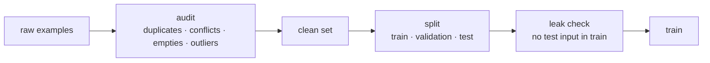

# The dataset: quality, duplicates, contamination and synthetic data

*Part of [Fine-tuning and post-training for the product and technology leader](./README.md)*

*Last reviewed: 2026-10 · Volatility: fast*

## TL;DR

In a fine-tune, the data is the product. The training code is standard. The dataset is yours, and every flaw in it ends up in the model.

Five flaws are common and cheap to find. **Duplicates** make the model over-learn some answers. **Near duplicates** do the same with slight rewording. **Conflicts** give two different answers to the same question, so the model learns to waver. **Empty and outlier examples** teach nonsense. And **leaks**, where a test question also appears in training, make the evaluation meaningless.

You can find all five with short scripts, before spending on training. A second source of risk is **synthetic data**, where another model writes the examples. It is fast and cheap. It also passes on that model's errors and style, and its terms of use may limit what you may train.

> 🎯 **For the product leader**
>
> **Why it matters** — Teams spend weeks on training runs and hours on the data. The reverse is the better ratio. An audit costs almost nothing and can save a failed run.
>
> **What it changes in your decisions** — You make a data audit a gate before training, with an owner. You decide who may write examples and who reviews them. You read the licence of any model that writes your data.
>
> **Ask your eng team** — *"What did the audit find, how many duplicates, conflicts and leaks, and how did we fix each?"*
>
> **Risk if ignored** — A model that scores 95% on a test it has already seen, and fails on real users. Or a dataset whose provenance and licence nobody can state.

## The mental model: the model is a mirror

The model matches its data. If 5% of examples are duplicates, it favours them. If two answers conflict, it splits the difference. If the test leaked into training, it recites. So you do not ask whether the training worked. You ask what the data was.



## Mechanics

### The audit

| Check | What it finds | Why it matters |
| --- | --- | --- |
| Exact duplicates | The same pair twice | Over-weights that answer |
| Near duplicates | Pairs that differ by case or a word | Same, and harder to see |
| Conflicts | One question, different answers | The model learns to hedge or guess |
| Empty answers | Blank or truncated outputs | Teaches the model to say nothing |
| Length outliers | Pairs far longer than the rest | Teaches runaway output |
| Leaks | A test input also in training | Inflates the score |

Near duplicates can be found by comparing sets of word triples, called shingles, with a Jaccard score. Lee and colleagues showed that removing duplicates from training text makes language models better and reduces memorization.

### Splits and leaks

Split before you tune, and keep the test set out of every later step, including prompt tuning and data generation. A leak does not have to be exact. A paraphrase of a test question in training counts. The audit should compare normalized text, and for important sets, embeddings.

### Where examples come from

- **Experts.** Slow, costly, and the best signal.
- **Production logs.** Realistic, and may hold personal data and the model's own past mistakes.
- **Synthetic data.** A stronger model writes prompts or answers. It scales, and it copies the teacher's errors, style and gaps. Using one model's outputs to train another is called **distillation**. Hinton and colleagues described the idea. Terms of service may restrict it, so check them.
- **Public datasets.** Convenient, and often overlap with what base models have seen.

### Fine-tuning on facts

Gekhman and colleagues found that models learn examples containing new facts more slowly than examples that match what they already know, and that learning them increases hallucination. That is another reason to tune for behaviour and retrieve for facts.

## Tradeoffs and decisions

- **Size vs. cleanliness.** Pruning bad examples shrinks the set and raises its quality.
- **Real vs. synthetic.** Real data is closer to use and scarcer. Synthetic data is cheap and carries the teacher's flaws.
- **Strict vs. loose leak checks.** Strict checks remove more training data and give a more honest score.
- **Privacy.** Logs can hold personal data. Clean or remove it before it reaches a training run.

## Failure modes

- **Leaked test set.** The score is high and the product is poor.
- **Unreviewed synthetic data.** The model learns the teacher's mistakes with full confidence.
- **Conflicting guidelines.** Two annotator groups follow different rules.
- **Stale data.** Examples reflect last year's policy.
- **Unknown licence.** Nobody can say if the data may be used for training.

## Under the hood

The file is `fine-tuning/code/lesson5_dataset.py`. It audits a small invented support dataset in which each problem was planted on purpose. The near-duplicate check uses shingles:

```python
def shingles(text, k=3):
    words = normalize(text).split()
    return {tuple(words[i:i + k]) for i in range(max(1, len(words) - k + 1))}

def jaccard(a, b):
    return len(a & b) / len(a | b) if a | b else 0.0
```

Other checks compare normalized questions for conflicts, flag blank answers, flag answers more than 2.5 standard deviations longer than average, and match evaluation questions against training questions.

## Worked example: an audit that finds six problems

*This example is invented. The data and numbers come from `fine-tuning/code/lesson5_dataset.py`.*

The training set has 14 support questions with answers. We planted problems. The evaluation set has 2 questions. The audit reports:

| Check | Found | Where |
| --- | --- | --- |
| Exact duplicates | 1 | Row 1 repeats row 0 |
| Near duplicates | 2 | Row 2 is the same question in lower case, close to rows 0 and 1 |
| Conflicts | 1 | Rows 3 and 4 answer the refund question in opposite ways |
| Empty answers | 1 | Row 10 |
| Length outliers | 1 | Row 11 |
| Leaks | 1 | The first evaluation question is also in training |

Every planted problem is found. None would stop a training run. All would shape the model. The leak is the most damaging, because it would make the test score look better than the model is.

## Practitioner checklist

- [ ] Is there a data audit gate before training, with an owner?
- [ ] Have we removed duplicates and near duplicates?
- [ ] Do conflicting answers get resolved by a written rule?
- [ ] Is the test set split off first and checked for leaks, including paraphrases?
- [ ] Do we know where each example came from and whether we may train on it?
- [ ] Is personal data removed from logs before use?
- [ ] Is synthetic data sampled and read by a person?

## Related lessons

- [Supervised fine-tuning](./supervised-fine-tuning.md) — what the model does with the data.
- [Data: features, labels and leakage](../machine-learning/data-features-labels-and-leakage.md) — leakage in general.
- [Speculative decoding, quantization and distillation](../content/01-inference-internals/speculative-quantization-distillation.md) — distillation as a serving technique.
- [AI security and guardrails](../ai-security-and-guardrails/README.md) — data poisoning.
- [Access control](../access-control/README.md) — who may see the data that trains a shared model.

## Sources

- Lee et al., *Deduplicating Training Data Makes Language Models Better*, ACL 2022 ([arxiv.org/abs/2107.06499](https://arxiv.org/abs/2107.06499)).
- Hinton, Vinyals and Dean, *Distilling the Knowledge in a Neural Network*, 2015 ([arxiv.org/abs/1503.02531](https://arxiv.org/abs/1503.02531)).
- Gekhman et al., *Does Fine-Tuning LLMs on New Knowledge Encourage Hallucinations?*, EMNLP 2024 ([arxiv.org/abs/2405.05904](https://arxiv.org/abs/2405.05904)).
- Zhou et al., *LIMA: Less Is More for Alignment*, NeurIPS 2023 ([arxiv.org/abs/2305.11206](https://arxiv.org/abs/2305.11206)): a small, curated dataset.
- The dataset and every number are invented. They come from `fine-tuning/code/lesson5_dataset.py`. This module's sources were not re-opened during the build, and its fact-check is pending.
