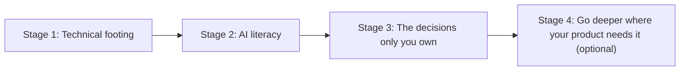
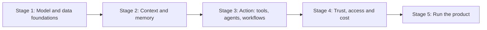
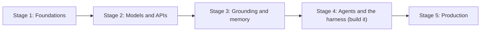
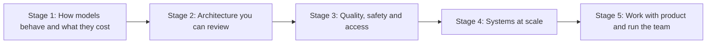

# Visual learning paths

*Part of [Learning paths](./README.md)*

## TL;DR

Each learning path is a list of stages. This page draws each path as one picture. The bars show how many hours each stage takes. The rows below them show what each stage reads, track by track, and which visual explainers it uses. The numbers come from the same data as the path pages, so the two always agree.

> 🎯 **For anyone choosing a path**
>
> **Why it matters** — A path is a time commitment. A picture shows its shape at a glance: where the hours go and what you read first.
>
> **What it changes in your decisions** — You can plan your weeks around the longest stage, and see which explainers to read first.
>
> **Ask yourself** — *"Which stage of my path is the longest, and do I have the weeks for it?"*
>
> **Risk if ignored** — You start a path without seeing its biggest stage, and stall halfway.

## How to read a picture

Every picture has two parts. The bars at the top show the hours for each stage, rounded to the nearest half hour. The rows below list the stages in order. Each row names the stage, its hours and its lesson count. Then it lists the tracks it reads, with the number of lessons from each, and the explainers it uses.

Read the explainers in a stage first. Each one follows a single example through a system in about ten minutes, so the lessons that follow are easier.

## 1. Senior PM

For a product manager with several years of experience who is starting to own AI features. 4 stages, about 21 hours in all. Full lesson lists, checkpoints and skip-ahead rules are on the [Senior PM path page](./senior-product-manager.md). Read the story: [A senior PM's path, one stage at a time](../explainers/one-senior-pm-path.md) follows one learner through this path.

## 2. AI Product Lead

For a product leader who owns an AI product line or a team of PMs shipping AI features. 5 stages, about 32 hours in all. Full lesson lists, checkpoints and skip-ahead rules are on the [AI Product Lead path page](./ai-product-lead.md). Read the story: [An AI product lead's path, one stage at a time](../explainers/one-ai-product-lead-path.md) follows one learner through this path.

## 3. AI Engineer

For a software engineer who builds AI-powered systems. 5 stages, about 86 hours in all. Full lesson lists, checkpoints and skip-ahead rules are on the [AI Engineer path page](./ai-engineer.md). Read the story: [An AI engineer's path, one stage at a time](../explainers/one-ai-engineer-path.md) follows one learner through this path.

## 4. AI Engineering Lead

For an engineering manager or tech lead who runs a team that builds AI systems. 5 stages, about 44.5 hours in all. Full lesson lists, checkpoints and skip-ahead rules are on the [AI Engineering Lead path page](./ai-engineering-lead.md). Read the story: [An AI engineering lead's path, one stage at a time](../explainers/one-ai-engineering-lead-path.md) follows one learner through this path.

## Worked example: reading one picture

Take the AI Engineer picture. The longest bar is stage 4, agents and the harness (build it), at about 29.5 hours, out of about 86 hours for the whole path. Its row shows why: Tool calling 2 · AI agents 1 · Agentic workflows 3 · AI engineering stack 1 · Harness engineering: 6 phases to build. An engineer with 9 hours a week should plan about 4 weeks for that stage alone. That is the stage to protect in the calendar.

## Failure modes

- **Reading the bars as value.** A long bar means more reading, not more importance. Short stages often hold the decisions.
- **Treating hours as measured.** The hours are a rule of thumb from lesson counts. Your pace will differ.
- **Skipping the explainers.** They are short, and they make the lessons after them faster to read.
- **Reading the picture instead of the path.** The picture shows the shape. The path page has the lessons, the checkpoints and the skip rules.

## Practitioner checklist

- [ ] Have I found my path's longest stage, and planned the weeks for it?
- [ ] Do I know which explainers my path uses, and in which stage?
- [ ] Have I read the path page's skip-ahead rules for what I already know?

## Under the hood: how the pictures are made

The pictures and the path pages come from one data structure in `scripts/gen_learning_paths.py`. Stage hours use the same rule as the path pages: 25 minutes per reading lesson, 60 minutes per harness lesson that you build, and 120 minutes to skim a harness phase. The total is then rounded to the nearest half hour. The same script writes each figure to `diagrams/learning-paths/visual-paths-<n>.html`, using the figure builders in `scripts/explainer_figures.py`. The build swaps each figure in for the matching diagram on this page. So a change to a path changes its page and its picture together.

## Related lessons

- [Senior PM path](./senior-product-manager.md)
- [AI Product Lead path](./ai-product-lead.md)
- [AI Engineer path](./ai-engineer.md)
- [AI Engineering Lead path](./ai-engineering-lead.md)
- [Visual explainers](../explainers/README.md) — the explainers named in the pictures.
- [Recap: paths compared](./recap.md)

## Sources

All numbers on this page come from the path data in this repository. The time estimates are this course's rule of thumb, not measured results. The page makes no claims beyond the paths themselves.
