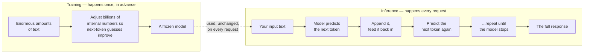
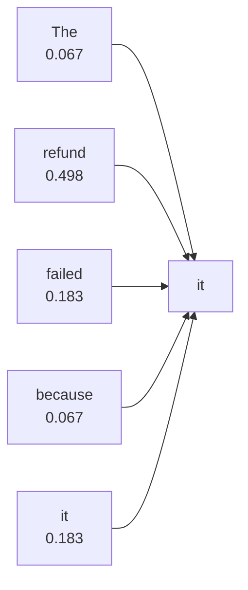

# What an LLM actually is

*Part of [LLMs for the product leader](./README.md)*

*Last reviewed: 2026-10 · Volatility: fast*

## TL;DR

A large language model does one thing: given some text, it predicts the most likely next
small piece of text, called a **token**. It does this once, appends the result, and does it
again, and again, until it decides to stop. A sentence, a paragraph, a whole essay is built
this way, one token at a time. There is no separate "understanding" step and no lookup
table of answers. The skill comes entirely from **training**: the model reads enormous
amounts of text beforehand and adjusts billions of internal numbers so its next-token
guesses get better and better. Once training ends, the model is frozen. Every time your
product calls it afterward is **inference** — using the frozen model to make guesses, not
teaching it anything new. This single mechanism, next-token prediction, explains far more
of an LLM's behavior, and its limits, than any product leader expects on first hearing it.

> 🎯 **For the product leader**
>
> **Why it matters** — Every question you will ask about an LLM later in this module — why
> it forgets, why it's confident and wrong, why the same prompt costs money each time — has
> its root in this one fact: the model predicts the next token, and nothing more.
>
> **What it changes in your decisions** — You stop expecting the model to "know" things the
> way a database knows a row. You start treating it as a very capable guesser, and you
> design your product to check its guesses where being wrong is costly.
>
> **Ask yourself** — *"When our model gives a confident, wrong answer, are we surprised
> because we've been thinking of it as a database instead of a predictor?"*
>
> **Risk if ignored** — A team builds a feature that assumes the model "remembers" a fact
> it was told once, or "knows" something outside its training, and discovers the failure
> only after a customer does.

## The mental model: an extremely well-read guesser

Picture someone who has read a meaningful share of the internet, every book they could get,
and millions of conversations, and who has one skill, honed to an extraordinary degree:
given the start of a sentence, guess the next word. Do that guess over and over, feeding
each guess back in as new input, and you get a full response. That is a large language
model. The guessing is not random — it is shaped by everything the model read — but it is
still a guess, weighted toward what is likely, not verified against what is true.



## Tokens: the model's actual unit of text

A model does not see words the way you do. It sees **tokens** — pieces of text, often
smaller than a word, that a fixed vocabulary breaks language into. The tokenizer can change
between models. Anthropic, for example, says Claude 4.7 and later models use a newer
tokenizer that turns the same text into about 30 percent more tokens than earlier models.
Count tokens with the model you plan to use. As an illustration, a longer word may split into two or three pieces, while a short, common word
is often one token on its own. This matters for a product leader for three concrete
reasons. **Cost** is usually counted in tokens. Anthropic, for example, bills Claude by
input tokens and output tokens. Check your own vendor's pricing page, but expect token
count to be a real line item. **The context window**, covered in the next lesson, is measured in tokens, not
words or characters. **Some tasks that look easy to a human are hard for a model precisely
because of tokens** — counting the letters in a word is awkward for a model that never sees
individual letters, only token chunks that may not align with them.

## Inside the model: attention

To predict the next token, the model must decide which earlier tokens matter. The step
that does this is the **attention mechanism**. It is the core of the **transformer**, the
model design behind LLMs such as Llama 3 and GPT-2. Meta's model card for Llama 3 describes it
as "an auto-regressive language model that uses an optimized transformer architecture."
Auto-regressive means it predicts one token at a time, as above.

Here is the mechanism in plain words. Each token starts as a list of numbers. The model
turns each token into three new lists:

- a **query**: what this token is looking for
- a **key**: what this token offers, like a label
- a **value**: the content this token passes on

For each token, the model compares its query with the key of every token it can see. A
close match gives a high score. The scores become weights that add up to 1. The token then
takes a blend of the values, weighted by those scores. After this step, each token's numbers
carry information from the tokens it found relevant.

Three terms complete the picture. **Self-attention** means the queries, keys and values
all come from the same text, so the text attends to itself. A **causal mask** lets each
token look only at tokens before it, never after. That keeps next-token prediction honest:
the model cannot peek at the answer. **Multi-head** attention runs several of these
comparisons side by side, so different heads can attend to different parts of the text. A transformer stacks many blocks. Each block has an attention layer and a
small network that works on each token alone.



Think of a reader who meets the word "it" and glances back to find what "it" means. That
is the intuition, and it breaks in two places. The model does not look up a meaning. Its
scores are learned numbers, and they can favour the wrong word. It also does not glance at
one word at a time. Every head scores every earlier token at once.

**Why this matters for speed and compute.** Every token is scored against every token it
can see. With n tokens, that is a table of n × n scores, for each head in each layer. Double
the tokens and the table grows about four times. This is why the [context window](./the-context-window.md)
has a real ceiling. It is also why the compute and the wait for a long prompt grow faster
than its length. The
scores are matrix multiplications, the operation covered in
[Tensors: matrix multiplication](../tensors/matrix-multiplication.md).

**The tradeoff.** Full attention lets every token see every earlier token, and you pay for
that with compute that grows with the square of the length. Model makers trim it with
other designs. Grouped-query attention shares each key and value head across several query
heads. Meta's Llama 3 model card says it uses this "to improve inference efficiency". In
sliding-window attention, each token sees only the most recent tokens inside the window.
Older tokens drop out of its direct view. [KV cache management](../content/01-inference-internals/kv-cache-management.md)
covers these designs. This lesson does not repeat them.

**Ask your eng team:** *"When our prompt doubles in length, what happens to our cost and
latency, and have we measured it or assumed it?"*

## Training versus inference: two very different costs

Training happens once, on a huge amount of computing power, and produces the frozen model.
This is why a vendor can spend a long time and a lot of money building a model, then let
millions of people use it. Inference happens every single time your product calls the
model, and it is a much smaller cost per call — but it happens constantly, so it is the
cost that actually shows up on your monthly bill. Confusing the two leads to real
mistakes: teams sometimes think "teaching" the model a new fact by mentioning it once means
the model has learned it permanently, when in fact nothing changes in the frozen model at
all. What changed is only the text you sent for that one request. The next request starts
from the same frozen model, knowing nothing extra unless you send it again.

## Reasoning models: more tokens before the answer

Many current models are trained to think first. Before the visible answer, they write out
working in their own words, then answer. This is still next-token prediction. The model
just predicts more tokens, and the working helps on math, code and multi-step analysis.
Three product facts follow. Thinking tokens are billed as output tokens, even when the
vendor does not show them. OpenAI and Anthropic both say so. They also occupy the context
window. And you steer the amount with a setting, usually called **reasoning effort**
(OpenAI) or **effort** (Anthropic), not with a longer prompt. Higher effort means better
answers on hard tasks, and a slower, costlier call. See
[Choosing a model](./choosing-a-model.md) for how to set it.

## Why this mechanism explains so much

Next-token prediction, alone, explains three things that otherwise look mysterious.
**Fluency without guaranteed truth** — the model is optimized to produce likely-sounding
continuations, not verified facts, which is why confident and wrong answers are a normal
output of the mechanism, not a rare bug. **The need for grounding** — because the model has
no memory beyond its training and the current request, any fact that must be current or
specific to your business has to be supplied at request time, which is the entire premise
of retrieval, covered in the [RAG & vector databases module](../rag-vector-databases/README.md).
**Why longer generation costs more** — every additional token is another prediction step,
so a longer answer is not a flat fee, it is proportionally more work.

## Worked example: what "it" looks at

*This example is illustrative. The scores are assumed, not taken from a real model. The
code in Under the hood reproduces every number.*

The text so far is "The refund failed because it". The model must decide what "it" refers
to. Follow the attention step for the token "it".

1. **Score.** Compare the query of "it" with the key of each token it can see. The assumed
   scores, after scaling, are: The 0, refund 2, failed 1, because 0, it 1.
2. **Turn scores into weights.** Raise e to each score: 1, 7.389, 2.718, 1 and 2.718. They
   add up to 14.826. Divide each by 14.826. The weights are 0.067, 0.498, 0.183, 0.067 and
   0.183. They add up to 1, apart from rounding.
3. **Blend.** The new numbers for "it" are a mix of the values, about half from "refund".
   The model has linked "it" to "refund".

Now the cost. All figures below are derived: they are n × n, and the step is shown.

| Prompt length (n) | Scores per head, per layer (n × n) | With the causal mask (n × (n + 1) ÷ 2) |
| --- | --- | --- |
| 8,000 tokens | 64,000,000 | 32,004,000 |
| 16,000 tokens | 256,000,000 | 128,008,000 |

The prompt doubled. The score table grew four times. The mask roughly halves the table, and
it does not change the fourfold growth.

## Failure modes

- **Treating the model like a database** — expecting it to "know" a fact it was never
  trained on or told this request, instead of recognizing it can only guess.
- **Assuming a mention becomes memory** — believing that telling the model something once
  means it will remember it in a future, separate conversation.
- **Ignoring token cost** — pricing a feature by "one API call" instead of by the tokens
  it sends and receives, which is how vendors such as Anthropic bill, and being surprised by
  the bill.
- **Expecting letter-level precision** — asking a model to count characters or reverse a
  word and treating the frequent mistakes as a bug, when they follow directly from how
  tokens work.
- **Planning long context as linear** — assuming a prompt twice as long needs twice the
  compute and time. The attention step grows faster than that, so a long-document
  feature can miss its latency target at the largest inputs.

## Under the hood: attention in a few lines

The formula is `softmax(Q·Kᵀ / √d + mask) · V`. `Q`, `K` and `V` hold the queries, keys and
values, one row per token. `d` is the length of each key. The mask adds minus infinity to
every score for a later token, so its weight becomes 0. PyTorch's reference version of
`scaled_dot_product_attention` follows the same steps: multiply queries by keys, scale by
`1 / √d`, apply a lower-triangle mask when `is_causal` is set, take the softmax, then
multiply by the values.

This standard-library version reproduces the worked example. The queries and keys are
assumed. The values are one-hot, so the output for "it" shows its weights directly.

```python
import math

def softmax(row):
    top = max(row)
    e = [math.exp(x - top) for x in row]     # exp(-inf) is 0, so masked tokens get no weight
    return [x / sum(e) for x in e]

def attention(Q, K, V, causal=True):
    """softmax(Q Kᵀ / √d + mask) · V, one query row at a time."""
    d = len(K[0])
    out, weights = [], []
    for i, q in enumerate(Q):
        scores = [sum(a * b for a, b in zip(q, k)) / math.sqrt(d) for k in K]
        if causal:                               # token i may look only at tokens 0..i
            scores = [s if j <= i else float("-inf") for j, s in enumerate(scores)]
        w = softmax(scores)
        weights.append(w)
        out.append([sum(w[j] * V[j][c] for j in range(len(V))) for c in range(len(V[0]))])
    return out, weights

tokens = ["The", "refund", "failed", "because", "it"]
K = [[0, 1, 0, 0], [2, 0, 0, 0], [1, 0, 1, 0], [0, 0, 0, 1], [1, 1, 0, 0]]   # assumed keys
Q = K[:4] + [[2, 0, 0, 0]]                                                   # assumed queries
V = [[1 if r == c else 0 for c in range(5)] for r in range(5)]              # one-hot values

out, w = attention(Q, K, V)
print([round(x, 3) for x in w[4]])
assert all(abs(sum(row) - 1) < 1e-12 for row in w)                 # weights sum to 1
assert all(w[i][j] == 0 for i in range(5) for j in range(i + 1, 5))  # no peeking ahead
assert [round(x, 3) for x in w[4]] == [0.067, 0.498, 0.183, 0.067, 0.183]
assert out[4] == w[4]                                              # one-hot values show the blend
for n in (8_000, 16_000):
    print(n, n * n, n * (n + 1) // 2)
assert 16_000 ** 2 == 4 * 8_000 ** 2
```

The query for "it" is `[2, 0, 0, 0]`. Its dot products with the five keys are 0, 4, 2, 0
and 2. Dividing by √4 = 2 gives the scores 0, 2, 1, 0 and 1 from the worked example. A real
model learns `Q`, `K` and `V` from weight tables, uses hundreds of numbers per token, and
runs many heads in parallel. PyTorch's `MultiheadAttention` documents that last step: each
head runs attention on its own projections, and the heads are joined and multiplied by one
more weight table.

## Practitioner checklist

- [ ] Does our team describe the model as a predictor, not a database, in planning
      conversations?
- [ ] Have we checked whether a "fact" our product depends on is actually in the model's
      training, or does it need to be supplied at request time?
- [ ] Is our cost model based on token counts, not a flat per-call assumption?
- [ ] For any task involving exact counting, spelling, or character-level detail, have we
      tested it directly instead of assuming the model handles it like a human would?
- [ ] If we use a reasoning model, do we budget for thinking tokens, and have we set effort
      on purpose?
- [ ] For long-input features, have we measured cost and latency at our largest real
      input, not only at a typical one?

## Related lessons

- [The context window](./the-context-window.md) — the limit that follows directly from
  how prediction works.
- [Why RAG?](../rag-vector-databases/why-rag.md) — supplying facts the frozen model does
  not have.
- [Inference internals](../content/01-inference-internals/README.md) — the engineering
  depth behind prefill, decode, and the cost of each token.
- [KV cache management](../content/01-inference-internals/kv-cache-management.md) — why
  a model keeps the keys and values of earlier tokens while it generates.
- [Matrix multiplication](../tensors/matrix-multiplication.md) — the operation that
  computes the attention scores, and how to count its cost.

## Sources

- PyTorch source, `torch/nn/functional.py`, docstring of `scaled_dot_product_attention`
  ([GitHub, main branch](https://github.com/pytorch/pytorch/blob/main/torch/nn/functional.py)):
  a reference version that multiplies queries by keys, scales by `1 / sqrt(d)`, applies a
  lower-triangle mask when `is_causal` is set, takes the softmax and multiplies by the
  values. With `enable_gqa`, it repeats each key and value head across several query heads.
  Read 2026-10.
- PyTorch source, `torch/nn/modules/activation.py`, docstring of `MultiheadAttention`
  ([GitHub, main branch](https://github.com/pytorch/pytorch/blob/main/torch/nn/modules/activation.py)):
  multi-head attention as the heads joined and multiplied by an output weight table, and
  the layer as the architecture of *Attention Is All You Need*. Read 2026-10.
- Stanford CS231n course notes, *Transformers*
  ([GitHub source, master branch](https://github.com/cs231n/cs231n.github.io/blob/master/transformers.md)):
  credits the transformer to Vaswani et al., *Attention Is All You Need*; self-attention
  derives queries, keys and values from the input; the masked decoder attends only to
  previous inputs. Read from the GitHub source, 2026-10.
- OpenAI, source code of GPT-2, its second Generative Pre-trained Transformer (GPT) model, `src/model.py`
  ([GitHub, master branch](https://github.com/openai/gpt-2/blob/master/src/model.py)): the attention mask
  keeps ones in the lower triangle, so each token sees only earlier tokens. Read 2026-10.
- Meta, Llama 3 model card
  ([GitHub, main branch](https://github.com/meta-llama/llama3/blob/main/MODEL_CARD.md)): "an
  auto-regressive language model that uses an optimized transformer architecture", with
  grouped-query attention "to improve inference efficiency". Read 2026-10.
- Hugging Face Transformers source, `src/transformers/masking_utils.py`, function
  `sliding_window_overlay`
  ([GitHub, main branch](https://github.com/huggingface/transformers/blob/main/src/transformers/masking_utils.py)):
  added on top of a causal mask, it keeps a key only when `kv_idx > q_idx - sliding_window`,
  so each token sees only the most recent tokens inside the window. Read 2026-10.
- Anthropic, Claude documentation,
  [Context windows](https://platform.claude.com/docs/en/build-with-claude/context-windows):
  conversation history is billed as input tokens and generated text as output tokens.
  Read 2026-10-11. Other vendors set their own pricing.
- Anthropic, Claude documentation,
  [Token counting](https://platform.claude.com/docs/en/build-with-claude/token-counting):
  Claude 4.7 and later models use a newer tokenizer, and the same input text produces
  approximately 30 percent more tokens than on earlier models, depending on the content.
  The page advises recounting prompts against the model you plan to use. Read 2026-10-11.
- Anthropic, Claude documentation,
  [Thinking](https://platform.claude.com/docs/en/build-with-claude/thinking): thinking
  tokens are billed as output tokens, even when the text is not returned, and count toward
  `max_tokens`. Read 2026-10-25.
- OpenAI, [Reasoning guide](https://developers.openai.com/api/docs/guides/reasoning):
  reasoning tokens are not visible through the API, occupy context-window space, and are
  billed as output tokens; effort values vary by model. Read 2026-10-25.
- The worked example's scores, queries, keys and values are assumed. The weights and the
  score counts are computed by the code in Under the hood.
