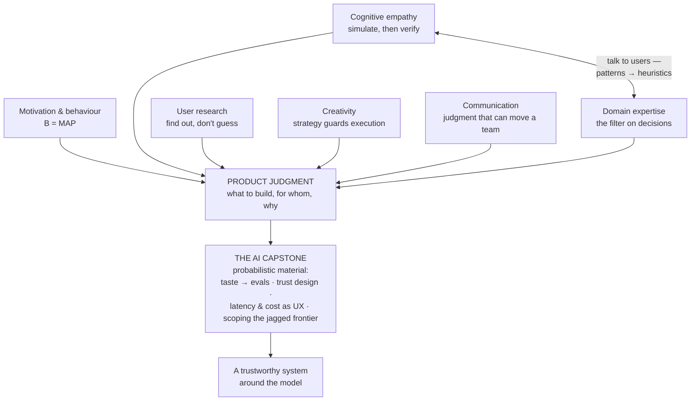

# Product sense for the AI PM

<!-- voice: human -->

Product sense is the instinct for what makes a product succeed. It shows up as the ability to see
what users need, including the needs they never say out loud, and to shape a solution that feels
right to them. People talk about it as a gift, but it behaves much more like a skill, one you
sharpen through repeated contact with users and deliberate practice. For a PM moving into AI
product management, it decides whether you lead the conversation about an AI feature or just nod
along in it. A model is a new and probabilistic material, and product sense is what tells you what
to build with it, for whom, and why.

This module has seven lessons. Six are habits that compound into strong product sense, and the
seventh, the AI capstone, applies all of them to building products on top of a model.

## How the lessons fit together

Six habits feed one judgment, and that judgment then gets tested against a new material.

1. [**Motivation theory**](./motivation-and-behaviour.md) covers the behaviour model, friction,
   satisfaction and ethical nudges, so you can see why a motivated user still doesn't act.
2. [**Cognitive empathy**](./cognitive-empathy.md) covers thinking about your own thinking,
   changing your mind, simulating the user and building taste.
3. [**User research**](./user-research.md) covers matching the method to the question, interviewing
   without leading, and researching trust in AI products.
4. [**Creativity**](./creativity.md) runs from strategy (positioning, focus) to execution (rituals,
   techniques and AI prototyping).
5. [**Communication**](./communication.md) covers artifacts, reviewing AI-drafted documents, earning
   buy-in, and product-sense interviews.
6. [**Domain expertise**](./domain-expertise.md) is about turning industry knowledge into intuition,
   building it fast, and not getting trapped by it.
7. [**Product sense for AI products**](./product-sense-for-ai.md) is the capstone. It covers what
   changes when the material is a probabilistic model, from evals as taste and trust design to
   scoping and keeping a person in the loop.

Each lesson opens with a situation, works through one example step by step, and ends with things to
do next. Several include short, credited moments from practitioners who have been guests on The
Growth Podcast with Aakash Gupta ([news.aakashg.com](https://www.news.aakashg.com)).

## Where the depth lives

This module touches several ideas that other lessons cover in full. When you want the deeper
version, go here.

| Idea in this module | Where it's covered in depth |
| --- | --- |
| Positioning, segmentation and strategy | [Markets and strategy](../business-acumen/markets-and-strategy.md) and [Competitive advantage and strategy](../business-acumen/competitive-advantage-and-strategy.md) |
| Influencing executives and stakeholders | [Executive influence and stakeholders](../business-acumen/executive-influence-and-stakeholders.md) |
| Discovery, and when to build, kill or reshape | [Discovery to delivery](../technical-product-management/discovery-to-delivery.md) |
| The prototype as the spec | [Technical product management for AI](../technical-product-management/tpm-for-ai-products.md) |
| The jagged edge, and the quality, speed and cost dials | [Model intuition](../building-ai-native-products/model-intuition.md) |
| Researching how people use agents | [Researching agent interactions](../building-ai-native-products/researching-agent-interactions.md) |
| Evals | [Evals: golden sets, adversarial, LLM-as-judge](../content/04-evals-observability/evals.md) |
| Scoping to the reliable frontier | [Technical sense for AI systems](../technical-product-sense/technical-sense-for-ai.md) |
| Range, reasoning and learning fast | [First principles & the polymath mind](../first-principles/README.md) |

## Connects to other tracks

- [Technical product sense](../technical-product-sense/README.md), the systems half of product
  judgment.
- [Technical product management](../technical-product-management/README.md), which turns sense into
  a shipped product.
- [Agentic AI as a product](../agentic-ai/agentic-ai-as-a-product.md), where taste meets outputs that
  vary.
- [First principles & the polymath mind](../first-principles/README.md), the reasoning range under
  strong judgment.

**📌 Close out the module:** [Recap & real-world examples](./recap.md) has how these ideas show up in
real products, a summary table and a self-test.
