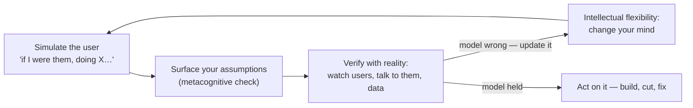

# Cognitive empathy: anticipating unvoiced needs

*Part of [Product sense for the AI PM](./README.md)*

<!-- voice: human -->

You've spent six months on an AI feature. You know which prompts work, what the model is good at
and why it sometimes refuses. A new user opens it, sees an empty text box, and has no idea what to
type. The gap between what you know and what they know is the whole subject of this lesson, and the
better you get at your own product, the wider that gap tends to become.

**Cognitive empathy** is understanding how users think, decide and experience your product. It is
different from emotional empathy, which is feeling their pain. Its job is prediction, because if you
can simulate a user's perspective you can guess what they'll need or do next before they tell you.
Three habits build it. **Metacognition** means examining your own thinking and biases, and
**intellectual flexibility** means changing your mind as evidence arrives. **Simulation** means
walking the user's journey, in your head or for real. Together they fight the **curse of
knowledge**, the expert's blindness to what a newcomer sees.

The loop in the diagram is the lesson in one picture. You simulate, you write down what you're
assuming, and then you check it against real people. Simulation without the check is just a story
you tell yourself.

## Thinking about your own thinking

Metacognition is stepping back to look at how you reached a decision. For a PM, it guards against
knee-jerk assumptions and against the curse of knowledge. A payments PM steeped in fintech jargon
assumes an onboarding step is obvious, while a first-timer finds it baffling. Metacognition turns
that assumption into a question you can test, which usually means running a quick session with a
first-timer rather than trusting expert intuition.

It also catches **overconfidence**. Teams grow sure of a solution after months on it, and the
confidence comes from time spent rather than from evidence. Two techniques help. The first is to ask
"what would prove me wrong?" about your most confident belief. The second is the **pre-mortem**, in
which you imagine it's a year from now and the product has failed, then list the plausible reasons.
That surfaces hidden risks before they cost you anything.

Pre-mortems have a cost of their own. Gautham Krishnan, who argues for them in large organisations,
also warns that people [use them to stall initiatives](https://www.youtube.com/watch?v=7NLLUfqv9uA)
(around 44:05 in his Growth Podcast episode). So time-box the exercise, and end it with a decision
about which risks you'll test, rather than with a list of reasons to wait.

In meetings, metacognition can be literal. You pause and say "let's break down how we're arriving at
this conclusion", which turns the room's hidden logic into something everyone can examine.

## Changing your mind

Cognitive empathy needs flexibility, which means adapting your thinking as new data arrives and
holding perspectives other than your own. Flexibility is being able to say "I was wrong" or "the
market changed, so our approach should too" without it costing you face.

Teresa Torres puts much of the blame for rigidity on how organisations reward people:

> "we still reward people for being right and for having strong opinions. And so we're not rewarding them for being curious"
> — Teresa Torres, [*Teresa Torres' Step-by-Step Guide to AI Product Discovery*](https://www.youtube.com/watch?v=wGuRuuPuYNQ), The Growth Podcast, around 31:47

If that's true where you work, flexibility has to be built on purpose. Sit with customer support to
hear raw frustration, and shadow a sales call to hear enterprise concerns. Challenge your own
assumptions ("we've always targeted young users; could this serve older ones, and what would that
take?"). Reward people who surface inconvenient truths, and assign someone to argue the opposite of
the prevailing view.

Watch for the sunk-cost fallacy as well, because months invested in a feature are no reason to keep
investing if it isn't working. Kodak is the story people reach for here, since it invented the
digital camera in 1975 and is remembered as the company that missed digital. Strategy writer Scott
Anthony warns that "the subtleties of what actually happened to Eastman Kodak are being forgotten",
and that executives draw the wrong conclusions from the short version. So use Kodak as a prompt to
look at your own attachment to a winning bet, rather than as settled history.

## Walking in the user's shoes

To anticipate needs, simulate the user. Ask "if I were a [target user] trying to do [X] in
[context], what would I feel or do next?" Mental simulation surfaces gaps before they reach
production, and there are several ways to do it.

- **Journey mapping.** Diagram each step toward a goal and, at each one, imagine the user's question
  or emotion. Mapping a first food-delivery order shows that right after ordering, the user wonders
  "what happens now?", so you need clear confirmation and tracking to head off the anxiety.
- **Living the day.** Take rides as a driver *and* as a passenger. Build something with your own API
  the way an outside developer would.
- **Dogfooding and usability testing.** Use your own product, then watch real users and narrate what
  you see ("she's hesitating here, confused by the wording").
- **Switching seats.** For a product with several kinds of user, step through as each one. A growth
  feature for buyers may add friction for sellers, and you only see that by switching.

Some PMs write mini-narratives ("Jane opens the app to do X, expects Y, sees Z, gets frustrated"),
because a concrete scene tends to surface details that an abstract list of requirements misses.

For AI products, this matters even more. Elizabeth Laraki points to a problem every chat-style
product shares:

> "how do you, for newer people, like how do you start, how do you kind of overcome the blank screen problem?"
> — Elizabeth Laraki, [*Crash Course in AI Product Design from Google Search + Maps Designer, Elizabeth Laraki*](https://www.youtube.com/watch?v=83ajrVQDowc), The Growth Podcast, around 22:23

You know what to type into your own product, but your user doesn't. So design for their mental model
of a chat box or a suggestion, and build the examples, hints and graceful failures a first-timer
needs.

## Worked example: the meeting-notes assistant

This example is invented, and so are its numbers. Say you're the PM for an AI assistant that
summarises sales calls and lists action items. Before the beta, you write down your three biggest
assumptions. Users will know to paste a transcript, they'll read the summary before acting on it, and
action items matter less than the summary.

You run a 30-minute pre-mortem with the team, and it produces eight reasons the feature could fail.
You pick the two you can test this week. One is that people won't know how to start, and the other
is that people will trust a wrong action item. Then you watch five first-time users, each given the
same real call transcript and no instructions.

| What you watched for | Users (of 5) |
| --- | --- |
| Sat at the empty box for more than 20 seconds before typing | 3 |
| Assumed the tool had recorded the call itself | 2 |
| Copied an action item into email without reading the summary | 4 |
| Acted on the one action item the model got wrong | 1 |

All three of your assumptions failed. Users didn't know how to start, which is the blank screen
problem, and two of them thought the tool had recorded the call, so knowing to paste a transcript
was not a given. Four of five acted on action items without reading the summary, which breaks the
second assumption, and that same behaviour shows they cared about action items far more than the
summary, which breaks the third. You add three example prompts
under the box and a single line saying what the tool can and can't do. You also move action items to
the top, each with a confirm step, because that is where users act and where a wrong answer costs
them. The whole check took one afternoon. Finding the same problems in launch-week support tickets
would have cost far more.

## From the show: watching it go wrong for real

George Harter tells a story about what a user's experience can mean to them, far beyond the screen:

> "One of them... was crying because she had recommended to her company to buy this product, and they did. And now she thought she was going to lose her job because of that decision."
> — George Harter, [*The Ultimate Guide to Knowing Your Users as a PM*](https://www.youtube.com/watch?v=igo5c_OoTe8), The Growth Podcast, around 41:51

No dashboard shows that, and a usability metric won't either. A buyer who championed your product has
staked their reputation on it, so a rough rollout is a personal risk for them as well as a support
issue for you. Simulating the user means simulating that person too.

## Talk to your users

There are many tactics for staying in tune with users, and they all come back to one habit, which
is talking to them and watching them. Here's an illustration, not a real case. Picture a PM who
spends an afternoon at a community help desk and watches people mistype their password again and
again, then conclude that the *app* is broken. No support ticket, survey or dashboard would surface
that as a product problem, because the users don't know what happened and so can't report it. A few
lessons follow from scenes like that one.

- **Mediated research has a failure mode.** A dedicated research team is a luxury, and it can also
  be a danger, because consuming results secondhand trains you to think of users as cohorts and
  percentages instead of people. Quantitative data is critical, and so is regularly watching one
  real person use your product.
- **The problems you witness are more real than the ones you're told.** Watching people do the
  simplest things surfaces problems no survey would report.
- **This is where intuition comes from.** At first the patterns you spot are small ("people struggle
  with passwords"). Over time they generalise into heuristics ("web forms can never be too simple"),
  and eventually you predict user feedback before you hear it. Product sense, on this view, is
  compressed exposure, built by repetition.

That last point is the practical answer to whether product sense can be learned. It can, at about
the rate you build up direct contact with users.

## How taste gets built

Taste is the part of product sense people describe as instinct, and the practitioners who talk about
it tend to describe a habit rather than a gift. Gautham Krishnan's definition is a good starting
point:

> "product sense is thinking deeply about every product that you interact with"
> — Gautham Krishnan, [*Product Strategy Masterclass by Gautham Krishnan, Product Leader @ Disney+ Hotstar*](https://www.youtube.com/watch?v=7NLLUfqv9uA), The Growth Podcast, around 02:08

Jaclyn Konzelmann lists [exceptional product taste](https://www.youtube.com/watch?v=rcz39Y0qFxw)
first among the traits she hires AI PMs for (around 16:11 in her episode). Julie Zhuo's view is that
the eye is easier to train than the hand, which she gives as her reason to keep [training her
eye](https://www.youtube.com/watch?v=1UAwtKjgO9Y) even as AI improves (around 1:06:53). These are
their views, though they point the same way, toward taste as something you practise.

A routine that fits a busy week is a 30-minute teardown. Pick one product you used this week, ideally
one with an AI feature. Write down what it made easy, where it made you hesitate, and one decision
you think its team made on purpose. Then write what you would change, and why. After a few months
the notes start to repeat themselves, and those repeats are your heuristics.

## Where it goes wrong

- **Curse of knowledge.** You design for your own expert mental model, not the newcomer's. It shows
  up as a feature that power users love and everyone else abandons in the first session.
- **Confirmation over falsification.** You gather evidence you're right instead of hunting for what
  would prove you wrong, so research only ever confirms the plan.
- **Rigidity.** You defend a months-old decision against new evidence because of the sunk cost.
- **Empathy by assertion.** You claim to "know the user" without simulating or watching anyone.
- **Pre-mortem as a stalling tool.** The exercise produces reasons to wait instead of tests to run.

## What to do next

- [ ] Name your three key assumptions about the user, and how each could be wrong.
- [ ] Run "what would prove me wrong?" on your most confident belief.
- [ ] Hold a time-boxed pre-mortem that ends with the two risks you'll test this week.
- [ ] Watch five first-time users try the feature with no instructions, and count what you see.
- [ ] For a product with several kinds of user, step through as each one.
- [ ] Start a weekly teardown note, and reread it once a month.

## Related lessons

- [Motivation theory](./motivation-and-behaviour.md)
- [User research](./user-research.md)
- [Creativity](./creativity.md)
- [Product sense for AI products](./product-sense-for-ai.md)
- [Technical product management for AI: eval-driven development](../technical-product-management/tpm-for-ai-products.md),
  where reading traces turns empathy into a routine.

## Sources

- Joanna Goodrich, [*The First Digital Camera Was the Size of a Toaster*](https://spectrum.ieee.org/first-digital-camera-history),
  IEEE Spectrum (The Institute), 6 April 2022 (Steven Sasson, Kodak, 1975) (as of 2026-11).
- Scott D. Anthony, [*Kodak's Downfall Wasn't About
  Technology*](https://hbr.org/2016/07/kodaks-downfall-wasnt-about-technology), Harvard Business
  Review, 15 July 2016 (introduction read; the rest is behind a paywall) (as of 2026-11-26).
- Quotes from The Growth Podcast with Aakash Gupta ([news.aakashg.com](https://www.news.aakashg.com)), used under its licence. The transcript text is machine-made and the quotes have not been checked against the audio.
