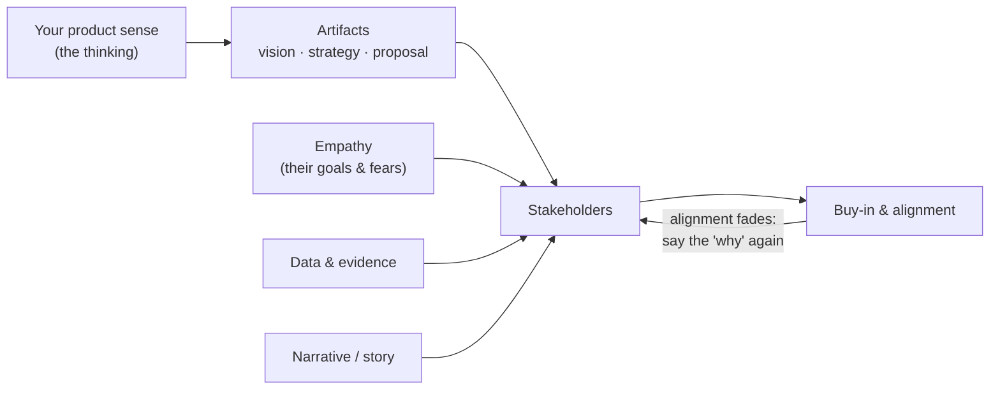

# Communication: artifacts, influence, and interviews

*Part of [Product sense for the AI PM](./README.md)*

<!-- voice: human -->

Picture the launch review for an AI feature. Engineering thought it was a draft assistant, sales
promised customers an autopilot, and the executive sponsor expected it to cut support costs by
Christmas. They all watched the same demo, and each of them heard a different product. Nobody was
careless. The product's purpose was simply never written down clearly enough to survive the trip
from one meeting to the next. Product sense you can't communicate can't move a team, and with AI,
where nobody is quite sure what the model can do, vague communication turns uncertainty into
misalignment.

Three kinds of communication matter here. **Artifacts** (vision, strategy, proposals) capture your
thinking so others can act on it. **Influence** earns buy-in when you have no authority to compel
it. And **interviews**, on either side of the table, are where your product sense is judged by how
you explain it.

The loop at the right of the diagram is the part people forget. Alignment fades, so part of the
PM's job is to keep saying why the product exists until everyone else can say it too.

## Writing the artifacts

Artifacts are the written things a PM produces. They capture product sense in words and become the
team's reference.

- **Vision.** A short picture of the future you'll create, rooted in user value. Amazon's Kindle
  vision is the standard example. In Amazon's words, "Our vision for Kindle is every book ever
  printed in any language, all available in less than 60 seconds." It describes the outcome rather than the method. To write one, imagine your
  product wildly successful in five years, describe what that looks like for users, and distil it.
- **Strategy document.** If vision is the destination, strategy is the map. It names target segments,
  value propositions, positioning and a few product pillars, and it says what's *out*. Tell it as a
  story (problem or opportunity, then approach, then why it wins), back it with data, and match the
  depth to the reader, with one page for executives and the full document for the team.
- **Proposals and one-pagers** persuade people to back a specific idea through context, problem,
  solution and impact. Amazon's press release and frequently-asked-questions document (**PRFAQ**)
  asks you to write the launch press release first and the FAQ after it. Whatever the format, answer five
  questions. Who is it for, what problem does it solve, why now, how do we know it's needed, and what
  does success look like?

The PRFAQ habit is worth stealing even if you never write one. If you can't write the
customer-facing story of the finished product in one page, you don't understand the product yet, and
building won't fix that. A cheap version for any team is to draft the launch announcement at kickoff
and treat every sentence you can't yet write as an open product question.

For an AI feature, write down what it won't do as carefully as what it will. Be candid about the
model's limits and unknowns, because an artifact that oversells the demo is how three people end up
imagining three products.

## Reviewing an AI-drafted artifact

AI tools now write a plausible first draft of any of these in seconds, and reviewing one is a
different skill from writing one. Matthew Wensing has a useful name for what goes wrong:

> "I think of them as like micro hallucinations it's not that it's totally wrong"
> — Matthew Wensing, [*How a VP of Product Uses Claude Without Producing Slop*](https://www.youtube.com/watch?v=yDeFGKaSoX8), The Growth Podcast, around 17:33

The risk is a confident draft that quietly skips a non-goal, invents a success metric nobody agreed,
or states a stakeholder's motivation you never confirmed. Read it the way you'd read an engineer's
design document, checking each claim against evidence you actually have rather than evidence the
draft asserts. A draft you didn't question is a draft you don't own, whoever's name is on it. ([The
technical-PM version of this discipline](../technical-product-management/specs-prds-and-rfcs.md)
covers reading an AI-drafted PRD.)

## Worked example: checking an AI-drafted one-pager

This example is invented, and so are its numbers. Say you ask a model to draft a one-pager for an AI
feature that suggests replies in a customer inbox. It produces a clean page in a minute. Before you
send it, you go through it sentence by sentence and mark every factual claim. There are 14.

| What you found | Claims |
| --- | --- |
| Backed by evidence you have (research notes, dashboards) | 8 |
| Plausible, but you have no evidence either way | 3 |
| Wrong in a small way (a micro hallucination) | 2 |
| Invented outright | 1 |
| Total | 14 |

The two small errors are typical. The draft says customers "asked for" suggested replies when your
notes show they asked for faster replies, and it says the pilot ran for six weeks when it ran for
four. The invented claim is a success target of a 30% cut in handling time that nobody has ever
agreed. You fix the two errors, delete the target and replace it with "success metric: to be agreed
with support leads", and turn the three unsupported claims into questions in an "open questions"
section. Eight of the fourteen claims survived as written, so the review took twenty minutes and
removed three statements that would have cost you credibility in the review meeting.

## Earning buy-in without authority

A brilliant idea still needs buy-in, and a PM usually can't compel it. This lesson keeps to the
basics, because [Executive influence and
stakeholders](../business-acumen/executive-influence-and-stakeholders.md) covers influence in depth.

Start from what each person values. An engineering lead cares about feasibility and team morale, a
finance lead about return, and sales about customer demand. Ethan Evans makes the same point about
the top of a company:

> "understanding that lens of how does your C-suite think and how do they make decisions"
> — Ethan Evans, [*Amazon VP: The Magic Loop Framework to Get Promoted*](https://www.youtube.com/watch?v=z95pArx8M_c), The Growth Podcast, around 21:32

Then build credibility with data and candour. An illustrative example is "60% of 200 surveyed users
were frustrated with onboarding", which is the kind of number that carries a proposal if you have it.
Be honest about risks and unknowns too ("here's what we know, here's what we're still
investigating"), because over-selling erodes trust and candour builds it. Wrap the idea in a story
about one user's day, so people feel the problem rather than just hear it. Meet sceptics one-to-one,
since a sceptic who feels heard often becomes an ally, and sometimes they've spotted a real risk.

Be wary of a meeting where everyone nods. Matthew Wensing again:

> "people can feign alignment really easily"
> — Matthew Wensing, [*How a VP of Product Uses Claude Without Producing Slop*](https://www.youtube.com/watch?v=yDeFGKaSoX8), The Growth Podcast, around 38:28

So test alignment instead of assuming it. Ask each stakeholder to say in their own words what the
feature is for and what it won't do. Where the answers differ, you've found the misalignment before
launch day does.

## Interviews, on both sides of the table

**As the candidate.** Product-sense questions ("design a product for X", "improve feature Y for user
Z") test structured thinking, creativity, empathy and clear communication. Practise a frame. Clarify
the goal and the user, surface their needs, prioritise a solution, and describe it with its
trade-offs. Think out loud about *why* you make each choice, because that's what shows judgment.
Keep a few real stories ready and structure them as Situation, Task, Action, Result (**STAR**).

Gayle Laakmann McDowell adds a warning about using STAR mechanically:

> "So yes, use the STAR framework, but you need to be thinking in your preparation about like, what are the signals that this story can send?"
> — Gayle Laakmann McDowell, [*Cracking the PM Interview, with the author of the book Gayle McDowell*](https://www.youtube.com/watch?v=kmvrlSghI8w), The Growth Podcast, around 42:19

For a product-sense story, the signals are usually the user insight, how you weighed the options,
the principle that guided you and what you learned.

**As the interviewer.** Judge product sense by *how* candidates reason. Do they start from the user,
ask about goals and pain, and offer more than one solution? Ask follow-ups ("why that approach?",
"what if metric A drops?") to see their reasoning and whether they can adjust. Have them critique an
existing product. Strong candidates structure the critique around user needs, cite what they
observed and justify their improvements.

## Where it goes wrong

- **Jargon and length.** A document only its author understands, which busy stakeholders won't dig
  into.
- **Facts without story.** A technically correct pitch that never makes anyone *feel* the problem.
- **Over-selling.** Hiding risks to win approval, then losing trust when reality arrives.
- **Assumed alignment.** Believing people remember the vision, or that nodding means agreement. It
  shows up at launch, as three teams describing three products.
- **Rubber-stamping the AI draft.** Circulating a fluent, complete-looking artifact without checking
  its specifics. It's the same over-selling risk, only faster.

## What to do next

- [ ] Give your current vision or strategy document to someone outside the team. If they don't get
      it without you narrating, sharpen it.
- [ ] Check your next proposal answers who it's for, what problem, why now, how you know, and what
      success looks like.
- [ ] Before you send an AI-drafted artifact, mark every factual claim and check each one.
- [ ] Ask three stakeholders to describe the feature in their own words, and compare the answers.
- [ ] Map who cares about what, and tailor your next proposal to it.
- [ ] Repeat the "why" often enough that the whole team can say it.

## Related lessons

- [Creativity](./creativity.md)
- [Cognitive empathy](./cognitive-empathy.md)
- [Domain expertise](./domain-expertise.md)
- [Specs, PRDs & RFCs](../technical-product-management/specs-prds-and-rfcs.md) (technical product
  management): the artifacts, professionalised.
- [Executive influence and stakeholders](../business-acumen/executive-influence-and-stakeholders.md)
  (business acumen): influence and stakeholder management in depth.

## Sources

- Amazon, [*Kindle at 10*](https://www.aboutamazon.com/news/devices/kindle-at-10), About Amazon,
  19 November 2017 (the Kindle vision sentence) (as of 2026-11).
- Werner Vogels, [*Working Backwards*](https://www.allthingsdistributed.com/2006/11/working_backwards.html),
  All Things Distributed, 1 November 2006 (write the press release first, then the FAQ) (as of 2026-11).
- Quotes from The Growth Podcast with Aakash Gupta ([news.aakashg.com](https://www.news.aakashg.com)), used under its licence. The transcript text is machine-made and the quotes have not been checked against the audio.
