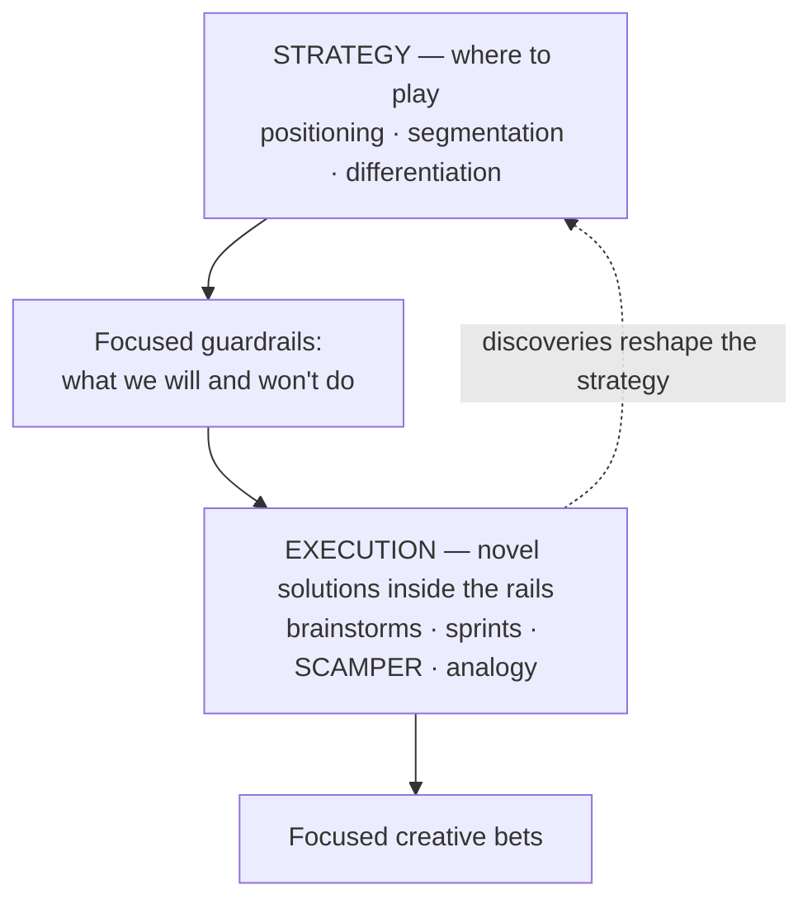

# Creativity: from strategic thinking to creative execution

*Part of [Product sense for the AI PM](./README.md)*

<!-- voice: human -->

Every competitor in your market has access to the same models you do. If your roadmap says "add AI
to onboarding", so does theirs, and the demo you're proud of could ship from three other companies
next quarter. So the creative question is no longer whether you can build the feature. It is what
problem you point it at, for whom, and what you'll refuse to build so that the bet gets your full
attention.

Creativity in product work has two halves. **Strategic thinking** decides *where* the product plays,
which covers positioning, segments, differentiation and, above all, focus. **Creative execution** is
the day-to-day generation of new solutions inside that strategy, through mindset, team rituals and
techniques. Strategy without execution is a nice deck, and execution without strategy is motion
without direction. Creativity tends to work best inside strategic guardrails.

## Strategy: where the product plays

This lesson only sketches strategy, because [Markets and
strategy](../business-acumen/markets-and-strategy.md) and [Competitive advantage and
strategy](../business-acumen/competitive-advantage-and-strategy.md) cover it in depth. The short
version is four moves.

- **Positioning.** Fill in "For [target segment] who [need], [Product] is a [category] that
  [benefit]. Unlike [competition], it [unique differentiator]." Good positioning is specific. "A task
  app for working parents that reduces mental load by prioritising intelligently" guides decisions in
  a way that "a task app for everyone" never will.
- **Segmentation.** Choose whom to serve, ideally by need or behaviour rather than demographics.
  TechCrunch's 2019 account says Slack began as a messaging tool that Tiny Speck, a game studio, built
  for internal use, which is a need real users already had, proven inside one team before it became
  the product.
- **Differentiation.** Users pick you for something **new** (a capability others lack) or something
  **better** (the same need met faster, cheaper or more pleasantly). Either way it has to matter to
  the user, because a unique feature nobody cares about wins nothing.
- **Focus.** Be clear on what you will and won't do. Derive a few pillars from your vision and use
  them to judge ideas, so that an idea which doesn't strengthen a pillar gets shelved, however good
  the demo.

Roger Martin has a test for whether any of this is real:

> "strategy is what you do, not what you say."
> — Roger Martin, [*Product Strategy Masterclass from Global Authority on Strategy*](https://www.youtube.com/watch?v=BD_4nsx5fTg), The Growth Podcast, around 14:45

By his test, your strategy is whatever your last three launches add up to, whatever the strategy
document claims. Strategy for an AI feature works the same way. If a competitor shipped the same
model tomorrow, what would still make your product the one users choose? If the honest answer is
"nothing", you have a feature, not a position.

Instagram is the classic story of focus. TechCrunch reported in 2010 that its founders first built
Burbn, a location-based app, and quoted Kevin Systrom saying the iPhone version "felt cluttered, and
overrun with features". In that account they cut it back to sharing, commenting on and liking photos,
and Instagram launched on 6 October 2010. TechCrunch's launch coverage described it as a
photo-sharing app with a set of filters. The
creative act was the cut. If you can't name the last good idea you shelved because it didn't
strengthen a pillar, you have a backlog rather than a strategy.

## From the show: proven, better, new

Mark Pincus, the founder of Zynga, teaches a framework he calls Proven, Better, New. **Proven** is
an experience already proven for this audience on this platform, which he says to copy down to the
pixel. **Better** is what, in his words, "10 out of 10 of the existing users" would want, not what you
think is better. **New** is your novel idea. His view of the first part is blunt:

> "anything that's proven, you are gonna legally copy And the better product maker you are, the better you are at copying."
> — Mark Pincus, [*How to steal your way to a hit product, with Mark Pincus (founder, Zynga)*](https://www.youtube.com/watch?v=G1uZZG6s7cc), The Growth Podcast, around 16:05

The reason is to protect the third bin. In his words, "New is your new novel idea, your innovation
zone", and he wants it isolated "so that you don't fail for the wrong reasons" (around 17:09). If a
launch mixes a novel idea with a clumsy version of everything users already expect, you can't tell
whether the idea failed or the basics did. Copying has legal and ethical limits, and he says
"legally" for a reason, but the sorting habit carries over to any product.

## Execution: generating ideas inside the rails

Even the best strategy stalls without the day-to-day creativity to carry it out.

**Mindset.** Creativity starts with psychological safety and a growth mindset. People have to feel
safe proposing wild ideas and asking "stupid" questions, so model it yourself. Celebrate experiments
that fail, treat setbacks as learning, and reward the people who iterate. Bring design, engineering,
data and marketing into ideation early, because each lens produces ideas the others won't.

**Rituals** make creativity a habit rather than an accident.

- **Brainstorms** with rules ("defer judgment", "no idea too crazy"), plus formats like *Crazy
  Eights* and *brainwriting* (write silently, then share), so quieter
  people contribute as much as louder ones.
- **Design sprints.** GV describes its sprint as a five-day process that goes from mapping a problem
  to testing a realistic prototype with customers. Jake Knapp began running sprints at Google in
  2010. Even a mini cycle of brainstorm, prototype and test adds structure.
- **Hack days**, with freedom to build anything product-related.
- **Labs and experiments**, a place where an unfinished idea can ship to the users who opt in.
  Gmail's undo send shows how an experiment can graduate. It started in 2009 as an experimental
  Gmail Labs feature and became a standard setting in 2015.
- **"How might we…?"** framing and the **5 Whys**, which reframe a problem from its root and open new
  solution spaces.

**Techniques** help you break out of a rut.

| Technique | What it does |
| --- | --- |
| **SCAMPER** | Substitute, Combine, Adapt, Modify, Put to another use, Eliminate, Reverse — systematically tweak an existing flow |
| **Mind mapping** | Branch outward from a central problem to surface non-linear connections |
| **Analogy thinking** | Borrow structure from a far field ("how do airports manage flow?") |
| **Constraint brainstorming** | Add an absurd constraint ("zero eng resources," "voice only") to force new approaches |
| **User co-creation** | Ask power users how *they'd* solve it |

Not every idea will be good. The point is to generate range, then filter it against the strategy.

## AI prototyping as divergence

AI tools have made the range part cheap. Where a team used to sketch three options and build one, a
PM can now generate several working prototypes in an afternoon. Sachin Rekhi argues for using that
power to widen the options rather than to rush to one answer:

> "AI shouldn't be used just to create one output. We should be using it to create multiple outputs, just the way we'd use a designer."
> — Sachin Rekhi, [*Advanced Guide to AI Prototyping with Sachin Rekhi (Reforge)*](https://www.youtube.com/watch?v=74kamD2jUng), The Growth Podcast, around 09:36

The discipline is to diverge, test and then decide. Generate several genuinely different prototypes,
put each in front of a few users, and choose on evidence. The trap is falling for the first prototype
because it works, which turns a cheap exploration into an expensive commitment. The engineering side
of this, including why prototype code shouldn't go to production, is in [Technical product
management for AI](../technical-product-management/tpm-for-ai-products.md).

## Worked example: three onboarding prototypes

This example is invented, and so are the numbers. Say you're the PM for a project-management app,
and new teams struggle to set up their first project. In one afternoon you use an AI prototyping tool
to build three different versions.

- **A, a chat assistant** that asks questions and builds the project as you answer.
- **B, a template picker** whose chosen template the model fills in from a one-line description.
- **C, an import** that turns an existing spreadsheet into a project.

You sort each one with Pincus's bins. B is mostly proven (templates are a familiar pattern) with a
"better" layer on top. C is the only genuinely new idea, and A is new too but in a way users haven't
asked for. Then you give each prototype to five people from your target segment and ask them to set
up a real project.

| Prototype | Finished setup (of 5) | Median minutes | Asked to keep using it (of 5) |
| --- | --- | --- | --- |
| A, chat assistant | 2 | 11 | 1 |
| B, template picker | 4 | 4 | 3 |
| C, spreadsheet import | 3 | 6 | 4 |

B wins on completion and speed, while C wins on pull, with four of five asking to keep using it. So
you ship B as the default path, because it is proven and better, and you put C behind a single
"import a spreadsheet" button as the isolated new bet. If C underperforms, you'll know the import
idea failed rather than the whole onboarding. You drop A, even though it made the best demo, because
two of five finishing is a signal you can't argue with. Five users per prototype is a small sample,
so you treat the result as a direction and confirm it with the launch metrics.

## Where it goes wrong

- **"Add AI" as strategy.** A capability with no segment, positioning or differentiation behind it.
  You see it as a launch with good press and flat usage.
- **Differentiation nobody wants.** Unique features that don't map to a real user need.
- **No focus.** A strategy that never says "no", so effort scatters across a long roadmap.
- **Novelty everywhere.** Every part of the product is new, so when it fails nobody can say why.
- **Falling for the first prototype.** AI makes one prototype easy, and the team stops exploring the
  moment it works.
- **Ideation theatre.** Brainstorms that generate sticky notes but never reach a prototype or a user.

## What to do next

- [ ] Write the product's positioning in the "for [who] who [need]… unlike…" form, and test it on
      someone outside the team.
- [ ] List your last three launches and ask Roger Martin's question: what strategy do they add up to?
- [ ] Name the last good idea you shelved because it didn't strengthen a pillar.
- [ ] Sort your next feature into proven, better and new, and keep the new part isolated.
- [ ] Next time you prototype with AI, build at least three different versions and test them before
      choosing.
- [ ] Adopt one repeatable ritual this quarter, such as a hack day or a monthly idea round.

## Related lessons

- [Cognitive empathy](./cognitive-empathy.md)
- [Communication](./communication.md)
- [Domain expertise](./domain-expertise.md)
- [First principles: the method](../first-principles/the-method.md), on deconstruction as the
  sharpest ideation technique.
- [Markets and strategy](../business-acumen/markets-and-strategy.md) and [Competitive advantage and
  strategy](../business-acumen/competitive-advantage-and-strategy.md) (business acumen): positioning,
  segmentation and strategy in depth.
- [Technical product management for AI](../technical-product-management/tpm-for-ai-products.md):
  vibe coding and why the prototype is becoming the spec.

## Sources

- Kate Clark, [*The Slack origin story*](https://techcrunch.com/2019/05/30/the-slack-origin-story/),
  TechCrunch, 30 May 2019 (secondary report; Tiny Speck's internal messaging tool; no first-party
  Slack page found) (as of 2026-11-27).
- MG Siegler, [*A Pivotal Pivot*](https://techcrunch.com/?p=241149), TechCrunch, 8 November 2010
  (secondary; quotes Systrom's Quora answer on Burbn, which returned 403) (as of 2026-11-26).
- MG Siegler, [Instagram launch coverage](https://techcrunch.com/2010/09/20/instagram/), TechCrunch,
  20 September 2010 (secondary; Burbn as a location-focused app; launch filters) (as of 2026-11-26).
- About Instagram, [product evolution timeline](https://about.instagram.com/about-us/instagram-product-evolution)
  ("Instagram Launches", 6 October 2010) (as of 2026-11-26).
- GV, [The Design Sprint](https://www.gv.com/sprint/) (five days; Jake Knapp at Google from 2010)
  (as of 2026-11).
- Gmail, [*New in Labs: Undo Send*](https://gmail.googleblog.com/2009/03/new-in-labs-undo-send.html),
  Official Gmail Blog, 19 March 2009 (as of 2026-11).
- Google Workspace Updates, [*Undo Send for Gmail on the
  web*](https://workspaceupdates.googleblog.com/2015/06/undo-send-for-gmail-on-web.html), 23 June 2015
  (as of 2026-11).
- Quotes from The Growth Podcast with Aakash Gupta ([news.aakashg.com](https://www.news.aakashg.com)), used under its licence. The transcript text is machine-made and the quotes have not been checked against the audio.
