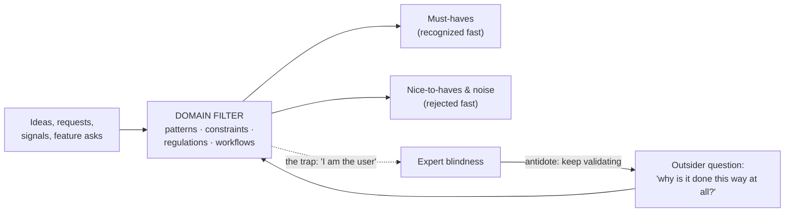

# Domain expertise: turning knowledge into intuition

*Part of [Product sense for the AI PM](./README.md)*

<!-- voice: human -->

You've just joined a company that sells software to hospitals, or to banks, or to freight brokers.
In your first planning meeting someone proposes a feature, and everyone else in the room can tell
within seconds that compliance will never approve it. You can't, because you don't yet know the
world the product lives in. PM fundamentals transfer across industries, but **domain expertise**,
deep knowledge of the specific world your users work in, is what lets you tell a must-have from a
nice-to-have before anyone has to explain it.

For an AI PM there are two domains at once. One is the user's industry. The other is the AI domain
itself, which covers what models do well, where they make things up, and what evaluation and safety
require. Thin knowledge of either produces confident, wrong product bets. The most expensive
version is an AI feature that's impressive in the demo and harmful in the real workflow, because
nobody understood what a wrong answer costs there.

## Why knowing the domain changes your judgment

Picture a PM building software for clinics (an illustration). With thin domain knowledge, they build
an electronic medical record (EMR) around generic UX and obvious needs like notes and scheduling.
With deep knowledge, they know the details that matter. There are compliance rules such as the US
Health Insurance Portability and Accountability Act (HIPAA), and doctors have seconds to enter data
between patients. There are common billing problems, and there are the politics of adopting a new tool. That knowledge
becomes a **filter**. It tells you which requests are must-haves, which ideas will meet resistance,
and what truly adds value in that context.

Experts also decide faster because they recognise patterns and recall what happened in similar
situations. A fintech PM who knows payments well will quickly reject a "cool" feature whose
compliance approval would take a year. Then they'll look for a path that meets the need without the
red tape. A newcomer tends to charge in and hit the wall.

Abhishek Fatehpuria, who builds AI products in fintech, describes what that wall looks like from the
inside:

> "you need to like really understand the regulatory landscape you're working in. Because if you don't understand that landscape, you're going to go to your legal partners [...] and they're going to think you're kind of crazy."
> — Abhishek Fatehpuria, [*How to Build AI products in FinTech | $100B Lessons from Robinhood VP PM*](https://www.youtube.com/watch?v=pc04_TW7Z3U), The Growth Podcast, around 08:08

Domain knowledge also builds credibility. Speaking your users' and stakeholders' language makes you
more persuasive, and sales and marketing back your calls when they can see you understand the
market.

## The expert's trap

Domain expertise has to complement the rest of product sense, not replace it. Marty Cagan's warning
is that "it can be dangerous for a product manager to have too much domain expertise," because
experts come to believe they are "more like their target customer than they really are". He also
writes that deep domain expertise is truly essential for only a few products. In his view, strong PMs
can come up to speed on most domains quickly if they approach it aggressively. His remedy is that
the PM "needs to constantly revisit assumptions about the domain and the customers", because new
regulations, behaviours and competitors will surprise you.

Here's an illustration of the trap, not a sourced case. Imagine a records system for clinicians whose
design input came mostly from billing and compliance experts. It handles claims perfectly and makes a
doctor click through screen after screen to record an ordinary visit. Domain expertise was present,
but it was the wrong domain's, and nobody asked the outsider's question of why a doctor's tool feels
like an invoice. Expertise tells you how the world works, while only contact with users tells you
whose version of that world your product just encoded.

A newcomer's "why is it done this way at all?" sometimes becomes a breakthrough, precisely because
they don't accept "that's just how it is". As you gain expertise, keep that outsider curiosity alive.
Rotate people across domains, keep validating with real users, and treat the domain as something that
keeps moving.

## From the show: learn fast, or arrive knowing?

Practitioners on The Growth Podcast disagree here, and the disagreement is useful. Marty Cagan's own
start as a PM was built on direct contact rather than prior knowledge:

> "I remember the person who was coaching me as a new product manager would not let me make a single decision until I visited in person 30 customers, 15 in the US, 15 in Europe."
> — Marty Cagan, [*The Marty Cagan Episode: Product Management Crash Course in 61 Minutes*](https://www.youtube.com/watch?v=J0FOFJFtOFw), The Growth Podcast, around 25:49

Those are his words as the transcript records them, and the numbers may be misheard. The point stands
either way, which is that the expertise came from visiting customers. George Harter puts more weight
on arriving with the domain already in hand:

> "So right now, I would say it's more important than ever to have industry experience and product management expertise."
> — George Harter, [*The Ultimate Guide to Knowing Your Users as a PM*](https://www.youtube.com/watch?v=igo5c_OoTe8), The Growth Podcast, around 07:26

Harter is talking about getting hired in a crowded job market, where industry experience gets your
application through the filter. Cagan is talking about doing the job well once you're there. Both
can be true. If you're switching domains, expect the hiring side to be harder, and once you're in,
learn the way Cagan's coach made him learn.

## Building expertise without getting trapped

When you enter a new domain, be systematic about it.

- **Learn intensively, with a time limit.** In the first months, read the industry reports, the
  regulations and the trade press. Cagan writes that it generally takes him one to three months to
  come up to speed on a new domain, and that some people are faster and some slower.
- **Ask the "dumb" questions.** Have experts explain things to you. If you don't understand how an
  Automated Clearing House (ACH) payment differs from a wire transfer, ask an operations manager.
  It's far better to ask early than to decide wrong out of ignorance.
- **Get hands-on.** Watch hospital staff use the software, sell something on your own e-commerce
  platform, or build a small project with your own API. Domain knowledge is procedural and
  contextual, and the vocabulary is the smallest part of it.
- **Build a network.** Part of expertise is knowing where to get answers fast, so find your go-to
  people (the veteran engineer, the candid customer) and bring in specialists in legal, compliance
  and operations early.

## Worked example: a 90-day domain plan

This plan is invented, and so are its numbers. Say you've moved from a consumer app to a business
payments company, to lead an AI feature that helps operations teams handle disputed card
transactions. You budget about six hours a week for deliberate learning, which over 13 weeks is
roughly 78 hours.

| Phase | Goal | Concrete actions | Done when |
| --- | --- | --- | --- |
| Days 1–30 | Learn the language | Read the card network's dispute rules summary and two industry reports. Sit with the operations team for two full days. Start a glossary. | The glossary has 40 terms and an ops lead says it's right |
| Days 31–60 | Learn the workflow and the stakes | Hold 10 customer conversations about the last dispute each handled. Shadow one compliance review. Write the five hardest questions a customer could ask, and answer them. | You can explain what a wrong AI answer costs, in money and in deadlines |
| Days 61–90 | Make a domain-informed call | Hold 10 more customer conversations. Write a one-page decision memo on where the model may suggest and where a person must decide. | The memo survives review by compliance and by two customers |

The plan adds up to 20 customer conversations, two days of shadowing and one compliance review. The
"done when" column matters more than the actions, because it turns learning into a checkable result
and stops it sliding into endless reading. The memo at the end is what an expert would produce, a
judgment about where a model's mistakes are tolerable, and it is the decision this whole lesson is
about.

## Where it goes wrong

- **The expert's trap.** "I am the user", so you stop validating and miss new perspectives. You see it
  when the team stops scheduling customer calls because "we already know".
- **Vocabulary without context.** You know the terms but not the procedures and stakes.
- **Arrogance over curiosity.** Treating the domain as solved while regulations and behaviours keep
  moving.
- **Endless learning.** Months of reading with no decisions. Set a time-box and a "done when".
- **Not knowing the cost of a wrong answer.** For AI features, this is the failure that matters most,
  because it is how you set the quality bar too low for the domain.

## What to do next

- [ ] Write down your domain's real constraints (regulatory, workflow, political), not just its
      surface needs.
- [ ] Write a 90-day plan with a "done when" for each phase.
- [ ] Ask one "dumb" question this week that you've been deciding around.
- [ ] Experience the domain hands-on, not only through reading.
- [ ] For your AI feature, write down what a confidently wrong output costs the user, and check it
      with someone who does the job.
- [ ] Write the five hardest questions someone could ask about your product, and answer them. The
      gaps are your study list.

## Related lessons

- [Communication](./communication.md)
- [Cognitive empathy](./cognitive-empathy.md)
- [Product sense for AI products](./product-sense-for-ai.md)
- [How systems are built](../technical-product-sense/how-systems-are-built.md), domain fluency for
  the technical layer your product runs on.
- [Learning how to learn](../first-principles/learning-how-to-learn.md) (first principles): methods
  for getting up to speed in a new field quickly.

## Sources

- Marty Cagan, [*The Role of Domain Experience*](https://www.svpg.com/the-role-of-domain-experience/),
  Silicon Valley Product Group (SVPG), 28 March 2005 (as of 2026-11).
- US Centers for Disease Control and Prevention, [*Health Insurance Portability and Accountability Act
  of 1996 (HIPAA)*](https://www.cdc.gov/phlp/php/resources/health-insurance-portability-and-accountability-act-of-1996-hipaa.html)
  (as of 2026-11-26).
- Quotes from The Growth Podcast with Aakash Gupta ([news.aakashg.com](https://www.news.aakashg.com)), used under its licence. The transcript text is machine-made and the quotes have not been checked against the audio.
