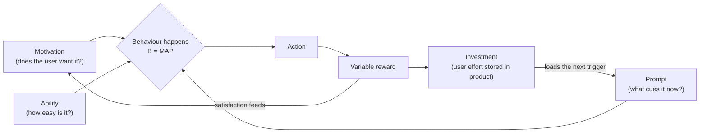

# Motivation theory: friction, satisfaction, and nudges

*Part of [Product sense for the AI PM](./README.md)*

<!-- voice: human -->

Say a new user lands on your product wanting exactly what it offers, and leaves four screens later
without ever using it. Nothing was wrong with their motivation, and nothing was wrong with the
product's core idea. Something in between got in the way, and nobody on the team can say which step
it was. This lesson is about finding that step, deciding whether it should exist at all, and making
the moment after it worth coming back for.

It matters more for AI features than for most. They rarely fail because the model is weak. They
fail because users never build the habit, either because the first useful output is buried behind
setup or because the first output disappoints and nobody returns for a second one. So the question
to carry through this lesson is how much friction sits between a new user and their first genuinely
useful model output, and how fast that first win arrives.

## The behaviour equation

The **Fogg behaviour model** says a behaviour happens only when three things come together at the
same moment: motivation, ability (how easy it is) and a prompt. BJ Fogg writes it as *B = MAP*.
Fogg says he once called the third element the "Trigger" and switched to "Prompt" in late 2017. The
Hook model later in this lesson still uses *trigger* for the same cue. His site calls B = MAP "the
simplest form" of the model, so read it as a memory aid rather than a sum to calculate. If any
element is missing, the behaviour doesn't happen.



The practical reading is simple. If you want people to do something, make it easy. Complex steps
and confusing screens stifle even a motivated user, while removing them lets motivation that already
exists turn into action. Adding more motivation (a bigger discount, a louder banner) is usually the
expensive fix for a problem that was really about ability.

Not all friction is bad, though. A little friction can protect quality or commitment. Email
verification gives you a cleaner user base, and a confirmation step prevents costly mistakes. The
discipline is **conscious friction**, which means you add friction only where it buys security,
thought or safety, and you remove it everywhere else.

## Selfish friction, and how to spot it

Jaryd Hermann draws a line that is useful in any signup review:

> "bad friction is like selfish friction where you have like you know marketing like we want to ask all these questions or sales like ask those questions because we want that data"
> — Jaryd Hermann, [*Product-Led Growth (PLG) Masterclass: How World Class Companies Grow in 2024*](https://www.youtube.com/watch?v=imoQn1qi_gs), The Growth Podcast, around 25:55

That gives you a test for every field and every step. Ask who the step serves. If it protects the
user, as identity checks and confirmations do, it is conscious friction and it stays. If it serves a
team's reporting needs and the user gets nothing for it, it is selfish friction, and the honest move
is to defer it until after the user has had their first win, or to drop it.

## Worked example: a savings-account signup

This example is invented, and so is every number in it. Say you run signup for a fintech savings
account. Of every 1,000 people who start signup, 270 end up with a funded account, which is 27%.
Your instinct says the form is too long, but you measure each step before you argue for that, and
you compute each row from the one above it.

| Step | Started the step | Pass rate | Finished the step |
| --- | --- | --- | --- |
| 1. Email and password | 1,000 | 80% | 800 |
| 2. Profile form (10 fields) | 800 | 50% | 400 |
| 3. Identity check | 400 | 90% | 360 |
| 4. Fund the account | 360 | 75% | 270 |

The profile form loses half of everyone who reaches it, which makes it the biggest leak by far.
When you read its ten fields, you find that six of them (how you heard about us, income bracket,
employer and three marketing preferences) exist because another team wants the data. That is selfish
friction. The identity check also loses people, but it protects the user and the business, so it
stays as conscious friction.

You cut the form to four fields and move the marketing questions to a survey after the first
deposit. Assume the form's pass rate rises from 50% to 80%, and the other steps keep their rates.
Then 800 people reach the form, 640 pass it, 576 pass the identity check, and 432 fund an account.
That moves the funded share from 27% to 43.2%. The 80% is an assumption, so you'd ship the change as
an experiment and measure the real rate rather than promise it.

## Satisfaction and habit

**Satisfaction** is the fulfilment a user gets from your product, and it is what turns a one-time
user into a returning one. A satisfying experience raises the motivation to come back, so
satisfaction and motivation form one loop rather than two separate things.

Nir Eyal's **Hook model** shows how that loop hardens into a habit:

```
   ┌─────────▶ TRIGGER ──▶ ACTION ──▶ REWARD ──▶ INVESTMENT ──┐
   │            (cue)      (do it)   (payoff)   (put in effort) │
   └──────────────────────  habit forms  ─────────────────────┘
```

The reward phase is where satisfaction lands, as a sense of accomplishment, useful information or
delight, and that burst reinforces the behaviour. In the investment phase the user adds data,
preferences or effort, which raises commitment and loads the next trigger. For your own product, ask
what is actually rewarding about the core action. Each critical action should be followed by clear
value or positive feedback, even if it is only a friendly confirmation, a progress bar or a
checkmark. A satisfied user tolerates minor friction, while a frustrated one drops off at the first
hurdle.

Duolingo's streak is the behaviour equation turned into a product. The product itself manufactures
the motivation (don't lose the streak), ability is a short lesson, and the trigger is a push
notification. Duolingo's own research paper (Yancey and Settles, presented in 2020 at the
Knowledge Discovery and Data Mining conference (KDD)) describes a bandit algorithm that learns which
reminder to send each learner. Notice the ethical line the design walks, too, because
Duolingo describes the Streak Freeze as a way to "hit pause on your streak for a day". When a habit feature feels coercive, it is usually
because it punishes lapses instead of rewarding returns.

For AI features, the reward after the first successful prompt deserves as much design attention as
the model. If the first output disappoints, the loop never starts.

## From the show: surface delight and deep delight

Nesrine Changuel separates two kinds of delight. Surface delight is the confetti and the animation.
Deep delight, in her words, is something else:

> "the deep delight is when we create functional solutions while addressing emotional needs while building them."
> — Nesrine Changuel, [*How to Engineer Delight Into AI Products*](https://www.youtube.com/watch?v=0rTAZ7qnKgc), The Growth Podcast, around 02:57

Surface delight has a trap of its own. A playful notification or a cute holiday prompt is usually
written with the happy case in mind, and it can land as a jolt for the user whose life doesn't
match that picture, which turns an engagement trick into a moment of hurt. Before you ship a
playful prompt, picture the user for whom it lands badly, because the same cognitive empathy that
finds friction also finds this. If you need a way to decide which
delighters are worth building at all, the Kano model in [Prioritization and
roadmaps](../technical-product-management/prioritization-and-roadmaps.md) sorts features into
basic needs, performance features and delighters.

## Nudges: influence without coercion

**Nudges** are design cues that steer behaviour *without restricting choice*, an idea Richard Thaler
and Cass Sunstein made famous in their 2008 book *Nudge*. Their own definition, as quoted by Mongin
and Cozic, is "any aspect of the choice architecture that alters people's behavior in a predictable
way without forbidding any option or significantly changing their economic incentives". The common ones:

| Nudge | How it works | Example |
| --- | --- | --- |
| **Defaults** | People stick with the pre-selected option | Sensible option pre-checked |
| **Prompts & reminders** | External trigger when motivation is likely | "It's been a week since your last workout" |
| **Social proof** | Herd behaviour builds trust | "Join 5,000+ peers using this" |
| **Gamification** | Streaks, points, badges boost motivation | Progress streaks |
| **Framing & personalization** | Highlight the benefit and tailor the choice | "Recommended for you" |

The rule is ethics first. A nudge should help users reach *their* goals with less friction, and it
should never push them toward *your* metric against their interest. The one-question test is whether
the nudge is helping the user or just helping you. The Duolingo Streak Freeze above passes that
test, because it keeps the push to practise while letting a learner pause the streak for a day
instead of punishing them for a lapse.

Regulators now enforce this line. In September 2025 the US Federal Trade Commission (FTC) settled its
case against Amazon over Prime for $2.5 billion, made up of a $1 billion civil penalty and $1.5
billion in refunds. The FTC alleged confusing sign-up screens and a hard-to-use cancellation path.
Friction that serves only your metric is a legal risk as well as a trust risk.

## Where it goes wrong

- **Friction you never measured.** The drop-off happens in a step everyone assumed was fine. You see
  it as a flat conversion number that nobody can explain, and the fix is to instrument each step
  before anyone defends it.
- **Action without reward.** Users complete the core action and feel nothing, so no habit forms. It
  shows up as decent activation and poor week-two retention.
- **Manipulative nudges.** Short-term metric wins that erode trust, which is the dark-pattern trap. It
  shows up later, in cancellations, complaints and sometimes a regulator's letter.
- **Frictionless where friction was protecting quality.** Someone removes a confirmation that
  prevented costly errors, and support tickets about mistakes rise a few weeks later.
- **Delight designed for the happy case.** A playful nudge that hurts the users it wasn't pictured
  for. It shows up as angry replies and a spike in notification opt-outs the day it goes out.

## What to do next

- [ ] Map one journey and *measure* drop-off at each step. Recompute each row from the one before it.
- [ ] For every field and step, ask who it serves. Defer or drop the selfish ones, and keep the
      friction that protects quality or safety.
- [ ] Check that a new user reaches a genuine win within the first few minutes, and for an AI
      feature, time how long it takes to reach the first useful output.
- [ ] Make sure each critical action is followed by a clear reward or positive feedback.
- [ ] Review every nudge with the question "whose goal does this serve?", and picture the user for
      whom it lands badly.
- [ ] Measure satisfaction at key moments, for example with Net Promoter Score (NPS) or a customer
      satisfaction score (CSAT). Where it's low, look for friction.

## Related lessons

- [Cognitive empathy](./cognitive-empathy.md)
- [Product sense for AI products](./product-sense-for-ai.md)
- [Communication](./communication.md)
- [Prioritization and roadmaps](../technical-product-management/prioritization-and-roadmaps.md)
  (technical product management): the Kano model, for deciding which delighters earn a place.

## Sources

- BJ Fogg, [Fogg Behavior Model](https://behaviormodel.org/), behaviormodel.org (B = MAP as "the
  simplest form": Motivation, Ability, Prompt) (as of 2026-11-26).
- BJ Fogg, [Prompts](https://behaviormodel.org/prompts/), behaviormodel.org ("I once called this
  element the 'Trigger.' I changed this term in late 2017.") (as of 2026-11-26).
- Nir Eyal, [*How to Manufacture Desire*](https://www.nirandfar.com/how-to-manufacture-desire/),
  nirandfar.com (Trigger, Action, Reward, Investment; post undated) (as of 2026-11).
- Kevin P. Yancey and Burr Settles, [*A Sleeping, Recovering Bandit Algorithm for Optimizing Recurring
  Notifications*](https://research.duolingo.com/papers/yancey.kdd20.pdf), KDD 2020 (as of 2026-11).
- Duolingo, [*How the Duolingo streak builds habit*](https://blog.duolingo.com/how-duolingo-streak-builds-habit/),
  31 January 2022 (Streak Freeze; the page does not mention streak repair) (as of 2026-11).
- Richard H. Thaler and Cass R. Sunstein, [*Nudge: Preface to the Final
  Edition*](https://www.chicagobooth.edu/review/nudge-preface-final-edition), Chicago Booth Review,
  19 January 2022 (first published 2008) (as of 2026-11).
- Philippe Mongin and Mikaël Cozic, [*Rethinking nudge: not one but three
  concepts*](https://doi.org/10.1017/bpp.2016.16), Behavioural Public Policy 2(1), 2018 (quotes
  Thaler and Sunstein's definition, 2009 edition, p. 6) (as of 2026-11-26).
- US Federal Trade Commission, [*FTC Secures Historic $2.5 Billion Settlement Against
  Amazon*](https://www.ftc.gov/news-events/news/press-releases/2025/09/ftc-secures-historic-25-billion-settlement-against-amazon),
  25 September 2025 (as of 2026-11).
- Quotes from The Growth Podcast with Aakash Gupta ([news.aakashg.com](https://www.news.aakashg.com)), used under its licence. The transcript text is machine-made and the quotes have not been checked against the audio.
