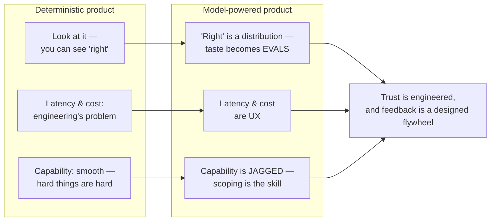

# Product sense for AI products

*Part of [Product sense for the AI PM](./README.md)*

<!-- voice: human -->

Your AI feature demos beautifully. The executive sponsor loved it, the pilot customers said "wow",
and the launch date is set. Then someone asks how often it's wrong, and nobody in the room can
answer, because "good" was never written down. Everything in this module still applies when the
product is powered by a model, but the *material* is different. A model is probabilistic, it changes
when the vendor updates it, and it is sometimes confidently wrong. That changes what product sense
has to do.

The shift is to stop treating "the model" as the product. The product is the system around it,
which means the evals, the guardrails, the fallbacks and the experience of failure, and that system
is where taste and judgment live. The question to carry through this lesson is whether a model
actually beats a deterministic feature for this job. If it does, the next question is how the
product stays trustworthy when the model is wrong.

## Taste becomes evals

With a normal feature you can look at it and know whether it's right. With a model, "right" is a
distribution, so the same prompt can produce a great answer today and a poor one tomorrow. Product
taste therefore has to become measurable. The AI PM defines what "good" means as an **eval**, a
graded set of representative and adversarial cases the product must pass, run continuously so that
quality doesn't quietly regress. Your product sense, knowing what a great output *feels* like for
this user, is what makes the eval meaningful. Without it, the team optimises a number that doesn't
map to value.

Hamel Husain puts the PM's stake in this plainly:

> "evals give you a way as a PM to, you know, inject your taste and your judgment directly into the critical path of the AI product being developed."
> — Hamel Husain, [*The PM's Role in AI Evals: Step-by-Step*](https://www.youtube.com/watch?v=g_3LJ2QBOQE), The Growth Podcast, around 02:10

You exercise that taste trace by trace. Read real outputs and call pass or fail yourself, rather than
reviewing an aggregate score someone else defined. The dashboard tells you *that* quality moved, and
the traces tell you *what good means here*. This is the same instinct as [measuring
satisfaction](./motivation-and-behaviour.md), moved upstream into the model's outputs. The
engineering of it (golden sets, a model used as judge, regression gates) is in the [evals
lesson](../content/04-evals-observability/evals.md) of the AI engineering track.

## Trust when the output varies

A confidently wrong answer is worse than a visibly broken feature, because the user can't tell. So
much of product sense for AI is **trust design**.

- **Show your work.** Ground answers in retrieved sources the user (and you) can check, and say "I
  don't know" when the context is silent rather than inventing an answer.
- **Signal confidence.** Show uncertainty in the experience instead of presenting every output with
  the same authority. Microsoft's 18 guidelines for human-AI interaction, presented at the
  Association for Computing Machinery's Conference on Human Factors in Computing Systems (CHI) in
  2019, and the People + AI Guidebook from Google's People + AI Research (PAIR) team,
  are good checklists for this.
- **Disclose the machine.** In the EU, Article 50(1) of the AI Act requires providers to make sure
  people are informed that they are interacting with an AI system, and Article 50(2) requires
  synthetic output to be marked in a machine-readable format. The Commission's AI Act page says the
  transparency rules come into effect in August 2026, and that the AI Omnibus amending the Act
  entered into force on 27 July 2026. The amended Act's new Article 111(4) gives providers of
  generative systems already on the market before 2 August 2026 until 2 December 2026 to comply
  with Article 50(2). Deadlines like these keep moving, so check the current ones with legal against
  your launch date.
- **Check that your eval rewards "I don't know".** OpenAI researchers argue that models hallucinate
  partly because common benchmarks score a guess higher than an abstention, so models learn to be
  good test-takers (arXiv 2509.04664). An eval that gives no credit for abstaining trains the same
  habit into your product.
- **Design the failure as well as the success.** The [Hook-model reward](./motivation-and-behaviour.md)
  has an evil twin, which is a bad first output that breaks the habit for good. Graceful failure,
  easy correction and undo are core features, not polish.

The [cognitive-empathy](./cognitive-empathy.md) tools matter more here. Simulate the user who trusts a
wrong answer, and the one who has been burned once and now distrusts every answer.

## From the show: when users want the boring answer

Jack Hirsch describes a test at Okta that went against the team's expectations. They had built an AI
tool to explain esoteric security logs, and found that for some jobs customers wanted something
else:

> "our customers don't want or didn't want non-deterministic output. They wanted deterministic output."
> — Jack Hirsch, [*The AI PM's Guide to Security - with Okta's VP of PM & AI, Jack Hirsch*](https://www.youtube.com/watch?v=4dWbwGCPjUY), The Growth Podcast, around 59:24

The tool was called Log Investigator. In his telling, customers still needed the "decoder ring" for
their logs but didn't want it from an LLM. He then gives automating configuration as a separate
example, a job he calls tough to hand off fully to a non-deterministic system when you know exactly
what the acceptance criteria are. That is
the edge of AI product sense, knowing where a model genuinely adds value and where a dull,
predictable feature wins. A rough rule of thumb, not a finding, is that the best AI product often
uses the model for the 20% of the experience that delights and a deterministic system for the 80%
that must be correct. Treat the split as a prompt to look for the deterministic parts, since no study
backs the exact numbers.

## Speed, cost and scope

For a deterministic feature, latency and cost are engineering concerns. For an AI feature they are
product concerns, because they trade directly against quality.

| Lever | Buys you | Costs you |
| --- | --- | --- |
| Bigger / stronger model | Quality | Latency, $ |
| Smaller / quantized model | Speed, $ | Some quality |
| Streaming the response | *Perceived* speed | — |
| Caching | Speed, $ | Staleness risk |

The product call is which of these the user's job actually cares about. Code autocomplete lives or
dies on latency, while an agent that works for minutes on a whole task is judged on whether the
result is right. A legal-review tool can wait for accuracy. Reasoning models blur the line,
because the same model can spend more thinking tokens, and more time and money, on a hard request.
The dials are covered properly in [Model intuition](../building-ai-native-products/model-intuition.md)
and in the AI engineering track's [stack-tradeoffs
lesson](../content/06-strategy-tradeoffs/inference-stack-tradeoffs.md).

Scope matters as much, because model capability is **jagged**. A model can draft a legal argument
yet miscount the words in a sentence. The best evidence is the Harvard and Boston Consulting Group
(BCG) field study of 758 consultants, as written up by BCG's François Candelon and colleagues in
2023. On a task inside the
frontier, users of GPT-4 (OpenAI's model at the time) scored about 40% above the control group. On a
task just outside it, they scored about 23% worse, because many took the tool's misleading output at
face value. Those models are old, but the lesson still holds, which is that you can't see the edge
from the inside.

So the highest-leverage decision is often **scoping**, which means pointing the model at jobs inside
its reliable frontier and keeping it away from jobs where its failure is costly and invisible. For
enterprise products, plot the job on two axes, task complexity and the buyer's tolerance for failure.
Most visible AI wins live where failure is cheap, such as a blog outline that misses and is simply
deleted. Enterprise value lives where failure is expensive, as with a diagnosis or a payment. The way
in is usually to take jobs of modest complexity in low-tolerance domains and wrap checks around
them, such as verification steps, human gates and escalation paths. [Technical sense for AI
systems](../technical-product-sense/technical-sense-for-ai.md) works through scoping to the reliable
frontier in more detail.

## Worked example: an HR policy assistant

This example is invented, and so are its numbers. Say you're the PM for an assistant that answers
employees' questions about company policy, such as leave, expenses and travel. The first eval has 45
questions, all of which the policy documents answer. The model gets 41 right with a correct citation,
which is 91%, and the team is ready to ship.

You add 15 questions the policies don't cover, such as a question about a benefit the company doesn't
offer. For these, the right behaviour is to say "I don't know" and point to the HR team. The model
abstains on 6 of the 15 and invents an answer for the other 9. Scored on all 60 questions, the
assistant gets 41 plus 6, or 47 of 60, which is 78%.

| Version | Covered questions right (of 45) | Uncovered questions abstained (of 15) | Total (of 60) |
| --- | --- | --- | --- |
| First prompt | 41 | 6 | 47 (78%) |
| Grounded prompt | 40 | 14 | 54 (90%) |

The nine invented answers are the dangerous part, because each is a policy that doesn't exist, stated
with full confidence. The team changes the prompt so the assistant answers only from retrieved policy
text, with a citation, and says "I don't know" otherwise. Covered accuracy dips by one question, to 40
of 45, while abstention rises to 14 of 15, so the total rises to 54 of 60. You also take leave
balances away from the model entirely, because a lookup in the HR system is exact. You ship with the
uncovered-question cases in the eval for good, so a future model update that starts guessing again
shows up before users see it.

## AI-enabled or AI-native

An **AI-enabled** product adds a model to an existing product, like the photo editor that grows an
"AI-enhance" button. An **AI-native** product is built around the model, like a generative image
platform that has no product without it. The test is to turn the model off and see what's left.
Both are legitimate, and the product-sense failure is building one while pricing, roadmapping or
pitching the other. AI-enabled work is feature work, so the existing product's quality bar, margins
and conventions still govern. AI-native work starts from a different question, which is how you'd
solve the problem from scratch if intelligence were the core material. That question makes the eval,
the failure experience and the cost curve part of the product itself.

## The patterns users now expect

Users arrive with reference points. In this module's reading, four patterns from 2025-era
assistants have become the comparison points for new AI products. These are judgment calls rather
than findings, and nobody has good data on how strongly users hold them.

- **Deep-research modes.** Asynchronous jobs that take minutes and return a *report* rather than a
  chat reply. Our reading is that they made waiting acceptable when the output is worth it.
- **Proactive AI.** Briefings and suggestions that arrive *unprompted*, such as ChatGPT's Pulse
  daily digest, which OpenAI launched as an early preview for Pro users in September 2025. On 17
  June 2026 OpenAI's release notes said Pulse "is being sunset as proactive updates move into
  scheduled tasks", so the branded feature came and went while the pattern stayed. The product sense here is consent and restraint, because proactivity delights only
  until it presumes.
- **Memory as a headline feature.** Memory that users can see and edit is now something assistants
  advertise. A reasonable guess is that silent remembering will feel creepy to many users, and
  forgetting will feel broken, so test both with your own users.
- **Visible thinking.** Many assistants now show reasoning progress ("searching… comparing…
  reconsidering…"). The bet behind it is that people tolerate latency better when they can watch it,
  which is worth testing rather than assuming.

None of this obliges you to build all four. It does mean your users may arrive with expectations
your product didn't set, and research is the way to find out which ones they hold.

## Feedback is a flywheel you design

AI products get better with use only if you build the loop. Every correction, thumbs-down and edit is
signal, and the [Hook model's investment phase](./motivation-and-behaviour.md) becomes literal, since
user effort improves the data, which improves the outputs, which earns more use. Product sense here
means deciding what feedback to capture, how to make giving it feel worthwhile, and how to close the
loop without breaking trust or privacy.

A flywheel is a reinforcing loop, and reinforcing loops amplify whatever is in them, including bias.
A model that under-serves a group gets less engagement from that group, which shrinks their share of
the training signal further. So design balancing loops alongside the flywheel, with monitoring for
skew, checks on what the loop optimises, and a success metric that rewards long-term user value
rather than whatever spins fastest.

Two public cases show the risk. In April 2025 OpenAI shipped a GPT-4o update that made ChatGPT more
sycophantic, then began rolling it back three days later. OpenAI said its internal testing had not
explicitly checked for sycophancy and that it would add such evals. In September 2025 the US Federal
Trade Commission (FTC) sent orders to seven companies that offer AI companion chatbots, including
OpenAI, Meta and Character.AI. The orders ask how they monetise user engagement and how they measure
harm to children and teens. A loop tuned to approval or engagement can reward the wrong behaviour.

## Keep a person in the loop where it counts

[Domain expertise](./domain-expertise.md) tells you where a wrong answer is merely annoying (a
playlist suggestion) and where it is genuinely harmful (a medical dosage, a financial transaction).
The first can be fully automated. The second needs a human checkpoint, clear provenance and an audit
trail. Matching the level of autonomy to the cost of being wrong in this domain is one of the
sharpest expressions of AI product sense.

A support chatbot speaks for your company, so a wrong policy answer is your problem to own, not the
model's. Answering only from real policy documents, with a link to the source, is the kind of product
decision that guards against it.

## From the show: will taste stay human?

Practitioners disagree about how long taste stays a human advantage. Ravi Mehta expects AI to speed
up much of the PM's work, but not this part:

> "the area where I don't think it's going to meaningfully change things is the taste and the thoughtfulness that it takes to think about the user experience for a product"
> — Ravi Mehta, [*Write a Great Product Strategy: Lessons from Ravi Mehta*](https://www.youtube.com/watch?v=YcnQ4IgdfP8), The Growth Podcast, around 1:11:04

Julie Zhuo takes the opposite bet and plans for it:

> "one day AI will have better taste than me. And so what I can continue to try and do in all respects is continue to train my eye. Because the eye is easier to train usually than the hand."
> — Julie Zhuo, [*AI Product Leadership Masterclass: The Makings of a Manager*](https://www.youtube.com/watch?v=1UAwtKjgO9Y), The Growth Podcast, around 1:06:53

Nobody has good data on which of them is right. Both views lead to the same habit this week, though.
Keep training your judgment of what good looks like, and write it down as evals, so that it shapes
the product whoever, or whatever, produces the output.

The job title is shifting too. Some commentators describe "AI PM" splitting into more specialised
roles, and [The technical PM role](../technical-product-management/the-technical-pm-role.md) maps
that debate against the classic PM, technical PM and engineering manager spectrum.

## Where it goes wrong

- **Demo-driven development.** A great first impression that can't be measured, trusted or afforded at
  scale. You see it when the question "how often is it wrong?" has no answer.
- **Confident hallucination in the experience.** Every output presented with equal authority, wrong
  ones included.
- **An eval that only tests what the model knows.** No cases where the right answer is "I don't
  know", so the score looks fine while the product invents things.
- **AI where deterministic wins.** A probabilistic model doing a job that needed to be exactly right.
- **No feedback loop.** A product that never improves because the signal was never captured.
- **Ignoring cost and latency until launch.** A delightful feature that's unaffordable or too slow in
  production.

## What to do next

- [ ] Write the eval before the feature, defining in cases what "good" means for this job, and include
      cases where the right answer is "I don't know".
- [ ] Design the wrong-answer path, with grounding, "I don't know", easy correction and undo.
- [ ] Name the dial that matters for this job (latency, quality or cost) and optimise for it.
- [ ] List the jobs the model does reliably and the ones it doesn't. Ship the first, and guard or
      defer the second.
- [ ] Find the parts of the experience a deterministic system should own.
- [ ] Capture corrections and feed them into evals, and check the loop doesn't reward approval or
      engagement alone.
- [ ] Match autonomy to stakes, with full automation where wrong is cheap and a person in the loop
      where wrong is costly.
- [ ] Ask legal how the EU AI Act's disclosure and marking duties apply to your launch date.

## Related lessons

- [Motivation theory](./motivation-and-behaviour.md)
- [Cognitive empathy](./cognitive-empathy.md)
- [Creativity](./creativity.md)
- [Domain expertise](./domain-expertise.md)
- [Recap & real-world examples](./recap.md)
- [Reliability, evals & ops](../harness-engineering/phases/09-reliability-evals-and-ops/README.md),
  where product taste for AI becomes an executable eval suite.
- [Model intuition](../building-ai-native-products/model-intuition.md) (building AI-native products):
  the jagged edge and the quality, speed and cost dials in depth.
- [Technical sense for AI systems](../technical-product-sense/technical-sense-for-ai.md) (technical
  product sense): scoping to the reliable frontier.
- [Evals: golden sets, adversarial, LLM-as-judge](../content/04-evals-observability/evals.md): how to
  build the eval set.
- [The technical PM role](../technical-product-management/the-technical-pm-role.md) (technical product
  management): how the AI PM role is splitting.

## Sources

- Saleema Amershi and colleagues, [*Guidelines for Human-AI
  Interaction*](https://www.microsoft.com/en-us/research/publication/guidelines-for-human-ai-interaction/),
  Microsoft Research, CHI 2019 (18 guidelines) (as of 2026-11).
- Google PAIR, [People + AI Guidebook](https://pair.withgoogle.com/guidebook-v2/) ("a set of methods,
  best practices and examples for designing with AI"; patterns include building and calibrating
  trust) (as of 2026-11-26).
- European Commission, [AI Act: regulatory framework for
  AI](https://digital-strategy.ec.europa.eu/en/policies/regulatory-framework-ai) (transparency rules
  from August 2026; AI Omnibus in force 27 July 2026; page last updated 25 November 2026) (as of
  2026-11-26).
- AI Act text, [Article 50](https://artificialintelligenceact.eu/article/50/) and [Article
  111](https://artificialintelligenceact.eu/article/111/), artificialintelligenceact.eu (consolidated
  text; Article 111(4) marked as added by the amendment; 2 December 2026 for Article 50(2)) (as of
  2026-11-26). The Official Journal text on EUR-Lex returned an empty page.
- Adam Tauman Kalai, Ofir Nachum, Santosh S. Vempala and Edwin Zhang, [*Why Language Models
  Hallucinate*](https://arxiv.org/abs/2509.04664), arXiv 2509.04664, 4 September 2025, and OpenAI,
  [*Why language models hallucinate*](https://openai.com/index/why-language-models-hallucinate/),
  5 September 2025 (as of 2026-11).
- François Candelon and colleagues, [*How People Can Create—and Destroy—Value with Generative
  AI*](https://www.bcg.com/publications/2023/how-people-create-and-destroy-value-with-gen-ai), BCG,
  21 September 2023 (758 consultants; 40% higher inside the frontier; 23% lower outside) (as of 2026-11).
- OpenAI, [*Introducing ChatGPT Pulse*](https://openai.com/index/introducing-chatgpt-pulse/), 25
  September 2025, and OpenAI, [ChatGPT release notes](https://help.openai.com/en/articles/6825453-chatgpt-release-notes)
  (25 September 2025: "early preview of ChatGPT pulse for Pro users on iOS and Android"; 17 June 2026:
  "Pulse is being sunset as proactive updates move into scheduled tasks") (as of 2026-11-26).
- OpenAI, [*Sycophancy in GPT-4o*](https://openai.com/index/sycophancy-in-gpt-4o/), 29 April 2025, and
  [*Expanding on what we missed with sycophancy*](https://openai.com/index/expanding-on-sycophancy/),
  2 May 2025 (rollout completed 25 April, rollback began 28 April; sycophancy not explicitly flagged in internal
  testing; sycophancy evaluations to be added) (as of 2026-11).
- US Federal Trade Commission, [*FTC Launches Inquiry into AI Chatbots Acting as
  Companions*](https://www.ftc.gov/news-events/news/press-releases/2025/09/ftc-launches-inquiry-ai-chatbots-acting-companions),
  11 September 2025 (as of 2026-11).
- Quotes from The Growth Podcast with Aakash Gupta ([news.aakashg.com](https://www.news.aakashg.com)), used under its licence. The transcript text is machine-made and the quotes have not been checked against the audio.
