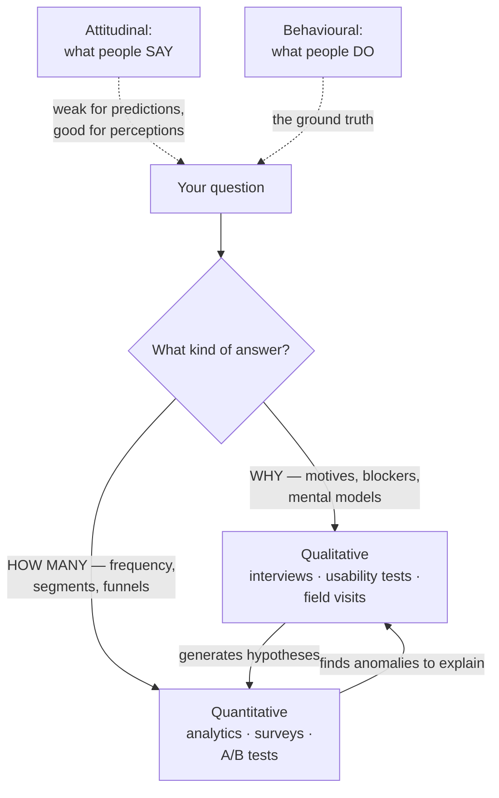

# User research: the craft of finding out

*Part of [Product sense for the AI PM](./README.md)*

*Last reviewed: 2026-11 · Volatility: medium*

<!-- voice: human -->

Picture this (an illustration, with invented numbers). You ask ten users whether they'd use an AI
feature that drafts their reports, and eight say yes. You ship it, and two of them try it once. Nobody lied to you. People are honest about
their problems and unreliable about their own futures, and the craft of user research is mostly the
craft of asking questions that don't depend on predictions. Product sense is built from user
contact, so getting that contact right is a discipline of its own.

## Two questions decide the method

Research methods split along two lines. **Qualitative** methods, such as interviews and usability
tests, answer *why* people do things. **Quantitative** methods, such as analytics and surveys at
scale, answer *how many* do it. A second line separates **attitudinal** data (what people say) from
**behavioural** data (what they actually do). Two rules govern the choice. Match the method to the
question, and when what people say and what they do disagree, trust what they do.

The pairing is the point. A funnel drop-off (quantitative) tells you where people leave, five
interviews (qualitative) tell you what happened there, and a survey (quantitative again) tells you
how widely that explanation holds. Research that stays on one side of the map gives you either
anecdotes with no scale or scale with no explanation.

Always allow for the gap between saying and doing. Users who *said* they'd pay didn't, and users who
*said* the old design was fine had already stopped using it. Statements are data about perceptions,
while behaviour is data about the world.

## Interviewing, the core skill

Most PM research is conversation, and most conversations are quietly bent by the person asking.
Teresa Torres names the most common way it happens:

> "we tend to ask really unreliable questions like, what do you like and dislike about different things?"
> — Teresa Torres, [*Teresa Torres' Step-by-Step Guide to AI Product Discovery*](https://www.youtube.com/watch?v=wGuRuuPuYNQ), The Growth Podcast, around 02:24

Her alternative is what she calls story-based interviewing, which means collecting a specific story
about a past experience. The habits that make it work:

- **Ask about past behaviour, not hypotheticals.** "Tell me about the last time you booked travel for
  work" beats "would you use a tool that…?" almost every time, because people are decent historians
  of their own behaviour and poor futurists.
- **Open, then narrow.** Start wide ("walk me through it"), then drill into specifics ("what did you
  do next? what were you feeling there?"). Save your own topics for the end. The structure of the
  [5 Whys](../first-principles/the-method.md) works on people too, used gently.
- **Don't lead, and don't pitch.** "Don't you think X would help?" gets polite agreement rather than
  truth. If you're testing your idea, watch people *use* it instead of asking them to bless it.
- **Let silence work.** The best material tends to arrive after the pause you resisted filling.
- **Keep the sample small and the rhythm frequent.** Five users per round, with rounds every few
  weeks, feeds the [pattern, heuristic, intuition](./cognitive-empathy.md) engine. Fifty interviews
  once a year produces a report, while five a month produces product sense.

Usability testing is interviewing's behavioural twin. You give a task, watch, and explain nothing.
The moment you explain the interface the test is over, because you won't be shipped alongside the
product to explain it to everyone else.

## From the show: five interviews or twenty?

The five-user number comes from Jakob Nielsen at Nielsen Norman Group, and it has a specific scope.
It is for qualitative usability rounds with similar users, run again and again. Nielsen's own
caveats are that a study with distinct user groups needs three or four users from each, and in a
later article he recommends testing with 20 users in quantitative studies.

George Harter gives a different number, for a different job:

> "And what that means to me is 20 user interviews and then a survey to prioritize what you hear in those interviews."
> — George Harter, [*The Ultimate Guide to Knowing Your Users as a PM*](https://www.youtube.com/watch?v=igo5c_OoTe8), The Growth Podcast, around 20:52

Harter is describing how a PM gets to know a new market, which is discovery about needs. Nielsen is
describing how to find usability problems in a design. Both can be right, because the purpose sets
the sample. Five people trying your prototype will find most of the problems in that prototype,
while twenty conversations plus a survey tell you which needs are common enough to build for. When
someone quotes a sample size at you, ask what question it was meant to answer.

## Jobs to be done: turning stories into a job

Interviews and usability tests produce a pile of individual stories. **Jobs to be done** (JTBD) is a
framework, associated with Clayton Christensen and his colleagues, that turns that pile into
something you can build against. In the Christensen Institute's words, people "hire" products or
services when "jobs" arise in their lives, to make progress in a specific circumstance. You can write
a job as "when I ___, I want to ___, so I can ___." The institute's best-known case is a fast-food
restaurant that found customers hiring milkshakes for different jobs at different times of day, with
the morning shake making a drive more interesting. The job stays
stable even when the products around it change, which is the payoff. Solutions come and go with the
competition, but the job survives your redesign, your pivot and your competitor's launch.

Surfacing a job takes a different interview from a features interview. Ask about the **moment of
first thought** ("what were you doing right before you started looking for a solution?"), the
**struggle** that made the status quo intolerable, and what else the customer considered, including
doing nothing or a workaround with no software in it at all. JTBD interviews fail the way ordinary
interviews do, by drifting into feature requests, so anchor every answer back to *when this
happened* and *what was true in that moment*.

A job stated well does two things a persona or feature request can't. It explains why customers
switch, because their circumstance changed or a competitor now does the job better in that same
circumstance. It also defines your real competitive set, which is whatever else gets hired for that
job, sometimes a spreadsheet and sometimes doing nothing.

## Researching AI products

AI products raise research questions that classic funnels miss. Do users *trust* the output, can
they *repair* a wrong answer, and do they understand what the system can't do? None of these appear
in analytics until they appear as churn. Three habits help.

- **Research the trust curve.** First impressions of AI features are unstable, with delight at a
  good answer and betrayal at a bad one. Research the *second* session as well as the first.
  Deliberately show participants an imperfect output, and watch the recovery. Do they edit, retry,
  distrust the feature, or distrust the whole product? ([Trust design](./product-sense-for-ai.md)
  depends on what you learn here.)
- **Surface the mental model.** Users bring very different theories of what the system is ("it's
  Google", "it's a person", "it knows my account"). A mismatched mental model predicts misuse and
  disappointment, so ask users to *predict* what the feature will do before they try it.
- **Treat behavioural signals as always-on research.** Edits, retries, rephrasings and abandonments
  are a continuous usability study running in production, and they are the same signals your
  [flywheel](./product-sense-for-ai.md) captures. Sample the traces behind them ([the trace-reading
  routine](../technical-product-management/tpm-for-ai-products.md)) and you get qualitative research
  at quantitative scale.

**Synthetic users are not users.** Some tools now offer AI "participants" that answer interview
questions in seconds. Nielsen Norman Group reran three of its real studies with such tools, and the
AI answers were too favourable, shallow and sometimes wrong. In one, the synthetic users claimed to
have finished online courses that real learners had abandoned. The group's advice is to use them
only for early desk research or to form hypotheses that real users then test, since they can't
supply the surprise that makes research worth doing.

**AI-moderated interviews are a different tool.** Here a real person talks to an AI interviewer. In
January 2026 Nielsen Norman Group tested two such tools with ten participants. The AI followed its
script and probed short answers, but it didn't chase unexpected points and never asked people to
confirm what it had understood. Only 3 of 10 participants called the conversation natural, and some
found the praise fake. The article's conclusion is that "they are not yet suitable for
semistructured or in-depth interviews, where following unexpected insights is critical." They fit structured feedback after a launch, recruitment screening,
and interviews in languages your team doesn't speak. Teresa Torres has a further worry about
handing interviews to AI:

> "I'm a little bit concerned about what it says to our customers. Like we really want to learn about you, but not enough to spend our own time doing it."
> — Teresa Torres, [*Teresa Torres' Step-by-Step Guide to AI Product Discovery*](https://www.youtube.com/watch?v=wGuRuuPuYNQ), The Growth Podcast, around 08:45

So use a person for early discovery, and use the AI interviewer to scale a question you already know
how to ask.

## Using AI to synthesise what you heard

Synthesis is where AI tempts you most, because turning ten transcripts into themes takes days. Torres
says she is "really torn" on synthesis, and that what she is wary of is using AI "to completely
automate that work" (around 09:12 and 11:25 in the same episode). Her reasoning is that everyone has
access to the same AI tools, so a team that outsources the work entirely loses what would make its
understanding different.

If you do use a model to draft themes, treat its output like any other unverified draft. Trace every
quote it gives you back to the transcript and the person who said it, because a model can merge two
people's words or smooth a hesitant answer into a confident one. Read at least a few transcripts in
full yourself, so you can tell when a theme doesn't match what you heard. And keep the counts honest,
since "several users said" should mean you can name them.

## Worked example: one round on an AI expense tool

This example is invented, and so are the counts. Say you're the PM for an AI feature that sorts a
small business's card transactions into expense categories. You plan one round of research over a
week: five interviews, then a usability test with five different people.

**The interviews.** You ask each owner to walk you through the last time they closed their books for
the month. Four of the five describe the same struggle, which is chasing receipts for transactions
they don't recognise. Only one mentions categorising as painful. That's a surprise, because your
feature assumes categorising is the job.

**The test.** You give five other owners a prototype with twelve transactions already sorted by the
model. You seed one wrong answer on purpose, filing a client lunch under "Office supplies". You ask
each person to review the list as if it were real, and you say nothing.

| What happened | Owners (of 5) |
| --- | --- |
| Spotted the wrong category and fixed it | 2 |
| Spotted it but couldn't find how to change it | 1 |
| Accepted the list without noticing | 2 |

Only two of five recovered from a wrong answer, and the fix control was hard to find. Two people
didn't look closely at all, which tells you the tool's confident layout invites people to accept the
list without checking it. Your decisions come straight from the counts. You put an "edit" control on
every row, flag low-confidence categories for review, and add a receipt-matching step to the next
round, because that was the struggle four of five owners described. Five interviews and five tests
won't tell you how common these problems are across all your customers, so a short survey goes out
next to size them.

## Where it goes wrong

- **Interviewing a model instead of a person.** Treating AI-simulated participants as evidence of
  what users do. They agree too easily and hide the unhappy path.
- **Scaling discovery with a script-bound interviewer.** Using an AI moderator before you know the
  right questions, so it asks what you wrote and misses what you didn't think of.
- **The focus-group future.** Asking users to predict their own behaviour, then building on the
  predictions.
- **Leading the witness.** Questions shaped so that agreement is the polite answer, which turns
  research into pitch rehearsal.
- **Demo-glow validation.** Testing only the happy path of an AI feature, so users meet the unhappy
  path in production instead.
- **Unchecked synthesis.** Circulating AI-drafted themes with quotes nobody traced back to a person.
- **Solution-shaped jobs.** Writing the job statement as a feature in disguise ("I want a faster
  search bar") instead of the progress underneath ("I want to feel confident I found the best
  price"). A real job statement survives a total redesign of the solution.
- **Research theatre.** A big annual study that's stale before it's summarised, instead of small,
  continuous contact.
- **Drifting into cohorts and percentages.** Consuming only aggregated findings until users stop
  being people ([the mediated-research trap](./cognitive-empathy.md)).

## What to do next

- [ ] For your current open question, decide whether it's a *why* or a *how many*, and check that
      your method matches.
- [ ] Rewrite your interview guide so every question asks about a past event.
- [ ] Watch a user (not a dashboard) use the product this month.
- [ ] For an AI feature, seed a wrong answer into your next test and count who recovers.
- [ ] If you use AI participants or an AI interviewer, keep them to hypotheses, screening or
      structured feedback, with real people doing the discovery.
- [ ] If a model drafts your synthesis, trace every quote back to its source before you share it.
- [ ] Write the job your product is hired for as "when ___, I want to ___, so I can ___", and list
      what else gets hired for it.

## Related lessons

- [Cognitive empathy](./cognitive-empathy.md)
- [Motivation & behaviour](./motivation-and-behaviour.md)
- [Product sense for AI products](./product-sense-for-ai.md)
- [Creativity: positioning and focus](./creativity.md)
- [Metrics & experimentation](../technical-product-management/metrics-and-experimentation.md)
- [Discovery to delivery](../technical-product-management/discovery-to-delivery.md) (technical
  product management): where this research feeds the decision to build, kill or reshape.
- [Researching agent interactions](../building-ai-native-products/researching-agent-interactions.md)
  (building AI-native products): research methods for agents in depth.

## Sources

- Jakob Nielsen, [*Why You Only Need to Test with 5
  Users*](https://www.nngroup.com/articles/why-you-only-need-to-test-with-5-users/), Nielsen Norman
  Group, 18 March 2000 (3–4 users per group) (as of 2026-11-26).
- Jakob Nielsen, [*Quantitative Studies: How Many Users to
  Test?*](https://www.nngroup.com/articles/quantitative-studies-how-many-users/), Nielsen Norman
  Group, 25 June 2006 ("test with 20 users in quantitative studies") (as of 2026-11-26).
- Maria Rosala and Kate Moran, [*Synthetic Users: If, When, and How to Use AI-Generated
  "Research"*](https://www.nngroup.com/articles/synthetic-users/), Nielsen Norman Group, 21 June 2024
  (as of 2026-11).
- Maria Rosala, [*AI-Moderated Interviews: If, When, and How to Use Them*](https://www.nngroup.com/articles/ai-interviewers/), Nielsen Norman
  Group, 30 January 2026 (as of 2026-11-26).
- Clayton M. Christensen, Taddy Hall, Karen Dillon and David S. Duncan, [*Know Your Customers' "Jobs
  to Be Done"*](https://hbr.org/2016/09/know-your-customers-jobs-to-be-done), Harvard Business
  Review, September 2016. Only the opening was readable (paywall) (as of 2026-11-26).
- Clayton Christensen Institute, [Jobs to Be Done](https://www.christenseninstitute.org/theory/jobs-to-be-done/)
  (people "hire" products when jobs arise; the milkshake case) (as of 2026-11-26).
- Quotes from The Growth Podcast with Aakash Gupta ([news.aakashg.com](https://www.news.aakashg.com)), used under its licence. The transcript text is machine-made and the quotes have not been checked against the audio.
