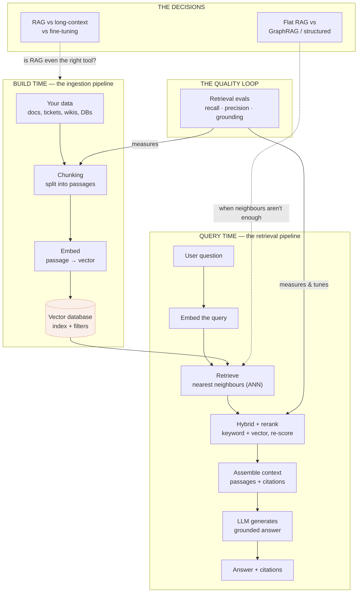

# RAG & vector databases for the product leader

A model's built-in knowledge is frozen at training time, generic, and has no source. It cannot know your customers, your contracts or what changed this morning. When it does not know, it guesses fluently.

**Retrieval-Augmented Generation (RAG)** is the common fix. Before the model answers, you *retrieve* the relevant facts from your own data and put them in front of it. The answer is then grounded in something real, current, private and citable. The machinery underneath, embeddings, vector databases, chunking and reranking, is where much of the engineering effort in AI features goes. It is also where their quality is won or lost.

This module is the product leader's map of that machinery, in ten lessons. It starts with the decision most teams skip: whether RAG is the right tool at all. It then covers how semantic search and vector databases work, why chunking and retrieval quality decide whether a feature can be trusted, when long context or fine-tuning fits better, and where flat RAG gives way to structure. It ends with a hands-on build using Claude Code with pgvector or Pinecone, and a reference to every RAG term.

**Every lesson has two layers.** The body is for the leader who decides. A short **Under the hood** section is for the engineer who builds. It points to code in `rag-vector-databases/code/` that runs on the Python standard library, with no account and no install, and ends in `assert` lines that check the direction of each claim. Run a file to see every quoted number printed. The examples share one invented corpus: the help centre of Fernpay, a made-up invoicing product.

## Where the depth lives

Each lesson summarizes an idea and points to the lesson that covers it in full.

| If you want the full depth on | Read |
| --- | --- |
| RAG architecture for engineers | [RAG architecture](../content/03-rag/rag-architecture.md) |
| Retrieval and answer metrics, faithfulness, citations | [Retrieval evals](../content/03-rag/retrieval-evals.md) |
| Evals, judges and monitoring in production | [Evaluation and observability](../evaluation-and-observability/README.md) |
| Graphs, entity extraction and GraphRAG | [Knowledge graphs](../knowledge-graphs/README.md) |
| What goes into the context window, and memory across sessions | [Context engineering](../context-engineering/README.md) and [Memory and context](../memory-and-context/README.md) |
| Tenant isolation and permission-aware retrieval | [Multi-tenant isolation](../content/05-safety-multitenancy/multi-tenant-isolation.md) |
| Prompt injection through retrieved documents | [AI security and guardrails](../ai-security-and-guardrails/README.md) |
| Agent guard rails for Claude Code | [Learning and doing ML with Claude Code](../machine-learning/learning-and-doing-ml-with-claude-code.md) |

## The knowledge graph

RAG is not a product. It is a pipeline with a quality loop. Everything in this module hangs off this picture:



Read it in three passes. **The pipeline.** At build time you cut your data into passages, turn each into a vector, and index it. At question time you turn the question into a vector, pull the nearest passages, sharpen them, and hand them to the model. **The quality loop.** Retrieval evals measure whether you find the right passages and whether the answer is supported. You tune chunking and reranking until they pass. **The decisions.** RAG is one option next to long context and fine-tuning, and it is the wrong option for counts, exact lookups and behaviour. Flat retrieval gives way to structure when the answer is a connection, not a passage.

## The lessons

1. [**When to use RAG, and when not to**](./when-to-use-rag.md) — the decision tree, the five signals, and the requests that need SQL, a lookup, long context or a prompt instead.
2. [**Why RAG?**](./why-rag.md) — grounding, freshness, private data and citations: the four jobs RAG does, and the refusal path.
3. [**Embeddings and semantic search**](./embeddings-and-semantic-search.md) — how meaning becomes numbers, and where similar is not correct.
4. [**Vector databases**](./vector-databases.md) — approximate search, the recall dial, the filter trap, and choosing a store.
5. [**Chunking and ingestion**](./chunking-and-ingestion.md) — the pipeline that decides what can ever be found.
6. [**Retrieval quality**](./retrieval-quality.md) — hybrid search, reranking, filters, and measuring recall.
7. [**RAG vs. long context vs. fine-tuning**](./rag-vs-long-context-vs-finetuning.md) — three ways to give a model knowledge, and what each costs.
8. [**Beyond flat RAG: GraphRAG and structured retrieval**](./graphrag-and-structured-retrieval.md) — multi-hop, global and counting questions.
9. [**Building RAG with Claude Code, pgvector and Pinecone**](./building-rag-with-claude-code.md) — a seven-stage build, run against a real Postgres, with the Pinecone equivalent.
10. [**RAG terms, explained**](./rag-terms.md) — every term by pipeline stage, with an example and a link.

Then the [recap and real-world examples](./recap.md), with a self-test.

## Run the code

Every example is in `rag-vector-databases/code/`. Run them all with one command.

```bash
python3 rag-vector-databases/code/test_examples.py
```

The files are `decide.py`, `mini_rag.py`, `embeddings_demo.py`, `ann_demo.py`, `chunking_demo.py`, `graph_demo.py` and `pgvector_demo.py`, with the shared `corpus.py`. `pgvector_demo.py` runs against a real Postgres with pgvector when one is reachable through the usual `PG*` settings, and prints a skip message otherwise. `pinecone_example.py` needs a Pinecone account, so the test runner does not run it.
