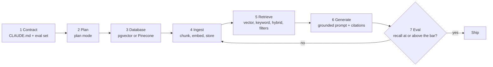

# Building RAG with Claude Code, pgvector and Pinecone

*Part of [RAG & vector databases for the product leader](./README.md)*

*Last reviewed: 2026-10 · Volatility: fast*

## TL;DR

This lesson builds a working RAG feature end to end, with Claude Code doing most of the typing. The store is Postgres with the **pgvector** extension. **Pinecone** is shown as the managed alternative, with a table that maps each step across.

The build has seven stages: a contract, a plan, the database, ingestion, retrieval, the grounded prompt, and an eval. Claude Code writes the code for each stage. You own three things it cannot decide for you: the eval questions, the permission rules, and the bar the eval must pass.

Everything here runs. The repo ships a standard-library pipeline with no install, and a pgvector demo that was run against Postgres 16 with pgvector 0.8.1. The real database returned the same ranking as the Python code, to three decimal places. The Pinecone code is written against the Python software development kit (SDK) 10.0.0 and was not run, because it needs an account.

> 🎯 **For the product leader**
>
> **Why it matters** — A coding agent can stand up a RAG prototype in an afternoon. That is real leverage. It also means a prototype with no eval, no permission filter and no delete path can reach a demo before anyone asks for them.
>
> **What it changes in your decisions** — You ask for the eval set and the recall bar before the first line of code. You choose the store by your operations, not by a benchmark. Postgres is enough for most first builds.
>
> **Ask your eng team** — *"Which command proves retrieval still works, what score must it pass, and does the agent run it before it says it is done?"*
>
> **Risk if ignored** — A fast demo that answers from a retracted policy, or shows one customer another customer's documents. Both are retrieval bugs that only a filter and an eval catch.

## The mental model: you set the contract, the agent fills in the stages



Two stages are yours. Stage 1 is the contract: what "correct" means. Stage 7 is the gate: the eval that proves it. Claude Code does the work in between, and loops back when the eval fails.

## Mechanics

### Stage 1: the contract

Claude Code reads a file called `CLAUDE.md` at the start of every session. The docs suggest you keep it short, and put in only what Claude cannot work out from the code. `/init` writes a starter file you can edit. For a RAG build, the contract fits in a few lines.

```markdown
# RAG service
- Corpus: docs/help-centre/*.md. Chunk by "## " section. Keep the title with each chunk.
- Store: Postgres 16 + pgvector, table `chunks`. Schema in db/schema.sql.
- Embeddings: one model for documents and queries. Never mix models in one table.
- Every answer cites chunk ids. If no chunk supports the answer, say "I don't know".
- Retrieval always filters status = 'current' and the caller's audience.
- Check: `python3 eval.py` must print recall@3 >= 0.90 before you say you are done.
- Never connect to the production database. Use the local container only.
```

`CLAUDE.md` is advice. The Claude Code docs say hooks are deterministic, and `CLAUDE.md` instructions are advisory. So turn the last two lines into enforcement as well. A Stop hook can run `eval.py` and block the end of a turn until it passes. A permission rule can block commands you never want run. The [machine learning lesson on Claude Code](../machine-learning/learning-and-doing-ml-with-claude-code.md) covers these guard rails in depth.

Write the eval set yourself. Twenty to fifty real questions, each with the chunk that answers it, is enough to start. Include paraphrases, exact codes, and one question whose answer is in a retracted document. The agent must not write the questions it is graded on.

### Stage 2: the plan

Start Claude Code in plan mode with `claude --permission-mode plan`, or press `Shift+Tab` in a session. In plan mode it reads and proposes, and changes nothing. Ask for the design before any code:

```text
Read CLAUDE.md and docs/help-centre/. Propose the schema, the chunking rule,
the index, the retrieval query with filters, and how eval.py computes recall@3.
Say which embedding model and dimension you assume. Do not write code yet.
```

Check four things in the plan: the vector dimension matches the embedding model, the filter is in every query, deletes are handled, and the eval uses your questions.

### Stage 3: the database

pgvector adds a vector type and nearest-neighbour search to Postgres. The quickest local start is the project's Docker image:

```bash
docker run -d --name rag-pg -e POSTGRES_PASSWORD=pw -p 5432:5432 pgvector/pgvector:pg16
```

Then the schema. This is adapted from `rag-vector-databases/code/pgvector_demo.sql`, with a real model's 1,024 dimensions and fewer columns:

```sql
CREATE EXTENSION IF NOT EXISTS vector;
CREATE TABLE chunks (
    id        text PRIMARY KEY,          -- 'refunds-v2#0': document id + section number
    doc       text NOT NULL,
    body      text NOT NULL,
    status    text NOT NULL,             -- 'current' or 'retracted'
    audience  text NOT NULL,             -- 'customer' or 'internal'
    embedding vector(1024) NOT NULL,     -- must equal the embedding model's dimension
    fts       tsvector GENERATED ALWAYS AS (to_tsvector('english', body)) STORED
);
CREATE INDEX ON chunks USING hnsw (embedding vector_cosine_ops);
CREATE INDEX ON chunks USING gin (fts);
```

Three choices sit in that schema. The `vector(1024)` size must match the model. The HNSW index is the approximate search; its operator class, `vector_cosine_ops`, must match the `<=>` cosine distance used in queries. The `fts` column gives you keyword search in the same table, which is what makes hybrid search one SQL statement.

Two limits from the pgvector documentation matter early. An index on the `vector` type supports up to 2,000 dimensions; the `halfvec` type supports up to 4,000. And a filter is applied after the approximate index scan, so a narrow filter can return fewer rows than you asked for. Version 0.8.0 added iterative index scans to fix that. They are off by default: turn them on with `SET hnsw.iterative_scan = strict_order`. They still stop at a scan limit, `hnsw.max_scan_tuples`.

Claude Code reaches the database through its Bash tool, with `psql`. You can also connect a database server over the Model Context Protocol (MCP) with `claude mcp add`. The docs warn you to verify that you trust each server before you connect it. Either way, give the session a local database and nothing else.

### Stage 4: ingestion

Ingestion reads each document, cuts it into chunks, embeds each chunk and stores it with its metadata. Anthropic does not offer its own embedding model. Its documentation points to Voyage AI. With Voyage, you embed documents and questions with different `input_type` values, which handles the gap between short questions and long passages:

```python
import voyageai

vo = voyageai.Client()                               # reads VOYAGE_API_KEY
doc_vectors = vo.embed(chunk_texts, model="voyage-4", input_type="document").embeddings
query_vector = vo.embed([question], model="voyage-4", input_type="query").embeddings[0]
```

`voyage-4` returns 1,024 numbers by default, which is why the schema says `vector(1024)`. Any embedding model works the same way. Pick one, record it in `CLAUDE.md`, and re-embed everything if you ever change it.

A good prompt for this stage names the chunk rule and the delete path:

```text
Write ingest.py. Chunk each file by "## " section and keep the title in each chunk.
Upsert by chunk id. When a source file is deleted or marked retracted, delete or
mark its chunks in the same run. Print counts of added, updated and removed chunks.
```

### Stage 5: retrieval

Four queries do most of the work. Each one is in `pgvector_demo.sql`.

```sql
-- vector search, filtered: the default query
SELECT id, 1 - (embedding <=> :'qvec') AS similarity
FROM chunks
WHERE status = 'current' AND audience = 'customer'
ORDER BY embedding <=> :'qvec'
LIMIT 3;
```

The keyword query uses Postgres full-text search with `websearch_to_tsquery`. The hybrid query runs both lists and fuses them with **reciprocal rank fusion**: each list gives a chunk `1 / (60 + rank)`, and the sums decide the order. pgvector's own README suggests reciprocal rank fusion or a cross-encoder to combine the two lists.

### Stage 6: the grounded prompt

The prompt puts numbered sources before the question and tells the model what to do when they do not answer it.

```python
import anthropic

prompt = "\n".join([
    "Answer only from the sources below. Cite each claim as [n].",
    "If the sources do not contain the answer, say you do not know.", "",
    *[f"[{n}] {c.title} > {c.section}: {c.body}" for n, c in enumerate(chunks, start=1)],
    "", f"Question: {question}",
])
client = anthropic.Anthropic()                       # reads ANTHROPIC_API_KEY
msg = client.messages.create(model="claude-opus-5-5", max_tokens=1024,
                             messages=[{"role": "user", "content": prompt}])
answer = next(b.text for b in msg.content if b.type == "text")
```

Gate the call before it happens. If neither the keyword search nor the vector search finds good evidence, skip the model and say "I don't know". The Claude API also has a built-in citations feature for documents you pass as `document` blocks; it returns the cited text with each claim.

### Stage 7: the eval

`eval.py` runs every question in your eval set and reports **recall@3**: the share of questions whose answering chunk is in the top 3. Report it by question type, because the averages hide the pattern. Make the agent run it, and gate the turn on it with a Stop hook if the build runs unattended. The Claude Code docs say Claude "stops when the work looks done", and that a check it can run is what closes the loop.

### The Pinecone variant

Pinecone is a managed vector database. You do not run a server. You create an index, write records to it and search it over an API. The SDK changed in version 10: an index now declares a **schema**, and you read and write it through `index.documents`.

```python
from pinecone import DenseVectorQuery, Pinecone, TextQuery

pc = Pinecone()                                      # reads PINECONE_API_KEY
pc.indexes.create(
    name="fernpay-help",
    schema={"fields": {
        "embedding": {"type": "dense_vector", "dimension": 1024, "metric": "cosine"},
        "body": {"type": "string", "full_text_search": {"language": "en"}},
    }},
    deployment={"deployment_type": "managed", "cloud": "aws", "region": "us-east-1"},
)
index = pc.index("fernpay-help")
index.documents.upsert(namespace="tenant-42", documents=[
    {"_id": "refunds-v2#0", "embedding": vec, "body": text, "status": "current", "audience": "customer"},
])
hits = index.documents.search(
    namespace="tenant-42", top_k=3,
    score_by=[DenseVectorQuery(field="embedding", values=query_vec)],
    filter={"status": {"$eq": "current"}, "audience": {"$eq": "customer"}},
)
```

Three details differ from Postgres. Only searched fields go in the schema; metadata you filter on is indexed when you write it. Upserts apply asynchronously, so a new record may not show in the next search. And a dense-vector clause must run alone, so hybrid search is two searches plus fusion in your code. The full file is `rag-vector-databases/code/pinecone_example.py`.

| Step | pgvector | Pinecone (SDK 10) |
| --- | --- | --- |
| Run the store | Your Postgres, or a hosted one | Managed by Pinecone |
| Declare vectors | `embedding vector(1024)` column | `dense_vector` field in the schema |
| Approximate index | `CREATE INDEX ... USING hnsw` | Built for you |
| Write | `INSERT ... ON CONFLICT` | `index.documents.upsert` |
| Vector search | `ORDER BY embedding <=> q LIMIT k` | `documents.search` with `DenseVectorQuery` |
| Keyword search | `tsvector` + `websearch_to_tsquery` | `TextQuery` on a `full_text_search` field |
| Filters | `WHERE` on any column | `filter={"field": {"$eq": ...}}` |
| Tenants | A column in `WHERE`, or row-level security | One namespace per tenant |
| Delete | `DELETE ... WHERE doc = ...` | `documents.delete(filter=...)` |
| Join with business data | Same database, plain SQL | A second call to your database |

## Tradeoffs and decisions

- **pgvector vs. Pinecone.** pgvector keeps vectors next to your business data, in a system you already back up and secure. You run it and tune it. Pinecone removes the operations work and bills by use. You add a second system and a sync job from your database.
- **Exact vs. approximate search.** With no index, pgvector scans every row and returns the exact top-k. An HNSW index is faster and can miss a neighbour. On a small table, exact search may be fast enough. Measure it before you add an index.
- **One embedding model vs. many.** A model trained for code or law may retrieve better in that domain. Each model needs its own column or index, and its own re-embed when it changes.
- **Agent speed vs. review.** Claude Code writes each stage quickly. Review the parts that carry risk: the filter, the delete path and the eval.

## Failure modes

- **Dimension mismatch.** The column is `vector(1536)` and the model returns 1,024 numbers. Inserts fail, or someone pads the vectors and recall collapses.
- **Wrong operator class.** The index uses `vector_l2_ops` and the query uses `<=>`. Postgres cannot use the index, so every search scans the table.
- **A filter that empties the result.** A narrow `WHERE` after an approximate scan returns 1 row instead of 10. Use iterative scans, a partial index or exact search for small tenants.
- **No delete path.** A retracted policy stays in the index and wins the search. In the worked example it scores 0.927 against 0.936 for the current one.
- **The agent grades itself.** Claude Code writes the eval questions and the code, and both agree. Keep the eval set human-written and read-only to the agent.
- **Production credentials in the session.** The agent can run any command its permissions allow. Point it at a local container only.
- **Prompt injection through documents.** A retrieved document says "ignore your instructions". Treat retrieved text as data, and never give the answering model tools it does not need.

## Under the hood

Two files show every stage with no account. `mini_rag.py` is the whole pipeline in the Python standard library. `pgvector_demo.py` loads the same chunks into a real Postgres through `psql` and runs the four queries from `pgvector_demo.sql`. It then checks that Postgres and Python agree.

```python
ids = lambda rows: [row[0] for row in rows]
assert ids(r["vector"]) == [cid for _, cid in r["python_vector"]]       # same ranking as Python
assert "refunds-v1#0" in ids(r["vector"])                               # the retracted policy competes
assert "refunds-v1#0" not in ids(r["vector_filtered"])                  # the filter removes it
assert ids(r["keyword_code"])[0] == "errors#0"                          # keyword search finds the code
assert ids(r["hybrid_code"])[0] == "errors#0"                           # and hybrid keeps it on top
assert "chunks_embedding_hnsw" in r["plan"]                             # the HNSW index is used
```

The embedding in these files is a toy with 30 numbers, so the schema there says `vector(30)`. With no Postgres reachable, the demo prints a skip message and exits cleanly.

## Worked example: the Fernpay help centre on Postgres

*This example is invented. Fernpay is a made-up product. The output is from `rag-vector-databases/code/pgvector_demo.py`, run against Postgres 16 with pgvector 0.8.1.*

The corpus is 10 help documents, cut into 22 chunks. One document is a retracted refund policy that allowed 30 days. The current policy allows 14.

**The retracted policy nearly wins.** Ask "can I get my money back on a yearly plan". Unfiltered, Postgres returns the current policy at 0.936 and the retracted one at 0.927. Add `WHERE status = 'current'` and the retracted chunk is gone. The Python index returns the same three chunks with the same scores.

**Keyword search finds the code.** Ask "what does E-4021 mean". Vector search ranks a refund chunk first, at a similarity of 0.113, and misses the E-4021 section (`errors#0`) in its top 3. Postgres full-text search returns `errors#0` first. The hybrid query keeps `errors#0` on top with a fused score of 0.0320.

**The index is used.** `EXPLAIN` shows `Index Scan using chunks_embedding_hnsw`. On 22 rows Postgres prefers a plain scan, so the demo turns sequential scans off for that one statement.

**The eval.** The demo runs no eval itself. In the Python pipeline (`mini_rag.py`), on 12 questions, recall@3 is 0.667 for keyword search, 0.833 for vector search and 0.917 for hybrid. The contract's bar is 0.90, so hybrid ships and vector search alone does not.

## Practitioner checklist

- [ ] Is the eval set written by a person, with the answering chunk for each question?
- [ ] Does `CLAUDE.md` name the corpus, the chunk rule, the model, the filter and the check?
- [ ] Is the check enforced by a hook or CI, not only written in `CLAUDE.md`?
- [ ] Does the vector column's dimension match the embedding model?
- [ ] Does the index's operator class match the distance operator in the queries?
- [ ] Is the status and permission filter in every retrieval query?
- [ ] Do deletes and retractions reach the index in the same run as the source change?
- [ ] Does the agent work only against a local or staging database?

## Related lessons

- [When to use RAG, and when not to](./when-to-use-rag.md) — check the tool before you build it.
- [Vector databases](./vector-databases.md) — HNSW, filters and choosing a store.
- [Retrieval quality](./retrieval-quality.md) — hybrid search, reranking and recall.
- [Learning and doing ML with Claude Code](../machine-learning/learning-and-doing-ml-with-claude-code.md) — the agent guard rails in depth.
- [Hooks](../harness-engineering/phases/06-permissions-and-security/02-hooks/docs/en.md) — enforcing a check every time.
- [AI security and guardrails](../ai-security-and-guardrails/README.md) — prompt injection through retrieved text.

## Sources

- pgvector [README](https://github.com/pgvector/pgvector/blob/v0.8.1/README.md), release 0.8.1: the `<=>`, `<->` and `<#>` operators, HNSW and IVFFlat indexes, `vector_cosine_ops`, the default `m` of 16 and `ef_construction` of 64, the 2,000-dimension index limit for `vector` and 4,000 for `halfvec`, filtering applied after the index scan, iterative index scans from 0.8.0, the Docker image, and hybrid search with full-text search and reciprocal rank fusion. Read from the source, 2026-10.
- PostgreSQL documentation, [Full text search](https://www.postgresql.org/docs/16/textsearch.html): `to_tsvector`, `websearch_to_tsquery` and `ts_rank`. Read 2026-10.
- Pinecone Python SDK [README and docs](https://github.com/pinecone-io/pinecone-python-client/tree/v10.0.0), release 10.0.0 (published 3 September 2026): `schema=` and `deployment=`, `index.documents.upsert` and `.search`, `DenseVectorQuery` and `TextQuery`, metadata filters, namespaces, asynchronous upserts, and a dense-vector clause that must appear alone. The call signatures were checked against the installed 10.0.0 package. Read 2026-10.
- Anthropic documentation, [Embeddings](https://platform.claude.com/docs/en/build-with-claude/embeddings): Anthropic does not offer its own embedding model, Voyage AI models, `voyage-4` with 1,024 dimensions by default, and the `input_type` parameter. Read 2026-10.
- Claude Code docs, [Best practices](https://code.claude.com/docs/en/best-practices): `CLAUDE.md` read at the start of every conversation, `/init`, plan mode with `Shift+Tab` or `--permission-mode plan`, hooks as deterministic, Stop hooks as a gate, and "Claude stops when the work looks done". Read 2026-10.
- Claude Code docs, [MCP](https://code.claude.com/docs/en/mcp): `claude mcp add`, scopes, and the warning to verify you trust each server. Read 2026-10.
- Cormack, Clarke and Büttcher, *Reciprocal rank fusion outperforms Condorcet and individual rank learning methods*, SIGIR 2009: the `1 / (k + rank)` fusion with k = 60.
- The Fernpay corpus, the eval questions and every number are invented. They come from `rag-vector-databases/code/`.
