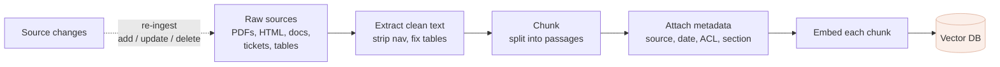

# Chunking & ingestion

*Part of [RAG & vector databases for the product leader](./README.md)*

*Last reviewed: 2026-10 · Volatility: medium*

## TL;DR

Before anything can be retrieved, your data must be cut into passages, embedded and indexed. That is the **ingestion pipeline**. Its most important and least glamorous step is **chunking**: cutting documents into pieces small enough to embed precisely and retrieve cleanly.

Chunking sets a ceiling on the whole feature. The model can only answer from a chunk that retrieval can find. If a fact is cut in half, no search can return it whole, however good the model or the database. Chunks that are too big blur several topics together and cost more tokens. Chunks that are too small lose the context that makes them make sense.

Around chunking sits the rest of the pipeline: clean text from messy sources, metadata on every chunk, and freshness. Freshness means the index follows the sources, including deletes. Ingestion is a permanent product surface, not a one-time load.

> 🎯 **For the product leader**
>
> **Why it matters** — When a RAG feature "can't find the answer that's obviously in our docs", the cause is usually here, not in the model.
>
> **What it changes in your decisions** — You fund ingestion as ongoing product work with an owner. When quality drops, you look at chunks and freshness before you swap models or databases.
>
> **Ask your eng team** — *"When our data changes, how long until retrieval reflects it, and can the right answer survive our chunking intact?"*
>
> **Risk if ignored** — A feature that is right on launch day and wrong a few weeks later: stale answers, unfindable facts, and citations to fragments that do not contain the claim.

## The mental model: you can only find what you filed well

Chunking is deciding how to cut documents into index cards. A fact split across two cards, or buried in a card about ten other things, cannot be retrieved cleanly. The model never sees your documents. It sees the cards retrieval hands it. **Chunking decides what is findable.**



## Mechanics

### The chunking tension

| Chunks too **big** | Chunks too **small** |
| --- | --- |
| One chunk covers many topics, so its embedding is a blur | A sentence without its surroundings is ambiguous |
| More tokens sent to the model on every question | The answer spans several chunks, and retrieval gets one |
| Irrelevant text distracts the model | Many more chunks to store and rank |

The craft is to cut along the document's **natural structure**: section, clause, heading or logical unit, so each chunk is about one thing. Two refinements help. **Overlap** repeats a little text at the start of the next chunk, so a fact on a boundary survives. And structured content, such as tables, code and lists, stays whole rather than being cut mid-row.

Keep the title and heading with each chunk. "Annual plans can be refunded within 14 days" means little alone. "Refund policy > Annual plans: …" is findable and citable.

### The rest of the pipeline

- **Extraction.** Real sources are messy. PDFs have headers, footers and columns. HTML has navigation. Tables turn to noise when flattened. Text that is wrong here is wrong in every answer.
- **Metadata.** Every chunk carries its source (for [citations](../content/03-rag/retrieval-evals.md)), its date (for recency), who may see it (for [permissions](../content/05-safety-multitenancy/multi-tenant-isolation.md)), and its status. Metadata is what lets you filter, cite and stay safe.
- **Freshness.** Data changes, so the index must follow: add the new, update the changed, and **delete the removed**. A retracted policy still in the index will be retrieved and cited.
- **Contextual chunks.** Some teams add a short note about the whole document to each chunk before embedding it. Anthropic's 2024 contextual retrieval post reports this cut retrieval failures by 35%, and by 49% when combined with contextual keyword search. **Late chunking** is a related method: embed the whole document first, then cut the result into chunk vectors.

### Cold start vs. steady state

The **cold start** is the one-time load of existing data. It is bounded and scriptable, a good place to try chunking rules. The **steady state** lasts forever. New documents arrive, old ones change or are deleted, and chunking rules evolve and need re-runs. A pipeline built only for the cold start gives a feature that is correct at launch and decays every week.

## Tradeoffs and decisions

- **Structure vs. simplicity.** Cutting by section needs a parser for each source type. Cutting every N characters needs none, and slices facts in half.
- **Overlap vs. duplicates.** Overlap rescues facts on boundaries. It also creates near-duplicate chunks that crowd the top results.
- **Big chunks vs. cost.** Bigger chunks are more likely to contain the whole answer. They send more tokens per question and blur the embedding.
- **Batch vs. streaming updates.** A nightly batch is simple and up to a day stale. Event-driven updates are fresh and more work to run.

## Failure modes

- **Blind character counts.** Cutting mid-sentence or mid-table because it was the one-line default.
- **The split fact.** The answer crosses a chunk boundary, so no single chunk contains it.
- **Chunks without metadata.** No source, date or permissions, so you cannot cite, filter by date or separate tenants.
- **Ingest once.** A cold start with no update or delete path. The index becomes a snapshot of the past, citing retracted sources.
- **Dirty extraction.** Navigation bars, boilerplate and broken tables embedded as if they were content.

## Under the hood

The file is `rag-vector-databases/code/mini_rag.py`. It has two chunkers. The first cuts by section and keeps the title and heading in each chunk. The second cuts blindly by character count, with optional overlap.

```python
def chunk_by_section(doc):
    parts = [p.strip() for p in doc["text"].split("\n## ") if p.strip()]
    out = []
    for n, part in enumerate(parts):
        heading, _, body = part.lstrip("# ").partition("\n")
        out.append(dict(id=f"{doc['id']}#{n}", text=f"{doc['title']}. {heading}. {body}",
                        status=doc["status"], audience=doc["audience"], updated=doc["updated"]))
    return out

def chunk_fixed(doc, size=120, overlap=0):
    body = re.sub(r"\s*## [^\n]*\n", " ", doc["text"]).strip()   # headings are lost
    step = size - overlap
    return [dict(text=body[s:s + size], ...) for s in range(0, len(body), step)]
```

`chunking_demo.py` runs the same 12 questions against four chunk plans. A question counts as answered when one of the top 3 chunks contains the whole answer fact.

## Worked example: four ways to cut the same help centre

*This example is invented. Fernpay is a made-up product. The numbers come from `rag-vector-databases/code/chunking_demo.py`, using hybrid search.*

| Chunk plan | Chunks | Facts cut in half | Questions answered in the top 3 | Words sent per question |
| --- | --- | --- | --- | --- |
| By section, title kept | 22 | 0 | 11 of 12 | 63 |
| Fixed 80 characters | 29 | 2 | 7 of 12 | 40 |
| Fixed 80, overlap 30 | 42 | 0 | 8 of 12 | 40 |
| Fixed 200 characters | 12 | 0 | 12 of 12 | 84 |

**Blind cuts lose answers.** At 80 characters, two facts are cut in half: "first day of every month" and "get error 429". No search can return them whole. Only 7 questions are answered.

**Overlap rescues the facts, not the ranking.** With 30 characters of overlap, no fact is cut. But there are now 42 chunks, many near-duplicates, and they crowd the top 3. Only 8 questions are answered. Fixed chunks also lose the titles and headings. That probably costs some matches, though the demo does not measure it separately.

**Big chunks win here, for a reason that will not last.** Each Fernpay document is 127 to 295 characters long, so a 200-character chunk holds most of a document. It answers all 12 questions, and sends a third more words per question than section chunks. On a real corpus, with documents of thousands of words, a big fixed chunk mixes many topics. Section chunks are the plan that scales.

## Practitioner checklist

- [ ] Do chunks follow the document's structure, with the title and heading kept?
- [ ] Are tables, code and lists kept whole?
- [ ] Does every chunk carry its source, date, status and permissions?
- [ ] Is there an add, update and **delete** path, with a set refresh cadence?
- [ ] Is extraction clean for our messiest real sources?
- [ ] Do we measure "answer fact in the top k" when we change the chunk rule?
- [ ] Does ingestion have an owner?

## Related lessons

- [Embeddings and semantic search](./embeddings-and-semantic-search.md) — what each chunk becomes.
- [Retrieval quality](./retrieval-quality.md) — measuring what chunking makes possible.
- [Building RAG with Claude Code](./building-rag-with-claude-code.md) — an ingestion prompt with a delete path.
- [RAG architecture](../content/03-rag/rag-architecture.md) — the engineering-depth version.
- [Governance, quality and trust](../knowledge-graphs/governance-quality-and-trust.md) — provenance and freshness in general.

## Sources

- Anthropic, [Introducing Contextual Retrieval](https://www.anthropic.com/news/contextual-retrieval), 19 September 2024: context of "usually 50-100 tokens" added to each chunk; top-20 retrieval failures cut by 35% with contextual embeddings and by 49% with contextual embeddings plus contextual BM25. Read 2026-10.
- Günther et al., *Late Chunking: Contextual Chunk Embeddings Using Long-Context Embedding Models*, 2024 ([arxiv.org/abs/2409.04701](https://arxiv.org/abs/2409.04701)).
- The Fernpay corpus, the chunk plans and every number are invented. They come from `rag-vector-databases/code/chunking_demo.py`.
