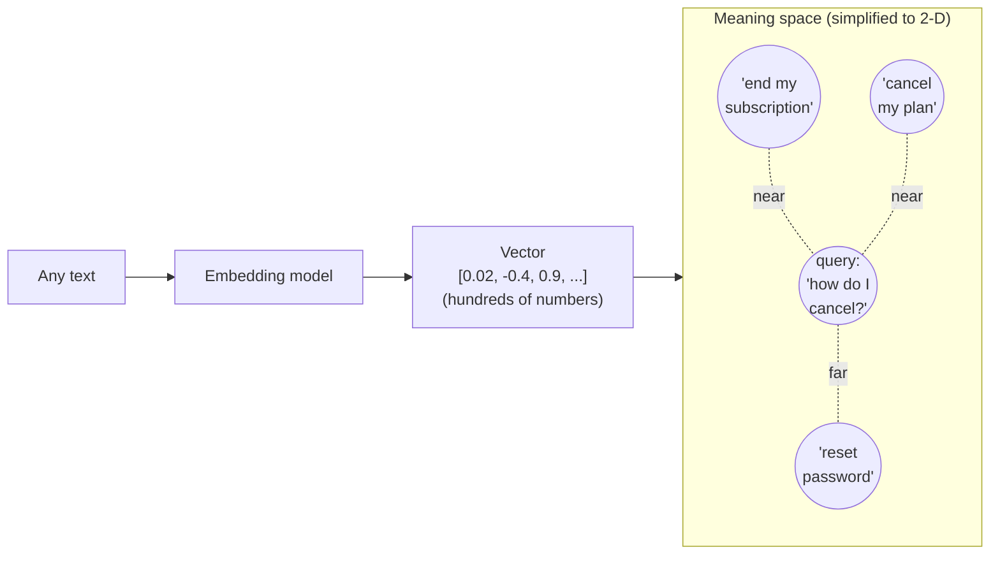

# Embeddings & semantic search

*Part of [RAG & vector databases for the product leader](./README.md)*

*Last reviewed: 2026-10 · Volatility: medium*

## TL;DR

To search by meaning rather than by exact words, you first turn text into numbers. An **embedding** is that translation. A model reads a piece of text and returns a long list of numbers, a *vector*. The model places the vectors so that texts with similar meanings land near each other.

Search then becomes geometry. The passages most relevant to a question are the vectors closest to the question's vector. This is **semantic search**. It is why a RAG system can answer "how do I stop paying?" from an article titled "Ending your subscription", with no word in common.

Embeddings have sharp edges. They measure resemblance, not truth. A retracted policy can sit almost on top of the current one. Exact codes and names are weak points. And a query embedded by one model cannot be compared with documents embedded by another.

> 🎯 **For the product leader**
>
> **Why it matters** — Embeddings sit under every RAG feature, semantic search box and recommendation you will ship. If you do not know their limits, you will promise "it understands meaning" and then be surprised when it retrieves something that is merely similar.
>
> **What it changes in your decisions** — You treat the embedding model as a product choice with a quality cost and a migration cost. You insist that retrieval is measured, not judged on a few demo queries.
>
> **Ask your eng team** — *"For a question worded nothing like our documents, does retrieval still find the right passage, and how do we know?"*
>
> **Risk if ignored** — A feature that shines on demo queries and fails on the long tail of real wording, because "similar" drifted from "relevant" and nobody measured it.

## The mental model: meaning as a map

Imagine every sentence placed on a huge map. Sentences with similar meanings sit close together. "Cancel my plan", "end my subscription" and "stop billing" form one neighbourhood. "Reset my password" sits far away. An embedding is the **coordinates** of a text on that map. Semantic search embeds the question, goes to its coordinates, and takes the nearest passages.



Real embeddings have hundreds or thousands of numbers, not two. So "nearby" can capture topic, intent and entities at once. The intuition still holds: **distance in the space is roughly difference in meaning.** A [vector database](./vector-databases.md) is the machinery that finds nearby points fast.

## Mechanics

- **Embedding a passage.** An embedding model turns each chunk of your data into one vector, once, at ingestion. The vectors go into a vector database.
- **Embedding a question.** At question time, the same model embeds the question into the same space, so distances can be compared.
- **Measuring closeness.** The usual measure is **cosine similarity**: the cosine of the angle between two vectors. 1 means the same direction. The system returns the top-k closest passages.
- **One model per index.** Questions and documents must come from the same model. Changing the model means re-embedding the whole corpus, because old and new vectors live in different spaces.
- **Questions and passages differ.** A short question and a long passage look different even when they match. Some embedding models take an input type for this. Voyage AI's models, for example, embed with `input_type="query"` or `input_type="document"`. Another method, HyDE, has a model write a hypothetical answer and embeds that instead of the question.

### Semantic vs. keyword search

| | Keyword (lexical) | Semantic (embeddings) |
| --- | --- | --- |
| Matches | Exact words | Meaning and paraphrase |
| Strong on | IDs, names, codes, exact quotes | Natural questions, synonyms, intent |
| Weak on | Synonyms and rewording | Rare exact strings |
| Fails quietly when | The user does not know the exact term | Something similar outranks the right passage |

Neither wins everywhere. Production systems run both and combine them. That is [hybrid search](./retrieval-quality.md).

## Tradeoffs and decisions

- **General vs. domain model.** A general model is a safe start. A model trained for code, law or finance may retrieve better in that domain, and ties you to that vendor.
- **Bigger vs. smaller vectors.** More numbers can hold more detail. They cost more memory and slower search. Many models let you choose a smaller size.
- **Switching models.** A better model may appear next quarter. Switching means re-embedding everything and re-running your evals. Budget for it.
- **Embeddings vs. keywords.** Embeddings win on wording. Keywords win on exact strings. Run both rather than pick one.

## Failure modes

- **Similarity treated as truth.** The top match ships as "the answer", with no filter or reranker. The similar-but-wrong passage reaches the model.
- **Mixed models.** Questions and documents embedded by different models, or a model change with no re-embed. Distances become meaningless.
- **The exact-match tail.** Pure semantic search misses queries that hinge on a code, a name or a stock-keeping unit (SKU). The fix is hybrid search, not a bigger model.
- **Versions and negation.** An old policy and a new one, or a rule and its negation, use nearly the same words. Their embeddings sit close together. Dates and status belong in metadata you can filter on.
- **"It understands meaning" claims.** Embeddings measure similarity. They do not reason.

## Under the hood

The file is `rag-vector-databases/code/mini_rag.py`. Its embedding is a toy, so you can read every step. A small hand-made table maps words to 22 concepts, such as "cancel" or "refund". Other words are hashed into a few spare slots. The vector is then scaled to length 1.

```python
def embed(text):
    v = [0.0] * DIM
    for t in tokens(text):
        if t in WORD2CONCEPT:                      # "stop", "end", "quit" -> the "cancel" slot
            v[CONCEPT_IDS[WORD2CONCEPT[t]]] += 1.0
        else:                                      # any other word -> one of 8 spare slots
            v[len(CONCEPTS) + zlib.crc32(t.encode()) % HASH_SLOTS] += HASH_WEIGHT
    norm = math.sqrt(sum(x * x for x in v)) or 1.0
    return [x / norm for x in v]

def cosine(a, b):                                  # both have length 1, so this is the cosine
    return sum(x * y for x, y in zip(a, b))
```

A real model learns its map from huge amounts of text, with hundreds or thousands of numbers. The toy writes the map by hand with 30. The behaviour you will see is the same in kind: good on paraphrase, weak on rare exact strings.

## Worked example: paraphrase, a near-miss, and a mixed-up model

*This example is invented. Fernpay is a made-up product. The numbers come from `rag-vector-databases/code/embeddings_demo.py`.*

**Paraphrase works.** The question "how do I stop paying for fernpay" shares no meaningful word with the "End plan" help section. Their cosine similarity is still 0.773, because "stop", "paying" and "end", "billing" map to the same concepts. Keyword search has no word to match in that section. It matches "fernpay" in unrelated chunks instead.

**Similar is not correct.** The question "can I get my money back on a yearly plan" scores 0.936 against the current refund policy and 0.927 against the retracted one. The two policies score 0.99 against each other. They differ only in the word "old" in one title and the number of days. Embeddings alone cannot tell which one is in force. A status filter can.

**Mixed models break everything.** We keep the index and embed the questions with a "different model": the same numbers in a shuffled order. Recall@3 on the 12-question eval set falls from 0.833 to 0.167. Nothing errors. The search returns confident, wrong results.

## Practitioner checklist

- [ ] Are questions and documents embedded by the same model, and is the model recorded with the index?
- [ ] Do we know the cost of changing the model: a full re-embed and a full eval?
- [ ] Do exact codes, names and IDs have a keyword path?
- [ ] Is there a stage after similarity, such as a filter or a reranker, to catch similar-but-wrong passages?
- [ ] Do dates, versions and status live in metadata we can filter on?
- [ ] Is retrieval measured on real, varied wording?

## Related lessons

- [Vector databases](./vector-databases.md) — where the vectors live and how neighbours are found fast.
- [Retrieval quality](./retrieval-quality.md) — hybrid search and reranking, the sharper second stage.
- [What a tensor is](../tensors/what-a-tensor-is.md) — the shape and bytes of a batch of vectors.
- [RAG architecture](../content/03-rag/rag-architecture.md) — the engineering-depth version.
- [Prompt vs. semantic caching](../content/01-inference-internals/prompt-vs-semantic-caching.md) — the same embedding trick used for caching.

## Sources

- Anthropic documentation, [Embeddings](https://platform.claude.com/docs/en/build-with-claude/embeddings): Anthropic does not offer its own embedding model; Voyage AI's models, the `input_type` parameter, and normalized embeddings where cosine similarity equals the dot product. Read 2026-10.
- Gao, Ma, Lin and Callan, *Precise Zero-Shot Dense Retrieval without Relevance Labels* (HyDE), ACL 2023 ([arxiv.org/abs/2212.10496](https://arxiv.org/abs/2212.10496)): embedding a generated answer instead of the raw question.
- The toy embedding, the corpus and every number are invented. They come from `rag-vector-databases/code/embeddings_demo.py` and `mini_rag.py`.
