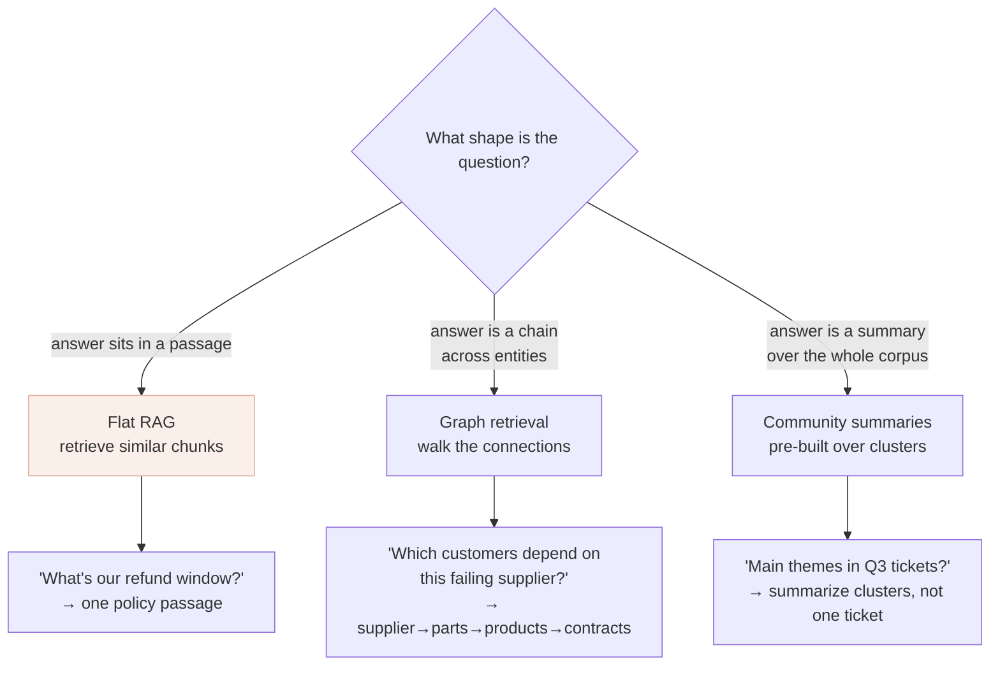

# Beyond flat RAG: GraphRAG & structured retrieval

*Part of [RAG & vector databases for the product leader](./README.md)*

*Last reviewed: 2026-10 · Volatility: medium*

## TL;DR

Plain, or "flat", RAG retrieves the chunks most *similar* to a question. That works when the answer sits in a passage. It fails when the answer is a *connection* that no single passage states, or a *summary* of the whole corpus, or a *count*.

Three question shapes break flat RAG. **Multi-hop**: "which customers are exposed to this supplier's recall?" The answer is a chain across documents. **Global**: "what are the main themes in this quarter's tickets?" The answer is about the corpus, not in it. **Quantitative**: "how many contracts renew in Q3?" The answer is computed from rows, and top-k retrieval can never count past k.

**GraphRAG** and structured retrieval fix this by retrieving *structure* instead of similar text. That can be a set of connected entities, pre-built summaries, or the result of a real database query. The discipline is to know which questions flat RAG cannot answer, and to add structure only when your roadmap has those questions.

> 🎯 **For the product leader**
>
> **Why it matters** — Teams hit a wall where "our RAG can't answer these questions". They either give up or over-build. The shape of the failing questions tells you when structure is worth it.
>
> **What it changes in your decisions** — You sort your questions into passage, multi-hop, global and quantitative before choosing an architecture. You let measured failures justify the step up, not a vendor deck.
>
> **Ask your eng team** — *"Are the questions we fail on about connections or whole-corpus summaries, or is our flat RAG just tuned badly?"*
>
> **Risk if ignored** — A feature that stalls on the questions that matter most. Or an expensive graph pipeline built for questions that were mostly simple lookups.

## The mental model: passages, chains and summaries



Flat RAG is the right and cheapest tool for the first shape, which covers most questions. The others are where structure earns its cost.

## Mechanics

### Why flat RAG breaks

- **Multi-hop.** The answer joins facts across documents: supplier, then part, then product, then customer. No chunk holds the whole chain. Similarity search fetches chunks that each resemble the question, and they rarely connect. Many rounds of retrieval can sometimes force it, but that is fragile and slow.
- **Global.** "What are the recurring complaints?" has no passage to retrieve. The answer is a synthesis over thousands of passages. Flat retrieval returns a handful, and the model summarizes those. The answer sounds confident and rests on a small, biased sample.
- **Quantitative.** "How many?" and "what is the total?" need every matching row. Top-k returns k at most.

### The structured approaches

- **GraphRAG.** Build a [knowledge graph](../knowledge-graphs/what-is-a-knowledge-graph.md) from your corpus: entities and typed relations. For multi-hop questions, retrieve connected subgraphs. For global questions, use summaries written in advance for each cluster of related entities. Microsoft Research's 2024 GraphRAG paper by Edge and colleagues built this for global questions over a whole corpus. The cost is a real indexing stage, with extraction, entity matching and summaries, that must be [kept fresh](../knowledge-graphs/governance-quality-and-trust.md).
- **Text-to-query.** When the answer lives in a database, do not embed and retrieve. Have the model [write a query](../knowledge-graphs/knowledge-graphs-and-llms.md), in SQL or Cypher, and let the database compute the exact answer.
- **A router.** Mature systems keep flat RAG for passage questions, and send multi-hop, global and quantitative questions to a graph or a query. That is several retrievers behind a router, not one architecture forced to do everything.

The [knowledge graphs](../knowledge-graphs/README.md) track covers graphs and their use with language models in full.

### How to decide

1. **Sort your questions.** Take a sample of real or expected questions. Label each one: passage, multi-hop, global or quantitative.
2. **Start flat and measure.** Ship hybrid RAG with an [eval set](./retrieval-quality.md). Watch which question types fail.
3. **Add structure where it fails.** Route only those question types to a graph or a query. Keep flat RAG for the rest.
4. **Cost the freshness.** A graph or structured index is a second thing to keep current. Budget for it first.

## Tradeoffs and decisions

- **Coverage vs. cost.** A graph answers multi-hop and global questions. It adds an extraction pipeline, entity matching and a second index to keep fresh.
- **Exact vs. approximate.** A database query returns the exact count. Retrieval returns similar text. Choose by the question.
- **One architecture vs. a router.** A router gives each question the right tool. It also adds a classification step that can route wrongly.

## Failure modes

- **GraphRAG as fashion.** A graph pipeline for a workload that was mostly simple lookups.
- **Flat RAG on multi-hop forever.** Adding more and more chunks to the prompt to force connections that similarity cannot make.
- **Similarity for aggregates.** Answering "how many?" from a few chunks instead of the source of truth. The numbers are confident and wrong.
- **All or nothing.** Replacing flat RAG with a graph, and losing the cheap, good tool for most questions.
- **Unmeasured escalation.** Moving to GraphRAG on a hunch, with no eval that shows flat RAG fails.

## Under the hood

The file is `rag-vector-databases/code/graph_demo.py`. It stores 13 facts as short chunks, one fact each, the way an ingestion pipeline would. Suppliers make parts, parts go into products, and customers buy products. A graph walk follows the links three steps.

```python
def walk(start):
    parts = {o for s, r, o in FACTS if s == start and r == "makes"}
    products = {o for s, r, o in FACTS if s in parts and r == "goes into"}
    customers = {s for s, r, o in FACTS if o in products and r == "buys"}
    return customers
```

The same file runs the multi-hop question and a count through the hybrid search from `mini_rag.py`, and compares.

## Worked example: a supplier recall and a renewal count

*This example is invented. The companies are made up. The numbers come from `rag-vector-databases/code/graph_demo.py`.*

**The multi-hop question.** "Which customers are exposed to the recall at Kestrel Metals?" Hybrid search returns the top 5 chunks:

- Kestrel Metals makes bracket B-2.
- Kestrel Metals makes hinge H-7.
- Northgate School buys Atlas shelf.
- The contract with Northgate School renews in Q1.
- bracket B-2 goes into Atlas shelf.

Those chunks name one exposed customer, Northgate School. The graph walk follows the chain: two parts, then two products (Atlas desk and Atlas shelf), then three customers: Brightwell Hotels, Harbor Clinic and Northgate School. Flat retrieval found one of the three. It missed the two customers that buy the Atlas desk, because the "hinge H-7 goes into Atlas desk" link was not in the top 5.

**The count.** "How many contracts renew in Q3?" The top 3 chunks all mention Q3, so a model reading them would say three. A count over the table gives five. Top-k retrieval can never count past k. A database query gets it right every time.

## Practitioner checklist

- [ ] Have we sorted our real questions into passage, multi-hop, global and quantitative?
- [ ] Is hybrid RAG in place and measured, so we know which types fail?
- [ ] Do counts and totals go to a database query, not to retrieval?
- [ ] For multi-hop or global needs, have we scoped a graph, including the cost of keeping it fresh?
- [ ] Do we route by question type, keeping flat RAG for most questions?

## Related lessons

- [When to use RAG, and when not to](./when-to-use-rag.md) — counts and connections in the decision tree.
- [Retrieval quality](./retrieval-quality.md) — make flat RAG good before adding structure.
- [Knowledge graphs and LLMs](../knowledge-graphs/knowledge-graphs-and-llms.md) — GraphRAG and text-to-query in depth.
- [What is a knowledge graph?](../knowledge-graphs/what-is-a-knowledge-graph.md) — the structure GraphRAG retrieves over.
- [RAG vs. long context vs. fine-tuning](./rag-vs-long-context-vs-finetuning.md) — the other axis of the decision.

## Sources

- Edge et al., *From Local to Global: A Graph RAG Approach to Query-Focused Summarization*, Microsoft Research, 2024 ([arxiv.org/abs/2404.16130](https://arxiv.org/abs/2404.16130)): a graph index with community summaries, for global questions over a whole corpus.
- The suppliers, customers and every number are invented. They come from `rag-vector-databases/code/graph_demo.py`.
