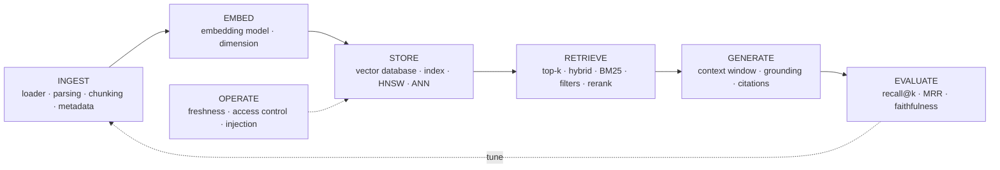

# RAG terms, explained

*Part of [RAG & vector databases for the product leader](./README.md)*

*Last reviewed: 2026-10 · Volatility: medium*

## TL;DR

RAG has a large vocabulary, and much of it is used loosely. This lesson defines every common term in plain language, grouped by the stage of the pipeline where it lives. Each term has a one-line example from the Fernpay help centre used across this module, and a link to the lesson that develops it.

Three habits make the vocabulary easier. First, place each term on the pipeline: ingest, embed, store, retrieve, generate, evaluate, operate. Second, separate the **retrieval** words from the **answer** words. Recall and precision describe what search found. Faithfulness and answer relevance describe what the model wrote. Third, when two terms seem to mean the same thing, ask which stage each one measures.

> 🎯 **For the product leader**
>
> **Why it matters** — Teams use the same word for different things. "Accuracy" can mean retrieval recall, answer correctness or citation support. A review where each person means a different thing ends with the wrong fix.
>
> **What it changes in your decisions** — You ask which stage a number measures before you act on it. A low faithfulness score needs a different fix from a low recall score.
>
> **Ask your eng team** — *"When you say the RAG feature is 90% accurate, which stage is that, on which questions, measured how?"*
>
> **Risk if ignored** — Money spent on a bigger model to fix answers that were wrong because retrieval missed the passage.

## The mental model: every term has a place on the pipeline

## Mechanics: the terms by stage

### Ingest

| Term | Plain meaning | Fernpay example | Develops it |
| --- | --- | --- | --- |
| **Corpus** | All the text the system can retrieve from. | The 10 help documents. | [Chunking and ingestion](./chunking-and-ingestion.md) |
| **Ingestion** | Reading sources, cutting them into chunks, embedding and storing them. | `ingest.py` runs nightly. | [Chunking and ingestion](./chunking-and-ingestion.md) |
| **Loader** | Code that reads one kind of source, such as PDF, HTML or a ticket system. | A loader for the help-centre Markdown. | [Chunking and ingestion](./chunking-and-ingestion.md) |
| **Parsing** | Turning a raw file into clean text and structure. | Dropping the navigation bar from an HTML page. | [Chunking and ingestion](./chunking-and-ingestion.md) |
| **Chunk** | One retrievable piece of a document. | `refunds-v2#0`, the annual-plan section. | [Chunking and ingestion](./chunking-and-ingestion.md) |
| **Chunking** | The rule that cuts documents into chunks. | One chunk per `##` section. | [Chunking and ingestion](./chunking-and-ingestion.md) |
| **Chunk size** | How long each chunk is, in characters or tokens. | Fixed 80-character chunks. | [Chunking and ingestion](./chunking-and-ingestion.md) |
| **Chunk overlap** | Text repeated at the start of the next chunk, so a fact on a boundary survives. | 30 characters of overlap. | [Chunking and ingestion](./chunking-and-ingestion.md) |
| **Metadata** | Fields stored with a chunk: source, date, status, audience. | `status = 'retracted'`. | [Chunking and ingestion](./chunking-and-ingestion.md) |
| **Contextual retrieval** | Adding a short note about the whole document to each chunk before it is embedded. | "From Fernpay's refund policy, 2026:" before a chunk. | [Chunking and ingestion](./chunking-and-ingestion.md) |
| **Late chunking** | Embedding the whole document first, then cutting the result into chunk vectors, so each keeps document context. | Not used in Fernpay. | [Chunking and ingestion](./chunking-and-ingestion.md) |

### Embed

| Term | Plain meaning | Fernpay example | Develops it |
| --- | --- | --- | --- |
| **Embedding** | A list of numbers that places a text so that similar meanings land close together. | Each chunk becomes 30 numbers in the toy. | [Embeddings](./embeddings-and-semantic-search.md) |
| **Embedding model** | The model that turns text into embeddings. | `voyage-4` in the build lesson. | [Embeddings](./embeddings-and-semantic-search.md) |
| **Dimension** | How many numbers are in one embedding. | 1,024 for `voyage-4` by default. | [Embeddings](./embeddings-and-semantic-search.md) |
| **Vector** | The list of numbers itself. | `[0, 0.5, 0.5, ...]`. | [Embeddings](./embeddings-and-semantic-search.md) |
| **Normalization** | Scaling a vector to length 1, so the dot product equals cosine similarity. | Every toy vector is unit length. | [Embeddings](./embeddings-and-semantic-search.md) |
| **Dense vector** | An embedding where most numbers are non-zero. It captures meaning. | The chunk embeddings. | [Retrieval quality](./retrieval-quality.md) |
| **Sparse vector** | A long vector where most numbers are zero, one slot per word. It captures exact words. | A keyword score per term. | [Retrieval quality](./retrieval-quality.md) |
| **Query and document input types** | Telling the embedding model whether a text is a short question or a passage. | `input_type="query"`. | [Building RAG](./building-rag-with-claude-code.md) |

### Store

| Term | Plain meaning | Fernpay example | Develops it |
| --- | --- | --- | --- |
| **Vector database** | A store that finds the vectors nearest to a query vector. | Postgres with pgvector. | [Vector databases](./vector-databases.md) |
| **Index** | A structure that makes search fast by not checking every vector. | `chunks_embedding_hnsw`. | [Vector databases](./vector-databases.md) |
| **Exact (brute-force) search** | Comparing the query with every vector. Always right, slow at scale. | 22 chunks: fast enough. | [Vector databases](./vector-databases.md) |
| **ANN** | Approximate nearest neighbour: fast search that may miss a true neighbour. | HNSW in Postgres. | [Vector databases](./vector-databases.md) |
| **HNSW** | Hierarchical navigable small world: a layered graph index, fast at query time. | `USING hnsw`. | [Vector databases](./vector-databases.md) |
| **IVF** | Inverted file index: vectors grouped into lists around centres; a query scans the nearest lists. | The `ann_demo.py` index. | [Vector databases](./vector-databases.md) |
| **Distance metric** | How closeness is measured: cosine, dot product or Euclidean (L2). | Cosine, `<=>` in pgvector. | [Building RAG](./building-rag-with-claude-code.md) |
| **Cosine similarity** | The cosine of the angle between two vectors. 1 means the same direction. | 0.936 for the current refund policy. | [Embeddings](./embeddings-and-semantic-search.md) |
| **Namespace** | A partition of an index. A search sees one namespace only. | One per tenant in Pinecone. | [Building RAG](./building-rag-with-claude-code.md) |

### Retrieve

| Term | Plain meaning | Fernpay example | Develops it |
| --- | --- | --- | --- |
| **Retriever** | The component that returns candidate chunks for a question. | `Index.hybrid()`. | [Retrieval quality](./retrieval-quality.md) |
| **Top-k** | How many chunks the retriever returns. | k = 3. | [Retrieval quality](./retrieval-quality.md) |
| **Semantic search** | Search by meaning, using embeddings. | "Stop paying" finds "End plan". | [Embeddings](./embeddings-and-semantic-search.md) |
| **Keyword (lexical) search** | Search by matching words. | "E-4021" finds the error page. | [Retrieval quality](./retrieval-quality.md) |
| **BM25** | The standard keyword scoring formula. Rare words count more; long chunks count less per word. | `Index.bm25()`. | [Retrieval quality](./retrieval-quality.md) |
| **Hybrid search** | Running keyword and semantic search and combining the lists. | Recall@3 0.917 versus 0.833. | [Retrieval quality](./retrieval-quality.md) |
| **Reciprocal rank fusion (RRF)** | Combining ranked lists by summing `1 / (60 + rank)` per chunk. | The hybrid query. | [Retrieval quality](./retrieval-quality.md) |
| **Metadata filter** | Excluding chunks by their fields before or after scoring. | `status = 'current'`. | [Retrieval quality](./retrieval-quality.md) |
| **Pre-filter and post-filter** | Filtering before the search, or after it. Post-filtering can leave fewer than k results. | 0.9 of 10 results for a small tenant. | [Vector databases](./vector-databases.md) |
| **Similarity threshold** | A minimum score below which a chunk is dropped. | 0.35 in the evidence gate. | [Why RAG?](./why-rag.md) |
| **Reranking** | Re-scoring the top candidates with a slower, more accurate model. | Not used in the toy. | [Retrieval quality](./retrieval-quality.md) |
| **Cross-encoder** | A reranker that reads the question and a chunk together. | A rerank model. | [Retrieval quality](./retrieval-quality.md) |
| **Query rewriting** | Changing the question before search: fixing spelling, expanding terms, adding context. | "E4021" to "E-4021". | [Retrieval quality](./retrieval-quality.md) |
| **Multi-query** | Searching with several rewrites of the question and merging the results. | Three phrasings of the refund question. | [Retrieval quality](./retrieval-quality.md) |
| **HyDE** | Hypothetical document embeddings: write a fake answer, then search with its embedding. | A drafted refund answer used as the query. | [Embeddings](./embeddings-and-semantic-search.md) |

### Generate

| Term | Plain meaning | Fernpay example | Develops it |
| --- | --- | --- | --- |
| **Context window** | The most text the model can read in one call. | Up to 1 million tokens on current Claude models. | [RAG vs. long context](./rag-vs-long-context-vs-finetuning.md) |
| **Augmentation (stuffing)** | Putting the retrieved chunks into the prompt. | Sources [1] and [2] above the question. | [Why RAG?](./why-rag.md) |
| **Grounding** | Answering from the supplied sources, not from memory. | "Answer only from the sources below." | [Why RAG?](./why-rag.md) |
| **Citation (attribution)** | A pointer from a claim to the source that supports it. | "14 days [1]". | [Why RAG?](./why-rag.md) |
| **Hallucination** | A fluent claim with no support. | Inventing a 30-day policy. | [Why RAG?](./why-rag.md) |
| **Refusal path** | The "I don't know" answer when the sources do not cover the question. | The weather question. | [Why RAG?](./why-rag.md) |
| **Lost in the middle** | Models use information at the start and end of a long prompt better than in the middle. | Why fewer, better chunks help. | [RAG vs. long context](./rag-vs-long-context-vs-finetuning.md) |
| **Prompt caching** | Reusing a processed prompt prefix across calls, at a lower price. | The handbook in the prompt. | [When to use RAG](./when-to-use-rag.md) |

### Evaluate

| Term | Plain meaning | Fernpay example | Develops it |
| --- | --- | --- | --- |
| **Eval set (golden set)** | Questions with the chunk or answer that is correct for each. | The 12 Fernpay questions. | [Retrieval quality](./retrieval-quality.md) |
| **Recall@k** | The share of questions whose answering chunk is in the top k. | 0.917 for hybrid. | [Retrieval quality](./retrieval-quality.md) |
| **Precision@k** | The share of the top k chunks that are relevant. | 1 relevant chunk in 3 is 0.33. | [Retrieval quality](./retrieval-quality.md) |
| **MRR** | Mean reciprocal rank: the average of 1 / rank of the first correct chunk. | 0.778 for hybrid. | [Retrieval quality](./retrieval-quality.md) |
| **nDCG** | A ranking score that gives more credit for relevant chunks near the top, with graded relevance. | Not used in the toy. | [Retrieval quality](./retrieval-quality.md) |
| **Faithfulness (groundedness)** | Whether every claim in the answer is supported by the retrieved chunks. | Checked by a person or a judge model. | [Retrieval quality](./retrieval-quality.md) |
| **Answer relevance** | Whether the answer addresses the question asked. | A refund answer to a refund question. | [Retrieval quality](./retrieval-quality.md) |
| **LLM as judge** | Using a model to grade answers against a rubric. | Grading faithfulness at scale. | [Evaluation](../evaluation-and-observability/README.md) |

### Operate

| Term | Plain meaning | Fernpay example | Develops it |
| --- | --- | --- | --- |
| **Freshness** | How quickly a change in the sources reaches the index. | The retracted policy removed in the same run. | [Chunking and ingestion](./chunking-and-ingestion.md) |
| **Re-indexing** | Rebuilding vectors after a change of model or chunk rule. | A new embedding model means re-embedding all 22 chunks. | [Embeddings](./embeddings-and-semantic-search.md) |
| **Access control** | Making retrieval return only what the caller may see. | `audience = 'customer'`. | [Vector databases](./vector-databases.md) |
| **Multi-tenancy** | Serving many customers from one system without mixing their data. | A namespace or a filter per tenant. | [Vector databases](./vector-databases.md) |
| **Indirect prompt injection** | Instructions hidden in a retrieved document that try to steer the model. | A page that says "ignore your rules". | [Building RAG](./building-rag-with-claude-code.md) |
| **Cost per query** | Embedding, search and model tokens for one question. | About $0.006 of input tokens per question with RAG. | [When to use RAG](./when-to-use-rag.md) |

### Beyond basic RAG

| Term | Plain meaning | Develops it |
| --- | --- | --- |
| **Agentic RAG** | A model that decides when to search, what to search for, and whether to search again. | [Agentic AI](../agentic-ai/README.md) |
| **GraphRAG** | Retrieval over a knowledge graph of entities and relations, with summaries of related groups. | [GraphRAG](./graphrag-and-structured-retrieval.md) |
| **Multi-hop question** | A question whose answer joins facts from several documents. | [GraphRAG](./graphrag-and-structured-retrieval.md) |
| **Global question** | A question about the whole corpus, such as its main themes. | [GraphRAG](./graphrag-and-structured-retrieval.md) |
| **Text-to-SQL** | A model writes a database query, and the database computes the answer. | [GraphRAG](./graphrag-and-structured-retrieval.md) |

## Tradeoffs and decisions

- **Similarity vs. relevance.** A high cosine similarity means "close in meaning". It does not mean "answers the question". The retracted policy has a similarity of 0.927.
- **Recall vs. precision.** A larger top-k raises recall and lowers precision. More chunks also cost more tokens.
- **Retrieval metrics vs. answer metrics.** Recall@k can be perfect while faithfulness is poor, and the reverse. Measure both.
- **Grounding vs. citation.** An answer can cite a source and still say something the source does not support. Check that the cited text supports the claim.

## Failure modes

- **One word, two meanings.** "Accuracy" used for both recall and answer correctness in the same review.
- **A metric with no stage.** A single "RAG score" that hides whether retrieval or generation failed.
- **Threshold as truth.** Treating a similarity cut-off as a relevance test. In the worked example an off-topic question scores 0.301, and a real code question scores 0.113.
- **Citations as decoration.** Showing sources without checking that they support the claim.

## Under the hood

Most retrieval terms in this lesson have a function in `rag-vector-databases/code/mini_rag.py`. Reranking, query rewriting, HyDE and nDCG do not; the toy leaves them out.

| Term | Function |
| --- | --- |
| Chunking | `chunk_by_section`, `chunk_fixed` |
| Embedding, normalization | `embed` |
| Cosine similarity | `cosine` |
| Semantic search, top-k, metadata filter | `Index.vector_search(query, k, where)` |
| BM25 | `Index.bm25` |
| Hybrid search, RRF | `Index.hybrid` |
| Refusal path, threshold | `has_evidence` |
| Augmentation, citation | `build_prompt` |
| Recall@k, MRR | `recall_at_k`, `reciprocal_rank`, `evaluate` |

## Worked example: one question, every term

*This example is invented. The numbers come from `rag-vector-databases/code/mini_rag.py`.*

A customer asks: "can I get my money back on a yearly plan?"

1. **Ingestion** has already cut the 10 documents into 22 **chunks** by section, each with **metadata**: status, audience and date.
2. The question is **embedded** with the same **embedding model** as the chunks.
3. **Semantic search** compares the question's **vector** with every chunk by **cosine similarity**. With no **filter**, the top 3 are the current policy (0.936), the **retracted** policy (0.927) and the annual-billing section (0.743).
4. The **metadata filter** `status = 'current'` removes the retracted chunk.
5. The **evidence gate** passes. The top **similarity** is 0.936, above the **threshold** of 0.35, so the question is not refused.
6. **Augmentation** puts the top 2 chunks into the prompt as sources [1] and [2], with an instruction to answer only from them and **cite** each claim.
7. A **grounded** answer reads "Annual plans can be refunded within 14 days of purchase [1]." It is **faithful**, because source [1] says exactly that. The toy builds the prompt but does not call a model.
8. In the **eval set**, this question's answering chunk is `refunds-v2#0`. In vector search it is at rank 1, so it counts for **recall@3** and its **reciprocal rank** is 1. Under **hybrid search** the keyword leg matches "plan" in two chunks of the "Ending your subscription" page, which push it to rank 3. It still counts for recall@3, with a reciprocal rank of 0.33.

## Practitioner checklist

- [ ] Does every number in our RAG reviews name the stage it measures?
- [ ] Do we report retrieval metrics (recall@k, MRR) and answer metrics (faithfulness, relevance) separately?
- [ ] Is "accuracy" defined in writing for this feature?
- [ ] Do we check that citations support the claims they are attached to?
- [ ] Do new team members know the difference between similarity and relevance?

## Related lessons

- [When to use RAG, and when not to](./when-to-use-rag.md) — the decision before the vocabulary.
- [Retrieval quality](./retrieval-quality.md) — most of the retrieval and eval terms in depth.
- [Building RAG with Claude Code](./building-rag-with-claude-code.md) — the terms as running code.
- [Glossary](../GLOSSARY.md) — every term across all tracks.
- [Evaluation and observability](../evaluation-and-observability/README.md) — judges, rubrics and online evals.

## Sources

- Lewis et al., *Retrieval-Augmented Generation for Knowledge-Intensive NLP Tasks*, NeurIPS 2020 ([arxiv.org/abs/2005.11401](https://arxiv.org/abs/2005.11401)): the term RAG.
- Robertson and Zaragoza, *The Probabilistic Relevance Framework: BM25 and Beyond*, Foundations and Trends in Information Retrieval, 2009: BM25.
- Malkov and Yashunin, *Efficient and robust approximate nearest neighbor search using Hierarchical Navigable Small World graphs*, IEEE TPAMI, 2020 ([arxiv.org/abs/1603.09320](https://arxiv.org/abs/1603.09320)): HNSW.
- Cormack, Clarke and Büttcher, *Reciprocal rank fusion outperforms Condorcet and individual rank learning methods*, SIGIR 2009: RRF with k = 60.
- Gao, Ma, Lin and Callan, *Precise Zero-Shot Dense Retrieval without Relevance Labels*, ACL 2023 ([arxiv.org/abs/2212.10496](https://arxiv.org/abs/2212.10496)): HyDE.
- Liu et al., *Lost in the Middle: How Language Models Use Long Contexts*, TACL 2024 ([arxiv.org/abs/2307.03172](https://arxiv.org/abs/2307.03172)).
- Anthropic, [Introducing Contextual Retrieval](https://www.anthropic.com/news/contextual-retrieval), September 2024: contextual retrieval.
- Günther et al., *Late Chunking: Contextual Chunk Embeddings Using Long-Context Embedding Models*, 2024 ([arxiv.org/abs/2409.04701](https://arxiv.org/abs/2409.04701)).
- Järvelin and Kekäläinen, *Cumulated gain-based evaluation of IR techniques*, ACM TOIS, 2002: nDCG.
- Edge et al., *From Local to Global: A Graph RAG Approach to Query-Focused Summarization*, 2024 ([arxiv.org/abs/2404.16130](https://arxiv.org/abs/2404.16130)): GraphRAG.
- Greshake et al., *Not what you've signed up for: Compromising Real-World LLM-Integrated Applications with Indirect Prompt Injection*, 2023 ([arxiv.org/abs/2302.12173](https://arxiv.org/abs/2302.12173)).
- The Fernpay examples and numbers are invented. They come from `rag-vector-databases/code/`.
