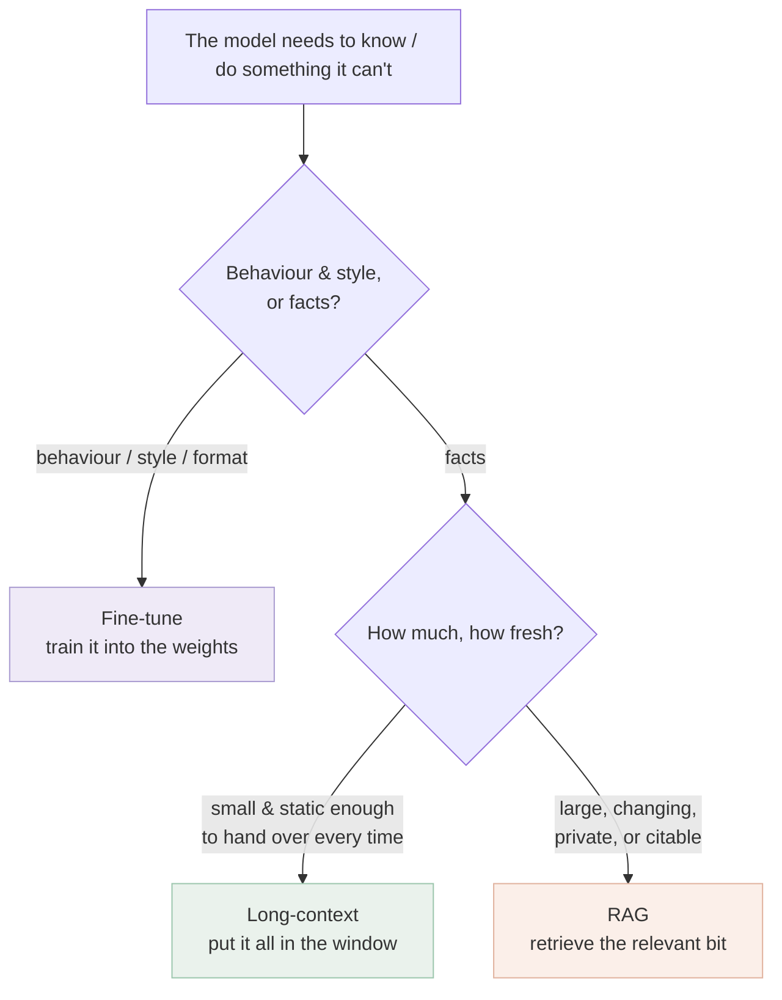

# RAG vs. long-context vs. fine-tuning

*Part of [RAG & vector databases for the product leader](./README.md)*

*Last reviewed: 2026-10 · Volatility: fast*

## TL;DR

There are three ways to give a model knowledge it did not have. **RAG** retrieves the relevant passages at question time and puts them in the prompt. **Long context** sends all the material in the prompt on every call. **Fine-tuning** trains the model on your examples, so patterns move into its weights.

Each fits a different need. Fine-tune for *how the model should behave*: voice, format, a classification. Retrieve for *what it needs to know* when that knowledge is large, changing or private. Use long context when the knowledge is small enough to send whole, or when the task needs the whole document.

They combine. A fine-tuned model with RAG is common. So is RAG that feeds a long window. Choosing the main tool for each need is the decision. [Lesson 1](./when-to-use-rag.md) gives the decision tree. This lesson compares the three in depth: cost, freshness, citations and quality.

> 🎯 **For the product leader**
>
> **Why it matters** — Two expensive mistakes are common. One is fine-tuning to teach facts, which go stale and cannot be cited. The other is paying long-context prices to re-read a knowledge base on every call.
>
> **What it changes in your decisions** — You separate two questions that get mixed up: "how should it behave?" and "what does it need to know?". You answer each with its own tool.
>
> **Ask your eng team** — *"Are we changing the model's behaviour or giving it facts, and how fresh must those facts be?"*
>
> **Risk if ignored** — A fine-tuned model that recites last quarter's policy with no source. Or a long-context bill that grows with your document count instead of your usage.

## The mental model: weights, window or lookup



- **Fine-tuning lives in the weights.** It is permanent and learned. It is good for a voice, a format or a domain style you would otherwise explain in every prompt. It is poor for facts. You would not retrain to change a price, and a weight cannot be cited.
- **Long context lives in the window.** You hand the model the material on every call. There is no retrieval to build, and the data is as fresh as what you send. You pay to process all of it on every call.
- **RAG is a lookup.** It fetches only the relevant passages. It scales to huge corpora, stays fresh, and supports citations and permissions. You pay for the retrieval pipeline this module describes.

## Mechanics

### The comparison

| | Fine-tuning | Long context | RAG |
| --- | --- | --- | --- |
| Best for | Behaviour, style, format | Small knowledge, or one whole document | Large, changing, private or citable knowledge |
| Freshness | Stale until you retrain | Fresh: you supply it | Fresh: update the index |
| Citations | No | Yes, with a citations feature such as the Claude API's | Yes, per passage |
| Cost shape | Training up front, normal serving | Every token, every call (caching helps) | Small prompts, plus a pipeline to run |
| Size limit | Not about data size | The context window | Millions of documents |
| Main risk | Facts go stale | Cost, and quality drops in long prompts | Retrieval quality caps answer quality |

The engineering detail is in the [strategy spoke](../content/06-strategy-tradeoffs/finetune-vs-icl-vs-rag.md).

### Why long context did not end RAG

Context windows have grown fast. Current Claude models accept up to 1 million tokens. Each jump revives the claim that RAG is obsolete. Four reasons keep it alive:

- **Cost.** Long context processes the whole pile on every call. The bill grows with document count times calls. Prompt caching cuts the price of repeated text, to 0.1 times the base price on Claude Haiku 5.5 and older models, 0.05 times on Claude Opus 5.5 and Sonnet 5.5, and 0.025 times on Claude Fable 5.1. It does not remove the cost.
- **Latency.** A huge prompt takes longer to read before the first word of the answer appears.
- **Quality.** Models do not use every part of a long prompt equally. Liu and colleagues found that accuracy was often highest when the relevant passage was at the start or end of the context, and dropped when it was in the middle. They called it "lost in the middle".
- **Size and change.** Many corpora are bigger than any window, and they change every day.

Long context is still the right tool when the knowledge is small and stable, or when the task needs the whole document. Anthropic's own guidance suggests that a knowledge base under about 200,000 tokens can go in the prompt. It is also a good partner to RAG: retrieve generously, and let a large window hold more candidates.

### They combine

Common stacks are a fine-tuned model plus RAG, where the model has your style and retrieves current facts, and RAG feeding a long window, where you retrieve widely and rely less on perfect precision. Pick the main tool by the dominant need. Add the others where they pay.

## Tradeoffs and decisions

- **Up-front cost vs. per-call cost.** Fine-tuning costs once per training run. Long context costs on every call. RAG costs a pipeline plus small calls.
- **Freshness vs. effort.** Long context and RAG are fresh by construction. Fine-tuning needs a new run for every change.
- **Simplicity vs. scale.** Long context is the simplest to build. It stops scaling at the window, and its cost grows with every question.
- **Citations vs. convenience.** RAG gives a per-passage source by construction. Long context can cite too, through a citations feature that points to the text it used.

## Failure modes

- **Fine-tuning for facts.** Training on a knowledge base to "make it know our product". The facts are stale by the next release and cannot be cited.
- **Long context by default.** Re-reading a knowledge base on every call because it was easier than RAG, until the bill and the latency force a rebuild.
- **RAG for behaviour.** Retrieving examples on every call to fix tone that a system prompt or fine-tuning would fix once.
- **One religion.** Using one approach for everything because it is the team's comfort zone.
- **Ignoring "lost in the middle".** Assuming a bigger window means better answers, then finding quality fell as the passage got buried.

## Under the hood

The file is `rag-vector-databases/code/decide.py`. Its cost function counts input tokens and bills cached tokens at a fraction of the base price.

```python
def cost_per_query(input_tokens, price_per_mtok, cached_tokens=0, cache_read_multiplier=0.1):
    fresh = input_tokens - cached_tokens
    return (fresh + cached_tokens * cache_read_multiplier) * price_per_mtok / 1_000_000

def scale_costs(corpus_tokens, questions=10_000, price=3.0, window=1_000_000, question=50, retrieved=2_000):
    fits = corpus_tokens + question <= window          # long context needs the corpus to fit
    ...
```

The sketch counts input tokens only. Output tokens are the same for all three approaches. It leaves out cache writes, which apply only to the cached options and recur each time the cache expires. It also leaves out embedding costs and the cost of running a retrieval pipeline.

## Worked example: the same 10,000 questions at three corpus sizes

*This example is invented. The price of $3 per million input tokens is an assumption for the arithmetic, not a quote. The numbers come from `rag-vector-databases/code/decide.py`.*

Each question is 50 tokens. RAG sends 2,000 tokens of retrieved chunks. Long context sends the whole corpus. Cached reads cost 0.1 or 0.05 times the base price, depending on the model.

| Corpus size | Long context | Cached at 0.1x | Cached at 0.05x | RAG |
| --- | --- | --- | --- | --- |
| 35,000 tokens (a handbook) | $1,051.50 | $106.50 | $54.00 | $61.50 |
| 400,000 tokens (a product's docs) | $12,001.50 | $1,201.50 | $601.50 | $61.50 |
| 2,500,000 tokens (docs plus past answers) | does not fit | does not fit | does not fit | $61.50 |

**The cost of RAG does not grow with the corpus.** It sends the same 2,000 tokens whether the corpus is a handbook or a library. Long context grows in proportion to the corpus.

**Caching changes the small case, not the large one.** For the handbook, cached long context is within $45 of RAG per 10,000 questions, and at 0.05x its reads are cheaper. Cache writes, about $0.13 each time the cache expires, can tip it back. It needs no pipeline. That is why [lesson 1](./when-to-use-rag.md) keeps the handbook in the prompt. At 400,000 tokens, cached long context costs about 10 to 20 times as much as RAG, depending on the cache price. At 2.5 million tokens, it is not an option.

## Practitioner checklist

- [ ] Have we separated behaviour (fine-tune or prompt) from facts (retrieve or long context)?
- [ ] For the facts: are they small and stable enough for long context?
- [ ] Does our cost model show how long-context cost grows with the corpus?
- [ ] Have we priced prompt caching before ruling long context out?
- [ ] If we fine-tune, is it for style, format or behaviour only?
- [ ] Have we considered combining tools?

## Related lessons

- [When to use RAG, and when not to](./when-to-use-rag.md) — the decision tree.
- [Why RAG?](./why-rag.md) — the four jobs that push you toward retrieval.
- [Context engineering](../content/00-foundations/context-engineering.md) — what fills the window and why more is not always better.
- [Fine-tuning vs. ICL vs. RAG vs. distillation](../content/06-strategy-tradeoffs/finetune-vs-icl-vs-rag.md) — the engineering-depth version.
- [Cost attribution](../content/04-evals-observability/cost-attribution.md) — pricing the three approaches honestly.

## Sources

- Liu et al., *Lost in the Middle: How Language Models Use Long Contexts*, Transactions of the ACL, 2024 ([arxiv.org/abs/2307.03172](https://arxiv.org/abs/2307.03172)): performance often highest when relevant information is at the start or end of the input, and lower in the middle.
- Anthropic, [Introducing Contextual Retrieval](https://www.anthropic.com/news/contextual-retrieval), 19 September 2024: knowledge bases under about 200,000 tokens in the prompt, with prompt caching. Read 2026-10.
- Anthropic documentation, [Prompt caching](https://platform.claude.com/docs/en/build-with-claude/prompt-caching) and [Models overview](https://platform.claude.com/docs/en/about-claude/models/overview): cache reads at 0.1 times the base input price on Claude Haiku 5.5 and older models, 0.05 times on Claude Opus 5.5 and Sonnet 5.5 and 0.025 times on Claude Fable 5.1, and a 1 million token context window on current models. Read 2026-10.
- The corpus sizes, the $3 price and every number are invented for the arithmetic. They come from `rag-vector-databases/code/decide.py`.
