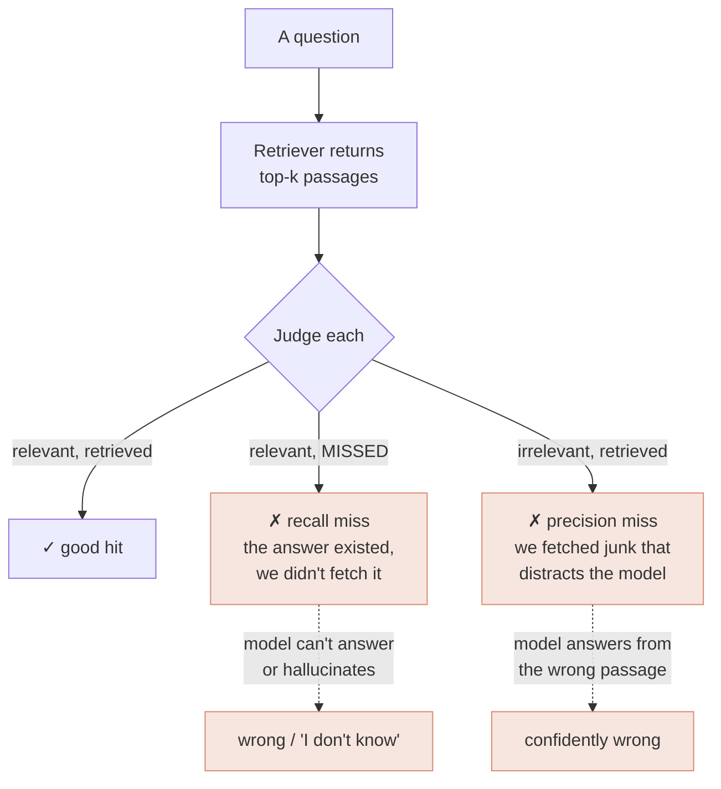

# Retrieval quality

*Part of [RAG & vector databases for the product leader](./README.md)*

*Last reviewed: 2026-10 · Volatility: medium*

## TL;DR

The model's answer can only be as good as the passages it receives. So retrieval quality *is* RAG quality.

Two numbers frame it. **Recall** asks: of the passages that could answer the question, how many did we retrieve? **Precision** asks: of the passages we retrieved, how many were relevant? They trade off, and which one you favour is a product decision.

Three levers do most of the work. **Hybrid search** runs keyword and [semantic search](./embeddings-and-semantic-search.md) together, so each covers the other's blind spot. **Reranking** has a slower, more accurate model re-score the top candidates. **Filtering** uses [metadata](./chunking-and-ingestion.md) to remove the wrong-but-similar: old versions, other tenants, forbidden documents.

Under all three sits one rule: you cannot improve what you do not measure. A retrieval **eval set** of real questions with known answers turns "the answers feel off" into "recall dropped on questions with error codes".

> 🎯 **For the product leader**
>
> **Why it matters** — Two teams with the same model and the same database can ship very different products, because of retrieval quality. The gap stays invisible until you measure it or a customer hits it.
>
> **What it changes in your decisions** — You make a retrieval eval set a launch requirement. You spend on hybrid search, reranking and filters before you pay for a bigger model.
>
> **Ask your eng team** — *"What is our recall on real, hard questions, broken down by question type, and is it on a dashboard?"*
>
> **Risk if ignored** — Uneven quality. Good on the questions you tried, confidently wrong on the ones you did not, and no way to catch a regression before users do.

## The mental model: two ways to be wrong



- **A recall miss.** The answer was in your data, and retrieval did not fetch it. The model says "I don't know" at best, and guesses at worst.
- **A precision miss.** Retrieval fetched irrelevant passages. The model may answer from the wrong one, confidently and with a citation.

## Mechanics

### Recall vs. precision: the product call

Retrieve more passages and recall rises while precision falls. Retrieve fewer and the reverse happens. The right balance depends on which failure costs more.

- **Favour recall** when a missed answer is the worse failure and the model can sift. Legal or medical research is an example: fetch widely, then rerank hard.
- **Favour precision** when a confident wrong answer is the worse failure. A customer-facing policy bot is an example: one distracting passage can produce an authoritative wrong answer.

### The three levers

- **Hybrid search.** Keyword search finds exact strings: IDs, names, codes. Semantic search finds paraphrase and intent. Running both and combining the lists covers both blind spots. A common way to combine them is **reciprocal rank fusion**: each list gives each chunk `1 / (60 + rank)`, and the sums decide the order. It needs no tuning of scores across the two lists.
- **Reranking.** First-pass search is fast and a little sloppy. It returns a wide net of perhaps 20 to 100 candidates. A **reranker**, often a cross-encoder that reads the question and each passage together, re-scores them. The best few reach the model. It costs some latency and no change to the index. Anthropic's 2024 contextual retrieval study reports that adding a reranker raised the cut in retrieval failures from 49% to 67%.
- **Filtering.** Use metadata to remove what should never be an answer: retracted versions, other tenants, documents this user may not see. Here retrieval quality and [safety](../content/05-safety-multitenancy/multi-tenant-isolation.md) are the same lever.

A strong default pipeline: hybrid search for about 50 candidates, filter by metadata, rerank to the top 5, then hand those to the model.

### Measuring it

Retrieval quality is invisible to inspection. A feature can look great on every question you try and fail on the ones you did not. The fix is an **eval set**: real questions, each tagged with the passage that should be retrieved. Run it on every change. Two metrics cover most needs:

- **Recall@k**: the share of questions whose answering passage is in the top k.
- **MRR** (mean reciprocal rank): the average of 1 / rank of the first correct passage. It rewards putting the answer first.

Break the numbers down by question type. An average hides the pattern that tells you which lever to pull. The [retrieval evals](../content/03-rag/retrieval-evals.md) spoke covers answer-side metrics such as faithfulness.

## Tradeoffs and decisions

- **Recall vs. precision.** Choose by the cost of each failure, feature by feature.
- **Latency vs. quality.** A reranker adds a model call on every question. It usually pays for itself in precision.
- **Simple fusion vs. tuned fusion.** Reciprocal rank fusion needs no tuning. A weighted blend can do better, if you have the eval set to tune it on.
- **Filter strictness vs. coverage.** A strict filter can hide the only passage that answers. Log how often filters empty the result.

## Failure modes

- **Semantic-only blindness.** No keyword leg, so every question about an exact code or name fails. The fix is hybrid search, not a bigger embedding model.
- **No reranker.** Raw top-k ships, and similar-but-wrong passages reach the model.
- **No filters.** The stale, the forbidden and the superseded are retrieved and cited.
- **Vibes-based quality.** No eval set, so quality is a feeling and regressions ship silently.
- **Fixing the model, not retrieval.** A bigger model, bought to fix answers that were wrong because retrieval handed it the wrong passages.

## Under the hood

The file is `rag-vector-databases/code/mini_rag.py`. Keyword search is BM25: rare words count more, and long chunks count less per word. Hybrid search fuses the two lists with reciprocal rank fusion.

```python
def hybrid(self, query, k=5, where=None, depth=20, c=60):
    votes = Counter()
    for ranked in (self.vector_search(query, depth, where), self.bm25(query, depth, where)):
        for rank, (_, cid) in enumerate(ranked, start=1):
            votes[cid] += 1 / (c + rank)
    return sorted(votes.items(), key=lambda x: -x[1])[:k]

def recall_at_k(results, gold):
    return 1.0 if gold in [cid for _, cid in results] else 0.0
```

Every search takes a `where` filter, such as `{"status": "current", "audience": "customer"}`. The eval runs all three search methods on the same 12 questions with the same filter.

## Worked example: keyword, vector and hybrid on the same 12 questions

*This example is invented. Fernpay is a made-up product. The numbers come from `rag-vector-databases/code/mini_rag.py`.*

The eval set has 12 questions. Seven are paraphrases, such as "download everything as a spreadsheet". Four hinge on an exact code, such as "E-4022". One mixes both.

| Method | Recall@3 | MRR | Paraphrase recall | Exact-code recall |
| --- | --- | --- | --- | --- |
| Keyword (BM25) | 0.667 | 0.667 | 0.43 | 1.00 |
| Vector | 0.833 | 0.736 | 1.00 | 0.50 |
| Hybrid (RRF) | 0.917 | 0.778 | 0.86 | 1.00 |

**Each leg has a blind spot.** Keyword search misses four paraphrases. Vector search misses two code questions. Hybrid search finds all the code questions and all but one paraphrase, so it has the best recall and the best MRR.

**Hybrid is not free.** It loses one question that vector search found: "how do I stop paying for fernpay". The keyword leg matched only the word "fernpay", in three unrelated chunks. Those chunks also sit lower down the vector list, so each collects two votes. The right chunk is first in the vector list and absent from the keyword list, so it has one vote, and falls out of the top 3. A reranker is the usual fix for that kind of noise.

**The filter matters as much as the method.** Without a filter, "can I get my money back on a yearly plan" returns the current policy at 0.936 and the retracted one at 0.927. With `status = 'current'`, the retracted chunk is gone. No ranking method can tell these two apart. Only metadata can.

## Practitioner checklist

- [ ] Do we run hybrid search, not semantic-only?
- [ ] Is there a reranking stage between search and the model?
- [ ] Do we filter by status, version, tenant and permission on every query?
- [ ] Have we chosen recall or precision for this feature, given its worst failure?
- [ ] Is there an eval set of real questions, run on every change?
- [ ] Are the results broken down by question type?

## Related lessons

- [Embeddings and semantic search](./embeddings-and-semantic-search.md) — the fuzzy first pass.
- [Chunking and ingestion](./chunking-and-ingestion.md) — retrieval can only find what chunking made findable.
- [Building RAG with Claude Code](./building-rag-with-claude-code.md) — the same three searches in Postgres.
- [Retrieval evals](../content/03-rag/retrieval-evals.md) — the engineering-depth version.
- [Evaluation and observability](../evaluation-and-observability/README.md) — the wider measurement discipline.

## Sources

- Robertson and Zaragoza, *The Probabilistic Relevance Framework: BM25 and Beyond*, Foundations and Trends in Information Retrieval 3(4), 2009: BM25.
- Cormack, Clarke and Büttcher, *Reciprocal rank fusion outperforms Condorcet and individual rank learning methods*, SIGIR 2009: reciprocal rank fusion with k = 60.
- Anthropic, [Introducing Contextual Retrieval](https://www.anthropic.com/news/contextual-retrieval), 19 September 2024: top-20 retrieval failures cut by 49% with contextual embeddings plus contextual BM25, and by 67% with a reranker added. Read 2026-10.
- pgvector [README](https://github.com/pgvector/pgvector/blob/v0.8.1/README.md), release 0.8.1: hybrid search with full-text search, combined by reciprocal rank fusion or a cross-encoder. Read 2026-10.
- The Fernpay corpus, the eval set and every number are invented. They come from `rag-vector-databases/code/mini_rag.py`.
