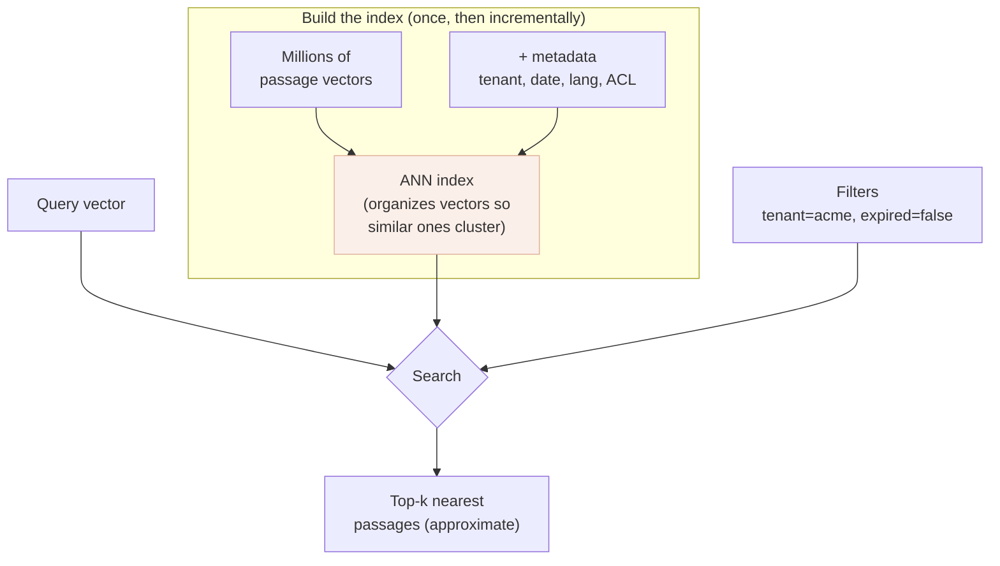

# Vector databases

*Part of [RAG & vector databases for the product leader](./README.md)*

*Last reviewed: 2026-10 · Volatility: medium*

## TL;DR

Once your data is a set of [embedding vectors](./embeddings-and-semantic-search.md), you need a place to keep them. Given a question's vector, that place must find the nearest ones in milliseconds. That is a **vector database**.

Its one hard trick is **approximate nearest neighbour (ANN)** search. Comparing the question with every vector is exact, and too slow at scale. An ANN index skips most of the vectors and finds *almost* the closest ones, much faster. You trade a little recall for a lot of speed, and you can tune the trade.

Around that core sit the features that decide the product: **metadata filters** (only this tenant, only current documents), **freshness** (add, update and delete without a rebuild), and scale. The search maths is now a commodity. The filters and the freshness are where products succeed or leak.

> 🎯 **For the product leader**
>
> **Why it matters** — This is the loudest, most vendor-crowded corner of RAG. Teams over-spend attention here. Knowing the vector store is a component keeps you out of a six-month bake-off for a workload Postgres can handle.
>
> **What it changes in your decisions** — You ask for the query shape before anyone names a vendor: how many vectors, which filters, what latency, how fresh. You push effort toward ingestion and retrieval quality, where it pays.
>
> **Ask your eng team** — *"How many vectors, filtered by what, at what latency, and did we test the database we already run?"*
>
> **Risk if ignored** — A costly specialist system you did not need. Or the reverse: a store that cannot filter by tenant, and shows one customer's passages to another.

## The mental model: a librarian for meaning

A normal database finds rows by exact match: "give me order 4411". A vector database finds rows by closeness: "give me the 5 passages most like this question". Picture a librarian who fetches the five books whose contents are most like your description. The librarian does not read every book each time. The shelves are arranged so that similar books sit together. That arrangement is the **index**.



## Mechanics

### Exact vs. approximate search

**Exact search** compares the question with every vector. It is always right. It is fine for thousands of vectors and too slow for hundreds of millions.

**ANN indexes** organize the vectors so a search checks only a small part of them. Two families are common:

- **HNSW** (hierarchical navigable small world) builds a layered graph. Each vector links to near neighbours. A search walks the graph from a coarse top layer to a fine bottom layer. pgvector's documentation says HNSW has a better speed-recall tradeoff than IVFFlat, with slower builds and more memory.
- **IVF** (inverted file) groups vectors into lists around centre points. A search scans only the lists whose centres are closest to the question. More lists scanned means better recall and more work.

Both have a dial. In pgvector it is `hnsw.ef_search` (40 by default) or `ivfflat.probes`. Turn it up for recall. Turn it down for speed.

### The filter trap

Products need filters: this tenant, this language, current documents only. With an approximate index, many stores apply the filter *after* the index scan. pgvector's documentation gives an example. If a filter matches 10% of rows, and `hnsw.ef_search` is 40, only about 4 rows match on average. You asked for 10 results and get 4.

Fixes exist. pgvector 0.8.0 added iterative index scans, which keep scanning until enough rows pass the filter. They are off by default (`SET hnsw.iterative_scan = strict_order` turns them on), and they stop at a scan limit, so a very narrow filter can still come up short. Other fixes are a partial index per common filter value, partitioning, or exact search on small tenants. Dedicated vector databases have their own filtered-search designs. Test filtered queries, not only unfiltered ones.

### What separates the options

| Capability | Why it is a product decision |
| --- | --- |
| **Metadata filtering** | Your tenant boundary and permission boundary. Get it wrong and you leak data. See [multi-tenant isolation](../content/05-safety-multitenancy/multi-tenant-isolation.md). |
| **Freshness** | Can you add, update and delete continuously, or must you rebuild? This decides whether your data can be current. |
| **Scale and cost** | Millions and billions of vectors need different designs and bills. Most products are smaller than vendors suggest. |
| **Hybrid support** | Does it combine keyword and vector search natively, or must you build that? |
| **Operations** | Backups, security and monitoring. A new distributed system is one more thing to run at 3 a.m. |

Three families cover most choices. **The database you already run**: Postgres with pgvector, or the vector features in most cloud databases. One system, one operations story. **Dedicated vector databases**: Pinecone, Weaviate, Qdrant, Milvus and others, built for scale, filtering and hybrid search. **Search engines with vectors**: Elasticsearch and OpenSearch, strong if you already run them for keyword search.

### Choosing without the vendor fog

1. **Write the query shape down.** Vector count, filters, latency budget, how often data changes, and whether it is in a user-facing request. One page beats any benchmark deck.
2. **Test what you already run first.** If pgvector or your cloud database meets the shape, stop. Revisit at the next order of magnitude.
3. **Buy a specialist for a real need.** Scale, filtering or hybrid search you cannot get otherwise, justified by the query shape.
4. **Keep the seams clean.** Keep raw sources replayable and ingestion store-neutral, so you can swap the store. [The economics of infrastructure](../technical-product-sense/economics-of-infrastructure.md) covers this lock-in discipline.

## Tradeoffs and decisions

- **Recall vs. speed.** Scanning more of the index finds more true neighbours and takes longer. Choose the point on the curve from your latency budget and your eval.
- **Build time vs. query time.** HNSW builds slowly and queries fast. IVF builds fast and needs a good number of lists.
- **One system vs. two.** Vectors in your main database join easily with business data. A separate store scales on its own and needs a sync job.
- **Filtered speed vs. filtered recall.** Filtering after the scan is fast and can return too few results. Filtering first is complete and can be slower.

## Failure modes

- **Bake-off theatre.** Months comparing stores on synthetic recall while chunking and retrieval quality, the real levers, go untouched.
- **Filters added late.** Discovering after launch that you cannot cheaply restrict retrieval to one tenant.
- **Too few filtered results.** A narrow filter after an approximate scan returns 1 of 10 results, and nobody notices because the demo tenant was large.
- **Rebuild-only freshness.** An index that cannot take updates, so "current data" means "data as of last Sunday".
- **Imaginary scale.** A billion-vector design for two million vectors.
- **Blaming the store.** The store returned the right neighbours. The answer was wrong because the [chunks](./chunking-and-ingestion.md) or the [ranking](./retrieval-quality.md) were wrong. Look upstream first.

## Under the hood

The file is `rag-vector-databases/code/ann_demo.py`. It builds a small IVF index in plain Python. k-means finds 32 centre points, and each vector joins the list of its nearest centre. A search scans only the `nprobe` closest lists.

```python
def ivf_search(pts, cents, groups, q, k, nprobe):
    near = sorted(range(len(cents)), key=lambda j: -dot(q, cents[j]))[:nprobe]
    cand = [i for j in near for i in groups[j]]        # only these vectors are compared
    return exact(pts, q, k, cand), len(cand)
```

The real Postgres version is in `pgvector_demo.sql`. It creates an HNSW index with `USING hnsw (embedding vector_cosine_ops)`, and `EXPLAIN` confirms that the search uses it.

## Worked example: the recall dial and the filter trap

*This example is invented. The vectors are random but clustered, from a fixed seed. The numbers come from `rag-vector-databases/code/ann_demo.py`.*

We index 5,000 vectors of 12 numbers each in 32 lists. We run 40 questions and compare the top 10 with exact search.

| Lists scanned | Recall@10 | Vectors compared |
| --- | --- | --- |
| 1 | 0.475 | 3.3% |
| 2 | 0.655 | 6.4% |
| 4 | 0.822 | 12.7% |
| 8 | 0.955 | 25.1% |
| 32 (all) | 1.000 | 100% |

Scanning a quarter of the vectors finds 95.5% of the true top 10. Scanning everything is exact search. Real indexes on real embeddings have different numbers. The shape is the same: recall rises with the work done.

**The filter trap.** Now each vector belongs to one of 50 tenants, so each tenant owns about 2% of the rows. We search first, take the top 40, then keep one tenant's rows. On average that returns **0.9** results out of the 10 requested. Filtering first, then searching exactly within the tenant, returns all 10. A demo on a big tenant would never show the problem.

## Practitioner checklist

- [ ] Do we have the query-shape page before any vendor conversation?
- [ ] Did we test the database we already run, on production-sized data?
- [ ] Is the tenant and permission filter enforced on every query?
- [ ] Have we tested filtered queries for small tenants, and counted the results returned?
- [ ] Can the index take adds, updates and deletes continuously?
- [ ] Do we know our recall at the index settings we ship?
- [ ] Are sources replayable, so we can change stores?

## Related lessons

- [Embeddings and semantic search](./embeddings-and-semantic-search.md) — what the vectors are.
- [Building RAG with Claude Code](./building-rag-with-claude-code.md) — pgvector and Pinecone, step by step.
- [Chunking and ingestion](./chunking-and-ingestion.md) — where the vectors come from.
- [Multi-tenant isolation](../content/05-safety-multitenancy/multi-tenant-isolation.md) — why filters are a safety boundary.
- [Access control](../access-control/README.md) — who may see which documents.

## Sources

- pgvector [README](https://github.com/pgvector/pgvector/blob/v0.8.1/README.md), release 0.8.1: HNSW and IVFFlat compared, `hnsw.ef_search` default of 40, `ivfflat.probes`, filtering applied after the index scan with the 10% and 4-rows example, iterative index scans from 0.8.0, partial indexes and partitioning. Read from the source, 2026-10.
- Malkov and Yashunin, *Efficient and robust approximate nearest neighbor search using Hierarchical Navigable Small World graphs*, IEEE TPAMI, 2020 ([arxiv.org/abs/1603.09320](https://arxiv.org/abs/1603.09320)).
- Jégou, Douze and Schmid, *Product Quantization for Nearest Neighbor Search*, IEEE TPAMI, 2011: the inverted-file index with coarse quantization behind IVF.
- The vectors, tenants and every number are invented. They come from `rag-vector-databases/code/ann_demo.py`.
