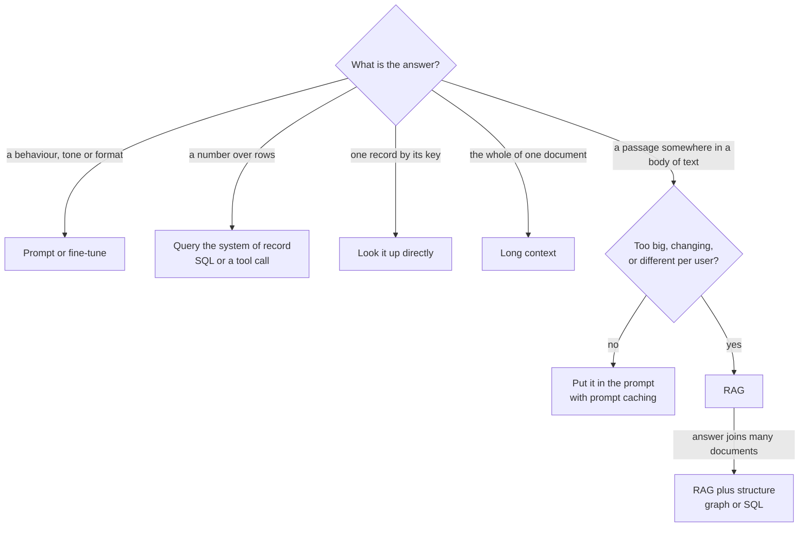

# When to use RAG, and when not to

*Part of [RAG & vector databases for the product leader](./README.md)*

*Last reviewed: 2026-10 · Volatility: medium*

## TL;DR

**Retrieval-Augmented Generation (RAG)** finds the passages that answer a question in your own data, and gives them to the model with the question. It is the default way to make a model answer from private, changing knowledge with citations. It is also the most over-prescribed pattern in AI products.

Many requests that arrive as "we need RAG" need something else. A count needs a database query. An order number needs an exact lookup. A summary of one contract needs the whole contract. A brand voice needs a prompt or fine-tuning. A small, stable handbook fits in the prompt, and prompt caching makes that cheap.

This lesson gives you a short decision tree and a scoring table. The test is simple. Use RAG when the knowledge is **too big to send on every call**, **changes often**, or **differs by user**, and the answer sits in a passage. If none of those hold, choose the simpler tool. The worked example scores six real-looking requests. Two get RAG. Four get something else.

> 🎯 **For the product leader**
>
> **Why it matters** — RAG adds a pipeline you must run forever: ingestion, an index, evals and freshness. When it is the wrong tool, you pay that cost and still get worse answers than the simple option.
>
> **What it changes in your decisions** — You ask what shape the answer has before anyone picks a vector database. Is it a passage, a number, a record, a whole document, or a behaviour? Only the first is a RAG question.
>
> **Ask your eng team** — *"Which of these questions could a SQL query, an exact lookup or the whole document in the prompt answer better than retrieval?"*
>
> **Risk if ignored** — A RAG feature that answers "how many invoices are overdue?" by reading three chunks. It returns a confident number that is wrong, because top-k retrieval can never count past k.

## The mental model: the shape of the answer picks the tool



Read the tree from the top. Each branch asks what kind of thing the answer is. RAG is the right tool for one branch only: the answer is a passage in a body of text that you cannot or should not send whole on every call.

## Mechanics

### The five signals for retrieval

RAG earns its cost when one of these holds.

| Signal | What it means | Example |
| --- | --- | --- |
| **Too big for the prompt** | The text is larger than you can send on every call. | 6 million tokens of help articles and tickets. |
| **Changes often** | The text changes faster than you would edit a prompt. | Prices, policies, inventory, open tickets. |
| **Different per user** | Each user may see only some of it. | Per-customer contracts, per-team documents. |
| **Private** | The text was never in any training set. | Your internal wiki. |
| **Must be cited** | Users or auditors need the source of each claim. | A compliance answer. |

The first three decide the question. "Private" and "must be cited" matter, but they do not demand retrieval on their own. A private handbook of 35,000 tokens can go in the prompt, and the model can cite its sections there.

How big is too big? Anthropic's 2024 contextual retrieval post gives a rule of thumb: a knowledge base under about 200,000 tokens, which is about 500 pages, can often go in the prompt whole. Prompt caching makes that cheaper and faster on repeat calls. Current Claude models accept up to 1 million tokens, but a bigger prompt still costs more per call and takes longer to read.

### The anti-patterns: requests that are not RAG

| The request | Why RAG is wrong | Use instead |
| --- | --- | --- |
| "How many invoices are overdue?" | The answer is computed from rows. Top-k retrieval sees only k chunks, so it cannot count. | A SQL query or a tool call to the system of record. |
| "What is the status of order 48213?" | The key is exact. A "similar" order is a wrong order. | A direct lookup by key, or keyword search. |
| "Summarize this contract." | The task needs the whole document. Retrieval hands over pieces. | Send the whole document (long context). |
| "Write in our brand voice." | This is behaviour, not knowledge. | A system prompt with examples, or fine-tuning. |
| "Answer from our 90-page handbook." | It is small and stable. Retrieval adds a pipeline and a new way to miss. | Put it in the prompt with prompt caching. |
| "Fix the model's reasoning on our domain." | Retrieval adds facts. It does not fix reasoning. | Better prompts, a stronger model, or tools. |
| "Remember what this user told us." | One user's history is small and ordered by time. | Conversation memory, covered in [memory and context](../memory-and-context/README.md). |

### Costs that come with RAG

A RAG feature has five running costs. You build and run an ingestion pipeline. You keep an index fresh, including deletes. You maintain an eval set to measure retrieval. You enforce permissions inside retrieval. You debug a new failure: the right passage existed, and retrieval missed it.

Prompting has none of those. Its cost is per call: you pay for every token you send. That is why size and freshness decide the question. Small and stable knowledge is cheaper to send than to retrieve. Large or changing knowledge is cheaper to retrieve.

## Tradeoffs and decisions

- **Simplicity vs. scale.** Putting the text in the prompt has no pipeline and no recall misses. It stops working when the text is too big or changes too often.
- **Exact vs. similar.** A database or a key lookup returns the exact answer or nothing. Retrieval returns the most similar passages, which may be wrong. Choose exact when the question has an exact answer.
- **Cost per call vs. cost to run.** Prompting costs more per call. RAG costs less per call and more to build and maintain. Volume decides which total is lower.
- **One tool vs. a router.** Real products often need several tools. A router sends counts to SQL, keys to lookup, and passages to RAG. This is more work, and it gives each question the right tool.

## Failure modes

- **RAG by default.** The team builds a vector pipeline before anyone asks what shape the answers have.
- **Counting with retrieval.** Aggregates answered from a few chunks. The numbers are confident and wrong.
- **Similar instead of exact.** An order, a stock-keeping unit (SKU) or an error code matched by meaning, so a near neighbour is returned.
- **Chunking a document the user wanted whole.** A summary built from the top 5 chunks of a 40-page contract leaves out the clauses that were not retrieved.
- **A pipeline for a handbook.** Weeks of ingestion work for 35,000 tokens that fit in one prompt.
- **RAG to fix behaviour.** Retrieving examples on every call to fix tone that a system prompt would fix once.

## Under the hood

The file is `rag-vector-databases/code/decide.py`. It writes the decision tree as an ordered list of rules. The first rule that fits wins.

```python
def decide(req):
    need = req["need"]
    if need == "behaviour":
        return "prompt or fine-tune"
    if need in ("count", "aggregate") or req.get("data") == "table":
        return "query the system of record"
    if need == "exact_key":
        return "look it up directly"
    if need == "whole_document":
        return "long context"
    s = signals(req)                      # too big, changes often, per-user access, ...
    if not s & {"too_big_for_prompt", "changes_often", "per_user_access"}:
        return "put it in the prompt, with prompt caching"
    if need == "connections":
        return "RAG plus structure"
    return "RAG"
```

The order matters. A count over private, changing data still has two retrieval signals. It goes to the database anyway, because the shape test comes first.

The same file has a cost sketch. It counts input tokens per question for three ways to answer from the handbook. Prompt caching bills a cached read at a fraction of the base input price. Anthropic's documentation puts it at 0.1 times on Claude Haiku 5.5 and older models, 0.05 times on Claude Opus 5.5 and Sonnet 5.5, and 0.025 times on Claude Fable 5.1. The sketch shows 0.1 and 0.05. The price per token is an assumption for the arithmetic, not a quote.

## Worked example: six requests, two get RAG

*This example is invented. The verdicts come from `rag-vector-databases/code/decide.py`.*

A product team brings six requests, all labelled "RAG".

| Request | Verdict | Why |
| --- | --- | --- |
| Support assistant over the help centre and past tickets | **RAG** | 6 million tokens, changes daily, needs citations, and each customer may see only their plan's articles. All five signals. |
| "How many invoices are overdue this month?" in the app | Query the system of record | The answer is a count over rows. |
| Summarize the contract the user just uploaded | Long context | The task needs the whole 30,000-token document. |
| Write marketing emails in our brand voice | Prompt or fine-tune | It is behaviour, not knowledge. |
| HR policy helper over a 90-page handbook | Put it in the prompt, with prompt caching | 35,000 tokens, stable, the same for every employee. |
| Security questionnaire answers from past responses and product docs | **RAG** | 2.5 million tokens, changes with every release, and every answer needs a source. |

Now look at the cost of the handbook choice. The sketch assumes $3 per million input tokens and 10,000 questions.

| How each question is answered | Input tokens per question | Input cost per 10,000 questions |
| --- | --- | --- |
| Send the whole handbook every time | 35,050 | $1,051.50 |
| Send the whole handbook, cached at 0.1x | 35,050, of which 35,000 cached | $106.50 |
| Send the whole handbook, cached at 0.05x | 35,050, of which 35,000 cached | $54.00 |
| Retrieve 5 chunks of about 400 tokens | 2,050 | $61.50 |

Caching cuts the cost of the full handbook by about 10 times at 0.1x, and about 20 times at 0.05x. At 0.1x, RAG is $45 cheaper per 10,000 questions. At 0.05x, the cached handbook is $7.50 cheaper than RAG on reads alone. Either way, a retrieval pipeline costs far more to build and run than the gap, so the handbook stays in the prompt.

The sketch leaves out two things. Output tokens are the same for all three, so they do not change the comparison. Cache writes are not: they apply only to the cached options, at 1.25 times the base price for the default 5-minute cache, and again each time the cache expires between questions. One write of the 35,000-token handbook costs about $0.13 at the assumed price, so about 57 cache expiries erase the $7.50 lead. With traffic spread over days, RAG's input cost is lower. The pipeline cost still decides the case.

## Practitioner checklist

- [ ] Have we named the shape of each answer: passage, number, record, whole document or behaviour?
- [ ] Do counts and aggregates go to a database or a tool, not to retrieval?
- [ ] Do exact keys go to a lookup or keyword search?
- [ ] Have we measured the corpus in tokens, and checked it against the "fits in the prompt" option?
- [ ] Do we know how often the knowledge changes, and whether access differs by user?
- [ ] Have we priced prompt caching against a retrieval pipeline at our real volume?
- [ ] If we chose RAG, which of the five signals justified it?

## Related lessons

- [Why RAG?](./why-rag.md) — the four jobs RAG does once you have chosen it.
- [RAG vs. long context vs. fine-tuning](./rag-vs-long-context-vs-finetuning.md) — the three options compared in depth.
- [GraphRAG and structured retrieval](./graphrag-and-structured-retrieval.md) — when the answer joins many documents.
- [Context engineering](../context-engineering/README.md) — what goes into the prompt, and in what order.
- [Cost optimization](../cost-optimization/README.md) — prompt caching and the cost per call.
- [Tool calling](../tool-calling/README.md) — how a model asks a database for an exact answer.

## Sources

- Anthropic, [Introducing Contextual Retrieval](https://www.anthropic.com/news/contextual-retrieval), 19 September 2024: a knowledge base "smaller than 200,000 tokens (about 500 pages of material)" can go in the prompt whole, and prompt caching for repeated context. Read 2026-10.
- Anthropic documentation, [Prompt caching](https://platform.claude.com/docs/en/build-with-claude/prompt-caching): cache reads billed at 0.1 times the base input price on most models, 0.05 times on Claude Opus 5.5 and Sonnet 5.5, and 0.025 times on Claude Fable 5.1; cache writes at 1.25 times for the 5-minute lifetime. Read 2026-10.
- Anthropic documentation, [Models overview](https://platform.claude.com/docs/en/about-claude/models/overview): current Claude models with a 1 million token context window. Read 2026-10.
- The six requests, the token counts (35,000 tokens is about 90 pages at Anthropic's ratio of 200,000 tokens to 500 pages) and the $3 price are invented for the arithmetic. They come from `rag-vector-databases/code/decide.py`.
