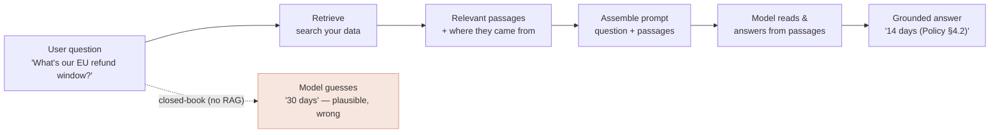

# Why RAG?

*Part of [RAG & vector databases for the product leader](./README.md)*

*Last reviewed: 2026-10 · Volatility: medium*

## TL;DR

A language model knows only what it learned in training. That knowledge is generic, frozen at a cutoff date, and has no source you can point to. Most real products need answers about *your* data: this customer, this policy, today's prices. They also need a source a person can check.

**Retrieval-Augmented Generation (RAG)** solves this without retraining. When a question arrives, you search your own data for the relevant passages. You paste them into the prompt. The model then answers from those passages instead of from memory.

RAG does four jobs a bare model cannot. **Grounding**: it answers from real text. **Freshness**: it uses today's data. **Private knowledge**: it uses data that was never in any training set. **Attribution**: it cites the source. Whether you need RAG at all is a separate question, covered in [lesson 1](./when-to-use-rag.md). This lesson is about what RAG does once you have chosen it, and what it does not do.

> 🎯 **For the product leader**
>
> **Why it matters** — "The model is smart, let's just ask it" is how teams ship features that invent a refund policy in the brand's voice. RAG is the difference between a demo and a feature you can put in front of a customer or an auditor.
>
> **What it changes in your decisions** — You stop asking "which model?" first. You ask which knowledge, how fresh, and how the answer is proved. The model becomes one component. Your data and its retrieval become the product.
>
> **Ask your eng team** — *"When our feature answers, can it point to the exact source it used, and is that source current and ours?"*
>
> **Risk if ignored** — Confident wrong answers about your own business. Each one is a support ticket, a cancelled contract or a compliance finding.

## The mental model: open-book, not closed-book

A bare model is a student in a **closed-book** exam. It writes fluently from memory, and it guesses when it half-remembers. RAG turns the exam into an **open-book** exam. The student still writes the answer, but first looks up the right pages. The model's job changes from recall to reading. Models are better and safer at reading.



The passages also set a boundary. You can tell the model: "answer only from these passages; if they do not contain the answer, say so." That instruction is only possible because retrieval supplies the passages. It turns a confident guesser into a system that knows where its knowledge ends.

## Mechanics

### The four jobs RAG does

| Job | What a bare model does | What RAG adds |
| --- | --- | --- |
| **Grounding** | Invents plausible answers when unsure | Answers from retrieved text, and can refuse when the text is missing |
| **Freshness** | Knows nothing after its training cutoff | Uses today's data: you update the index, not the model |
| **Private knowledge** | Knows only public training data | Answers from your documents |
| **Attribution** | Cannot say where an answer came from | Each claim points to a source passage |

The jobs map to product requirements. A support assistant needs all four. A coding helper needs freshness and private knowledge: your code. A research tool depends on attribution. Naming the jobs your feature needs tells you how much to invest in retrieval quality.

### The three steps

1. **Retrieve.** Search your data for the passages most likely to answer the question. [Embeddings](./embeddings-and-semantic-search.md) and [keyword search](./retrieval-quality.md) do this.
2. **Augment.** Put those passages into the prompt, numbered, with where each came from.
3. **Generate.** The model writes the answer from the passages and cites them.

### What RAG is not

- **Not fine-tuning.** Fine-tuning changes the model's weights. It is good for behaviour and style, and poor for facts, which go stale and cannot be cited. RAG supplies facts at question time. See [lesson 7](./rag-vs-long-context-vs-finetuning.md).
- **Not just search.** Search returns documents for a person to read. RAG returns passages for a model to read and turn into an answer.
- **Not a guarantee.** RAG makes grounding possible, not automatic. If retrieval returns the wrong passage, the model answers faithfully from the wrong passage. That is why [retrieval quality](./retrieval-quality.md) is the real work.

## Tradeoffs and decisions

- **Grounding vs. coverage.** "Answer only from the sources" stops invention. It also makes the feature say "I don't know" more often. Decide which failure is worse for your users.
- **More passages vs. fewer.** More passages raise the chance the answer is there. They also add noise and cost. Five well-chosen passages often beat twenty.
- **Citations vs. fluency.** Inline citations make answers longer and less smooth. They also make every claim checkable.

## Failure modes

- **Closed-book shipping.** Trusting the model's memory for facts about your business, until a customer posts a screenshot of an invented policy.
- **Retrieval as an afterthought.** Polishing the prompt while the retriever returns the wrong passages. The answer cannot be better than its sources.
- **Citation theatre.** Showing sources that do not support the claim. That is worse than no sources, because it creates false trust.
- **No "I don't know" path.** A feature that always answers, even when retrieval found nothing relevant, is a slower guesser.

## Under the hood

The file is `rag-vector-databases/code/mini_rag.py`. Two small functions do the work of this lesson. The first decides whether there is enough evidence to answer at all. The second builds the grounded prompt.

```python
def has_evidence(index, question, where=None, min_cosine=0.35):
    """Answer only if the keyword leg finds a match, or the vector leg finds a close one."""
    top = index.vector_search(question, 1, where)
    return bool(index.bm25(question, 1, where)) or bool(top and top[0][0] >= min_cosine)

def build_prompt(index, question, hits):
    lines = ["Answer only from the sources below. Cite each claim as [n].",
             "If the sources do not contain the answer, say you do not know.", ""]
    for n, (_, cid) in enumerate(hits, start=1):
        c = index.get(cid)
        lines.append(f"[{n}] {c['title']} > {c['section']} (updated {c['updated']}): {c['text']}")
    return "\n".join(lines + ["", f"Question: {question}"])
```

The gate uses both legs on purpose. A similarity score alone is a weak test, as the worked example shows.

## Worked example: a grounded prompt and a refusal

*This example is invented. Fernpay is a made-up invoicing product. The numbers come from `rag-vector-databases/code/mini_rag.py`.*

**A question the data covers.** A customer asks "can I get my money back on a yearly plan?". Retrieval returns the current refund policy first, with a similarity of 0.936. The prompt the model receives starts like this:

```text
Answer only from the sources below. Cite each claim as [n].
If the sources do not contain the answer, say you do not know.

[1] Refund policy > Annual plans (updated 2026-03): ... refunded within 14 days of purchase ...
[2] Plans and prices > Annual billing (updated 2026-03): ... the same as 10 months.
```

A grounded answer is "within 14 days of purchase [1]". A closed-book model has no way to know Fernpay's window. The old, retracted policy said 30 days, and it scored 0.927, almost as high. [Lesson 6](./retrieval-quality.md) shows how a filter removes it.

**A question the data does not cover.** Another customer asks "what is the weather in Lisbon tomorrow?". The best vector match is an invoice page, with a similarity of 0.301. Keyword search finds nothing. The gate says there is no evidence, so the feature answers "I don't know" without calling the model.

**Why one threshold is not enough.** The question "what does E-4021 mean?" has a real answer in the data. Its best vector match scores only 0.113, lower than the weather question. A similarity threshold alone would refuse the real question and answer the off-topic one. Keyword search finds the error page, so the two-leg gate gets both cases right.

## Practitioner checklist

- [ ] Which of the four jobs does this feature need?
- [ ] Can the feature say "I don't know" when retrieval finds nothing useful?
- [ ] Does every answer cite a source a user could open?
- [ ] Is the refusal gate tested on real questions, both covered and not covered?
- [ ] Is retrieval quality, not only prompt wording, on the roadmap?

## Related lessons

- [When to use RAG, and when not to](./when-to-use-rag.md) — decide whether you need retrieval at all.
- [Embeddings and semantic search](./embeddings-and-semantic-search.md) — how retrieval finds passages by meaning.
- [Retrieval quality](./retrieval-quality.md) — filters, hybrid search and recall.
- [RAG architecture](../content/03-rag/rag-architecture.md) — the engineering-depth version.
- [Retrieval evals](../content/03-rag/retrieval-evals.md) — proving the model used the data.

## Sources

- Lewis et al., *Retrieval-Augmented Generation for Knowledge-Intensive NLP Tasks*, NeurIPS 2020 ([arxiv.org/abs/2005.11401](https://arxiv.org/abs/2005.11401)): the RAG pattern of a retriever plus a generator, with provenance for answers.
- AI Incident Database, [Incident 1039](https://incidentdatabase.ai/cite/1039/), reported April 2025: an AI support agent at a software company invented a login policy, and users cancelled before staff stepped in. Read 2026-10.
- The Fernpay corpus, the questions and every number are invented. They come from `rag-vector-databases/code/mini_rag.py`.
