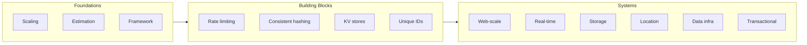

# System design for the technical PM

How real systems are designed at scale — from rate limiters to stock exchanges. This track covers the architecture, tradeoffs, and failure modes that shape product decisions.



Every lesson in this track follows the same shape:

- **TL;DR** — the system in a paragraph, the core tradeoff, the scale.
- 🎯 **For the technical PM** — why it matters to the product, what it changes in your decisions, the sharp question to ask your eng team, and the product risk if you ignore it.
- **Mental model** — the one diagram or analogy that makes the system click.
- **Mechanics** — how it actually works: components, data flow, protocols.
- **Tradeoffs & decisions** — named tradeoffs with costs.
- **Failure modes** — how it breaks in production.
- **Practitioner checklist** — what to verify before you ship or bet on this architecture.

This track covers **28 real-world systems** across eight system lessons, plus lessons on numbers, traffic and caching, distributed data and reliability, and a question bank. Systems are grouped by the kind of problem they solve.

## Connects to other tracks

- The [technical product sense](../technical-product-sense/README.md) track teaches you how to *read* systems. This track teaches you how they're *designed*.
- The [AI engineering](../content/00-foundations/README.md) modules show what's different when LLMs are in the loop — caching, isolation, cost. This track shows the distributed-systems foundations everything rests on.
- The [agentic AI](../agentic-ai/README.md) track uses message queues, event sourcing, and state machines from this track as agent infrastructure.

## The lessons

- [Foundations & framework](./foundations-and-framework.md) — scaling from zero to millions, back-of-envelope estimation, the four-step system design framework, what a design review evaluates, and a seven-stage practice plan
- [Numbers, formulas and papers](./numbers-and-formulas.md) — latency orders of magnitude, availability and downtime, estimation shortcuts, and the classic papers
- [Traffic, caching, APIs and storage choice](./traffic-caching-apis-and-storage-choice.md) — load balancers, caching strategies, CDNs, choosing a store, and API design
- [Core building blocks](./core-building-blocks.md) — rate limiting, consistent hashing, distributed key-value stores, and unique ID generation
- [Distributed data and consistency](./distributed-data-and-consistency.md) — replication, sharding, CAP and PACELC, consistency models, consensus, sagas and the outbox, and clocks
- [Web-scale services](./web-scale-services.md) — URL shortener, web crawler, notification system, and news feed
- [Real-time systems](./real-time-systems.md) — chat system, search autocomplete, and video streaming platforms
- [Storage & sync](./storage-and-sync.md) — cloud file storage and S3-like object storage
- [Location & geo services](./location-and-geo-services.md) — proximity service, nearby friends, and mapping/navigation
- [Data infrastructure](./data-infrastructure.md) — distributed message queues, metrics monitoring, ad click aggregation, and email service
- [Transactional & financial systems](./transactional-and-financial.md) — hotel reservation, gaming leaderboard, payment system, digital wallet, and stock exchange

- [Reliability and operations](./reliability-and-operations.md) — SLOs, observability, resilience patterns, safe deploys, regional failure, backups, and five incident case studies
- [Question bank](./question-bank.md) — 50 design questions, by level, mapped to the lessons that answer them

**📌 Close out the module:** [Recap & real-world examples](./recap.md)

## Where the depth lives

Each lesson summarizes an idea and points to the lesson that covers it in full.

| If you want the full depth on | Read |
| --- | --- |
| Turning load forecasts into capacity | [Numbers, formulas and papers](./numbers-and-formulas.md) and [Foundations & framework](./foundations-and-framework.md) |
| Rate limits, hashing, quorums and IDs | [Core building blocks](./core-building-blocks.md) |
| Caches, balancers, CDNs, stores and APIs | [Traffic, caching, APIs and storage choice](./traffic-caching-apis-and-storage-choice.md) |
| Replicas, consistency, consensus and sagas | [Distributed data and consistency](./distributed-data-and-consistency.md) |
| Failure, rollout safety and recovery | [Reliability and operations](./reliability-and-operations.md) |
| Feeds, caches and fan-out | [Web-scale services](./web-scale-services.md) |
| Messages that must not be lost or doubled | [Data infrastructure](./data-infrastructure.md) and [Transactional & financial systems](./transactional-and-financial.md) |
| How the LLM-serving side of a system works | [Generating text and the KV cache](../transformers/generating-text-and-the-kv-cache.md) and [Cost optimization](../cost-optimization/README.md) |
| Evals, traces and the numbers you measure | [Evaluation and observability](../evaluation-and-observability/README.md) |
| Practising with questions | [Question bank](./question-bank.md) |

## Run the code

Every example is in `system-design/code/`. Run them all with one command.

```bash
python3 system-design/code/test_examples.py
```

Each file ends with `assert` lines. A passing file checks the direction of each claim in the lessons, such as consistent hashing moving only about 1/N of the keys. Run a file to see every quoted number printed.
