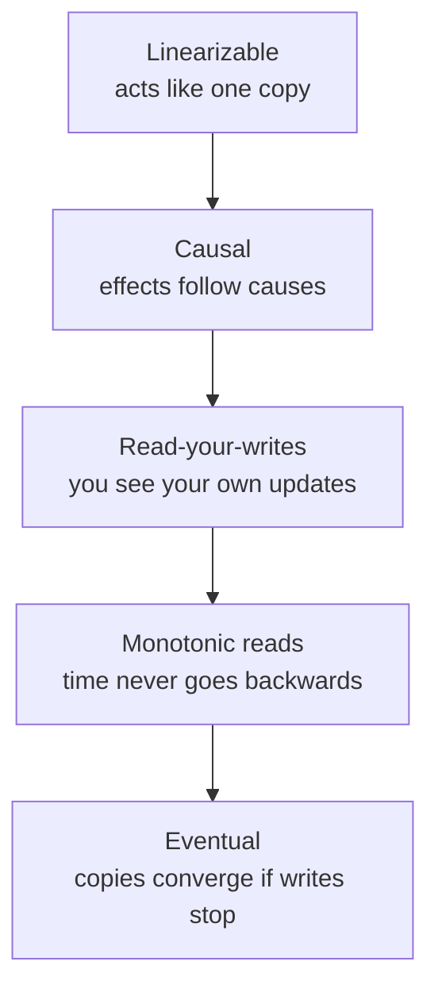

# Distributed data and consistency

*Part of [System design for the technical PM](./README.md)*

*Last reviewed: 2026-10 · Volatility: stable*

## TL;DR

One machine cannot hold or serve all the data of a large product, so data is copied and split across machines. Copying is **replication**. Splitting is **sharding**. Both create a new problem: copies can disagree, and the network between machines can fail.

Every design here is a choice about what to give up. During a network partition, a system must choose between **consistency** and **availability**. When there is no partition, it still trades **latency** against consistency. The useful skill is to say which operation needs which guarantee. A payment needs the latest value. A like count can lag.

Across services, you cannot rely on one database transaction. You use **sagas**, which undo completed steps when a later step fails, and the **transactional outbox**, which makes "update the database and publish an event" safe. And you cannot trust wall-clock time to order events, so systems use logical clocks.

> 🎯 **For the technical PM**
>
> **Why it matters** — These choices decide what users see after they act: the old profile photo, a missing message, a double charge. They also decide how the product behaves when a region fails.
>
> **What it changes in your decisions** — You write consistency promises per feature, in plain words. You ask which reads can be stale, and for how long. You accept that some failures show a delay rather than an error.
>
> **Ask your eng team** — *"For each key flow, what guarantee do we give after a write, what happens during a partition, and how do we avoid duplicates when a step fails halfway?"*
>
> **Risk if ignored** — Users who change a setting and see the old one. Orders charged but not created. Lost updates that nobody can explain.

## The mental model: a ladder of promises



Higher rungs are easier to reason about and cost more latency and availability. Lower rungs are faster and cheaper, and the application must tolerate surprises. Choose the lowest rung each feature can live with.

## Mechanics

### Replication

- **Leader-follower.** Writes go to one leader, which streams changes to followers that serve reads. It is simple. Followers can lag, and the system needs a failover plan when the leader dies.
- **Multi-leader.** Several leaders, often one per region, accept writes. It gives low write latency in each region. Concurrent writes to the same data conflict, and the system must resolve them.
- **Leaderless.** Clients write to and read from several replicas using quorums, as in Dynamo-style stores. It is highly available. Conflict handling is part of the design.

**Synchronous** replication avoids data loss on failover and adds latency. **Asynchronous** replication is faster and can lose the last writes. Many systems use **semi-synchronous** replication: at least one follower confirms.

### Sharding

Sharding splits data across machines by a key. **Range** sharding keeps neighbouring keys together, which suits range scans, and creates hot ranges such as "the latest time". **Hash** sharding spreads load evenly, and range queries must visit every shard. A **directory** (lookup service) decides placement, which allows moves at the cost of an extra hop. Choose a shard key that matches your most common query and spreads load. Plan for **hot keys**, such as a celebrity account, with caching or by splitting the key. Plan for **resharding** as data grows. [Core building blocks](./core-building-blocks.md) covers consistent hashing.

### CAP and PACELC

**CAP** says that when a network partition happens, a system must choose between consistency (every read sees the latest write) and availability (every request gets a non-error answer). Partitions are not optional, so the real choice is what to give up during one. **PACELC** adds the everyday case: if there is a Partition, choose Availability or Consistency; Else, choose Latency or Consistency. Do not label a whole system "CP" or "AP". Say which operations need which guarantee.

### Consistency models

| Model | Promise |
| --- | --- |
| Linearizable | Once a write completes, every later read sees it, as if there were one copy |
| Causal | Effects are seen after their causes: a reply never appears before the comment it answers |
| Read-your-writes | A user always sees their own updates |
| Monotonic reads | A user never sees data go back in time |
| Eventual | If writes stop, copies converge. Nothing is promised meanwhile |

A familiar failure: a user changes a profile photo and refreshes. The read hits a lagging follower and shows the old photo. That breaks read-your-writes. One fix is to read from the leader for a short time after a user writes.

### Quorums

With N replicas, a write waits for W acknowledgements and a read asks R replicas. If R + W > N, every read set overlaps every write set, so a read sees the latest write. [Core building blocks](./core-building-blocks.md) shows the check. Quorums alone do not give linearizability: concurrent writes and sloppy quorums can still return stale or conflicting data.

### Consensus

**Consensus** lets a group of nodes agree on a sequence of values, such as a replicated log, despite failures. With 2f + 1 nodes it tolerates f failures, because every decision needs a majority. **Raft** was designed to be understandable: leader election, log replication and safety. It is used in systems such as etcd. **Paxos** is the older family, used in Google's Chubby and Spanner. Use consensus for small, critical state: leader election, configuration, locks and metadata. Do not use it for every high-volume write.

### Consistency across services

- **Two-phase commit** asks every participant to prepare, then to commit. It is atomic and blocking. If the coordinator fails at the wrong moment, participants hold locks.
- A **saga** splits a business transaction into local transactions, each with a compensating action. If charging a card fails after a flight and a hotel were reserved, the saga cancels the hotel and then the flight. Sagas are available and only eventually consistent.
- The **transactional outbox** makes "update the database and publish an event" atomic. The service writes the event to an outbox table in the same database transaction. A separate relay publishes it. Without it, a crash between the two steps loses the event.

### Time

Clocks drift, and NTP adjusts them, so timestamps from different machines cannot safely order events. "Last write wins" by timestamp can silently drop the newest write. Use **logical clocks** (Lamport), **vector clocks** or **hybrid logical clocks** to order events. Spanner's TrueTime goes further and exposes clock uncertainty, then waits it out.

## Tradeoffs and decisions

- **Consistency vs. latency.** Stronger guarantees need more round trips.
- **Consistency vs. availability.** During a partition, refuse or diverge.
- **Leader vs. leaderless.** Simple reasoning against write availability.
- **Sync vs. async replication.** Durability on failover against write latency.
- **Range vs. hash sharding.** Scans against even load.
- **2PC vs. saga.** Atomicity with blocking against availability with compensation.
- **Wall clock vs. logical clock.** Human-readable time against correct ordering.

## Failure modes

- **Stale reads.** A follower or cache lags behind the leader.
- **Lost updates.** Concurrent writes resolved by a wall-clock timestamp.
- **Split brain.** Two leaders both accept writes after a failover.
- **Lost events.** A service updates its database, crashes before publishing, and downstream systems never learn.
- **Hot shard.** One key or range takes most of the load.
- **Resharding outage.** A data move that takes the system down.
- **Compensation that cannot undo.** An email already sent, or money already moved out.
- **Consensus used as a database.** High-volume writes pushed through a small consensus group.

## Under the hood

Four files in `system-design/code/` run the ideas on small models.

- `replication_lag.py` shows a read-your-writes violation on a lagging follower and a fix.
- `saga.py` runs a three-step saga and compensates in reverse order when the last step fails.
- `outbox.py` compares a dual write with an outbox when a process crashes between the two steps.
- `lamport.py` orders events with logical clocks and shows last-write-wins under a clock skew.

```python
def receive(self, remote):            # Lamport clock: take the later clock, then count the event
    self.t = max(self.t, remote) + 1
    return self.t
```

## Worked example: four failures, four fixes

*The data is invented. The numbers come from the four files above.*

**Read-your-writes.** The follower lags by 2 seconds. A user uploads a new photo and refreshes half a second later. A read from the follower returns the old photo. A read from the leader, used for 5 seconds after the user's own write, returns the new one. Three seconds later, the follower has caught up.

**Saga.** A trip books a flight, then a hotel, then charges a card. The charge fails. The saga cancels the hotel, then the flight, in reverse order. The final state shows no reservation and no charge.

**Outbox.** Ten orders are placed. The process crashes before publishing the event for order 6. With a dual write, 10 orders are stored and only 9 events are published, so one order is never announced. With an outbox, 10 are stored and 10 are published, because the relay publishes the pending record after it restarts.

**Clocks.** A sends a message with logical time 2. B receives it and moves to time 3, then replies at time 4. The order 2 < 3 < 4 matches cause and effect. With wall clocks, a server that runs 2 seconds fast stamps an earlier write as 7.0. A later write on a correct clock gets 6.0. "Last write wins" keeps the older write.

## Practitioner checklist

- [ ] Is the consistency promise written for each key flow, in plain words?
- [ ] Do we know the replication lag in normal and bad conditions?
- [ ] Is read-your-writes handled for settings and profile edits?
- [ ] Is the shard key tied to the main query, with a plan for hot keys and resharding?
- [ ] Is every cross-service flow a saga or an outbox, not a dual write?
- [ ] Does every compensation exist, and is it tested?
- [ ] Do we order events with logical clocks, not wall-clock timestamps?
- [ ] Is consensus used only for small, critical state?

## Related lessons

- [Core building blocks](./core-building-blocks.md) — consistent hashing, quorums and vector clocks in a key-value store.
- [Transactional and financial systems](./transactional-and-financial.md) — payments, ledgers and exchanges.
- [Data infrastructure](./data-infrastructure.md) — logs, delivery semantics and idempotent consumers.
- [Traffic, caching, APIs and storage choice](./traffic-caching-apis-and-storage-choice.md) — caches and replicas as sources of staleness.
- [Reliability and operations](./reliability-and-operations.md) — what to do when a region fails.

## Sources

- Seth Gilbert and Nancy Lynch, *Brewer's Conjecture and the Feasibility of Consistent, Available, Partition-Tolerant Web Services*, ACM SIGACT News, 2002: CAP.
- Daniel Abadi, *Consistency Tradeoffs in Modern Distributed Database System Design*, IEEE Computer, 2012: PACELC.
- Diego Ongaro and John Ousterhout, *In Search of an Understandable Consensus Algorithm*, USENIX ATC 2014: Raft.
- Hector Garcia-Molina and Kenneth Salem, *Sagas*, SIGMOD 1987.
- Leslie Lamport, *Time, Clocks, and the Ordering of Events in a Distributed System*, CACM 1978.
- James Corbett et al., *Spanner: Google's Globally-Distributed Database*, OSDI 2012: TrueTime.
- Martin Kleppmann, *Designing Data-Intensive Applications*, O'Reilly, 2017: replication, consistency and consensus.
- The data and failures in the worked example are invented. The numbers come from `system-design/code/`. These sources were not re-opened during this revision, and the lesson's fact-check is pending.
