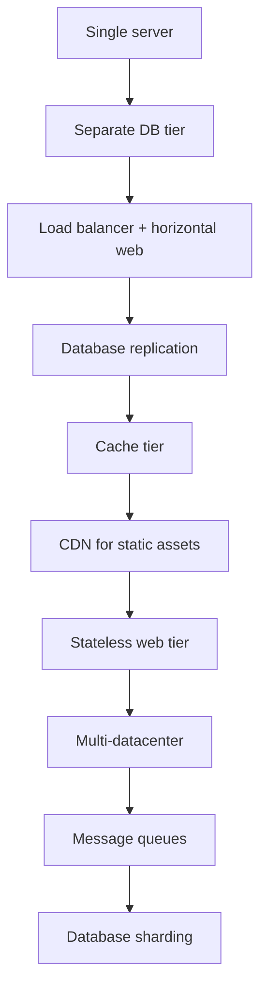
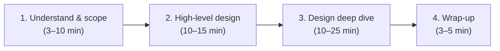

# Foundations & framework

*Part of [System design for the technical PM](./README.md)*

*Last reviewed: 2026-10 · Volatility: stable*

## TL;DR

Every system starts as one server. It grows by separating concerns: compute from storage, reads from writes, hot data from cold. **Scaling** is the art of adding capacity without redesigning. It uses load balancers, replication, caching, CDNs, message queues, and sharding. Before you design anything, **back-of-envelope estimation** forces you to confront the numbers: QPS, storage, bandwidth, cost. The **four-step framework** — scope, high-level design, deep dive, wrap-up — keeps you from getting lost in detail before you've agreed on what you're building.

> 🎯 **For the technical PM**
>
> **Why it matters** — If you can't estimate QPS or spot where a system will bottleneck, you're making capacity and timeline decisions blind. The framework isn't academic. It's how your team should scope every technical bet.
>
> **What it changes in your decisions** — You stop treating scaling as "we'll figure it out later." You insist on estimation before committing to architecture. You know when vertical scaling hits a wall and horizontal scaling demands statelessness.
>
> **Ask your eng team** — *"What's our peak QPS, and which tier hits its limit first — compute, storage, or network?"*
>
> **Risk if ignored** — You ship a system that works at demo scale and breaks at launch scale, or you over-provision by 10× because nobody ran the numbers.

---

## Scaling: from one server to millions of users

The evolution follows a predictable path. Each step solves one bottleneck and introduces the next:



### Single server to separated tiers

Everything starts on one machine: web server, database, cache, static files. The first split separates **compute** (web/application servers) from **storage** (database). They scale differently: compute is stateless and horizontally scalable, while storage needs replication and consistency guarantees.

### Load balancing and replication

A **load balancer** sits in front of web servers and distributes requests. Users hit the LB's public IP. Individual servers keep private IPs, hidden from clients. This enables horizontal scaling (add servers behind the LB) and eliminates single points of failure.

**Database replication** follows, typically master-slave: writes go to the master, reads fan out across replicas. If the master fails, a slave is promoted. If a slave fails, reads redirect to others. The tradeoff: replication lag means reads can be stale. That's acceptable for most features, but dangerous for financial transactions.

### Caching, CDN, and statelessness

A **cache tier** (Redis, Memcached) sits between the web tier and the database. Read-through caching: check cache first, fall back to DB, populate cache for next read. Critical decisions: expiration policy, eviction strategy (LRU is the default), and how to handle cache-DB inconsistency during writes.

A **CDN** pushes static assets to edge servers near users. CDN cost is proportional to traffic, so cache expiration tuning matters — too short wastes origin bandwidth, too long serves stale content.

**Statelessness** means moving session data out of individual web servers into a shared store (Redis, or a dedicated session DB). This lets any request go to any server. That's what makes auto-scaling and multi-datacenter deployments possible.

### Sharding: the final frontier

When the database itself becomes the bottleneck, you **shard** — partition data across multiple database instances. The key decision is the **shard key**: it must distribute data evenly and support your most common queries without cross-shard joins.

Sharding introduces three hard problems:
- **Resharding** — when shards grow unevenly, you need to redistribute. Consistent hashing ([lesson 2](./core-building-blocks.md)) solves this.
- **Celebrity/hotspot problem** — one shard gets disproportionate traffic (e.g., a celebrity's data). Solution: dedicate shards per hot key, or add a secondary partition layer.
- **Join and denormalization** — cross-shard joins are expensive or impossible. You denormalize, trading storage for query simplicity.

---

## Back-of-envelope estimation

Jeff Dean's philosophy: "back-of-the-envelope calculations are estimates you create using a combination of thought experiments and common performance numbers." The goal isn't precision — it's sanity-checking whether a design is feasible.

### The numbers you need to know

| Operation | Latency |
|---|---|
| L1 cache reference | 0.5 ns |
| L2 cache reference | 7 ns |
| Main memory reference | 100 ns |
| SSD random read | 150 μs |
| HDD seek | 10 ms |
| Send 1 MB over 1 Gbps network | 10 ms |
| Read 1 MB sequentially from SSD | 1 ms |
| Read 1 MB sequentially from HDD | 20 ms |
| Cross-datacenter round trip | 150 ms |

**Key insight:** memory is fast, disk is slow, network is expensive. Compress data before sending it over the network. Avoid disk seeks whenever possible.

### Availability in nines

| Availability | Downtime/year | Downtime/day |
|---|---|---|
| 99% (two nines) | 3.65 days | 14.4 minutes |
| 99.9% | 8.77 hours | 1.44 minutes |
| 99.99% | 52.6 minutes | 8.6 seconds |
| 99.999% (five nines) | 5.26 minutes | 0.86 seconds |

### Worked example: Twitter-scale estimation

- 300M monthly active users, 50% daily → 150M DAU
- Each user tweets 2/day on average → 300M tweets/day
- 10% of tweets contain media, average 1 MB → 30 TB/day of media storage
- QPS: 300M / 86,400 ≈ 3,500 avg, ~7,000 peak (2× avg)
- 5-year storage: 30 TB/day × 365 × 5 ≈ **55 PB**

The point isn't the exact number — it's knowing whether you need terabytes or petabytes, hundreds of QPS or hundreds of thousands.

---

## The four-step system design framework

A structured approach that prevents you from diving into implementation before agreeing on scope:



### Step 1: Understand the problem and establish scope

Ask clarifying questions. Document assumptions. Determine the scale (users, QPS, storage, latency requirements). Identify the most important features. You can't design everything in 45 minutes, so scope decides what to detail and what to sketch.

### Step 2: Propose high-level design and get buy-in

Draw the box diagram: clients, load balancers, web servers, caches, databases, message queues, CDNs. Walk through the main use cases against the diagram. Do a quick back-of-envelope check. Get agreement before going deeper.

### Step 3: Design deep dive

Prioritize the 2–3 most critical or interesting components. This is where you discuss algorithms, data models, API contracts, consistency models, and failure handling. Balance depth with breadth — a thorough treatment of one component is better than a shallow pass across everything.

### Step 4: Wrap-up

Summarize the design. Name the bottlenecks you didn't address. Propose what you'd improve next: error handling, scaling the next bottleneck, metrics and monitoring. This is where you show you understand the system's limits, not just its capabilities.

---

## What a design review evaluates

A design discussion, in a team review or in a hiring interview, is graded on four things.

| What | The question behind it |
| --- | --- |
| Scoping | Did you ask what the system must do, separate functional from non-functional needs, and fix the scale before you drew boxes? |
| High-level design | Did you produce a working architecture, with APIs, a data model and the core components? |
| Depth and trade-offs | Did you find the bottleneck, go deep on it, and say why you chose one option over another? |
| Communication | Did you state assumptions, think aloud and adapt to hints? |

### A common 45-minute split

| Phase | Minutes | Output |
| --- | --- | --- |
| Requirements | about 5 | Features, scale, latency, availability, consistency |
| Estimates | about 5 | Queries per second, storage, bandwidth, to the precision that changes the design |
| API and data model | about 5 | The few calls and tables that matter |
| High-level design | about 10 | A box diagram that works end to end |
| Deep dives | about 15 | The hardest parts: hot spots, consistency, failure |
| Wrap-up | about 5 | Trade-offs, bottlenecks, what you would do next |

Treat the split as a guide. Some reviewers want depth early, so follow their lead. Say your assumptions out loud and check them: "I'll assume 100 million daily users and mostly reads. Does that match what you had in mind?"

### Five mistakes that sink strong engineers

1. Jumping into components before you clarify requirements and scale.
2. Naming a technology without saying what problem it solves here.
3. Ignoring failure: what happens when this box, region or dependency goes down?
4. Designing for Google scale when the stated load fits on one database.
5. Staying silent. The reviewer grades your reasoning, not only the final diagram.

### How to practise: a seven-stage roadmap

Durations assume 8 to 12 focused hours a week. Experienced engineers can compress the stages they know.

| Stage | Focus | Build this |
| --- | --- | --- |
| 0. Foundations (2 to 4 weeks) | Networking, operating systems, SQL, indexes, transactions, big-O | A small REST API on Postgres. Add an index and a cache. Measure p50 and p95 latency before and after. |
| 1. Building blocks (4 to 6 weeks) | Load balancers, caches, CDNs, queues, search, rate limiters, ID generators | Write a load balancer and a rate limiter, then load-test them. |
| 2. Distributed systems core (4 to 6 weeks) | Replication, partitioning, consistency, quorums, consensus, clocks | A replicated key-value store sharded with consistent hashing. Kill nodes and watch. |
| 3. Classic designs (6 to 8 weeks) | 15 or more designs with the framework above | One design document a week, reviewed by someone else. |
| 4. Scale and reliability (3 to 4 weeks) | SLOs, timeouts, retries, circuit breakers, safe deploys, disaster recovery | Inject failures into your project and write a blameless postmortem. |
| 5. ML and GenAI design (4 to 6 weeks) | Recommendations, ranking, search, vector search, LLM serving, agents | A small two-stage recommender, or an open model served behind an API. |
| 6. Practice (ongoing) | Timed mocks, out loud | Ten or more mocks. Keep a log of the feedback and fix one habit a week. |

The best study loop is recall. Read one design, then redraw it from memory on a blank page before you read it again.

---

## What happens when you type a URL and press Enter

This one question touches every layer in the track. Practise telling it in two minutes, then go deep wherever someone points.

1. **DNS.** The browser and operating system check their caches. If the name is unknown, a recursive resolver asks the root servers, then the top-level domain servers, then the authoritative servers for the IP address, which is often a CDN's.
2. **Connection.** A TCP handshake, then a TLS handshake. HTTP/3 uses QUIC, which combines both.
3. **Request.** The HTTP request reaches the CDN edge. On a miss, a load balancer forwards it to an application server.
4. **Backend.** Services read caches and databases, may call other services, and build a response.
5. **Response.** The HTML returns. The browser parses it, fetches CSS, scripts and images, mostly from the CDN, and renders the page.

Each step is a place where a design can be fast or slow, and a place where it can fail.

---

## Under the hood

The file is `system-design/code/estimator.py`. It holds the estimation formulas as small functions, so you can change an assumption and watch the answer move.

```python
def twitter_like(dau=200e6, posts_per_user=2, read_ratio=100, bytes_per_post=300):
    posts = dau * posts_per_user
    write_qps = posts / 86_400
    return dict(write_qps=write_qps, peak_write_qps=3 * write_qps, read_qps=write_qps * read_ratio,
                gb_per_day=posts * bytes_per_post / 1e9, tb_per_year=posts * bytes_per_post * 365 / 1e12)
```

The file ends with asserts for every number below, plus the Base62 and availability figures used in the [numbers and formulas](./numbers-and-formulas.md) lesson.

## Worked example: a Twitter-like service on one page

*The inputs are assumed. The numbers come from `system-design/code/estimator.py`.*

Assume 200 million daily active users, 2 posts each per day, 300 bytes per post and 100 reads for every write.

| Quantity | Result | What it tells you |
| --- | --- | --- |
| Posts per day | 400 million | |
| Write rate | about 4,630 per second (peak about 13,900 at 3x) | One well-tuned database cluster, with queues, can take this. |
| Read rate | about 463,000 per second | Reads dominate by two orders of magnitude, so cache and precompute. |
| Post text per day | about 120 GB | Small. |
| Post text per year | about 43.8 TB, before replicas | Media will dwarf it, so media goes to object storage and a CDN. |

Round aggressively and say so out loud. The goal is the right order of magnitude, not decimals.

## Failure modes

- **Premature optimization** — sharding before you've exhausted replication; caching before you've indexed properly.
- **Estimation without units** — "we need a lot of storage" is not an estimate. Label everything: QPS, GB/day, ms latency.
- **Ignoring the read/write ratio** — a 100:1 read-heavy system and a 1:1 write-heavy system need fundamentally different architectures.
- **Stateful web tier** — session affinity (sticky sessions) prevents horizontal scaling and makes failover dangerous.
- **Single points of failure** — any component without redundancy is a system-wide outage waiting to happen.

## Practitioner checklist

- [ ] Can you estimate the QPS, storage, and bandwidth for the system from first principles?
- [ ] Have you identified the read/write ratio and designed the architecture accordingly?
- [ ] Is the web tier stateless? Can any request go to any server?
- [ ] Does every critical component have redundancy (no SPOF)?
- [ ] Have you chosen a cache eviction strategy and defined TTLs?
- [ ] Do you know which tier will hit its scaling limit first?
- [ ] Is the shard key chosen to distribute data evenly and support your primary queries?

## Related lessons

- [Core building blocks](./core-building-blocks.md) — the primitives (consistent hashing, rate limiting) that the scaling path relies on
- [Latency, scale & performance](../technical-product-sense/latency-scale-performance.md) — the product-sense view of the same scaling concerns
- [Economics of infrastructure](../technical-product-sense/economics-of-infrastructure.md) — what scaling decisions cost in dollars
- [Production failure modes](../content/06-strategy-tradeoffs/production-failure-modes.md) — how these patterns fail when LLMs are in the loop

← [Overview](./README.md) · → [Core building blocks](./core-building-blocks.md)

## Sources

- Jeff Dean, "Numbers everyone should know" and the widely circulated "latency numbers every programmer should know": the order-of-magnitude figures.
- Betsy Beyer et al., *Site Reliability Engineering*, O'Reilly, 2016 (sre.google/sre-book): SLIs, SLOs and error budgets.
- Martin Kleppmann, *Designing Data-Intensive Applications*, O'Reilly, 2017: the standard reference for the data topics in this track.
- Alex Xu, *System Design Interview*, volumes 1 and 2: the four-step framework and many of the systems this track covers.
- These sources were not re-opened during this revision, and the lesson's fact-check is pending. Numbers in the worked examples are invented or estimated, and come from the code in `system-design/code/`.
